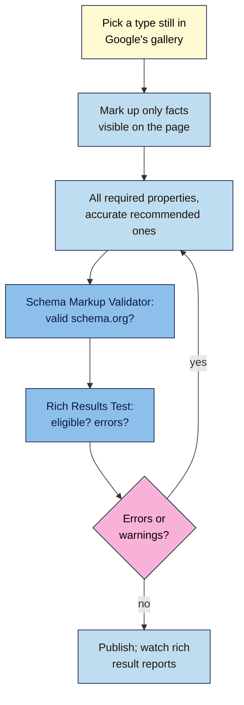

# M12.L05 — Structured Data That's Valid and Honest
> After this lesson you can write JSON-LD for the types most small sites need (Organization, Article, BreadcrumbList, Product and LocalBusiness), check it with both the Rich Results Test and the Schema Markup Validator, and recognise markup that won't earn anything: retired rich results, invisible content and self-serving review stars.

**Time:** ~18 min reading + ~50 min hands-on + ~10 min exercise · **Level:** L3 Advanced · **Prereqs:** M12.L04, M11.L05 · **Remediate to:** M11.L05
**Verified against:** Google Search Central "Introduction to structured data markup" (2025-12-10), "General structured data guidelines" (2026-07-10), "Structured data markup that Google Search supports" (2026-10-16), the Product, Merchant listing, Review snippet (all 2026-09-08), Organization, Article and Breadcrumb docs, "AI optimization guide" (2026-07-10) and "Latest Google Search documentation updates"; Search Central blog posts on How-to and FAQ changes (2023-08-08), the Structured Data Testing Tool (2020-12-15), simplifying the results page (2025-06-12) and breadcrumbs on mobile (2025-01-23); Search Console Help "Rich Results Test", all on 2026-11-09.

> ⚠️ **Freshness flag:** Google retires rich results often. **FAQ** rich results stopped on 7 May 2026 and their docs were removed in June 2026; **HowTo** ended in 2023; a batch of types was phased out in 2025. Breadcrumbs show on desktop results only since January 2025. **Check the search gallery before adding any type.**

## Learning objectives
1. **Write** JSON-LD for Organization, Article, BreadcrumbList, Product and LocalBusiness that matches what's visible on the page. *(O1)*
2. **Validate** markup with the Rich Results Test and the Schema Markup Validator, and explain what each one checks. *(O2)*
3. **Identify** retired rich results and self-serving or invisible markup. *(O3)*

## Why it matters
Structured data (Lesson 1.5) labels facts on a page so search engines can read them for sure: this is a product, it costs ₹650, it's in stock. Done right, it can make a page eligible for richer results, like prices and availability in Google's shopping features.

Done wrong, it does nothing or worse. Nila's "AI SEO" plugin added FAQ markup to every post "for AI Overviews". FAQ rich results no longer exist, and the questions aren't even on the page. Kavya's theme shows 4.9 stars from her Google reviews in her studio's markup: Google says that's ineligible. Valid structured data **that matches visible content** is part of non-negotiable #13.

## Core concept
**Plain version:** use **JSON-LD** (a block of labelled facts in a `<script>` tag). Mark up only what visitors can see, include every required property, and only use types Google still supports if you want a rich result. Test with **two** tools: the Schema Markup Validator asks "is this correct schema.org?" and the Rich Results Test asks "is this eligible for a Google rich result?" Even then, there's no guarantee.

**Analogy:** labels on jars in a shop. Clear, true labels help shoppers and stock-takers. A label saying "honey" on an empty jar, or a "best seller" badge you printed yourself, gets you in trouble.

**Precise definitions:**
- **JSON-LD:** a structured data format in a `<script type="application/ld+json">` tag. "Google recommends using JSON-LD for structured data if your site's setup allows it."
- **Required property:** must be present for a rich result; "Items that are missing required properties are not eligible".
- **Merchant listing:** Product markup for pages "where customers can purchase products from you".
- **Product snippet:** Product markup "For product pages where people can't directly purchase the product", such as a review post.
- **Self-serving review:** a review or rating of a business shown on that business's own site and marked up as stars.
- **Rich Results Test (RRT):** Google's free tool showing "which rich result types were found on the page" and any errors. "The default user agent is smartphone."
- **Schema Markup Validator (SMV):** validator.schema.org, whose main purpose is "to check syntax and compliance of markup with schema.org standards".

### The general rules
| Rule | Google's words |
|---|---|
| Visible | "Don't mark up content that is not visible to readers of the page." |
| Honest | "Don't mark up irrelevant or misleading content, such as fake reviews or content unrelated to the focus of a page." |
| Complete | "Items that are missing required properties are not eligible"; "it is more important to supply fewer but complete and accurate recommended properties" than many sloppy ones |
| No guarantee | "Google does not guarantee that your structured data will show up in search results, even if your page is marked up correctly" |
| Penalty | A structured data manual action means a page "loses eligibility for appearance as a rich result; it doesn't affect how the page ranks in Google web search" |
| AI search | "Structured data isn't required for generative AI search, and there's no special schema.org markup you need to add." |

### The types most small sites need
| Type | Where | Required | Notes |
|---|---|---|---|
| **Organization** | Home or about page | "There are no required properties" | Name, logo, URL, contact, `sameAs` profiles: the same identity as Lesson 11.5 (#12) |
| **Article / BlogPosting** | Blog posts | "There are no required properties" | Headline, image, dates matching the visible ones (Lesson 7.5), author |
| **BreadcrumbList** | Most pages | "at least two ListItems" | Match the visible breadcrumb; represent "a typical user path … instead of mirroring the URL structure". Desktop results only since 2025 |
| **Product (merchant listing)** | Pages where you sell | `name`, `image`, `offers` (an `Offer`) with price and `priceCurrency` | "merchant listings require an Offer as the merchant has to be the seller"; price "greater than zero"; currency in "three-letter ISO 4217 format" (`INR`, `EUR`) |
| **Product (product snippet)** | Review or comparison posts | `name` plus a review, rating or offer | For pages where people "can't directly purchase the product" |
| **LocalBusiness** | Location page | `name`, `address` | From Lesson 11.5; no self-serving ratings |

### Reviews and stars: who can have them
- "If you use AggregateRating, users should be able to see that aggregate rating on the page."
- "Don't aggregate reviews or ratings from other websites."
- A business marking up reviews of **itself** (on LocalBusiness or Organization markup) is "ineligible for star review feature", including reviews shown "through an embedded third-party widget (for example, Google Business reviews or Facebook reviews widget)".
- Product reviews written by customers **on a product page** are a different case: they're about the product, shown on the page, and can be marked up within Product *(course reading of the Review snippet and Product docs; check the current docs)*.

### Retired: don't add these for Google rich results
| Type | Status |
|---|---|
| FAQPage | "This feature will no longer appear in Google Search starting May 7, 2026"; docs removed June 2026 |
| HowTo | Gone since September 2023 |
| Course Info, Claim Review, Estimated Salary, Learning Video, Special Announcement, Vehicle Listing | Phased out in 2025 |
| Practice problem; Dataset | Practice problem docs removed January 2026; Dataset is for Dataset Search only |
| Book Actions | Still supported: Google "Removed the deprecation banner" in November 2025 |

Existing FAQ markup is harmless, but it no longer earns anything in Google Search. Keep it only if another tool you use reads it *(observed practice; Google hasn't said in 2026 whether to remove it)*.

## How it works


**In words:** pick a type Google still supports. Mark up only facts visitors can see, with every required property and accurate recommended ones. Check it's valid schema.org in the Schema Markup Validator, then check eligibility and errors in the Rich Results Test. Fix and retest until clean, then publish and watch Search Console's rich result reports.

> **Under the hood: why two tools disagree.** schema.org is a shared vocabulary for all search engines and apps; it has hundreds of types. Google supports only some of them for rich results, each with its own required properties. So a block can be perfectly valid schema.org (SMV is happy) and still show "No items detected" or errors in the RRT, because Google doesn't use that type or needs more properties. In 2020 Google said "the Rich Results Test and Search Console are the best tools to make sure your markup is valid for Google Search."

## Hands-on walkthrough
You'll mark up and validate two pages, and check the LocalBusiness block from Lesson 11.5. Nila's details are illustrative.

**Before you start: which steps apply to you?**
- **Path A (your own site):** use your SEO plugin's schema settings where possible; add custom JSON-LD only where the plugin can't.
- **Path B (practice):** paste the JSON-LD into the **Code** tab of the RRT and SMV (no live page needed).
- **Path C (client site):** prepare and validate the markup; the client or developer adds it.

**Part A — Product page (20 min)**
1. Write JSON-LD for one product page as a merchant listing:
```json
{
  "@context": "https://schema.org",
  "@type": "Product",
  "name": "Chikmagalur Medium Roast, 250 g",
  "image": "https://nilacoffee.example/images/chikmagalur-250.jpg",
  "description": "Single-estate arabica from Chikmagalur, roasted in Bengaluru.",
  "brand": { "@type": "Brand", "name": "Nila Coffee" },
  "offers": {
    "@type": "Offer",
    "url": "https://nilacoffee.example/shop/chikmagalur-medium-roast/",
    "price": "650.00",
    "priceCurrency": "INR",
    "availability": "https://schema.org/InStock"
  }
}
```
2. Check every value is visible on the page: same name, price, currency and stock status.
3. Paste it into the SMV (https://validator.schema.org/) and the RRT (https://search.google.com/test/rich-results). Record both results.
   > 🖼️ **Image prompt:** The Rich Results Test result (1280×800) for a product page showing "Merchant listings" and "Product snippets" detected as valid items. Highlight the detected merchant listing item with a 3px #F9B2D7 outline; blur any personal details.
   > **Alt text:** Rich Results Test showing valid merchant listing and product snippet items for a product page, with the merchant listing highlighted.
   **Expected:** valid in both; the RRT lists merchant listing (and product snippet) items, perhaps with optional warnings (shipping, returns) to note.

**Part B — Blog post (15 min)**
1. Mark up one brew-guide post with `BlogPosting` (headline, image, `datePublished`, `dateModified`, author) and a `BreadcrumbList` matching the visible breadcrumb (Home › Brew guides › French press).
2. Validate in both tools.
   **Expected:** both valid; dates and headline match the page exactly.

**Part C — LocalBusiness and the retired check (15 min)**
1. Run Lesson 11.5's LocalBusiness block through both tools. Fix any errors.
2. Run three pages (yours or competitors') through the RRT. Note any FAQPage or HowTo markup, and mark it "no Google rich result since <date>".
   **Expected:** LocalBusiness valid with no `aggregateRating`; a short retired-types list.

**Expected output:** a **Structured data** tab: two marked-up pages with SMV and RRT results and dates, the validated LocalBusiness block, and a retired-types note.

## When to use / when not to
**Do this** for products you sell, posts, breadcrumbs, your organisation and each real location.

**Don't** add FAQ or HowTo markup for Google features, mark up reviews or FAQs that aren't on the page, copy ratings from Google or other sites, or add markup "for AI search".

**The trade-off:** an SEO plugin's automatic schema is quick and usually fine for Organization, Article and breadcrumbs. Hand-written JSON-LD gives control, but it must be kept in sync with the page (prices, stock, dates), or it becomes misleading *(observed practice)*.

## Use AI for this
**Example prompt:**
> "Write Product JSON-LD for a merchant listing using only these facts from my page: [paste name, image URL, price, currency, availability, page URL]. Use an Offer, ISO 4217 currency, and no ratings or reviews. Don't add any property I didn't give you."

**What AI does well here:** clean, correctly nested JSON-LD from facts you supply.
**Where it gets it wrong:** it invents ratings, adds FAQ or HowTo blocks, uses "Rs" or "₹" instead of `INR`, or makes up properties.
**How to check:** compare every value with the page, then run both validators.

## Common mistakes
- **FAQ or HowTo markup** for Google rich results (retired).
- **Markup for content that isn't visible.**
- **Self-serving stars** on LocalBusiness or Organization, including from review widgets.
- **`"price": "0"`** or "Rs" as a currency on a merchant listing.
- **Two plugins** both outputting Product or Organization markup.
- **Breadcrumb markup that doesn't match** the visible breadcrumb.
- **Validating only in the SMV** and assuming Google will show a rich result.

## Troubleshooting
| Symptom | Likely cause | Fix |
|---|---|---|
| SMV valid, RRT "No items detected" | Type not a Google rich result (or retired) | Expected; use a supported type if you want a rich result |
| RRT error "Missing field 'offers'" | Required property missing | Add an `Offer` with price and currency |
| "Invalid value in field 'priceCurrency'" | "Rs" or "₹" | Use `INR` (ISO 4217) |
| Duplicate Product items | Theme and plugin both output markup | Turn one off |
| Rich result report drops after a redesign | Template lost its markup | Recheck the template in RRT |
| Manual action "Structured data issue" | Invisible, misleading or self-serving markup | Remove it; request review (Lesson 9.5) |

## Exercise
**Task:** finish your **Structured data** tab (Parts A–C). Then answer these. All details are illustrative.
1. Nila's product markup has `"price": "0"` and `"priceCurrency": "Rs"`. Fix both.
2. Her plugin adds FAQPage markup with six questions not shown on the page. Two problems?
3. Kavya's studio markup includes `aggregateRating` from her Google reviews widget. Eligible?
4. Tomás's markup passes the SMV but the RRT says "No items detected" for a `HardwareStore` page. Is it broken?
5. Nila's "best grinders under ₹5,000" review post links to other shops. Merchant listing or product snippet?
6. A client says "add schema so we show up in AI Overviews". What does Google say?

**Expected outcome:** a completed tab, and these answers:
- **1** Price must be "greater than zero" for merchant listings (₹650.00), and the currency `INR` in "three-letter ISO 4217 format".
- **2** Invisible content ("Don't mark up content that is not visible") and a retired feature (FAQ ended 7 May 2026).
- **3** No: reviews of itself, even through "an embedded third-party widget (for example, Google Business reviews …)", are "ineligible for star review feature".
- **4** Not necessarily: it's valid schema.org; the RRT may show no Google rich result for that page. Check for errors, not just "items".
- **5** Product snippet: merchant listings need pages "where customers can purchase products from you".
- **6** "Structured data isn't required for generative AI search, and there's no special schema.org markup you need to add."

**Stretch goal:** check whether your SEO plugin and theme both output Organization or Product markup (RRT shows duplicates). Turn one off.

## Key takeaways
- JSON-LD, only for visible, accurate facts, with every required property.
- SMV checks schema.org validity; RRT checks Google rich-result eligibility. Use both.
- Product: merchant listing where you sell (Offer, price > 0, ISO currency); product snippet for reviews.
- No self-serving stars on LocalBusiness or Organization, even from widgets.
- FAQ, HowTo and a 2025 batch are retired; structured data isn't needed for AI search.
- A structured data manual action removes rich results, not rankings.

## Teach it back
Explain to a shop owner in 3 sentences why their Google review stars can't go in their own site's markup, and what markup is worth adding instead.

## Glossary terms added
- JSON-LD — added to `seo-101/glossary.md`
- Merchant listing — added to `seo-101/glossary.md`
- Product snippet — added to `seo-101/glossary.md`
- Self-serving review — added to `seo-101/glossary.md`
- Schema Markup Validator — added to `seo-101/glossary.md`
- *Already in the glossary:* Structured data, Rich result, LocalBusiness markup

## Further reading
*All checked 2026-11-09.*
- Google Search Central — Introduction to structured data markup: https://developers.google.com/search/docs/appearance/structured-data/intro-structured-data
- Google Search Central — General structured data guidelines: https://developers.google.com/search/docs/appearance/structured-data/sd-policies
- Google Search Central — Structured data markup that Google Search supports: https://developers.google.com/search/docs/appearance/structured-data/search-gallery
- Google Search Central — Product and Merchant listing: https://developers.google.com/search/docs/appearance/structured-data/product · https://developers.google.com/search/docs/appearance/structured-data/merchant-listing
- Google Search Central — Review snippet: https://developers.google.com/search/docs/appearance/structured-data/review-snippet
- Google Search Central — Organization · Article · Breadcrumb: https://developers.google.com/search/docs/appearance/structured-data/organization · https://developers.google.com/search/docs/appearance/structured-data/article · https://developers.google.com/search/docs/appearance/structured-data/breadcrumb
- Google Search Central — Latest documentation updates: https://developers.google.com/search/updates
- Google Search Central blog — Structured Data Testing Tool update (2020): https://developers.google.com/search/blog/2020/12/structured-data-testing-tool-update
- Google Search Central blog — Simplifying breadcrumbs on mobile (2025-01-23): https://developers.google.com/search/blog/2025/01/simplifying-breadcrumbs
- Rich Results Test: https://search.google.com/test/rich-results · Schema Markup Validator: https://validator.schema.org/

> ⚠️ **May change:** the list of supported rich results, required properties (merchant listings change often), and how breadcrumbs show. Recheck the gallery and the updates log every 3–6 months.

## Refresher card
*Used by remediation when a learner fails a quiz twice on a later lesson that points back here.*
**Format:** JSON-LD recommended. **Rules:** visible only; no misleading or fake reviews; all required properties; fewer but accurate recommended ones; no guarantee; manual action = loses rich results, not rankings; not needed for AI search. **Types:** Organization (no required; home/about); Article/BlogPosting (no required; dates match); BreadcrumbList (≥2 items; desktop only since 2025); Product merchant listing (name, image, Offer, price > 0, ISO 4217 e.g. INR) vs product snippet (can't buy here); LocalBusiness (name, address). **Reviews:** rating must be visible; don't aggregate from other sites; self-serving on LocalBusiness/Organization ineligible, widgets included. **Retired:** FAQ (7 May 2026), HowTo (2023), 2025 batch; Book Actions kept. **Tools:** SMV = valid schema.org; RRT = Google eligibility (smartphone).
