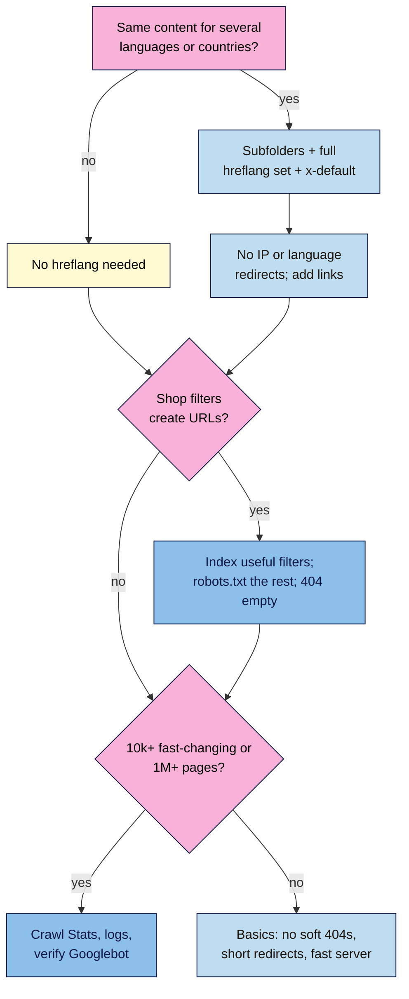

# M12.L06 — International Sites, Faceted Navigation and Crawl Budget
> After this lesson you can choose a URL structure for a site in several languages or countries, write a correct set of hreflang tags (and know when you don't need any), decide which shop filter URLs Google should crawl, and know when crawl budget and server logs are worth your time.

**Time:** ~18 min reading + ~45 min hands-on + ~10 min exercise · **Level:** L3 Advanced · **Prereqs:** M12.L05, M06.L03, M06.L02 · **Remediate to:** M06.L03
**Verified against:** Google Search Central "Managing multi-regional and multilingual sites" (2025-12-10), "Tell Google about localized versions of your page" (last updated 2026-09-21) and "How Google crawls locale-adaptive pages" (2025-12-10); Google Crawling Infrastructure "Managing crawling of faceted navigation URLs" (2025-12-18), "Crawl budget management for large sites" (2026-07-22) and "Verifying requests from Google's crawlers and fetchers" (2026-03-20); Search Central blog "Spring cleaning: the URL Parameters tool" (2022-03-28); Search Console Help "Crawl Stats report", all on 2026-11-09.

> ⚠️ **Freshness flag:** Google's faceted navigation, crawl budget and crawler verification docs **moved** to `developers.google.com/crawling/docs/` (old links redirect). Search Console's **URL Parameters tool** was retired in 2022. The hreflang doc was updated in September 2026; recheck it before building a large set. We couldn't find current hreflang docs for Bing or other engines, so this lesson covers Google only.

## Learning objectives
1. **Choose** a URL structure (country domain, subdomain or subfolder) for an international site. *(O1)*
2. **Write** a correct hreflang set with self-references, return links and x-default, and avoid redirecting by location. *(O2)*
3. **Decide** which filter URLs to crawl or block, and when crawl budget and log files matter ("go further"). *(O3)*

## Why it matters
Nila is planning two things: Tamil brew guides for Tamil Nadu, and a UK shop for customers in Britain. Her developer wants to send UK visitors to the UK shop automatically, by IP address. Googlebot mostly crawls from the US, so it might never see the Indian or Tamil pages at all.

Tomás has a different problem. His shop's filters (size, material, brand, sort order) can be combined in thousands of ways, each with its own URL. Google can spend its visits on `?size=6mm&brand=x&sort=price` and miss his new products.

Most small sites need neither hreflang nor crawl-budget work. Part of this lesson is knowing when you **don't** need it (Kavya's one-language studio site doesn't).

## Core concept
**Plain version:** if you have the same page in different languages or for different countries, give each version its **own URL**, link them together with **hreflang** tags (each version lists all the others **and itself**), and never auto-redirect by IP or browser language. For shop filters, let Google crawl only the filter pages people actually search for, and block the rest. Crawl budget only matters for very large or fast-changing sites.

**Analogy:** a menu printed in three languages. Each version is on its own card, every card says "also available in Tamil and English (UK)", and the waiter never snatches the card away based on your accent.

**Precise definitions:**
- **ccTLD:** a country-code domain such as `.in`, `.pt` or `.co.uk`.
- **hreflang:** an annotation telling Google which language (and optionally region) a page is for, and where its alternates are.
- **x-default:** the hreflang value "used when no other language/region matches the user's browser setting", often a language selector page.
- **Locale-adaptive page:** one URL that changes its content by the visitor's IP or browser language. Google recommends against it for indexing.
- **Faceted navigation:** filters on category pages (size, colour, brand, price) that create new URLs.
- **Crawl budget:** "the set of URLs that Google can and wants to crawl" on your site.

### Choosing a URL structure
From Google's table (abridged):
| Structure | Example | Pros | Cons |
|---|---|---|---|
| Country domain | `nilacoffee.co.uk` | "Clear geotargeting", "Easy separation of sites" | "Expensive (can have limited availability)", "Requires more infrastructure", "Can only target a single country" |
| Subdomain | `uk.nilacoffee.example` | "Easy to set up", "Allows different server locations" | Users may not know if "uk" is a language or country |
| Subfolder | `nilacoffee.example/en-gb/` | "Easy to set up", "Low maintenance (same host)" | "Separation of sites harder" |
| URL parameter | `?loc=gb` | | "Not recommended." |

**Course rule of thumb:** a small business usually does best with **subfolders** on its existing domain: one site to maintain, one set of links. Server location "is not a definitive signal", and "Google ignores locational meta tags".

Language comes from the page itself: "Google uses the visible content of your page to determine its language." So translate the content properly; a `lang` attribute alone does nothing for Google.

### hreflang rules
| Rule | Google's words |
|---|---|
| List itself and all others | "Each language version must list itself as well as all other language versions." |
| Return links | "If two pages don't both point to each other, the tags will be ignored." |
| Full URLs | "Alternate URLs must be fully-qualified, including the transport method (http/https)" |
| Codes | Language "in ISO 639-1 format", optional region "in ISO 3166-1 Alpha 2 format" (so `en-GB`, not `en-UK`) |
| Methods | HTML tags, HTTP headers or the sitemap: "The three methods are equivalent from Google's perspective"; pick one |
| Fallback | "x-default", typically a language selector page |
| Duplicates | Versions are "only considered duplicates if the main content of the page remains untranslated"; canonical each version to itself, not across languages |

Nila's set (on every one of the three pages, plus the selector):
```html
<link rel="alternate" hreflang="en-in" href="https://nilacoffee.example/en-in/french-press/" />
<link rel="alternate" hreflang="ta-in" href="https://nilacoffee.example/ta-in/french-press/" />
<link rel="alternate" hreflang="en-gb" href="https://nilacoffee.example/en-gb/french-press/" />
<link rel="alternate" hreflang="x-default" href="https://nilacoffee.example/choose-region/" />
```
*Illustrative URLs.* WordPress multilingual plugins usually generate these; your job is to check them.

### Don't redirect by location
"Avoid automatically redirecting users from one language version of a site to a different language version". Googlebot's IP addresses "appear to be based in the USA", and it sends requests "without setting Accept-Language". An IP redirect can hide every other version from Google. Instead, show a banner or link: "Looks like you're in the UK. Go to the UK shop?" Google recommends "separate locale URL configurations" with hreflang.

### Faceted navigation: crawl the useful filters only
Filters "can generate infinite URL spaces", causing "Overcrawling" and "Slower discovery crawls". Google's two paths:
1. **Not needed in search:** "Use robots.txt to disallow crawling of faceted navigation URLs." "Oftentimes there's no good reason to allow crawling of filtered items." (Using `#fragments` for filters is the other option.)
2. **Some filters worth indexing** (for example, "Bosch drills", which people search for): use clean URLs, keep filters in a consistent order with no duplicates, and "Return an HTTP 404 status code when a filter combination doesn't return results."

`rel="canonical"` and `nofollow` on filter links "are generally less effective in the long term" for controlling crawling. And don't use `noindex` to save crawling: Google "will still request, but then drop the page" (crawl budget guide).

Tomás's plan (illustrative): allow `/drills/bosch/` (a real category page with demand); disallow `?sort=`, `?size=` and multi-filter combinations in robots.txt (Lesson 6.2); 404 for empty combinations.

### Go further: crawl budget and logs
- **Who needs it:** "Large sites (1 million+ unique pages) with content that changes moderately often" or "Medium or larger sites (10,000+ unique pages) with very rapidly changing content". Otherwise: "you don't need to read this guide." That's all four of our running examples.
- **What helps anyone:** fix soft 404s (Lesson 6.1), "Avoid long redirect chains" (Lesson 6.5), block infinite filter spaces, keep the server fast (5xx errors and 429s make Google crawl less).
- **Crawl Stats report** (Search Console → Settings → Crawl stats) shows Google's crawling history. "This report is available only for root-level properties" (a domain property, Lesson 1.8).
- **Log files:** your host's raw access logs show every Googlebot visit. Anyone can fake the "Googlebot" name, so verify: "Run a reverse DNS lookup on the accessing IP address from your logs, using the host command", then "Run a forward DNS lookup" to confirm it matches.

## How it works


**In words:** if you have the same content for several languages or countries, use subfolders (usually), a full hreflang set with x-default, and links instead of automatic redirects. Otherwise, you don't need hreflang. If shop filters create URLs, let Google crawl only the useful ones, block the rest in robots.txt, and return 404 for empty combinations. Only very large or fast-changing sites need crawl-budget work with Crawl Stats and logs; everyone else just keeps the basics clean.

> **Under the hood: why one missing tag breaks a pair.** hreflang is a two-way agreement. If the English page says "my Tamil version is X" but X doesn't say "my English version is Y", Google can't be sure the site owner controls both, so it ignores the pair. That's why "If two pages don't both point to each other, the tags will be ignored", and why plugins that generate the whole set from one place are safer than hand-written tags *(course explanation of Google's rule)*.

## Hands-on walkthrough
You'll write an international plan (or a "not needed" note) and a facet map. Details are illustrative.

**Before you start: which steps apply to you?**
- **Path A (your own site):** plan for your real languages and filters; check Crawl Stats if you have a domain property.
- **Path B (practice):** plan Nila's three versions and Tomás's filters.
- **Path C (client site):** plan and send to the developer; test any robots.txt change first.

**Part A — International plan (20 min)**
1. In an **International** tab, answer: Do you have (or plan) the same content in more than one language or for more than one country? If no, write "No hreflang needed: one language, one market (date)" and skip to Part B.
2. If yes: choose a structure using Google's table, and say why.
3. Write the full hreflang set for one page (every version + x-default). Check: each lists itself and all others; full `https://` URLs; ISO codes; one method.
4. Note how visitors will switch versions (a link or banner, not a redirect).
   **Expected:** Nila: subfolders `/en-in/`, `/ta-in/`, `/en-gb/`; a four-line set on each page; a "choose region" selector as x-default; a UK banner instead of an IP redirect. Kavya: "No hreflang needed".

**Part B — Facet map (15 min)**
1. In a **Facet map** tab, list your category filters and their URL parameters (click each filter and look at the address bar).
2. For each, decide **index** (real search demand, real content) or **block**. Draft robots.txt lines for the blocked ones and test them in Search Console's robots.txt report (Lesson 6.2), or a tester.
   > 🖼️ **Image prompt:** A spreadsheet "Facet map" tab (1280×720) listing filter parameters (sort, size, brand, material) with an "Index or block" column and draft robots.txt rules beside them. Highlight the "block" rows with a 3px #F9B2D7 outline; blur any personal details.
   > **Alt text:** A facet map sheet listing shop filter parameters with index or block decisions and draft robots.txt rules, block rows highlighted.
3. Check one empty combination (for example, a size that doesn't exist for that brand). Does it return 404, or 200 "No products found"?
   **Expected:** Tomás: index `/drills/bosch/`; block `?sort=`, `?size=`, multi-filter combinations; empty combos currently return 200 → ask the developer for 404.

**Part C — Go further (10 min, optional)**
1. Path A: open **Crawl Stats** (domain property only). Note total requests and any rise in server errors.
2. If your host offers raw logs, filter a day for "Googlebot" and verify one IP with `host <ip>`, then `host <hostname>`.
   **Expected:** a dated note, or "not needed: site under 10,000 pages".

**Expected output:** an **International** tab (plan or "not needed" note) and a **Facet map** tab with index/block decisions, draft robots.txt rules and the empty-combination check.

## When to use / when not to
**Do this** when you add a language or country version, launch shop filters, or run a large catalogue or news site.

**Don't** add hreflang to a one-language site, use URL parameters for languages, redirect by IP, block filters with `noindex` "to save crawl budget", or follow guides that use the URL Parameters tool.

**The trade-off:** every language or country version is a site to keep up to date (prices, stock, translations). Add one only when you can maintain it. A half-translated, stale version is worse than none *(course rule of thumb)*.

## Use AI for this
**Example prompt:**
> "Here are the language and country versions of one page: [list URLs and their audiences]. Write the full hreflang set for each page using ISO 639-1 language and ISO 3166-1 region codes, fully-qualified URLs, a self-reference on every page and an x-default pointing to [selector URL]. Then list any mistakes in this existing set: [paste]."

**What AI does well here:** generating complete, consistent sets and spotting missing return links or wrong codes.
**Where it gets it wrong:** it uses `en-UK`, forgets self-references, suggests IP redirects "for user experience", or writes robots.txt rules that block too much.
**How to check:** check codes against ISO lists, confirm each page lists all others and itself, and test robots.txt rules before publishing.

## Common mistakes
- **Missing self-reference or return links** in hreflang.
- **Wrong codes:** `en-UK` (should be `en-GB`), `ta-TN`, or region-only codes.
- **Relative URLs** in hreflang.
- **Canonical pointing across languages** (the Tamil page canonical to the English one).
- **IP or browser-language redirects.**
- **Indexable filter combinations** with no limits, or `noindex` used to save crawling.
- **Worrying about crawl budget** on a 200-page site.

## Troubleshooting
| Symptom | Likely cause | Fix |
|---|---|---|
| Wrong country version ranks | Missing or broken hreflang; IP redirects | Full set with return links; remove redirects |
| hreflang ignored | No return link, relative URLs, invalid codes | Fix each; use one method |
| Translated pages "Duplicate" in Search Console | Canonical points to another language | Self-canonical on each version |
| Thousands of filter URLs in "Discovered - currently not indexed" | Facets crawlable | robots.txt disallow; keep useful ones |
| Empty filter pages indexed | 200 "No products" | Return 404 |
| A "Googlebot" in logs hammering the site | Fake bot | Verify with reverse and forward DNS; block if fake |

## Exercise
**Task:** finish your **International** and **Facet map** tabs (Parts A–C). Then answer these. All details are illustrative.
1. Nila's `/en-in/` page lists `/ta-in/` and `/en-gb/` but not itself. What's wrong?
2. Her `/en-gb/` page has no hreflang tags at all. What happens to the pairs that point to it?
3. A tag reads `hreflang="en-UK"`. Fix it.
4. Her developer wants to redirect UK IP addresses to `/en-gb/` automatically. What's the risk, and the alternative?
5. Tomás's empty filter combinations return 200 "No products found". What should they return?
6. Kavya's 40-page site: should she study crawl budget and server logs?

**Expected outcome:** two tabs, and these answers:
- **1** "Each language version must list itself as well as all other language versions." Add the self-reference.
- **2** They're ignored: "If two pages don't both point to each other, the tags will be ignored."
- **3** `hreflang="en-GB"` (ISO 3166-1 Alpha 2 code for the UK is GB).
- **4** Googlebot's IPs "appear to be based in the USA" and it may never see some versions; show a banner or link instead.
- **5** "Return an HTTP 404 status code when a filter combination doesn't return results."
- **6** No: the guide is for 10,000+ fast-changing or 1 million+ page sites. Keep the basics clean instead.

**Stretch goal:** find a large international site you know, view the source of one page, and check its hreflang set against the rules above.

## Key takeaways
- Separate URLs per language or country (usually subfolders); never URL parameters or IP redirects.
- hreflang: every version lists itself and all others, with return links, full URLs, ISO codes and an x-default.
- Language is judged from visible content; translate properly and canonical each version to itself.
- Shop filters: crawl only useful ones, block the rest in robots.txt, 404 empty combinations; not `noindex`.
- Crawl budget is for very large or fast-changing sites; everyone else fixes soft 404s, chains and slow servers.

## Teach it back
Explain to a shop owner in 3 sentences why sending UK visitors to the UK shop automatically could hide their Indian pages from Google, and what to do instead.

## Glossary terms added
- hreflang — added to `seo-101/glossary.md`
- x-default — added to `seo-101/glossary.md`
- ccTLD — added to `seo-101/glossary.md`
- Locale-adaptive page — added to `seo-101/glossary.md`
- Faceted navigation — added to `seo-101/glossary.md`
- Crawl budget — added to `seo-101/glossary.md`

## Further reading
*All checked 2026-11-09.*
- Google Search Central — Managing multi-regional and multilingual sites: https://developers.google.com/search/docs/specialty/international/managing-multi-regional-sites
- Google Search Central — Tell Google about localized versions of your page: https://developers.google.com/search/docs/specialty/international/localized-versions
- Google Search Central — How Google crawls locale-adaptive pages: https://developers.google.com/search/docs/specialty/international/locale-adaptive-pages
- Google Crawling Infrastructure — Managing crawling of faceted navigation URLs: https://developers.google.com/crawling/docs/faceted-navigation
- Google Crawling Infrastructure — Crawl budget management for large sites: https://developers.google.com/crawling/docs/crawl-budget
- Google Crawling Infrastructure — Verifying requests from Google's crawlers and fetchers: https://developers.google.com/crawling/docs/crawlers-fetchers/verify-google-requests
- Search Console Help — Crawl Stats report: https://support.google.com/webmasters/answer/9679690
- Google Search Central blog — Spring cleaning: the URL Parameters tool (2022): https://developers.google.com/search/blog/2022/03/url-parameters-tool-deprecated

> ⚠️ **May change:** the hreflang doc (updated September 2026), doc locations, crawl budget thresholds. Recheck every 6 months.

## Refresher card
*Used by remediation when a learner fails a quiz twice on a later lesson that points back here.*
**Structure:** ccTLD (strong, costly, one country) · subdomain · subfolder (easy, same host; usual choice) · parameters not recommended. Language = visible content; server location not definitive; geo meta tags ignored. **hreflang:** each version lists itself + all others; return links or ignored; full https URLs; ISO 639-1 language + optional ISO 3166-1 region (en-GB not en-UK); one method (HTML, header or sitemap); x-default = selector; self-canonicals. **Redirects:** no IP/Accept-Language redirects (Googlebot US-based, no Accept-Language); use links/banners. **Facets:** robots.txt for unneeded filters; indexable ones consistent and 404 when empty; canonical/nofollow weaker; not noindex. **Crawl budget:** 1M+ or 10k+ fast-changing sites; Crawl Stats (domain property); verify Googlebot via reverse + forward DNS.
