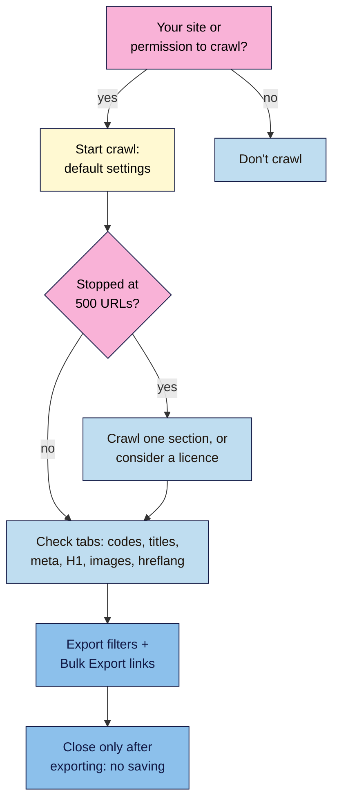

# M13.L01 — Screaming Frog Like a Pro (Free First)
> After this lesson you can say exactly what Screaming Frog's free version does and what a licence adds, run a polite crawl and export the right data before you close the app, and decide when JavaScript rendering, custom extraction or API connections are worth paying for.

**Time:** ~15 min reading + ~45 min hands-on + ~10 min exercise · **Level:** L3 Advanced · **Prereqs:** M06.L06, M10.L02 · **Remediate to:** M06.L06
**Verified against:** Screaming Frog SEO Spider pricing page, product page, FAQ, user guide (General, Configuration, Tabs) and release history (version 25.1, 4 November 2026), all on 2026-11-09. No crawl was run for this lesson; menu names come from the user guide.

> ⚠️ **Freshness flag:** Screaming Frog released version 25 on 3 November 2026, adding an "Auto Throttle Crawl Rate" and other features; menus move between versions. The licence is "£199" "Per Year" per user on 2026-11-09. Screaming Frog doesn't list which individual settings (such as list mode) work in the free version, so **check in the app** before relying on one.

## Learning objectives
1. **Map** what the free version does and what a licence adds. *(O1)*
2. **Run** a polite crawl and export the tabs you need before closing. *(O2)*
3. **Explain** the licence features (JavaScript rendering, custom extraction, API connections, saved crawls) and when they're worth paying for. *(O3)*

## Why it matters
In Lesson 6.6 you ran your first crawl and looked at response codes, directives and canonicals. That's the start. Screaming Frog also checks titles, meta descriptions, headings, images, hreflang and sitemaps in one pass, which turns a week of page-by-page checking into an afternoon.

It's also easy to misuse. People pay for a licence they don't need, or crawl a client's shop at full speed with "Ignore robots.txt" switched on. Or they "crawl as Googlebot" and think they've seen what Google sees. This lesson is about getting the most from the free version, knowing what the paid one adds, and using both responsibly.

## Core concept
**Plain version:** the free version crawls up to 500 URLs with fixed, sensible settings: it respects robots.txt, uses its own user agent, and runs at a moderate speed. You can browse every tab and export them, but you can't save the crawl or change the configuration. A licence (£199 a year per user) removes the limit, lets you save crawls and change settings, and adds JavaScript rendering, custom search and extraction, and connections to Search Console, GA4 and PageSpeed Insights.

**Analogy:** a library card vs a staff pass. The card lets you read everything on the open shelves, as long as you take notes before closing time. The staff pass opens the back rooms, lets you leave books on your desk overnight, and comes with responsibilities.

**Precise definitions:**
- **Crawl configuration:** settings such as speed, user agent, robots.txt handling, rendering and crawl limits. Restricted in the free version.
- **Threads:** simultaneous requests. "By default the SEO Spider is set at 5 simultaneous requests known as 'threads'".
- **Rendering mode:** "Text Only" ("crawl and extract from the raw HTML only") or JavaScript (renders in headless Chrome).
- **Custom extraction:** collecting specific data (an author name, a price) from every page using XPath, CSS Path or Regex. Licence only.
- **List mode:** crawling a list of URLs you paste or upload, instead of following links.
- **Bulk Export:** a top-level menu that "allows bulk exporting of all data", such as every link to a 404.

### Free vs licence
Screaming Frog's own words: "The free version is restricted to crawling up to 500 URLs in a single crawl. The crawl configuration, saving of crawls, and advanced features such as JavaScript rendering, custom extraction, and API integrations are also restricted."

| You want to… | Free | Licence |
|---|---|---|
| Find broken links, redirects, errors | ✅ | ✅ |
| Check titles, meta descriptions, headings, directives, hreflang, sitemaps | ✅ (the free column on the pricing page) | ✅ |
| Crawl more than 500 URLs | ❌ | ✅ ("dependent on allocated memory and storage") |
| Save and reopen a crawl | ❌ export before closing | ✅ "Crawls can be saved and opened … with a licence" |
| Change speed, user agent, robots.txt handling | ❌ defaults only | ✅ |
| Render JavaScript | ❌ | ✅ |
| Custom search and extraction | ❌ | ✅ |
| Pull in Search Console, GA4, PSI data | ❌ | ✅ (the Google APIs are free; the connector needs a licence) |
| Schedule crawls, compare crawls | ❌ | ✅ |

Licences "are annual", and the app "returns to the restricted free version upon expiry". The free version "does not require any form of email capture, or sign up."

### The defaults you can rely on
- **robots.txt:** "By default the SEO Spider will obey robots.txt protocol and is set to 'Respect robots.txt'." (Lesson 10.2 covered why you keep it that way on other people's sites.)
- **Speed:** 5 threads, and version 25's "auto throttle setting automatically slows requests to a host pushing back with 429s, 503s or if they are dropping connections." Screaming Frog warns that pushing threads too high could "overload a server and crash it".
- **User agent:** its own. A licence lets you pick "preset user-agents for Googlebot, Bingbot" and others, but **that doesn't make you Googlebot**: "It's common for sites to block a spoofed Googlebot request". To see what Google sees, use URL Inspection (Lesson 12.4).
- **Text only:** the free crawl reads the raw HTML. Content or links added by JavaScript won't show (check those with Lesson 12.4's method).

### The tabs worth exporting
Beyond Lesson 6.6's response codes, directives and canonicals:
| Tab | Filters to check | Links to |
|---|---|---|
| **Page Titles** | Missing, Duplicate, Multiple | Lesson 4.1 |
| **Meta Description** | Missing, Duplicate, Multiple | Lesson 4.1 |
| **H1** | Missing, Duplicate, Multiple | Lesson 4.2 |
| **Images** | Missing Alt Text, large file sizes | Lesson 4.4 |
| **Hreflang** | Missing return links, non-200 targets | Lesson 12.6 |
| **Sitemaps** | URLs in sitemap that aren't indexable, or indexable URLs missing from it | Lesson 6.4 |

Screaming Frog explains each filter in its user guide, for example "Multiple - Any pages which have multiple page titles. There should only be a single page title element". Two titles or two meta descriptions often mean two SEO plugins (Lesson 13.5).

To export, select a filter and click **Export**: "if you are using a filter and click 'export' it will only export the data contained within the filtered option." For links pointing to a problem (for example, every page linking to a 404), use **Bulk Export**.

### What a licence adds (know it, see it demonstrated)
- **JavaScript rendering:** Config → Spider → Rendering → JavaScript. It renders pages in headless Chrome and, "Like Google, it will also discover any links in the raw HTML." Useful for JavaScript-heavy sites.
- **Custom search:** find pages that contain (or don't contain) something, such as a missing analytics tag, across up to 100 filters.
- **Custom extraction:** "collect any data from the HTML of a URL", for example `count(//h1)` to count H1s, or every product price or author name.
- **APIs:** Search Console (clicks, impressions, and URL Inspection for "up to 2,000 URLs per property a day"), GA4 (sessions, key events) and PSI (lab and CrUX data). Screaming Frog says this data "is only accessible locally on your machine".
- **Saved crawls and comparisons:** crawl before and after a change (a migration, a plugin swap) and compare.

**Course rule of thumb:** stay free while your site is under 500 URLs and you don't need JavaScript rendering or saved comparisons. Buy a licence when you manage several sites, any site over 500 URLs, or migrations (list-mode redirect checks and before/after comparisons save hours). Lesson 13.6 covers paid tools more broadly.

## How it works

**In words:** crawl only your own site, or one you have permission to crawl. Start with the default settings. If the crawl stops at 500 URLs, crawl one section at a time or consider a licence. Check each tab (response codes, titles, meta descriptions, H1s, images, hreflang, sitemaps), then export the filters with issues and use Bulk Export for links. Close the app only after exporting, because the free version can't save.

> **Under the hood: why a crawler and Google can disagree.** A crawler starts from your home page and follows links, with its own user agent and (in the free version) without running JavaScript. Google also uses sitemaps, external links and its own rendering (Lessons 6.6, 12.4). So a page Screaming Frog never found may still be indexed, and a link only JavaScript adds may be invisible to a text-only crawl. Treat the crawl as one view, not the truth *(course reading of both tools' docs)*.

## Hands-on walkthrough
You'll crawl your project site, export the on-page tabs, and build a settings table. Nila's details are illustrative.

**Before you start: which steps apply to you?**
- **Path A (your own site):** crawl your live site.
- **Path B (practice):** crawl your WordPress practice site (or the Blogger site from Module 1).
- **Path C (client site):** crawl only with written permission, outside the shop's busy hours.

**Part A — The crawl (10 min)**
1. Update Screaming Frog to the latest version. Enter your home page URL and click **Start**.
2. Note the total URLs and whether the crawl stopped at 500.
   **Expected:** Nila's shop (illustrative): 412 URLs crawled, finished.

**Part B — On-page tabs (25 min)**
1. For each tab in the table above, record the count for each filter in a **Crawl findings** row (Lesson 6.6's tab).
   > 🖼️ **Image prompt:** Screaming Frog SEO Spider (1280×800) with the Page Titles tab open and the "Duplicate" filter selected, showing a few product URLs sharing one title. Highlight the filter dropdown with a 3px #F9B2D7 outline; blur any personal details.
   > **Alt text:** Screaming Frog's Page Titles tab filtered to duplicate titles, with the filter menu highlighted.
2. Export every filter with results (select the filter → **Export**).
3. Use **Bulk Export** to export all links pointing to 4xx pages.
   **Expected (Nila):** 18 duplicate titles (product variants sharing a title), 6 pages with multiple meta descriptions (a sign of two plugins; Lesson 13.5), 40 images missing alt text, 3 internal links to 404s.

**Part C — Settings by task (10 min)**
1. In a **Screaming Frog settings** tab, copy the "Free vs licence" table and add one column: "Do I need it for my project? (yes/no + why)".
   **Expected:** for most learners, "no licence needed yet"; one reason you might buy one later.

**Expected output:** updated **Crawl findings** with on-page counts, exported files saved in your project folder, and a **Screaming Frog settings** tab with your licence decision.

## When to use / when not to
**Do this** monthly on your own site, before and after big changes (theme, plugin, migration), and in every audit.

**Don't** crawl sites you don't control without permission, switch to "Ignore robots.txt" or high thread counts on someone else's server, claim a spoofed Googlebot crawl shows what Google sees, or buy a licence just to tick a box.

**The trade-off:** the free version's fixed settings protect other people's servers and make results comparable, but you can't save, extend or render. A licence is cheap for professionals and unnecessary for most small sites *(course rule of thumb)*.

## Use AI for this
**Example prompt:**
> "Here is a CSV export from Screaming Frog's Page Titles tab, filtered to Duplicate: [paste]. Group the URLs by shared title, guess the cause for each group (product variants, pagination, tag archives, two plugins), and suggest a fix. Don't invent URLs."

**What AI does well here:** grouping hundreds of rows and spotting patterns in URLs.
**Where it gets it wrong:** it invents Screaming Frog menu names, says the free version can render JavaScript, or proposes rewriting every title instead of fixing the template.
**How to check:** confirm menu names in the user guide, and spot-check three URLs from each group in the browser.

## Common mistakes
- **Closing the free version before exporting** (it can't save).
- **Ignoring robots.txt or raising threads** on someone else's site.
- **"Crawling as Googlebot"** to see what Google sees.
- **Trusting a text-only crawl** on a JavaScript-heavy site.
- **Fixing each duplicate title by hand** when one template is the cause.
- **Buying a licence** for a 40-page site with no migrations planned.

## Troubleshooting
| Symptom | Likely cause | Fix |
|---|---|---|
| Crawl stops at 500 | Free limit | Crawl one section (start from a section URL), or license |
| Only one URL crawled | Home page blocked, redirects off-site, or JavaScript links | Check robots.txt, the redirect, and link markup (Lesson 12.4) |
| Many 403 or 429 responses | Server or CDN blocking the crawler | Stop; ask the host; crawl more slowly (licence) at a quiet time |
| H1 "Missing" but you see one in the browser | H1 added by JavaScript | Check View Source vs rendered (Lesson 12.4) |
| Two titles or meta descriptions per page | Two SEO plugins or theme + plugin | Lesson 13.5 |
| Can't reopen yesterday's crawl | Free version | Re-crawl; export next time |

## Exercise
**Task:** finish your crawl, exports and **Screaming Frog settings** tab (Parts A–C). Then answer these. All details are illustrative.
1. Nila's crawl shows 6 pages under Meta Description → Multiple. What's the most likely cause?
2. Tomás's shop has 3,200 URLs. What can the free version do, and what are his options?
3. A freelancer says: "I crawled Kavya's site as Googlebot, so we know what Google sees." What's wrong?
4. Amara's client site builds its menu with JavaScript, and the free crawl finds only the home page. Why?
5. You need every product page's price and "Out of stock" text in one sheet. Which feature, and is it free?
6. A colleague set 20 threads and "Ignore robots.txt" to audit a competitor faster. What do you say?

**Expected outcome:** a completed crawl and tab, and these answers:
- **1** Two SEO plugins (or a plugin and the theme) both outputting a meta description; check View Source (Lesson 13.5).
- **2** Crawl up to 500 URLs per crawl (one section at a time); or buy a licence to remove the limit and save crawls.
- **3** A spoofed user agent isn't Googlebot ("It's common for sites to block a spoofed Googlebot request"); use URL Inspection.
- **4** The free crawl reads raw HTML only ("Text Only"), so JavaScript links aren't found; fix the links (Lesson 12.4) or use JavaScript rendering with a licence.
- **5** Custom extraction (XPath, CSS Path or Regex); licence only.
- **6** Don't: it ignores the site owner's rules and could "overload a server". Respect robots.txt and defaults (Lesson 10.2).

**Stretch goal:** run the same crawl one week later and compare the counts in your **Crawl findings** tab by hand. Note what changed and why.

## Key takeaways
- Free: 500 URLs per crawl, default settings, all main tabs, exports, no saving.
- Licence (£199/year per user): unlimited, saved crawls, configuration, JavaScript rendering, extraction, APIs.
- Defaults respect robots.txt and a moderate speed; keep them on sites you don't own.
- A Googlebot user agent isn't Googlebot; use URL Inspection for Google's view.
- Export every filter you need, and Bulk Export the links, before closing.

## Teach it back
Explain to a colleague in 3 sentences what Screaming Frog's free version can and can't do, and when you'd buy a licence.

## Glossary terms added
- Crawl configuration — added to `seo-101/glossary.md`
- Custom extraction — added to `seo-101/glossary.md`
- List mode — added to `seo-101/glossary.md`
- Bulk Export — added to `seo-101/glossary.md`
- *Already in the glossary:* User agent, Crawler / Googlebot

## Further reading
*All checked 2026-11-09.*
- Screaming Frog — SEO Spider pricing: https://www.screamingfrog.co.uk/seo-spider/pricing/
- Screaming Frog — SEO Spider FAQ: https://www.screamingfrog.co.uk/seo-spider/faq/
- Screaming Frog — User guide: General: https://www.screamingfrog.co.uk/seo-spider/user-guide/general/
- Screaming Frog — User guide: Configuration: https://www.screamingfrog.co.uk/seo-spider/user-guide/configuration/
- Screaming Frog — User guide: Tabs: https://www.screamingfrog.co.uk/seo-spider/user-guide/tabs/
- Screaming Frog — Release history: https://www.screamingfrog.co.uk/seo-spider/release-history/

> ⚠️ **May change:** price, the free/licence split, menu names (version 25 added several). Recheck the pricing page and release history every 6 months.

## Refresher card
*Used by remediation when a learner fails a quiz twice on a later lesson that points back here.*
**Free:** 500 URLs/crawl; no sign-up; defaults only (Respect robots.txt, own user agent, 5 threads, auto throttle in v25, text-only); all main tabs (codes, titles, meta, H1, images, directives, canonicals, hreflang, sitemaps); Export per filter + Bulk Export; **can't save**. **Licence:** £199/year per user; unlimited (memory-bound); save/open/compare crawls; configuration (speed, UA, robots handling); JavaScript rendering; custom search and extraction (XPath/CSS/Regex); Search Console, GA4, PSI APIs; scheduling. **Ethics:** your site or permission; never ignore robots.txt or raise threads on others' servers. **Spoofed Googlebot ≠ Googlebot**; use URL Inspection.
