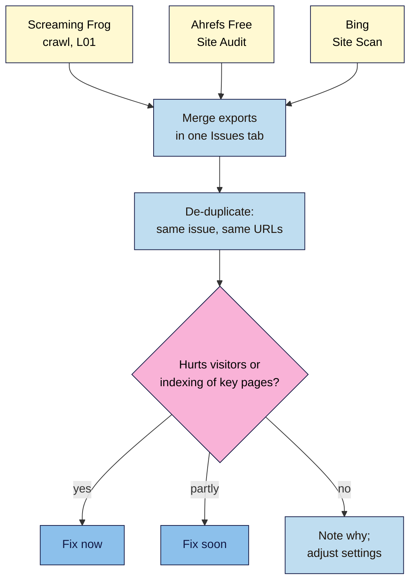

# M13.L02 — Second-Opinion Crawlers: Ahrefs Free Site Audit and Bing Site Scan
> After this lesson you can run two free cloud audits of your verified site (Ahrefs' Site Audit and Bing's Site Scan), explain why their results differ from Screaming Frog's and from each other, and turn three tools' findings into one short, prioritised issue list instead of chasing a health score.

**Time:** ~14 min reading + ~45 min hands-on + ~10 min exercise · **Level:** L3 Advanced · **Prereqs:** M13.L01, M01.L08 · **Remediate to:** M06.L06
**Verified against:** ahrefs.com/free, Ahrefs Site Audit product page, Ahrefs Academy "Site Audit: introduction", Ahrefs Help "What is a verified project" (2026-09-03); Bing Webmaster blog posts of 29 July 2020, 17 June 2025 and 10 February 2026, all on 2026-11-09. No audits were run for this lesson.

> ⚠️ **Freshness flag:** Ahrefs Webmaster Tools was renamed **Ahrefs Free** ("They're the same account"). Bing's only official descriptions of Site Scan are a 2020 post and a 2025 feature list; we couldn't find a help page with its limits. Bing's **AI Performance** report is a public preview (February 2026). Menus and limits may change.

## Learning objectives
1. **Set up** a verified Ahrefs Free project and a Bing Site Scan. *(O1)*
2. **Compare** findings across tools and explain why they differ. *(O2)*
3. **Prioritise** real issues over health scores. *(O3)*

## Why it matters
Screaming Frog (Lesson 13.1) runs on your computer, without JavaScript in the free version, and forgets everything when you close it. Two free cloud tools fill those gaps:
- **Ahrefs Free Site Audit** runs in the cloud, keeps history, and its product page says it "Executes JavaScript".
- **Bing Site Scan** checks your site the way one of the search engines that crawls it sees problems.

Running three tools raises a new problem: three different lists and two "health scores". Nila's Ahrefs score is 94, so her freelancer says the site is "basically perfect". Meanwhile her best-selling category page is set to `noindex`: one "notice" among hundreds. This lesson is about reading the lists, not the scores.

## Core concept
**Plain version:** run Ahrefs' Site Audit and Bing's Site Scan on your verified site, export their issues, and merge them with your Screaming Frog crawl in one sheet. For each issue, ask: does it affect real visitors or indexing of pages that matter? Fix those first. A tool's score is its own weighting, not Google's.

**Analogy:** three doctors checking the same patient. They'll use different words and flag different things. You care about the diagnosis they agree on and anything serious, not each doctor's "wellness score".

**Precise definitions:**
- **Ahrefs Free:** Ahrefs' free plan for **verified** sites (formerly Ahrefs Webmaster Tools); includes Site Audit and backlink data (Lesson 9.3).
- **Crawl credit:** Ahrefs' unit for Site Audit: "Only internal HTML pages that return the 200 (OK) HTTP status code consume crawl credits." Redirects, errors, images and external links don't.
- **Site Scan:** Bing's "on-demand site audit tool which crawls your site and checks for common technical SEO issues".
- **Health score:** a tool's summary number for issues found; each tool weights issues its own way.
- **Errors, warnings, notices:** Ahrefs' three levels ("Site Audit segments issues into errors, warnings, and notices").

### What each tool gives you
| | Screaming Frog free | Ahrefs Free Site Audit | Bing Site Scan |
|---|---|---|---|
| Runs | On your computer | In the cloud | In the cloud |
| Access | Any site (ask permission) | "For verified websites" | Sites verified in Bing Webmaster Tools |
| Limit | 500 URLs per crawl | "5 K crawl credits/month per project" | Not published |
| JavaScript | No (text only) | "Executes JavaScript" | Not stated |
| History | No (can't save) | Yes, over time | Past scans listed *(observed practice)* |
| Export | Per filter, Bulk Export | "Export all issues in bulk" | Export option in the scan *(observed practice)* |
| Bonus | Full control of what you check | Backlinks for your site (Lesson 9.3) | Robots.txt tester ("the same parser we use in production"), URL inspection, recommendations |

Ahrefs Free is truly free: "No credit card, no trial period, no hidden charges." Bing Webmaster Tools lets you sign in "using your Microsoft, Google, or Facebook account", and you set it up in Lesson 1.8.

### Why the lists differ
- **Different crawls:** different start points, limits, user agents, and JavaScript handling.
- **Different rules:** each tool decides what counts as an issue (for example, a title "too long" at different lengths).
- **Different weights:** Ahrefs says "issues are not universal across all websites. For example, we classify orphan pages as errors, but this might not hold true for an ecommerce store that sells seasonal products". You can change an issue's importance in its settings.
- **Different moments:** a scan from last week won't show yesterday's fix.

### Real issues first
**Course rule of thumb:** sort every finding into one of three buckets.
| Bucket | Examples | Do |
|---|---|---|
| **Fix now** | Important pages `noindex`, 4xx/5xx in menus, redirect chains on key links, broken canonicals, duplicate titles on templates, mixed content | This week |
| **Fix soon** | Missing alt text, missing meta descriptions, slow pages with field-data problems | This month |
| **Note or ignore** | Cosmetic warnings, issues that don't apply to your site (seasonal "orphans"), notices about pages you don't care about | Record why |

Any tool's issue might be in any bucket: a "notice" can be urgent, an "error" can be irrelevant. That's why you read the list.

### Bing's other free tools
Bing's 2025 list includes a Sitemaps report, "Crawl Control", search performance "using up to 16 months of data", "Top Recommendations" ("prioritized, actionable suggestions") and backlink insights. Its new **AI Performance** report "shows how publisher content appears across Microsoft Copilot" and AI summaries in Bing; it's a preview, and Module 14 looks at AI search.

## How it works

**In words:** export the issues from Screaming Frog, Ahrefs' Site Audit and Bing's Site Scan into one sheet. Merge duplicates so each issue appears once, with the tools that found it. Ask of each: does it hurt visitors or the indexing of pages that matter? If yes, fix it now; if partly, fix it soon; if not, note why (and adjust the tool's settings if it keeps flagging it). Ignore the health scores.

> **Under the hood: why a cloud crawler can render JavaScript and your free desktop crawler can't.** Rendering every page in a headless browser takes far more computing power than reading raw HTML. Cloud tools spread that cost over their servers (and limit it with credits); a desktop tool's free version keeps it simple. That's why Ahrefs can see a JavaScript-injected H1 that Screaming Frog free reports as missing *(course explanation; check Lesson 12.4's method for any page in doubt)*.

## Hands-on walkthrough
You'll run two audits and build one **Issues** tab. Nila's details are illustrative.

**Before you start: which steps apply to you?**
- **Path A (your own site):** verify the site in Ahrefs Free (Search Console import is usually quickest) and use your Bing Webmaster Tools account from Lesson 1.8.
- **Path B (practice):** both tools need a verified, public site. If your practice site is local, run them on your Blogger site from Module 1, or follow Nila's figures.
- **Path C (client site):** ask the client to verify (or add you as a user); don't verify a client's site with your own DNS access without consent.

**Part A — Ahrefs Free Site Audit (15 min)**
1. At ahrefs.com/free, sign up and add your verified site as a project. In the crawl settings, set a sensible "Max number of internal pages" for a small site.
2. Run the audit. When it finishes, open the issues list and export all issues.
   > 🖼️ **Image prompt:** Ahrefs Site Audit overview (1280×800) for a small site showing the health score and a list of issues split into errors, warnings and notices. Highlight the issues list (not the score) with a 3px #F9B2D7 outline; blur any personal details.
   > **Alt text:** Ahrefs Site Audit overview with a health score and an issues list split into errors, warnings and notices, the list highlighted.
   **Expected:** a CSV or ZIP of issues, and a health score you'll note but not act on.

**Part B — Bing Site Scan (10 min)**
1. In Bing Webmaster Tools, open **Site Scan**, start a new scan and wait for it to finish.
2. Export or copy the issues and their counts.
   **Expected:** a list of issues (often broken links, duplicate titles, missing meta descriptions).

**Part C — One Issues tab (20 min)**
1. In a new **Issues** tab: **Issue · URLs affected · Found by (SF / Ahrefs / Bing) · Example URL · Bucket (now / soon / note) · Why · Owner · Date fixed**.
2. Paste each tool's findings, merge duplicates, then bucket each one.
3. Check one "notice" from each tool for anything urgent (for example, `noindex` on a key page).
   **Expected (Nila):** "Fix now": the coffee-beans category is `noindex` (an Ahrefs notice), 3 menu links to 404s (all three tools), 18 duplicate product titles (SF, Bing). "Note": 12 "orphan" seasonal product pages (intended; removed from the menu after the season).

**Expected output:** Ahrefs and Bing exports saved, and an **Issues** tab with merged, bucketed findings.

## When to use / when not to
**Do this** monthly (Ahrefs can be scheduled), after big changes, and as a second opinion before telling a client "the site is clean".

**Don't** report a health score as the site's SEO quality, fix every warning in tool order, verify sites you don't control, or treat any one tool's list as complete.

**The trade-off:** more tools catch more issues, but also more noise. Three tools are plenty for a small site; merging them takes time, so do it monthly, not daily *(course rule of thumb)*.

## Use AI for this
**Example prompt:**
> "Here are three issue exports (Screaming Frog, Ahrefs Site Audit, Bing Site Scan) for the same site: [paste]. Merge them into one table with columns Issue, URLs affected, Found by, Example URL. Don't drop any issue, and don't invent counts. Then suggest a bucket (fix now / soon / note) with a one-line reason, treating noindex on key pages and broken menu links as most urgent."

**What AI does well here:** merging differently named issues ("4XX page" vs "Broken link") and counting.
**Where it gets it wrong:** it may treat the health score as meaningful, drop issues it thinks are minor, or invent fixes for problems that are intended.
**How to check:** compare totals with each export, and confirm every "fix now" item on the live page.

## Common mistakes
- **Reporting the health score** instead of the issues.
- **Fixing in the tool's order** instead of by impact.
- **Ignoring notices** that hide a real problem.
- **Not adjusting settings** for issues that don't apply (seasonal orphans).
- **Comparing counts across tools** as if they measured the same thing.
- **Running audits on unverified client sites** without consent.

## Troubleshooting
| Symptom | Likely cause | Fix |
|---|---|---|
| Can't start Ahrefs Site Audit | Site not verified | Verify (Search Console import, DNS or HTML file) |
| Credits running out | Large site, or many 200 pages | Set "Max number of internal pages"; crawl key sections |
| Ahrefs shows an H1 that Screaming Frog says is missing | JavaScript-injected H1 | Check source vs rendered (Lesson 12.4) |
| Bing finds issues the others don't | Different rules or crawl | Check the URLs; bucket them like any other |
| Fixed issue still listed | Old scan | Rerun the scan |
| Wildly different totals | Different limits and definitions | Compare issues, not totals |

## Exercise
**Task:** finish your exports and **Issues** tab (Parts A–C). Then answer these. All details are illustrative.
1. Nila's freelancer says: "Health score 94, so the site is fine." What do you check?
2. Ahrefs flags 12 orphan pages on Nila's shop; they're last season's limited roasts, kept for returning customers. Bucket?
3. Tomás's Ahrefs crawl used fewer credits than he expected. He has many redirects and 404s. Why?
4. Screaming Frog says Kavya's pages have no H1; Ahrefs says they do. What's going on?
5. Amara wants to run Ahrefs Site Audit on a prospect's site she hasn't been hired by yet. Can she?
6. Bing Site Scan and Ahrefs both report "duplicate titles" with different counts. Which is right?

**Expected outcome:** two exports and an Issues tab, and these answers:
- **1** The issues list, especially notices about `noindex`, broken menu links and canonicals on key pages; scores are each tool's own weighting.
- **2** "Note": Ahrefs itself says orphan pages "might not hold true for an ecommerce store that sells seasonal products". Adjust the issue's importance.
- **3** "Only internal HTML pages that return the 200 (OK) HTTP status code consume crawl credits."
- **4** The H1 is probably added by JavaScript: Ahrefs "Executes JavaScript"; Screaming Frog free reads raw HTML. Check source vs rendered.
- **5** No: Site Audit is "For verified websites", and verifying needs the owner's access and consent.
- **6** Possibly both: different crawls and rules. Check the URLs each lists, and fix the template causing them.

**Stretch goal:** in Ahrefs, change the importance of one issue that doesn't apply to your site, rerun, and note how the score moves while nothing about the site changed.

## Key takeaways
- Ahrefs Free Site Audit: verified sites, 5,000 credits a month per project (only 200 HTML pages count), JavaScript, history, bulk export.
- Bing Site Scan: free, on-demand, alongside a robots.txt tester and URL inspection.
- Tools differ in crawl, rules and weights; compare issues, not totals or scores.
- Merge findings into one Issues tab and bucket by real impact: now, soon, note.
- Notices can hide urgent problems; errors can be irrelevant.

## Teach it back
Explain to a client in 3 sentences why a health score of 94 doesn't mean their site is fine, and what you look at instead.

## Glossary terms added
- Crawl credit — added to `seo-101/glossary.md`
- Site Scan — added to `seo-101/glossary.md`
- Health score — added to `seo-101/glossary.md`
- *Already in the glossary:* Bing Webmaster Tools, Ahrefs Free (formerly Ahrefs Webmaster Tools)

## Further reading
*All checked 2026-11-09.*
- Ahrefs — Ahrefs Free: https://ahrefs.com/free
- Ahrefs — Site Audit: https://ahrefs.com/site-audit
- Ahrefs Academy — Site Audit introduction: https://ahrefs.com/academy/how-to-use-ahrefs/site-audit/introduction
- Ahrefs Help — What is a verified project: https://help.ahrefs.com/en/articles/4321336-what-is-a-verified-project
- Bing Webmaster blog — Announcing the new Bing Webmaster Tools (2020): https://blogs.bing.com/webmaster/2020/7/Announcing-the-new-Bing-Webmaster-Tools-(migration-complete)/
- Bing Webmaster blog — Start using Bing Webmaster Tools (2025): https://blogs.bing.com/webmaster/2025/6/Start-Using-Bing-Webmaster-Tools-to-Improve-Your-Site-Visibility/
- Bing Webmaster blog — AI Performance public preview (2026): https://blogs.bing.com/webmaster/2026/2/Introducing-AI-Performance-in-Bing-Webmaster-Tools-Public-Preview/

> ⚠️ **May change:** Ahrefs Free limits and features, Bing Site Scan options, AI Performance (preview). Recheck every 6 months.

## Refresher card
*Used by remediation when a learner fails a quiz twice on a later lesson that points back here.*
**Ahrefs Free** (= Ahrefs Webmaster Tools): verified sites; Site Audit 5,000 credits/month per project; only internal 200 HTML pages use credits; executes JavaScript; errors/warnings/notices; bulk export; "issues are not universal" (e.g. seasonal orphans); adjust issue importance. **Bing Site Scan:** free, on-demand, verified sites; finds broken links, duplicate tags, missing metadata; plus robots.txt tester, URL inspection, recommendations, AI Performance (preview). **Method:** merge SF + Ahrefs + Bing into one Issues tab; de-duplicate; bucket now/soon/note by impact on visitors and key-page indexing; ignore health scores; compare issues, not totals.
