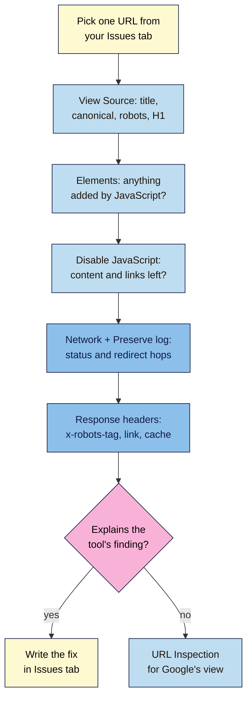

# M13.L03 — Chrome DevTools and Extensions for SEO
> After this lesson you can check one page closely with the browser's own tools (View Source, Elements, Disable JavaScript and the Network panel), read status codes, redirect hops and robots headers, and choose SEO extensions that are safe and still supported.

**Time:** ~12 min reading + ~35 min hands-on + ~10 min exercise · **Level:** L3 Advanced · **Prereqs:** M13.L02, M12.L04 · **Remediate to:** M12.L04
**Verified against:** Chrome for Developers docs (DOM, Disable JavaScript, Network reference, Device mode, Override user agent, Lighthouse overview), the "Web Vitals extension merged" post (13 January 2025), Chrome Web Store Help "Install and manage extensions" and the Chrome Web Store program policies, all on 2026-11-09. Menu names come from the docs; no browser test was run.

> ⚠️ **Freshness flag:** DevTools menus change with Chrome releases (about every 4 weeks). The **Web Vitals extension** was merged into the Performance panel in Chrome 132 (January 2025); old tutorials still recommend it. Extension names, owners and permissions change, so check each one before installing.

## Learning objectives
1. **Use** View Source, Elements, Disable JavaScript and Network (Preserve log) to check one page. *(O1)*
2. **Inspect** status codes, redirect chains, `X-Robots-Tag` and cache headers. *(O2)*
3. **Choose** extensions safely (trusted publisher, narrow permissions) and avoid retired ones. *(O3)*

## Why it matters
Crawlers (Lessons 13.1–13.2) tell you *which* pages have problems. To find out *why*, you check one page closely, and the best tool for that is already in your browser.

Some problems only show up there. A `noindex` sent in an HTTP header never appears in the page's HTML. A redirect chain looks like one jump in the address bar. A heading that JavaScript adds is missing from View Source. And a cached page can keep serving last week's `noindex` after you've fixed it. DevTools shows all of these in a few clicks, for free, on any public page.

## Core concept
**Plain version:** View Source shows what the server sent. **Elements** shows the page after JavaScript and the browser have changed it. **Disable JavaScript** shows what's left without scripts. The **Network** panel (with **Preserve log** on) shows every request, including each redirect hop and the response headers, where `X-Robots-Tag`, canonical `Link` headers and cache headers live.

**Analogy:** View Source is the recipe, Elements is the finished dish, and the Network panel is the delivery receipt: who sent what, when, and with which instructions attached.

**Precise definitions:**
- **DOM:** the live page structure. Chrome's docs: "HTML represents initial page content and the DOM represents active, current page content. When JavaScript adds, removes, or edits nodes, the DOM becomes different than the HTML."
- **Response headers:** information the server sends with a page (status code, `Location` for redirects, `X-Robots-Tag`, `Link`, `Cache-Control`). Not visible in the page.
- **`X-Robots-Tag`:** a robots rule (such as `noindex`) sent as an HTTP header instead of a meta tag (Lesson 6.2).
- **Preserve log:** a Network setting that keeps requests across page loads. "To save requests across page loads, check the Preserve log checkbox on the Network panel." Needed to see every hop of a redirect.
- **Disable cache:** "To emulate how a first-time user experiences your site, check the Disable cache checkbox." (This affects your browser's cache, not a server or CDN page cache.)

### Which tool answers which question
| Question | Tool | Look for |
|---|---|---|
| Is the title, canonical, robots meta, H1 in the HTML the server sends? | **View Source** (Ctrl/Cmd+U) | Search (Ctrl/Cmd+F) for `<title`, `canonical`, `robots`, `<h1` |
| Did JavaScript add or change something? | **Elements** vs View Source | Present in Elements but not in View Source = added by JavaScript (Lesson 12.4) |
| What's left without JavaScript? | **Disable JavaScript** (Command Menu: type "javascript", select **Disable JavaScript**) | Missing content or links |
| What status code and redirects? | **Network**, Preserve log on, reload | Status column; each 301/302 hop and its `Location` |
| Is there a header `noindex` or canonical? | **Network** → click the page request → **Headers** → Response headers | `x-robots-tag`, `link: <…>; rel="canonical"` |
| Am I seeing a cached page? | Response headers | `cache-control`, `age`, and host-specific cache headers *(observed practice; names vary by host and CDN)* |
| How does it look on a phone? | **Device mode** | Layout, hidden content. Chrome calls it "a first-order approximation"; check on a real phone too |
| Lab speed and basic checks? | **Lighthouse** panel, or **Performance** panel | Lab data only; field data comes from CrUX (Lesson 12.1) |

### User agent override: what it does and doesn't do
DevTools can change the user agent string. Chrome's docs say this "does not change how Chrome browser functions internally, it changes content that Chrome is served." It's useful for spotting a site that serves different content to different user agents. Like Screaming Frog's setting (Lesson 13.1), it **doesn't make you Googlebot**: requests still come from your IP address, and Google's own view comes from URL Inspection.

### Extensions: helpful, but choose carefully
Extensions can read every page you visit, so treat installing one like giving someone a key.
- **Trusted publisher:** Chrome Web Store Help says "Make sure you only approve extensions that you trust." Enhanced Safe Browsing may warn "This extension is not trusted by Enhanced Safe Browsing."
- **Narrow permissions:** the Chrome Web Store policy tells developers to "Request access to the narrowest permissions necessary". An SEO extension that wants to "read and change all your data on all websites" may need that to work, so weigh who makes it.
- **Retired:** the Web Vitals extension "has officially merged with the Performance panel in DevTools" (Chrome 132), and Google planned to "revoke its CrUX API key", which breaks its field data. Use DevTools' Performance panel and PageSpeed Insights instead.
- **One example from a vendor page:** the **Ahrefs SEO Toolbar** (free, "No verification needed") offers "Compare raw vs rendered HTML". Other popular SEO extensions weren't researched for this course; check each one's publisher, permissions and last update yourself *(course rule of thumb)*.

**Course rule of thumb:** DevTools first, extensions second. Most single-page checks need no extension. Keep two or three trusted extensions at most, and remove any you haven't used in a month.

## How it works

**In words:** take one URL from your Issues tab. In View Source, check the title, canonical, robots meta and H1. In Elements, see whether JavaScript added anything. Disable JavaScript to see what's left. Open Network with Preserve log on and reload to see the status code and every redirect hop. Then read the response headers for `x-robots-tag`, a canonical `link` and cache headers. If that explains the crawler's finding, write the fix; if not, check Google's view with URL Inspection.

> **Under the hood: why a header `noindex` hides so well.** HTTP headers arrive before the page and aren't part of the HTML, so View Source, Elements and most on-page checkers never show them. Servers, security plugins and CDNs can add them to whole folders (often PDFs or staging sites). Google treats an `X-Robots-Tag: noindex` like a robots meta `noindex` (Lesson 6.2), so a single server rule can remove many pages *(course explanation)*.

## Hands-on walkthrough
You'll run a **One-page check** on 3 URLs and record it. Nila's details are illustrative.

**Before you start: which steps apply to you?**
- **Path A (your own site):** pick 3 URLs from your **Issues** tab (Lesson 13.2): a key page, a redirected URL and one flagged issue.
- **Path B (practice):** use your practice site; a local site works for every part except comparing with live tools.
- **Path C (client site):** fine on any public page; you're only viewing what any visitor sees.

**Part A — Source, Elements, no JavaScript (15 min)**
1. Add a **One-page check** tab: **URL · Title (source) · Canonical (source) · Robots meta · H1 in source? · H1 in Elements? · Works without JS? · Status · Redirect hops · x-robots-tag · Cache headers · Finding · Fix**.
2. For each URL: View Source and search for each item; open DevTools → **Elements** and search for the H1; open the Command Menu (Ctrl/Cmd+Shift+P), type "javascript", choose **Disable JavaScript**, reload, and note what disappears. Turn JavaScript back on afterwards.
   **Expected:** most pages match in source and Elements. Any difference is something JavaScript adds.

**Part B — Network and headers (15 min)**
1. Open **Network**, tick **Preserve log** (and **Disable cache**), and load the redirected URL.
2. Note each row's status (301, 302, 200) and the final URL. Click the first row → **Headers** and read `location`.
   > 🖼️ **Image prompt:** Chrome DevTools Network panel (1280×800) with Preserve log ticked, showing an old URL returning 301 then the new URL returning 200, and the Headers pane open on the 301 showing the location header. Highlight the Preserve log checkbox and the status column with a 3px #F9B2D7 outline; blur any personal details.
   > **Alt text:** DevTools Network panel with Preserve log ticked, a 301 then a 200, and the location header shown.
3. Click the page's own request and read the **Response Headers**. Record any `x-robots-tag`, `link` and cache headers.
   **Expected (Nila):** the old `/shop/filter-coffee/` URL does 301 → 301 → 200 (a chain to fix, Lesson 6.5); the PDF brew guide sends `x-robots-tag: noindex` (intended); the coffee-beans category's cache header shows a cached copy from before the `noindex` was removed (purge the cache, Lesson 13.5).

**Part C — Extensions audit (5 min)**
1. Open `chrome://extensions`. For each SEO extension, note who publishes it, when it was last updated and what it can access. Remove the Web Vitals extension if installed.
   **Expected:** two or three extensions you trust, or none.

**Expected output:** a **One-page check** tab with 3 rows and a finding and fix for each.

## When to use / when not to
**Do this** whenever a crawler flags an issue you don't understand, after any redirect, plugin or caching change, and before telling a client "it's fixed".

**Don't** treat Device mode as a real phone, a user agent override as Googlebot, or a single Lighthouse run as field data. Don't install extensions just because a tutorial lists them.

**The trade-off:** DevTools is exact but works one page at a time; crawlers cover the whole site but explain less. Use crawlers to find, DevTools to explain *(course rule of thumb)*.

## Use AI for this
**Example prompt:**
> "Here are the response headers for one page, copied from Chrome DevTools: [paste]. List any headers that affect search (status, location, x-robots-tag, link rel=canonical, cache-control, age, vary) and explain each in one line for a non-developer. Don't guess at headers that aren't there."

**What AI does well here:** explaining unfamiliar headers and spotting `noindex` or a canonical in a long list.
**Where it gets it wrong:** it invents host-specific cache header meanings, or says a header affects rankings when it doesn't.
**How to check:** look up each header in MDN or your host's documentation, and confirm `noindex` with URL Inspection.

## Common mistakes
- **Checking only View Source** and missing header `noindex`.
- **Forgetting Preserve log**, so a chain looks like one redirect.
- **Treating Elements as what Google gets** without testing (Lesson 12.4).
- **Leaving JavaScript disabled** and wondering why sites break.
- **Trusting a cached page** after a fix.
- **Installing many extensions** with broad permissions, or the retired Web Vitals one.

## Troubleshooting
| Symptom | Likely cause | Fix |
|---|---|---|
| Only one request in Network after a redirect | Preserve log off | Tick Preserve log; reload |
| Page `noindex` in tools but not in source | `X-Robots-Tag` header | Read Response Headers; find the server or plugin rule |
| H1 in Elements, not in source | Added by JavaScript | Lesson 12.4: server-render it |
| Fix not visible | Page, CDN or browser cache | Disable cache; purge the site and CDN cache |
| Device mode looks fine; real phone doesn't | Simulation only | Test on a real phone |
| Extension shows no field data | Retired Web Vitals extension | Use PSI or the Performance panel |

## Exercise
**Task:** finish your **One-page check** tab and extensions audit (Parts A–C). Then answer these. All details are illustrative.
1. Screaming Frog says Nila's PDF guide is `noindex`, but there's no meta tag (it's a PDF). Where is the rule?
2. The address bar shows Tomás's old URL going straight to the new one. Why check Network with Preserve log?
3. Kavya's class schedule is in Elements but not in View Source. What does that tell you, and what do you check next?
4. Amara removed `noindex` from a page, but tools still see it. The headers show `age: 86400`. What's likely?
5. A tutorial says to install the Web Vitals extension for field data. What do you do instead?
6. A colleague switches DevTools to a Googlebot user agent and says "Google sees the page fine". What's wrong?

**Expected outcome:** a completed tab and audit, and these answers:
- **1** An `X-Robots-Tag: noindex` response header; read the response headers in Network.
- **2** To see every hop: there may be a chain (301 → 301 → 200) that the address bar hides.
- **3** JavaScript adds it; check the rendered HTML in URL Inspection or the Rich Results Test (Lesson 12.4) and prefer server-rendering.
- **4** A cached copy about a day old (`age` is in seconds); purge the page and CDN cache, then recheck.
- **5** Use DevTools' Performance panel and PageSpeed Insights; the extension merged into DevTools in Chrome 132.
- **6** Overriding the user agent only changes what's served to you; it doesn't make you Googlebot. Use URL Inspection.

**Stretch goal:** find one page on your site with a canonical `link` header or `x-robots-tag` you didn't know about, and trace which plugin or server rule adds it.

## Key takeaways
- View Source = what the server sent; Elements = after JavaScript; Disable JavaScript = what's left.
- Network with Preserve log shows status codes, every redirect hop and response headers.
- Header rules (`X-Robots-Tag`, canonical `Link`) don't appear in the HTML.
- Cache headers explain "fixed but not fixed"; purge caches after changes.
- Choose few, trusted extensions; the Web Vitals extension is retired.

## Teach it back
Explain to a colleague in 3 sentences how to find a `noindex` that isn't in the page's HTML.

## Glossary terms added
- DOM — added to `seo-101/glossary.md`
- Response headers — added to `seo-101/glossary.md`
- Preserve log — added to `seo-101/glossary.md`
- *Already in the glossary:* X-Robots-Tag, Redirect chain, Source HTML, Rendered HTML, User agent

## Further reading
*All checked 2026-11-09.*
- Chrome for Developers — Get started with viewing and changing the DOM: https://developer.chrome.com/docs/devtools/dom
- Chrome for Developers — Disable JavaScript: https://developer.chrome.com/docs/devtools/javascript/disable
- Chrome for Developers — Network features reference: https://developer.chrome.com/docs/devtools/network/reference
- Chrome for Developers — Device mode: https://developer.chrome.com/docs/devtools/device-mode
- Chrome for Developers — Override the user agent string: https://developer.chrome.com/docs/devtools/device-mode/override-user-agent
- Chrome for Developers — Lighthouse overview: https://developer.chrome.com/docs/lighthouse/overview
- Chrome for Developers blog — Web Vitals extension merged (13 January 2025): https://developer.chrome.com/blog/web-vitals-extension-merged
- Chrome Web Store Help — Install and manage extensions: https://support.google.com/chrome_webstore/answer/2664769
- Chrome Web Store — Program policies: https://developer.chrome.com/docs/webstore/program-policies/policies

> ⚠️ **May change:** DevTools panel names and menus, extension availability and ownership. Recheck every 6 months.

## Refresher card
*Used by remediation when a learner fails a quiz twice on a later lesson that points back here.*
**View Source** (Ctrl/Cmd+U) = server HTML. **Elements** = live DOM after JavaScript ("the DOM becomes different than the HTML"). **Disable JavaScript**: Command Menu → "javascript". **Network:** Preserve log (all redirect hops), Disable cache (first-time visitor; not server/CDN cache); click a request → Headers: status, `location`, `x-robots-tag`, `link rel=canonical`, `cache-control`, `age`. **Device mode** = approximation; **UA override** ≠ Googlebot; **Lighthouse** = lab. **Extensions:** trusted publisher, narrow permissions, few; Web Vitals extension merged into DevTools (Chrome 132, Jan 2025).
