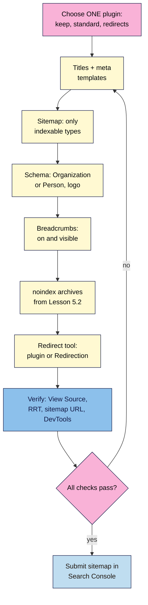

# M13.L04 — Choose ONE SEO Plugin and Configure It End to End
> After this lesson you can pick one SEO plugin (Yoast SEO, Rank Math or All in One SEO) for a given WordPress site, configure its titles and meta templates, sitemap, schema, breadcrumbs, archive `noindex` and redirects, and prove that each setting works by checking the page's source code, the Rich Results Test and Search Console.

**Time:** ~15 min reading + ~50 min hands-on + ~10 min exercise · **Level:** L3 Advanced · **Prereqs:** M13.L03, M05.L02, M06.L04 · **Remediate to:** M05.L02
**Verified against:** wordpress.org plugin pages for Yoast SEO 28.8, Rank Math SEO 1.0.281 and All in One SEO 5.0.5; Yoast Help (XML sitemaps, breadcrumbs), Yoast SEO Premium page; AIOSEO docs (XML sitemap); Rank Math KB (redirections); Make WordPress Core "New XML sitemaps functionality in WordPress 5.5" (22 July 2020), all on 2026-11-09. No plugin was installed for this lesson; menu names vary by version.

> ⚠️ **Freshness flag:** all three plugins update every few weeks, and their menus, free features and prices change. On 2026-11-09, **only Rank Math's free version includes a redirect manager**; Yoast's is Premium and AIOSEO's is Pro. Check the plugin's own page before relying on a feature.

## Learning objectives
1. **Choose** one plugin (Yoast SEO, Rank Math or AIOSEO) for a given site. *(O1)*
2. **Configure** titles and meta templates, sitemap, schema, breadcrumbs, archive `noindex` and redirects. *(O2)*
3. **Verify** the output in View Source, the Rich Results Test and Search Console. *(O3)*

## Why it matters
So far this course has used WordPress on its own: core's `wp-sitemap.xml` (Lesson 6.4), titles you write by hand (Lesson 4.1), and archive decisions you made in Lesson 5.2. That works for a small site. An SEO plugin does the same jobs with templates and switches, so a 300-product shop like Nila's doesn't need 300 hand-written titles.

But a plugin is only as good as its settings, and settings can be wrong in silent ways. A sitemap can be switched on but still list tag archives you set to `noindex`. Breadcrumb schema can be added with no breadcrumbs on the page. A redirect feature can be turned on but hidden. This lesson configures one plugin, then **checks every setting from the outside**, the way Google sees it.

If you took WordPress 101, you did a quick Yoast set-up in its Module 5. This lesson goes further: choosing, configuring every SEO job, and proving it works.

## Core concept
**Plain version:** install **one** SEO plugin. Use it for five jobs: title and meta templates, the XML sitemap, schema, breadcrumbs, and `noindex` for archives you don't want in search. Add a redirect tool (in the plugin if it's free, or the separate free Redirection plugin). Then check each job in View Source, the Rich Results Test and Search Console.

**Analogy:** a plugin is a control panel for a building's signs, directory and fire exits. Flipping a switch on the panel isn't enough; you walk the building to check the signs changed.

**Precise definitions:**
- **SEO plugin:** a WordPress plugin that writes titles, meta descriptions, canonicals, robots meta, structured data and an XML sitemap for every page.
- **Title template:** a pattern such as `%title% | %sitename%` (each plugin uses its own variable names) that builds titles for every post of a type.
- **Sitemap index:** the plugin's main sitemap file that links to one sitemap per post type or taxonomy (often `/sitemap_index.xml`).
- **Redirect manager:** a tool for creating 301 redirects inside WordPress (Lesson 6.5).

### Pick one
All three cover this course's needs for free; no source shows that one ranks better *(course reading)*.

| | **Yoast SEO** | **Rank Math** | **All in One SEO** |
|---|---|---|---|
| Version, installs (2026-11-09) | 28.8, 10+ million | 1.0.281, 4+ million | 5.0.5, 2+ million |
| Titles, meta, sitemap, schema, breadcrumbs (free) | ✅ | ✅ | ✅ ("SEO titles and meta descriptions, an XML sitemap, schema markup") |
| Redirects | Premium ("Redirect manager with bulk tools, CSV import and export"; "$ 118.80 / year (ex VAT)") | **Free** ("Smart Redirection manager", "Built-in 404 monitor") | Pro ("AIOSEO Pro adds advanced features like the redirection manager") |
| WooCommerce | Separate paid add-on | In the free plugin *(vendor's feature list; not tested)* | In paid plans *(vendor's feature list)* |
| Catch | Free version has no redirect manager | Redirections need "Advanced mode", and the module "does not allow redirection of the homepage" | FAQ markets sitemaps as helping "domain authority", which is a third-party metric, not a Google signal |

**Course rule of thumb, how to choose:**
1. **Already using one?** Keep it. Switching costs more than any difference between them.
2. **Agency or host standard?** Use theirs (Amara).
3. **Need free redirects?** Rank Math, or any plugin plus the free **Redirection** plugin.
4. **Otherwise:** the one whose settings you find clearest.

Nila (illustrative) already runs Yoast on her shop and adds the free Redirection plugin. Kavya picks Rank Math for its free redirects.

### The five jobs and how to verify each
| Job | Set in the plugin | Verify outside the plugin |
|---|---|---|
| **Title and meta templates** | Per post type and taxonomy: title pattern, meta description pattern (or written per page) | View Source: one `<title>`, one `meta name="description"`; Screaming Frog Page Titles → Duplicate (Lesson 13.1) |
| **XML sitemap** | Sitemap switched on; only indexable types included | Open the sitemap URL; `/wp-sitemap.xml` should redirect or stop listing; submit in Search Console (Lesson 6.4) |
| **Schema** | Site represents an Organization or Person, name, logo; content types | Rich Results Test and Schema Markup Validator (Lesson 12.5): one graph, no errors |
| **Breadcrumbs** | Breadcrumbs on, and shown by the theme (block, shortcode or theme setting) | Visible on the page **and** `BreadcrumbList` in the Rich Results Test; they must match |
| **Archive `noindex`** | `noindex` for archives you decided in Lesson 5.2 (often tags, date, author on a one-author site) | View Source on one archive: `robots` meta has `noindex`; the archive isn't in the sitemap |
| **Redirects** (tool) | One test redirect (old URL → new URL, 301) | DevTools Network with Preserve log: one 301, then 200 (Lesson 13.3) |

### What the plugin does to WordPress's own sitemap
WordPress core has made a sitemap at `/wp-sitemap.xml` since version 5.5. It includes "author archives" and all public taxonomies by default. Core's own note says a plugin that sets `noindex` should "exclude those from the sitemap too". SEO plugins replace it. AIOSEO says so directly: "our XML sitemaps will override the default WordPress sitemaps". Yoast notes that "Post Types marked as noindex will not appear in the sitemap". For Yoast and Rank Math we found no official statement about core's sitemap, so **check it yourself**: open `/wp-sitemap.xml` after setting up. It should redirect to the plugin's sitemap or stop working. If both sitemaps work, submit only the plugin's sitemap and look for a conflict (Lesson 13.5).

### Switching plugins safely
Each plugin can import from the others (Rank Math lists "Yoast SEO" among its imports). Import, check a few pages, then **deactivate and delete the old one**. Rank Math's FAQ: "It is recommended to remove other SEO plugins. Using other SEO plugins alongside Rank Math can hurt your website's performance and cause conflicting SEO results."

## How it works

**In words:** choose one plugin (the one you already have, your agency's standard, or the one with the free features you need). Set the title and meta templates, the sitemap, schema, breadcrumbs, `noindex` for the archives you chose in Lesson 5.2, and a redirect tool. Then check each one from outside WordPress: View Source, the Rich Results Test, the sitemap URL and DevTools. Fix anything that fails, and submit the sitemap in Search Console when everything passes.

> **Under the hood: how a plugin changes every page at once.** WordPress builds each page's `<head>` by running "hooks", places where plugins can add or change output. An SEO plugin hooks in to replace the title, add meta tags, canonicals and JSON-LD, and to serve its own sitemap. That's why one switch changes thousands of pages, and why two SEO plugins (or a theme that also adds tags) can both write to the same `<head>` (Lesson 13.5) *(course explanation)*.

## Hands-on walkthrough
You'll configure one plugin and fill in an **SEO plugin set-up checklist**. Nila's details are illustrative.

**Before you start: which steps apply to you?**
- **Path A (your own WordPress site):** back up first (your host's backup or a plugin). Use your existing SEO plugin if you have one.
- **Path B (practice):** your WordPress practice site is ideal. Skip the Search Console steps if it's local.
- **Path C (client site):** do it on a staging copy first (Lesson 6.2), with the client's agreement.

**Part A — Choose and install (10 min)**
1. Write down your choice and one reason, using the rule of thumb above. If another SEO plugin is already active, **don't** add a second one: either keep it or import and remove it.
2. Install and activate your plugin. Skip or carefully read any set-up wizard; note each choice it makes.
   **Expected:** one SEO plugin active in **Plugins**.

**Part B — Configure the five jobs (25 min)**
1. **Titles and meta:** set a title pattern for posts, pages, products (if any) and categories. Write meta descriptions for your 5 most important pages by hand.
2. **Sitemap:** switch it on, and exclude any post type or taxonomy you `noindex`.
3. **Schema:** say whether the site represents an Organization or a Person; add the name and logo.
4. **Breadcrumbs:** switch them on and add them to your theme (breadcrumbs block, shortcode such as Yoast's `[wpseo_breadcrumb]`, or the theme's setting).
5. **Archive `noindex`:** apply your Lesson 5.2 decisions (for example tags `noindex`, date archives off).
6. **Redirects:** create one test redirect (for example `/test-old/` → `/about/`, 301), in the plugin or the Redirection plugin.
   > 🖼️ **Image prompt:** A WordPress SEO plugin's settings screen (1280×800) showing the content types or taxonomies section, with the tags taxonomy set to not appear in search results and the sitemap toggle on. Highlight the tags setting with a 3px #F9B2D7 outline; blur any personal details.
   > **Alt text:** An SEO plugin's taxonomy settings with tags set to noindex and the sitemap on, the tags setting highlighted.

**Part C — Verify from the outside (15 min)**
1. Add an **SEO plugin set-up** tab: **Job · Setting · How verified · Result · Date**.
2. View Source on the home page, one post and one tag archive: count `<title>` and `description` tags (exactly one each), check `canonical` and `robots`.
3. Open your sitemap index and `/wp-sitemap.xml`. Note what each does.
4. Run one post through the Rich Results Test: one graph, `BreadcrumbList` matching the visible breadcrumbs.
5. Load `/test-old/` with DevTools Network (Preserve log): 301 → 200. Then delete the test redirect.
6. Submit the sitemap in Search Console (Lesson 6.4) and remove the old one if listed.
   **Expected (Nila):** one title and description per page; tags `noindex` and absent from the sitemap; `/wp-sitemap.xml` redirects to `/sitemap_index.xml`; breadcrumbs visible and valid; test redirect 301 → 200.

**Expected output:** one configured plugin and an **SEO plugin set-up** tab with a verified result for every job.

## When to use / when not to
**Do this** on any WordPress site with more than a handful of pages, and re-verify after plugin updates and theme changes.

**Don't** run two SEO plugins, trust a setting without checking the page, switch plugins for a rumoured ranking gain, or buy Premium only for features you don't use.

**The trade-off:** a plugin saves hours with templates, but it hides what it does behind switches, and updates can change defaults. Verifying from the outside after set-up and after major updates keeps you in control *(course rule of thumb)*.

## Use AI for this
**Example prompt:**
> "Here is the `<head>` of one page from my WordPress site, copied from View Source: [paste]. List every title, meta description, canonical, robots meta, Open Graph tag and JSON-LD block, and tell me if anything appears twice or conflicts. Don't guess which plugin made them unless a comment says so."

**What AI does well here:** spotting duplicates in a long `<head>` and summarising JSON-LD.
**Where it gets it wrong:** it invents settings menus, claims one plugin ranks better, or mixes up plugin variables.
**How to check:** confirm menu names in the plugin's own help pages, and every result in View Source and the Rich Results Test.

## Common mistakes
- **Two SEO plugins active** (or a theme plus plugin both writing tags).
- **Sitemap including `noindex` archives**, or two sitemaps submitted.
- **Breadcrumb schema without visible breadcrumbs.**
- **Assuming free redirects** in Yoast or AIOSEO.
- **Trusting the wizard's defaults** without reading them.
- **Switching plugins without importing** and checking first.

## Troubleshooting
| Symptom | Likely cause | Fix |
|---|---|---|
| Two `<title>` or description tags | Two plugins, or theme adds tags | Lesson 13.5: deactivate one; check theme settings |
| `/wp-sitemap.xml` and the plugin sitemap both work | Plugin sitemap off, or a conflict | Turn the plugin sitemap on; submit one; check for another plugin |
| Breadcrumbs in RRT but not on the page | Not added to the theme | Add the block, shortcode or theme setting |
| No Redirections menu in Rank Math | Module off or Easy mode | Turn on the module; switch to Advanced mode |
| Can't redirect the home page in Rank Math | Documented limit | Use a server rule or the Redirection plugin |
| Titles unchanged after editing template | Page has its own title, or a cache | Check the page's own setting; purge the cache |

## Exercise
**Task:** finish your set-up and **SEO plugin set-up** tab (Parts A–C). Then answer these. All details are illustrative.
1. Nila runs Yoast free and needs to redirect 40 old product URLs. What are her options?
2. Kavya's tag archives are `noindex`, but they're still in her sitemap. What should she check?
3. Tomás's View Source shows two meta descriptions per page. What's the likely cause?
4. Amara's agency standard is AIOSEO, but she prefers Rank Math. Which should she use on client sites?
5. A plugin's FAQ says its sitemap can "improve your domain authority". How do you read that?
6. The Rich Results Test shows `BreadcrumbList` on Kavya's posts, but no breadcrumbs appear on the page. What's wrong?

**Expected outcome:** a configured plugin and checklist, and these answers:
- **1** Yoast Premium's redirect manager, or the free Redirection plugin alongside Yoast free.
- **2** That the taxonomy is excluded from the sitemap in the plugin (core's note: `noindex` items should be excluded), and that only the plugin's sitemap is submitted.
- **3** Two SEO plugins, or a theme plus a plugin, both writing tags; keep one (Lesson 13.5).
- **4** The agency standard: switching costs more than any difference, and no source shows one ranks better.
- **5** A marketing claim: "domain authority" is a third-party metric, not a Google signal.
- **6** Breadcrumbs are switched on but not added to the theme; markup must match visible content (Lesson 12.5). Add them to the theme or turn the setting off.

**Stretch goal:** after the next plugin update, rerun Part C and note anything that changed.

## Key takeaways
- One SEO plugin, never two. Yoast, Rank Math and AIOSEO all cover the basics for free.
- Choose by what you already use, your agency's standard and free features you need (only Rank Math has free redirects).
- Configure five jobs: titles and meta, sitemap, schema, breadcrumbs, archive `noindex`, plus a redirect tool.
- Verify every setting outside WordPress: View Source, RRT, the sitemap URL, DevTools.
- Check what happens to `/wp-sitemap.xml`; submit only one sitemap.

## Teach it back
Explain to a client in 3 sentences why they need exactly one SEO plugin and how you'd prove it's set up correctly.

## Glossary terms added
- SEO plugin — added to `seo-101/glossary.md`
- Title template — added to `seo-101/glossary.md`
- Redirect manager — added to `seo-101/glossary.md`
- *Already in the glossary:* Sitemap (XML sitemap), Sitemap index, Canonical URL, noindex

## Further reading
*All checked 2026-11-09.*
- WordPress.org — Yoast SEO: https://wordpress.org/plugins/wordpress-seo/
- WordPress.org — Rank Math SEO: https://wordpress.org/plugins/seo-by-rank-math/
- WordPress.org — All in One SEO: https://wordpress.org/plugins/all-in-one-seo-pack/
- Yoast Help — XML sitemaps in Yoast SEO: https://yoast.com/help/xml-sitemaps-in-the-wordpress-seo-plugin/
- Yoast Help — How to implement Yoast SEO breadcrumbs: https://yoast.com/help/how-to-implement-yoast-seo-breadcrumbs/
- Yoast — Yoast SEO Premium: https://yoast.com/product/yoast-seo-premium-wordpress/
- Rank Math KB — Setting up redirections: https://rankmath.com/kb/setting-up-redirections/
- AIOSEO docs — How to create an XML sitemap: https://aioseo.com/docs/how-to-create-an-xml-sitemap/
- Make WordPress Core — New XML sitemaps functionality in WordPress 5.5 (2020): https://make.wordpress.org/core/2020/07/22/new-xml-sitemaps-functionality-in-wordpress-5-5/

> ⚠️ **May change:** plugin versions, menus, free/paid splits and prices. Recheck the wordpress.org pages every 3–6 months.

## Refresher card
*Used by remediation when a learner fails a quiz twice on a later lesson that points back here.*
**One plugin only** (Rank Math FAQ: two "can hurt your website's performance and cause conflicting SEO results"). **Choose:** keep current → agency standard → free redirects (Rank Math only; else free Redirection plugin) → clearest settings. **Five jobs:** title/meta templates · sitemap (only indexable types; core `/wp-sitemap.xml` should be replaced; submit one) · schema (Organization/Person, logo) · breadcrumbs (visible + `BreadcrumbList`, matching) · archive `noindex` (Lesson 5.2), plus redirects. **Verify outside:** View Source (one title, one description), RRT/SMV, sitemap URLs, DevTools 301 → 200, Search Console. Yoast redirects = Premium ($118.80/yr ex VAT, 2026-11-09); AIOSEO redirects = Pro; Rank Math redirects need Advanced mode, can't redirect the home page.
