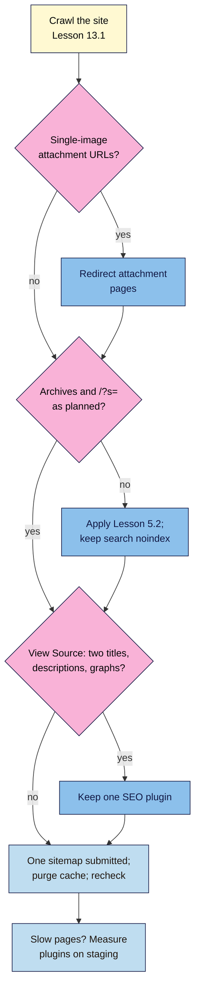

# M13.L05 — WordPress-Specific SEO Traps
> After this lesson you can find and fix the SEO problems that are specific to WordPress (indexable attachment pages, thin archives, internal search pages, two SEO plugins, duplicate sitemaps, stale page caches and plugin bloat), using evidence from a crawl and View Source rather than rules of thumb such as "fewer plugins is always faster".

**Time:** ~14 min reading + ~40 min hands-on + ~10 min exercise · **Level:** L3 Advanced · **Prereqs:** M13.L04 · **Remediate to:** M13.L04
**Verified against:** Make WordPress Core posts on attachment pages (WordPress 6.4, 16 October 2023), Site Health cache checks (6.1, 6 October 2022) and big images (5.3, 9 October 2019); WordPress Advanced Administration "Optimization" (2026-10-14); Yoast Help (media pages, attachment redirects, plugin conflicts); Rank Math KB (general settings); AIOSEO docs (attachment pages, sitemaps); wordpress.org Rank Math FAQ, all on 2026-11-09.

> ⚠️ **Freshness flag:** WordPress 6.4 changed attachment pages for **new** sites only; older sites keep them unless a plugin redirects them. Plugins disagree on where attachment pages should redirect (the file or the parent post). No primary source gives a "safe number" of plugins.

## Learning objectives
1. **Find** and fix attachment pages, thin archives and internal search pages. *(O1)*
2. **Detect** two SEO plugins or duplicate sitemaps from View Source. *(O2)*
3. **Manage** plugin bloat, page caching and image sizes with evidence, not plugin counts. *(O3)*

## Why it matters
WordPress is flexible, and its defaults are built for every kind of site, not for yours. That's how Nila's shop, set up in 2019, ended up with 1,100 indexable pages that each show a single product photo, two meta descriptions on every page after a freelancer "tried" Rank Math without removing Yoast, and a coffee-beans category that stayed `noindex` for a week after she fixed it, because the cache kept serving the old page.

None of these show up in the WordPress dashboard. All of them show up in a crawl (Lessons 13.1–13.2) and in View Source (Lesson 13.3). This lesson is a sweep for the traps that WordPress sites fall into most often *(course reading of the sources above)*.

## Core concept
**Plain version:** check seven things. (1) Attachment pages redirect, rather than being indexable. (2) Archives follow your Lesson 5.2 decisions. (3) Search-results pages stay `noindex`. (4) Only one SEO plugin writes the `<head>`. (5) Only one sitemap is submitted. (6) The page cache is purged after SEO changes. (7) Slow plugins are found by measuring, not counting.

**Analogy:** a WordPress site is a house with a lot of factory-fitted extras. Some doors (attachment pages) open onto empty cupboards; two thermostats (two SEO plugins) fight each other; and the noticeboard (cache) still shows last week's notice.

**Precise definitions:**
- **Attachment page:** a page WordPress created for each uploaded file, showing just that image or file.
- **Internal search page:** a results page from your own site's search box (`/?s=…`). Core adds `noindex` to these (Lesson 5.2).
- **Page cache:** stored copies of finished pages served to visitors to save time. Fast, but can serve an old version after you change something.
- **Plugin bloat:** plugins that slow the site or add output you don't need. It's about how heavy each plugin is, not how many you have.

### The seven traps
| # | Trap | How to find it | Fix |
|---|---|---|---|
| 1 | **Attachment pages indexable** | Crawl: many thin URLs with a single image; or Media → an item → "View attachment page" opens a page | Redirect them (WordPress setting on new sites, or the SEO plugin) |
| 2 | **Thin archives indexed** | Crawl: tag, author, date archives; sitemap lists them | Apply Lesson 5.2: merge, delete or `noindex`; exclude from sitemap |
| 3 | **Search pages indexed** | `site:` checks or Search Console show `/?s=` URLs | Keep core's `noindex`; don't link to search results; don't block them in robots.txt (Google can't see the `noindex` then, Lesson 6.2) |
| 4 | **Two SEO plugins** (or theme plus plugin) | View Source: two titles, descriptions, canonicals or JSON-LD graphs; Screaming Frog "Multiple" filters | Keep one; import, then deactivate and delete the other |
| 5 | **Duplicate sitemaps** | `/wp-sitemap.xml` and `/sitemap_index.xml` both work; two submitted in Search Console | One plugin sitemap; remove the old one in Search Console |
| 6 | **Stale cache** | Change visible in the editor, not on the live page; `age` header (Lesson 13.3) | Purge the page and CDN caches after SEO changes; recheck |
| 7 | **Plugin bloat** | Slow pages in field data (Lesson 12.1); test by deactivating on staging | Remove unused plugins; replace heavy ones; measure before and after |

### Trap 1: attachment pages
WordPress's 2023 core note explains the problem: attachment pages "get indexed by search engines, and sometimes even rank in search results, leading to bad results for users and site owners." Since **WordPress 6.4**, "attachment pages for new WordPress installations are fully disabled". But "On existing sites, the option is set to 1 on upgrade", so **older sites still have them**. A quick check: on a site with them disabled, the admin link "View attachment page" becomes "View Media File".

The plugins disagree about where to send them:
| Source | Redirects attachment pages to |
|---|---|
| WordPress 6.4 (new sites) | The file itself |
| Yoast SEO | The file: "we disable the media pages by default"; "Disabling media pages will cause all attachment URLs to redirect to the media itself". Yoast says parent-post redirects were "not always reliable" |
| Rank Math | The parent post: "redirects the URLs of your attachment pages to the post" they're used in; "we recommend enabling this setting" |
| AIOSEO | The file by default ("This is our recommendation and the default setting"), with "Attachment Parent" as an option |

**Course reading:** either target is fine. What matters is that attachment pages aren't indexable. Photographers or image libraries may want them, and Yoast says "you can manually enable media pages" in that case.

### Traps 4 and 5: two plugins, two sitemaps
Rank Math's FAQ is the clearest vendor warning: "It is recommended to remove other SEO plugins. Using other SEO plugins alongside Rank Math can hurt your website's performance and cause conflicting SEO results." Lesson 6.3 showed what happens with two canonicals. Yoast's method for finding conflicts is to "review the source code as you deactivate plugins", on a staging site or with the "Health Check & Troubleshooting" plugin.

What duplicates *(observed practice)*: titles (one wins), meta descriptions, canonicals, Open Graph tags, JSON-LD graphs (two Organization nodes), robots meta, and sitemaps.

### Traps 6 and 7: cache and bloat
- **Cache:** since WordPress 6.1, **Tools → Site Health** checks whether "the site is using a full page cache solution". Caching is good for speed (Lesson 12.2); the SEO trap is a stale copy. Purge after any SEO change *(observed practice)*.
- **Bloat:** WordPress's own guide says "The number of plugins and their performance will also have a huge impact on your site's performance" and suggests you "Try selectively disabling plugins to measure server performance." Notice "and their performance": one heavy page-builder or chat widget can cost more than ten small plugins. There's no supported "maximum number of plugins" *(course reading)*.
- **Image sizes:** WordPress scales very large uploads down ("The default threshold value is 2560px") and makes several sizes for `srcset`. Upload sensibly sized images (Lesson 4.4); extra sizes take disk space but aren't an SEO problem in themselves.

## How it works

**In words:** crawl the site. If you find many single-image attachment URLs, redirect them. Check that archives match your Lesson 5.2 plan and that search pages keep their `noindex`. In View Source, look for anything that appears twice; if so, keep one SEO plugin. Make sure only one sitemap is submitted, purge the cache and recheck. If pages are slow, measure plugins on a staging site rather than deleting by count.

> **Under the hood: why old sites keep attachment pages.** WordPress 6.4 added one database option, `wp_attachment_pages_enabled`. New installs set it to 0 (redirect to the file); existing sites were set to 1 on upgrade so nothing broke. So two sites running the same WordPress version can behave differently, depending on when they were installed. That's why you check, not assume *(from the core note)*.

## Hands-on walkthrough
You'll sweep your site for the seven traps and record before-and-after evidence. Nila's details are illustrative.

**Before you start: which steps apply to you?**
- **Path A (your own site):** back up first; make changes on staging if you have it (Lesson 6.2).
- **Path B (practice):** a new practice site won't have attachment pages (installed after 6.4). Upload an image, check "View Media File", and follow Nila's figures for the rest.
- **Path C (client site):** sweep and report; change only with the client's agreement.

**Part A — Crawl and check (20 min)**
1. Crawl the site (Lesson 13.1) and save the exports as "before".
2. Add a **WordPress traps** tab: **Trap · Found? · Evidence · Fix · After (evidence) · Date**.
3. Go through traps 1–7 using the "How to find it" column. For trap 4, View Source on 3 pages and count `<title`, `name="description"`, `rel="canonical"` and `application/ld+json`.
   > 🖼️ **Image prompt:** View Source of a WordPress page (1280×800) with the browser's find bar searching for name="description" and showing "2 of 2" matches, one from each of two SEO plugins. Highlight both matching lines and the match count with a 3px #F9B2D7 outline; blur any personal details.
   > **Alt text:** View Source showing two meta description tags from two SEO plugins, both lines and the 2-match count highlighted.
   **Expected (Nila):** 1,100 attachment URLs (old site), tag archives indexed, 2 meta descriptions per page (Yoast plus Rank Math), both `/wp-sitemap.xml` and `/sitemap_index.xml` submitted, cached `noindex` on the coffee-beans category.

**Part B — Fix (15 min)**
1. Fix each trap you found, in this order: two plugins first (it affects everything else), then attachment pages, archives, sitemaps, cache.
2. For bloat: on staging, deactivate one suspect plugin at a time and compare a lab test (Lesson 12.2). Remove only those that are unused or measurably heavy.

**Part C — Re-crawl (5 min)**
1. Purge the cache, re-crawl and fill the **After** column.
   **Expected (Nila):** attachment URLs now 301 to files; 1 meta description per page; one sitemap in Search Console; the category indexable.

**Expected output:** a **WordPress traps** tab with evidence before and after, and the "before" and "after" crawl exports.

## When to use / when not to
**Do this** on any WordPress site you take over, after adding or removing SEO, cache or page-builder plugins, and once a year as a check-up.

**Don't** delete plugins by count, block search pages in robots.txt, enable attachment pages "just in case", or run a second SEO plugin to "try it".

**The trade-off:** every fix here is small, but making several at once on a live site makes it hard to tell what broke what. Fix in order and re-crawl between big changes *(course rule of thumb)*.

## Use AI for this
**Example prompt:**
> "Here is a Screaming Frog export of URLs from my WordPress site: [paste]. Group them into: posts, pages, products, categories, tags, author archives, date archives, attachment pages, search pages, other. Count each group and flag groups that usually shouldn't be indexed. Don't invent URLs; mark anything you can't classify as 'other'."

**What AI does well here:** spotting WordPress URL patterns (`/attachment/`, `/tag/`, `/author/`, `?s=`).
**Where it gets it wrong:** it may say all tag pages must be `noindex` (Lesson 5.2 says decide), or name a plugin limit.
**How to check:** open a sample from each group, and confirm robots meta in View Source.

## Common mistakes
- **Assuming 6.4 fixed attachment pages** on an older site.
- **Blocking `/?s=` in robots.txt**, so Google can't see the `noindex`.
- **Running two SEO plugins** while testing.
- **Submitting both sitemaps.**
- **Forgetting to purge the cache** after SEO changes.
- **Deleting plugins by count** instead of measuring.

## Troubleshooting
| Symptom | Likely cause | Fix |
|---|---|---|
| Hundreds of thin URLs with one image | Attachment pages on an older site | Redirect them in the SEO plugin |
| Two meta descriptions | Two SEO plugins, or theme plus plugin | Keep one; check theme settings |
| Search Console lists `/wp-sitemap.xml` and plugin sitemap | Both submitted | Remove the old one; keep the plugin's |
| Fix not visible on live page | Page or CDN cache | Purge; check the `age` header |
| Site faster after deleting 10 small plugins? No change | Count isn't the cause | Measure the heavy ones on staging |
| `/?s=` pages in Search Console's indexed list | Linked from somewhere, `noindex` blocked by robots.txt | Remove the robots.txt block; remove links |

## Exercise
**Task:** finish your **WordPress traps** tab and both crawls (Parts A–C). Then answer these. All details are illustrative.
1. Nila's 2019 site runs WordPress 7.1, so attachment pages should be off. Why aren't they?
2. Kavya's SEO plugin sends attachment pages to the parent post; a blog says they must go to the file. Who's right?
3. Tomás blocked `/?s=` in robots.txt "to keep search pages out". Why might that backfire?
4. Amara's client has 38 plugins, and someone says "delete half to speed it up". What do you do instead?
5. Nila removed `noindex` from a category an hour ago, but URL Inspection's live test still shows it. What do you check?
6. You find two `application/ld+json` blocks, each with an Organization. What's the likely cause?

**Expected outcome:** a completed tab and crawls, and these answers:
- **1** Core sets the option to 1 "on upgrade" for existing sites; only new installs have them off. Redirect them in the plugin.
- **2** Both are fine: plugins disagree (file vs parent). What matters is that the pages aren't indexable.
- **3** If Google can't crawl the pages, it can't see core's `noindex`, so linked URLs can still be indexed (Lesson 6.2).
- **4** Measure: test suspects on staging, and remove unused or measurably heavy plugins. WordPress ties speed to "number of plugins and their performance".
- **5** The page or CDN cache (purge it; check the `age` header), then the plugin's setting for that category.
- **6** Two SEO plugins, or theme plus plugin, both outputting schema; keep one.

**Stretch goal:** on staging, measure one heavy plugin's effect with three lab runs before and after deactivating it (Lesson 12.2), and record the difference.

## Key takeaways
- Older WordPress sites still have attachment pages; redirect them (file or parent, either is fine).
- Archives follow your Lesson 5.2 decisions; search pages keep core's `noindex`, unblocked.
- One SEO plugin and one sitemap; prove it in View Source and Search Console.
- Purge caches after SEO changes, and recheck.
- Plugin speed is about weight, not count: measure on staging.

## Teach it back
Explain to a client in 3 sentences why their 2019 WordPress site has hundreds of image-only pages in Google and how you'll fix it.

## Glossary terms added
- Attachment page — added to `seo-101/glossary.md`
- Internal search page — added to `seo-101/glossary.md`
- Page cache — added to `seo-101/glossary.md`
- Plugin bloat — added to `seo-101/glossary.md`
- *Already in the glossary:* Archive page, noindex, Staging site

## Further reading
*All checked 2026-11-09.*
- Make WordPress Core — Changes to attachment pages (WordPress 6.4, 2023): https://make.wordpress.org/core/2023/10/16/changes-to-attachment-pages/
- Yoast Help — Media pages settings: https://yoast.com/help/yoast-seo-settings-media-pages/
- Yoast Help — Redirect image attachment URLs: https://yoast.com/help/redirect-image-attachment-urls/
- Yoast Help — How to check for plugin conflicts: https://yoast.com/help/how-to-check-for-plugin-conflicts/
- Rank Math KB — General settings: https://rankmath.com/kb/general-settings/
- AIOSEO docs — Redirecting attachment pages: https://aioseo.com/docs/redirecting-attachment-pages/
- WordPress Advanced Administration — Optimization: https://developer.wordpress.org/advanced-administration/performance/optimization/
- Make WordPress Core — New cache Site Health checks in WordPress 6.1 (2022): https://make.wordpress.org/core/2022/10/06/new-cache-site-health-checks-in-wordpress-6-1/
- Make WordPress Core — Big image handling in WordPress 5.3 (2019): https://make.wordpress.org/core/2019/10/09/introducing-handling-of-big-images-in-wordpress-5-3/

> ⚠️ **May change:** plugin defaults for attachment pages and sitemaps, Site Health checks. Recheck plugin help pages every 6 months.

## Refresher card
*Used by remediation when a learner fails a quiz twice on a later lesson that points back here.*
**Seven traps:** (1) attachment pages: off for new installs since 6.4, still on for upgraded sites; redirect (file: core/Yoast/AIOSEO default; parent: Rank Math; either fine). (2) archives: Lesson 5.2 decisions; exclude `noindex` ones from sitemap. (3) `/?s=` search: core `noindex`; don't block in robots.txt. (4) two SEO plugins: View Source for doubled title/description/canonical/JSON-LD; keep one. (5) sitemaps: one plugin sitemap submitted. (6) cache: purge after SEO changes; check `age`. (7) bloat: "number of plugins and their performance"; measure on staging; no magic number. Big images scaled at 2560px.
