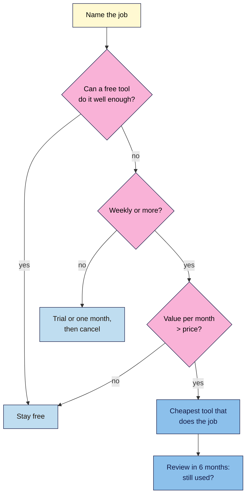

# M13.L06 — Paid SEO Tools: When They're Worth It
> After this lesson you can list exactly what free SEO tools can't do, compare paid plans by the job you need done (with dated prices in the vendor's own currency), and decide whether a given business should pay for a tool, and for what, or stay free.

**Time:** ~12 min reading + ~30 min hands-on + ~10 min exercise · **Level:** L3 Advanced · **Prereqs:** M13.L05, M10.L05 · **Remediate to:** M13.L02
**Verified against:** the pricing pages of Screaming Frog, Ahrefs (pricing and ahrefs.com/free), Semrush ("SEO + AI Search" pricing) and Moz Pro, all on 2026-11-09, plus the Yoast SEO Premium page. Prices are as shown to a server in the United States; they may differ by country and currency.

> ⚠️ **Freshness flag:** **prices and plans change often.** Semrush restructured its plans (older articles mention Pro, Guru and Business). Ahrefs shows different prices by location (the same Starter plan showed "€27/mo" and "$29/mo" on different fetches). Treat every price here as a dated example, not a quote. None of these vendors published rupee prices on the pages we checked.

## Learning objectives
1. **List** what free tools can't do (competitor data at scale, large or JavaScript crawls, scheduled monitoring). *(O1)*
2. **Compare** paid plans by need, with dated prices and currency. *(O2)*
3. **Decide** whether a given business should pay, and for what. *(O3)*

## Why it matters
Every SEO tutorial ends with a tool recommendation, and many of them are affiliate links. Kavya was told she "needs Ahrefs" for her 40-page yoga site. That's about $1,500 a year for data she can mostly get free from Search Console, Bing and Ahrefs Free (Lesson 13.2).

On the other hand, Amara's agency manages 12 client sites and checks competitors weekly. Doing that with free tools takes hours and still leaves gaps. Paying would be cheap compared with her time.

The skill isn't knowing which tool is "best". It's knowing which **job** a free tool can't do, and whether that job matters enough to pay for.

## Core concept
**Plain version:** free tools cover your own site well: Search Console, Bing Webmaster Tools, Ahrefs Free (verified sites), Screaming Frog free (500 URLs), DevTools and one SEO plugin. Paid tools mainly add three things: **data about other people's sites** (competitors' keywords and links), **scale** (big or JavaScript sites, many projects), and **automation** (scheduled crawls, rank tracking, reports). Pay only when one of those blocks a real job you do repeatedly.

**Analogy:** hiring a van. If you move house once, rent for a day. If you deliver every week, buy one. If you only carry shopping, you don't need a van.

**Precise definitions:**
- **All-in-one SEO suite:** a paid platform (Ahrefs, Semrush, Moz Pro) with keyword research, backlink data, site audits and rank tracking for any site.
- **Rank tracking:** checking your positions for a fixed keyword list on a schedule. Search Console gives average positions for queries you already appear for; trackers check any keyword you choose *(course explanation)*.
- **Verified vs non-verified project:** a site you've proved you own vs one you haven't (competitors). Free tools mostly need verification.

### What free can't do
| Job | Free option | Free limit | Paid adds |
|---|---|---|---|
| Your own keywords and clicks | Search Console, Bing | 16 months of data; your site only | Nothing essential |
| Your own backlinks | Search Console, Bing, Ahrefs Free (Lesson 9.3) | Your verified site | More history, alerts |
| Your own site audit | Screaming Frog free, Ahrefs Free, Bing Site Scan | 500 URLs per crawl; 5,000 credits a month; no JavaScript in SF free | Unlimited crawls, JavaScript, schedules, comparisons |
| **Competitors' keywords and links** | Manual SERP checks, free tool tiers (Module 10) | A few lookups a day or month | Full data, any site, exports |
| **Rank tracking for chosen keywords** | Search Console (average position for queries you get) | No chosen-keyword tracking, no local grid | Daily tracking, local, competitors |
| **Many sites or clients** | Free tools per site | Time | Projects, reports, users |

### Dated price examples (2026-11-09, as shown to a US server)
| Tool | Entry option | What it's for | Source wording |
|---|---|---|---|
| **Screaming Frog** licence | £199 per year per user | Crawls over 500 URLs, JavaScript, saved crawls, APIs (Lesson 13.1) | "£199" "Per Year" |
| **Ahrefs** | Starter $29/mo; Lite $129/mo; Standard $249/mo; Advanced $449/mo | Competitor research, backlinks, audits | Lite: "20 non-verified, unlimited verified projects", "2 years of historical data" |
| **Semrush** (SEO plan) | $139 monthly, or $117.33/mo billed annually | Keyword and competitor research, tracking | "5 websites to monitor", "500 keywords to track" |
| **Moz Pro** | $49/month entry plan; Standard $99/mo ($79/mo yearly) | Keyword research, links, tracking | Entry plan "for individuals managing a single website"; Standard "For small businesses that just need the basics of SEO" |
| **Yoast SEO Premium** | $118.80/year (ex VAT) | Redirect manager, extra features (Lesson 13.4) | "$ 118.80 / year (ex VAT)" |

*Converting to rupees or euros:* use the rate on the day you buy, and add local taxes. Plans paid in US dollars from India may include foreign-transaction fees *(observed practice; check with your bank)*.

### The decision
**Course rule of thumb:** answer four questions for each paid tool.
1. **What job?** Name one repeated job a free tool can't do.
2. **How often?** Weekly or more: consider paying. Once a quarter: use a free trial or a one-month plan, then cancel.
3. **What's it worth?** Hours saved per month × your hourly rate, or the value of the decision it informs. Compare with the price.
4. **Cheapest option that does the job?** A Screaming Frog licence (£199/year) often solves a crawling problem that a $129/month suite would also solve.

| Persona (illustrative) | Need | Decision |
|---|---|---|
| **Kavya**, 40-page studio site | Own site, local | **Stay free.** Search Console, GBP, Ahrefs Free, Screaming Frog free |
| **Nila**, ~400 URLs, 2 rival roasters | Own site; occasional competitor checks | **Stay free**; maybe one month of a suite before a big content plan |
| **Tomás**, 3,200-product shop | Crawls over 500 URLs, migration planned | **Screaming Frog licence** (£199/year); no suite yet |
| **Amara**, agency with 12 clients | Weekly competitor research, tracking, reports | **One suite** (the agency's choice) + Screaming Frog licence |

## How it works

**In words:** name the job first. If a free tool does it well enough, stay free. If not, ask how often: for a rare job, use a trial or pay for one month. For a weekly job, compare its value with the price; if it's worth it, choose the cheapest tool that does the job, and review in six months whether you still use it.

> **Under the hood: why competitor data costs money.** To show any site's keywords and links, a tool has to crawl a large part of the web and estimate rankings and traffic for millions of keywords, then keep that data fresh. Your own site's data is cheap: you prove you own it, and Google or Bing give you the real numbers. That's why own-site tools are free and competitor tools are paid, and why third-party traffic figures are **estimates** (Module 10) *(course explanation)*.

## Hands-on walkthrough
You'll build a **Tool comparison** tab and write a buy/don't-buy decision for your project site.

**Before you start: which steps apply to you?**
- **Path A and B:** decide for your own site or practice project.
- **Path C (client site):** decide for the client, and say who pays.

**Part A — Jobs (10 min)**
1. In a **Tool comparison** tab, list the SEO jobs you do: **Job · How often · Free tool used · What's missing · Hours per month**.
   **Expected:** most rows have a free tool and nothing important missing.

**Part B — Compare (10 min)**
1. For each row with something missing, check the current price on the vendor's own pricing page (not a review site). Record **Tool · Plan · Price · Currency · Date checked · Does it solve the gap?**
   > 🖼️ **Image prompt:** A spreadsheet tab named "Tool comparison" (1280×800) with columns Job, How often, Free tool, What's missing, Paid option, Price, Currency, Date checked, showing five rows, two with a paid option filled in. Highlight the Date checked column with a 3px #F9B2D7 outline; blur any personal details.
   > **Alt text:** A Tool comparison spreadsheet with jobs, free tools, gaps and dated paid options, the Date checked column highlighted.

**Part C — Decide (10 min)**
1. Write one paragraph: buy, trial or stay free, and why, using the four questions.
   **Expected:** for most small sites, "stay free" or "one month before a big project".

**Expected output:** a **Tool comparison** tab and a dated buy/don't-buy paragraph.

## When to use / when not to
**Do this** before any tool purchase, at renewal time, and when a client asks "which tool should we buy?"

**Don't** buy because a tutorial or affiliate post says so, compare prices from review sites, quote prices without a date and currency, or treat a tool's traffic estimates as fact.

**The trade-off:** paid tools save time and show competitors, but every subscription is a recurring cost that's easy to forget. A dated review every six months keeps you honest *(course rule of thumb)*.

## Use AI for this
**Example prompt:**
> "Here are the SEO jobs I do, how often, and what free tools I use: [paste]. For each, tell me whether a free tool is enough. Where it isn't, name the type of paid tool that would help. Don't quote prices; I'll check them on vendors' pages."

**What AI does well here:** sorting jobs and naming tool categories.
**Where it gets it wrong:** prices and plan names (often out of date), and it may favour well-known brands.
**How to check:** every price on the vendor's own page, dated.

## Common mistakes
- **Buying a suite for a small site** that free tools cover.
- **Quoting old prices** or plan names (Semrush's changed).
- **Comparing currencies** without noting location and date.
- **Forgetting to cancel** after a one-month project.
- **Treating traffic estimates as real numbers.**
- **Paying for a suite** when a £199 crawler licence solves the real gap.

## Troubleshooting
| Symptom | Likely cause | Fix |
|---|---|---|
| Different prices for the same plan | Location, currency, sale or annual billing | Note currency, date and billing period |
| Plan names don't match a tutorial | Plans restructured | Use the vendor's current page |
| Tool's traffic differs from your Search Console | Estimates vs real data | Trust Search Console for your own site |
| Subscription unused for months | No repeated job | Cancel; use a trial next time |
| Client wants a tool "everyone uses" | Brand pressure | Show the jobs table and costs |

## Exercise
**Task:** finish your **Tool comparison** tab and paragraph (Parts A–C). Then answer these. All details are illustrative.
1. A blog tells Kavya she "needs Ahrefs". What do you ask first?
2. Tomás's only gap is crawling 3,200 URLs before a migration. Cheapest fix?
3. Amara sees the same Ahrefs plan as $29 in one place and €27 in another. What's going on?
4. Nila wants competitor keyword data once before planning next year's content. Buy a year?
5. An old tutorial recommends Semrush's "Guru" plan. What do you do?
6. A suite says a rival gets "12,000 visits a month". How do you report that?

**Expected outcome:** a tab and paragraph, and these answers:
- **1** Which job, how often, and whether a free tool already does it.
- **2** A Screaming Frog licence (£199/year), not a suite.
- **3** Prices shown by location and currency; record currency and date.
- **4** No: a trial or one month, then cancel.
- **5** Check the current pricing page; plans were restructured.
- **6** As a third-party **estimate**, with the tool name and date (Module 10).

**Stretch goal:** set a calendar reminder six months from now to review every SEO subscription against your jobs table.

## Key takeaways
- Free tools cover your own site; paid tools add competitors, scale and automation.
- Pay only for a repeated job a free tool can't do, worth more than its price.
- Rare jobs: trial or one month, then cancel.
- Quote prices from vendors' pages, with currency and date.
- Often the cheapest fix is narrow: a crawler licence, not a suite.

## Teach it back
Explain to a small-business owner in 3 sentences how to decide whether to pay for an SEO tool.

## Glossary terms added
- All-in-one SEO suite — added to `seo-101/glossary.md`
- Rank tracking — added to `seo-101/glossary.md`
- Verified project — added to `seo-101/glossary.md`

## Further reading
*All checked 2026-11-09.*
- Screaming Frog — SEO Spider pricing: https://www.screamingfrog.co.uk/seo-spider/pricing/
- Ahrefs — Pricing: https://ahrefs.com/pricing
- Ahrefs — Ahrefs Free: https://ahrefs.com/free
- Semrush — SEO + AI Search pricing: https://www.semrush.com/pricing/seo-ai-search/
- Moz — Moz Pro pricing: https://moz.com/products/pro/pricing
- Yoast — Yoast SEO Premium: https://yoast.com/product/yoast-seo-premium-wordpress/

> ⚠️ **May change:** every price, plan name and limit here. Recheck vendors' pages before any purchase.

## Refresher card
*Used by remediation when a learner fails a quiz twice on a later lesson that points back here.*
**Free covers own site:** Search Console, Bing, Ahrefs Free (verified), Screaming Frog free (500 URLs), DevTools, one plugin. **Paid adds:** competitor data, scale (big/JS crawls, many projects), automation (schedules, rank tracking, reports). **Four questions:** what job? how often? value vs price? cheapest tool that does it? **Examples (2026-11-09, US):** SF £199/yr; Ahrefs Starter $29, Lite $129/mo; Semrush SEO $139/mo ($117.33 annual); Moz $49 entry, Standard $99/mo; Yoast Premium $118.80/yr ex VAT. Quote with currency + date; traffic figures are estimates.
