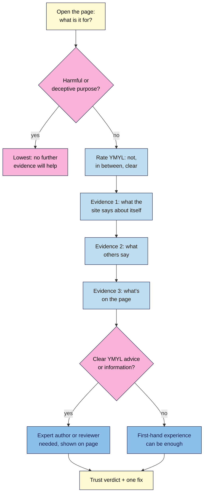

# M14.L01 — E-E-A-T Through a Rater's Eyes
> After this lesson you can judge a page's trust the way Google's quality raters are trained to, using three sources of evidence, and say whether its topic needs real expertise or whether first-hand experience is enough.

**Time:** ~15 min reading + ~35 min hands-on + ~10 min exercise · **Level:** L3 Advanced · **Prereqs:** M01.L07, M04.L03 · **Remediate to:** M04.L03
**Verified against:** Google's *Search Quality Rater Guidelines* PDF (cover date September 11, 2025; sections 0.1, 2.3, 3.1, 3.3, 3.4, 3.4.1), *Creating helpful, reliable, people-first content* (last updated 2026-10-05), *Google Search's guidance on using generative AI content* (2026-10-01) and *Third-party SEO tools, services and advice* (2026-06-05), all checked on 2026-11-10.

> ⚠️ **Freshness flag:** Google revises the rater guidelines every year or two, and section numbers move. Check the cover date of the PDF before you quote it. This lesson uses the **September 11, 2025** edition. The guidelines describe what raters are asked to look for. They are **not** a list of ranking signals.

## Learning objectives
1. **Explain** what quality raters do and don't do, and why E-E-A-T isn't a score. *(O1)*
2. **Rate** a page's trust using the three evidence sources: what the site says about itself, what others say, and what's on the page. *(O2)*
3. **Classify** pages as clearly YMYL, in between, or not YMYL, and say when first-hand experience is enough. *(O3)*

## Why it matters
Kavya wrote a post called "5 yoga poses for lower back pain". Tomás's shop blog has "How to replace a light switch". Nila Coffee has "How to brew pour-over at home". All three are how-to posts, but Google doesn't hold them to the same standard. A wrong brewing ratio wastes a cup of coffee. A wrong wiring step can kill someone, and bad back-pain advice can injure a student.

Module 4 taught you to write people-first content and said E-E-A-T isn't a single ranking factor. This lesson goes to the source. Google works with outside raters who judge search results using a public 182-page handbook. When you can read your own pages the way they're trained to, you can see what Google's systems are designed to reward, without guessing or buying an "E-E-A-T score".

## Core concept
**Plain version:** Google hires outside **search quality raters** to judge whether search results are good. They don't rank anything. Their ratings tell Google's engineers whether a change to the ranking systems made results better or worse. To rate a page, raters ask: what is this page for, how much harm could it do if it's wrong (**YMYL**), and how much can I **trust** it? They answer the trust question with evidence from three places: the website itself, what others say about it, and the page.

**Analogy:** Google's own: "we use them as a restaurant might get feedback cards from diners." The diners don't cook. Their cards tell the kitchen whether a new recipe is working.

**Precise definitions:**
- **Search Quality Rater Guidelines (the "rater guidelines"):** the public handbook Google gives its raters. The PDF's cover just says "General Guidelines"; Google calls it the search quality rater guidelines.
- **Page Quality (PQ) rating:** a rater's judgement of how well a page achieves its purpose, on a scale from **Lowest** to **Highest**.
- **E-E-A-T:** Experience, Expertise, Authoritativeness and Trust. The guidelines: "The most important member at the center of the E-E-A-T family is Trust."
- **YMYL (Your Money or Your Life):** topics where wrong content "could significantly impact the health, financial stability, or safety of people, or the welfare or well-being of society."
- **Reputation research:** looking for independent information about a website or creator. The guidelines say it "is required for all PQ rating tasks."

### What raters do, and what they don't
| Claim | True or false | Source |
|---|---|---|
| A rater can push your page down | **False** | "No single rating can directly impact how a particular webpage, website, or result appears in Google Search" (§0.1) |
| Ratings measure whether Google's systems work | **True** | "ratings are used to measure how effectively search engines are working to deliver helpful content" (§0.1) |
| Rater data feeds the ranking algorithm directly | **False** | "Rater data is not used directly in our ranking algorithms." (helpful content page) |
| The guidelines are a guide to ranking first | **False** | "These guidelines are not a guide to ranking first in Google" (generative AI content page) |
| Reading them helps you assess your own content | **True** | "Reading the guidelines may help you self-assess how your content is doing from an E-E-A-T perspective" (helpful content page) |
| An SEO tool can measure your E-E-A-T score | **False** | E-E-A-T isn't a score. "Third-party tools don't have access to our internal ranking data." (third-party SEO page) |

### The four parts of E-E-A-T, with the guidelines' own examples
| Part | The rater's question (§3.4) | Guidelines example | Our persona |
|---|---|---|---|
| **Experience** | Does the creator have "the necessary first-hand or life experience for the topic"? | A review from "someone who has personally used the product" | Nila's brew guide, with her own photos and ratios |
| **Expertise** | Does the creator have the knowledge or skill the topic needs? | "home electrical rewiring advice from a skilled electrician or from an antique homes enthusiast who has no knowledge of electrical wiring?" | Tomás's light-switch guide needs an electrician |
| **Authoritativeness** | Is the creator or site "known as a go-to source for the topic"? | "a local business profile page on social media may be the authoritative and trusted source for what is on sale now" | Kavya's own class schedule (one consistent identity, Module 11) |
| **Trust** | Is the page "accurate, honest, safe, and reliable"? | "Online stores need secure online payment systems and reliable customer service." | Nila's and Tomás's shops: HTTPS, returns, contact details |

Trust sits in the middle because "untrustworthy pages have low E-E-A-T no matter how Experienced, Expert, or Authoritative they may seem." The guidelines' example: a financial scam written by an expert scammer is still untrustworthy. They also say: "If a page is untrustworthy for any reason, it has low E-E-A-T."

### The three evidence sources (§3.4)
1. **"What the website or content creators say about themselves"**: the About page, bylines, author pages, contact and customer service details (§2.5.2–2.5.3).
2. **"What others say about the website or content creators"**: independent reviews, news, expert recommendations, forum discussions (§3.3).
3. **"What is visible on the page, including the Main Content and sections such as reviews and comments"**: is the content accurate, careful and clearly made by someone who knows the topic?

Three rules from the reputation sections are worth knowing:
- **Be sceptical of self-praise.** Raters are told to "Be skeptical of claims that websites make about themselves, particularly when there is a clear conflict of interest." "Reviews" by the product's maker "are not as trustworthy due to the conflict of interest." Nila's "Best Indian coffee beans" list that ranks her own beans first is a conflict of interest, so it needs to say so.
- **Reputation depends on the topic.** A site can be a go-to source for one thing and untrustworthy for another, so raters research reputation "according to the topic of the page". For YMYL topics, reputation "should be judged by what experts in the field have to say."
- **No reputation isn't bad reputation.** "Small websites may have little or no reputation information. This is not indicative of high or low quality." Kavya's studio isn't penalised for being unknown.

### YMYL is a spectrum (§2.3)
"Many or most topics are not YMYL." The guidelines suggest three buckets: "clear YMYL, definitely not YMYL or something in between." The four YMYL areas are health or safety, financial security, government, civics and society, and "other".

| Page | YMYL rating | Why |
|---|---|---|
| Nila: "How to brew pour-over at home" | Not YMYL | A bad cup of coffee harms no one |
| Nila: "Does coffee raise blood pressure?" | Clear YMYL (health) | A wrong answer could affect someone's health decisions |
| Kavya: "Class schedule and prices" | Not YMYL | Practical information |
| Kavya: "5 yoga poses for lower back pain" | In between to clear YMYL (health) | Wrong advice could injure someone with a back problem |
| Tomás: "How to replace a light switch" | Clear YMYL (safety) | Wrong steps risk electric shock or fire |
| Tomás: "Best cordless drills under €150" | Not YMYL, or in between (money) | A product review: honesty matters, little harm |

### Experience or expertise? (§3.4.1)
On clear YMYL topics, life experience can still be valuable: "Pages that share first-hand life experience on clear YMYL topics may be considered to have high E-E-A-T as long as the content is trustworthy, safe, and consistent with well-established expert consensus. In contrast, some types of YMYL information and advice must come from experts."

The guidelines' example is "Sleep challenges when pregnant". Tips on using pillows, from people who've been through it, are valuable **experience**. Which sleep medications are safe in pregnancy is advice for **experts**.

Apply it to Kavya. "How yoga helped me after my own back injury" is a life-experience story, which is fine if it's safe and doesn't contradict medical advice. "Which poses treat a slipped disc" is medical advice, so it needs a physiotherapist or doctor as author or reviewer, named on the page.

## How it works

**In words:** start with the page's purpose. If it's harmful or designed to deceive, the guidelines say to rate it Lowest, and nothing else matters. Otherwise rate how YMYL the topic is, then collect the three kinds of evidence: what the site says about itself, what others say, and what's on the page. If the page gives clear YMYL advice or information, it needs an expert, shown on the page. If not, first-hand experience can be enough. Finish with a trust verdict and the one fix that would raise it most.

> **Under the hood: why Google publishes a rater handbook at all.** Before a ranking change launches, Google runs experiments where raters compare two sets of results, one with the change and one without, and say which is better. Google's *How Search Works* site says it ran 719,326 search quality tests and 124,942 side-by-side experiments in 2023 (figures as published; may be updated). The handbook keeps thousands of raters consistent, so the guidelines describe what Google's systems are **aiming for**, not how they measure it *(course explanation)*.

## Hands-on walkthrough
You'll build a **Rater lens** tab in your project workbook and rate three of your own pages.

**Before you start: which steps apply to you?**
- **Path A (your own site):** pick three pages, including one that might be YMYL.
- **Path B (practice site):** use your practice posts. If none is YMYL, add one of the persona pages from the YMYL table as your third row.
- **Path C (client site):** use the client's pages. Do the reputation searches in a private window and share the findings tactfully: what others say can be unwelcome news.

**Part A — Open the source (5 min)**
1. Open the rater guidelines PDF (link in Further reading). Check the date on the cover.
   **Expected:** "September 11, 2025" or a newer date. If it's newer, check that the section numbers you use still match the table of contents.
2. Read §3.4 (about two pages) and the table in §3.4.1.

**Part B — Set up the tab and rate YMYL (10 min)**
1. In a **Rater lens** tab, add the columns: **URL · Purpose · YMYL (not / in between / clear) · YMYL area · What we say · What others say · What's on the page · Experience or expert needed? · Trust verdict · One fix**.
2. Add your three pages. For each, write the purpose in one line ("teach beginners to brew pour-over") and rate YMYL using the three buckets.
   **Expected:** most pages on a small business site are "not YMYL". If every page is "clear YMYL", re-read §2.3: you're probably over-rating.

**Part C — Gather the three kinds of evidence (15 min)**
1. **What we say:** from each page, find the byline, a link to an author page, the About page, and contact or customer service details. Note what's missing.
2. **What others say:** run the guidelines' searches (§3.3.3), replacing the example with your brand and domain. In a private window, search:
   - `"Nila Coffee" -site:nilacoffee.in`
   - `"Nila Coffee" reviews -site:nilacoffee.in`
   - `"nilacoffee.in" -site:nilacoffee.in`

   Note independent reviews, press, expert mentions or complaints. Skip your own social profiles: the guidelines say pages the company "closely maintains" aren't independent.
   **Expected:** for a small site, little or nothing. Write "no reputation information (neutral, §3.3.5)", not "bad".
   > 🖼️ **Image prompt:** A Google results page (1280×800) for the search `"Nila Coffee" reviews -site:nilacoffee.in` showing a few independent results (a review site, a forum thread, a local news mention). Highlight the `-site:` part of the search box with a 3px #F9B2D7 outline; blur any personal details.
   > **Alt text:** Google results for a brand reviews search that excludes the brand's own site, the -site: operator highlighted.
3. **What's on the page:** read the main content as a stranger. Is it accurate? Does it show first-hand work (photos, measurements, results)? Is it safe? Any conflicts of interest not disclosed?

**Part D — Verdict and one fix (5 min)**
1. For each page, fill in **Experience or expert needed?** using §3.4.1, then a one-line **Trust verdict** and **One fix**.
   **Expected:** fixes such as "add an author box linking to an About page", "add 'reviewed by [named physiotherapist]'", "disclose that we sell the beans we rank first", "add returns and contact details to the footer".
   > 🖼️ **Image prompt:** A spreadsheet tab named "Rater lens" (1280×800) with columns URL, Purpose, YMYL, What we say, What others say, What's on the page, Experience or expert, Trust verdict, One fix, showing three rows (a brew guide, a back-pain yoga post, a light-switch guide). Highlight the YMYL column with a 3px #F9B2D7 outline; blur any personal details.
   > **Alt text:** A Rater lens spreadsheet rating three pages, with the YMYL column highlighted.

**Expected output:** a **Rater lens** tab with three rated pages, each with a YMYL rating, evidence from all three sources, a trust verdict and one fix.

## When to use / when not to
**Do this** before publishing anything on a YMYL topic, when you take over a site (Tomás's case), during the capstone audit, and when a client asks "how do we improve E-E-A-T?"

**Don't** treat the guidelines as a ranking checklist ("add 5 trust badges"), pay for an "E-E-A-T score", fake expertise (an invented doctor or an AI headshot is deception, Module 7), or panic because a small site has no reputation information.

**The trade-off:** an expert reviewer for YMYL posts costs time or money. For a small business, often the better choice is to **narrow the topic** (Kavya writes about her classes and her own practice, and links to a physiotherapist for back conditions) rather than publish medical advice without an expert *(course rule of thumb)*.

## Use AI for this
**Example prompt:**
> "Here is the text of a page from my site: [paste]. Using the YMYL definition from Google's Search Quality Rater Guidelines (September 2025, section 2.3), rate the topic as 'not YMYL', 'in between' or 'clear YMYL' and say why. Then list claims on the page that would need an expert source or reviewer. Don't give me a score."

**What AI does well here:** spotting health, money and safety claims in a long page, and finding missing bylines or sources.
**Where it gets it wrong:** it can't do reputation research reliably (it may invent reviews or awards), it may over-rate everything as YMYL, and it may quote section numbers from an older edition.
**How to check:** do the "what others say" searches yourself, and check any quote against the PDF you opened.

## Common mistakes
- **Treating raters as judges of your site.** They rate samples to test Google's systems; they can't move your page.
- **Buying or reporting an "E-E-A-T score".** Third-party tools have no access to Google's data.
- **Rating every page YMYL.** "Many or most topics are not YMYL."
- **Counting your own social profiles as reputation.** Raters look for independent sources.
- **Giving medical, legal or safety advice on experience alone** when the guidelines say it "must come from experts".
- **Hiding a conflict of interest** (ranking your own products first in a "best of" list without saying so).
- **Quoting an old edition.** Check the cover date and section numbers.

## Troubleshooting
| Symptom | Likely cause | Fix |
|---|---|---|
| Reputation searches find nothing | Small or new site | Record it as neutral (§3.3.5); focus on what you say and what's on the page |
| Searches only show your own profiles | You didn't exclude them | Add more `-site:` exclusions, e.g. `-site:instagram.com/nilacoffee` |
| A section number doesn't match | Newer edition of the PDF | Use the table of contents; quote the edition date |
| You can't decide between "in between" and "clear" YMYL | It depends on the page's purpose | Ask "could a wrong answer hurt someone's health, money or safety?" If yes, treat it as clear |
| Client says "we're experts, it's obvious" | Expertise isn't visible on the page | Show it: bylines, credentials, a reviewer, an About page |

## Exercise
**Task:** finish your **Rater lens** tab (Parts A–D). Then answer these. All details are illustrative.
1. Amara's client asks her to "raise our E-E-A-T score from 54 to 80". What does she tell them?
2. Kavya wants to post "How yoga helped me recover from my own back injury". Experience or expert needed?
3. Kavya also wants "Which poses cure sciatica". Experience or expert needed?
4. Tomás's searches for his shop's reputation return nothing independent. What does he write in the tab?
5. Nila's "Best Indian coffee beans 2026" puts her own beans first. What does a rater think, and what's the fix?
6. A well-written page with a real expert byline turns out to be a payment scam. How is it rated?

**Expected outcome:** a tab with three rated pages, and these answers:
- **1** E-E-A-T isn't a score, and third-party tools have no access to Google's ranking data. Offer a Rater lens review with specific fixes instead.
- **2** Life experience can be enough if it's safe and consistent with expert consensus (§3.4.1).
- **3** Expert: treatment advice on a clear YMYL health topic must come from a doctor or physiotherapist, named on the page.
- **4** "No reputation information (neutral, §3.3.5)". It isn't a negative sign for a small site.
- **5** A conflict of interest makes the list less trustworthy. Disclose it clearly, and include fair comparisons with other roasters.
- **6** Lowest: untrustworthy pages have low E-E-A-T "no matter how Experienced, Expert, or Authoritative they may seem".

**Stretch goal:** read §3.3.4 (reputation of content creators) and run the "what others say" searches for one author on your site, by name.

## Key takeaways
- Raters test Google's systems; they don't rank pages. Use their guidelines as a self-assessment lens, not a checklist.
- Trust is the centre of E-E-A-T, and an untrustworthy page has low E-E-A-T whatever else it has.
- Judge trust from three sources: what you say, what others say, and what's on the page. Little reputation is neutral for small sites.
- YMYL is a spectrum, and most topics aren't YMYL. On clear YMYL advice, an expert must be visible.
- There is no E-E-A-T score. Don't buy one, and don't report one.

## Teach it back
Explain to a small-business owner in 3 sentences what Google's quality raters do, and why their handbook is still worth reading.

## Glossary terms added
- Search quality raters — added to `seo-101/glossary.md`
- Page Quality (PQ) rating — added to `seo-101/glossary.md`
- Reputation research — added to `seo-101/glossary.md`

## Further reading
*All checked 2026-11-10.*
- Google — Search Quality Rater Guidelines, "General Guidelines" (PDF, September 11, 2025): https://static.googleusercontent.com/media/guidelines.raterhub.com/en//searchqualityevaluatorguidelines.pdf
- Google Search Central — Creating helpful, reliable, people-first content: https://developers.google.com/search/docs/fundamentals/creating-helpful-content
- Google Search Central — Google Search's guidance on using generative AI content: https://developers.google.com/search/docs/fundamentals/using-gen-ai-content
- Google Search Central — Third-party SEO tools, services and advice: https://developers.google.com/search/docs/fundamentals/third-party-seo
- Google Search Central blog — Our latest update to the quality rater guidelines: E-A-T gets an extra E for Experience (15 Dec 2022): https://developers.google.com/search/blog/2022/12/google-raters-guidelines-e-e-a-t
- Google — How Search Works: rigorous testing: https://www.google.com/search/howsearchworks/how-search-works/rigorous-testing/

> ⚠️ **May change:** the rater guidelines edition and section numbers, and the How Search Works testing figures (2023 data).

## Refresher card
*Used by remediation when a learner fails a quiz twice on a later lesson that points back here.*
**Raters** test Google's systems; "No single rating can directly impact" a page. **E-E-A-T:** Experience, Expertise, Authoritativeness, Trust; Trust is central, and untrustworthy = low E-E-A-T. Not a score; tools can't measure it. **Three evidence sources:** what the site says about itself, what others say (`"brand" reviews -site:domain`), what's on the page. Little reputation on a small site is neutral (§3.3.5). **YMYL:** health or safety, money, civics, other; rate as not / in between / clear; "Many or most topics are not YMYL." **§3.4.1:** life experience can be enough if safe and consistent with expert consensus; some YMYL advice "must come from experts".
