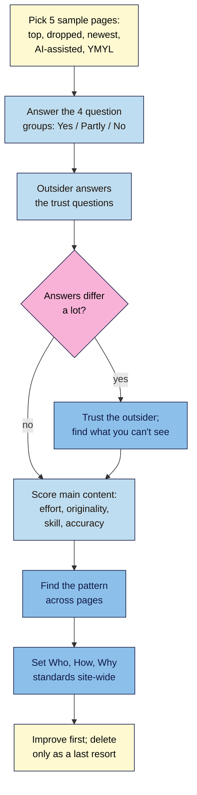

# M14.L02 — People-First Content: A Self-Assessment
> After this lesson you can run Google's full people-first self-assessment across a sample of your site's pages, with an outsider's view, document Who, How and Why for the whole site, and turn down the quality myths that waste time or break trust.

**Time:** ~14 min reading + ~40 min hands-on + ~10 min exercise · **Level:** L3 Advanced · **Prereqs:** M14.L01, M07.L04 · **Remediate to:** M14.L01
**Verified against:** Google Search Central *Creating helpful, reliable, people-first content* (last updated 2026-10-05), *Google Search's guidance on using generative AI content* (2026-10-01), *Google Search's core updates and your website* (2025-12-10), and the *Search Quality Rater Guidelines* PDF (September 11, 2025; §4.6.5–4.6.6), all checked on 2026-11-10.

> ⚠️ **Freshness flag:** the helpful content page gained its **"Main content"** section (effort, originality, talent or skill, accuracy) in **October 2026**. Older guides list only the question groups. Google edits this page every few months, so recount the questions before you copy them into a template.

## Learning objectives
1. **Apply** Google's people-first questions to a sample of your own pages, with an unaffiliated reviewer. *(O1)*
2. **Document** Who, How and Why for the whole site: bylines, how content is made, and AI use and disclosure. *(O2)*
3. **Reject** quality myths: word counts, changing dates, "freshness" churn and fake author profiles. *(O3)*

## Why it matters
Nila Coffee's blog has 40 posts. A content agency offers a "quality package": rewrite every post to 2,000 words, change every date to this month so the posts look fresh, and add an author called "Chef Arjun, coffee scientist" with a stock photo. It sounds like work that pleases Google. Google's own page says each of those three things is a warning sign or a deception.

In Module 4 you checked **one page** with eight of Google's questions. Here you check the **site**: a sample of pages across all four question groups, an outsider's honest view, and site-wide answers to Who, How and Why. This is the self-assessment Google points to when a site loses traffic, and Lesson 14.6 builds on it.

## Core concept
**Plain version:** Google publishes about 30 questions to help you judge whether your content is made for people or for search engines. Answer them for a handful of representative pages. Ask someone who doesn't work for you to answer some of them too. Then check what Google says raters look for in the main content: **effort, originality, talent or skill, accuracy**. Finally, make Who, How and Why obvious across the site, not just on one post.

**Analogy:** a restaurant inspection versus tasting one dish. Module 4 tasted one dish. This lesson walks through the kitchen: who cooks, how the food is made, and why each dish is on the menu.

**Precise definitions:**
- **People-first content:** in Google's words, "content that's created primarily for people, and not to manipulate search engine rankings."
- **Search engine-first content:** content "made primarily to gain search engine rankings". Google lists 11 warning-sign questions for it.
- **Main content (MC):** "any part of the web page that directly helps the page achieve its purpose": text and media, tools, user contributions, tabbed sections, titles and headings.
- **Unaffiliated reviewer:** someone you trust who doesn't work for, or earn from, your site.

### The four question groups
Google's page (2026-10-05) has four groups. Answering "yes" is good in the first three. In the fourth, "yes" is a warning.

| Group | How many | A question that catches small sites out |
|---|---|---|
| **Content and quality** | 12 | "Does the content provide substantial value when compared to other pages in search results?" |
| **Expertise** | 4 | "If someone researched the site producing the content, would they come away with an impression that it is well-trusted or widely-recognized as an authority on its topic?" |
| **Focus on people-first content** | 5 | "Does your site have a primary purpose or focus?" |
| **Avoid search engine-first content** | 11 | "Are you writing about things simply because they seem trending and not because you'd write about them otherwise for your existing audience?" |

Google says to go beyond your own answers: "consider having others you trust but who are unaffiliated with your site provide an honest assessment." And if traffic fell: "consider an audit of the drops you may have experienced. What pages were most impacted and for what types of searches?"

### What raters look for in the main content
The October 2026 section lists four attributes raters are trained to judge:

| Attribute | Google's description | High (Nila Coffee) | Low |
|---|---|---|---|
| **Effort** | "The extent to which human work went into creating the content" | A brew-ratio table from 20 test brews, with photos | "using generative AI to produce large amounts of text without manual oversight or curation" |
| **Originality** | Information or perspectives "that aren't already available on other websites" | Tasting notes for her own single-estate beans | A rewrite of the top three results |
| **Talent or skill** | The skill needed "to provide a satisfying experience" | Clear steps, a working grind-size chart | Hard to follow, broken calculator |
| **Accuracy** | Factual; for YMYL, "highly accurate and consistent with established expert consensus" | Caffeine figures from a cited source | Made-up health claims |

Two details matter. First, "Attribution or giving credit to other sources doesn't replace the need for original effort." Crediting the site you copied doesn't make the page yours. Second, "not all content requires specialized expertise". Google's example is someone sharing a new way to clear snow from a driveway.

The rater guidelines are blunt about the bottom of the scale. Pages "created at scale with no original content or added value for users, should be rated Lowest, no matter how they are created" (§4.6.5). The same goes when almost all of the main content "is copied, paraphrased, embedded, auto or AI generated, or reposted from other sources with little to no effort, little to no originality, and little to no added value" (§4.6.6). Licensed or syndicated content isn't counted as copied.

### Who, How and Why, site-wide
Module 4 answered these for one page. For a site, each answer becomes a **standard** that every relevant page follows.

| Question | Google's wording | Site-wide standard (Nila Coffee) |
|---|---|---|
| **Who** | "Do bylines lead to further information about the author or authors involved"? | Every guide has a byline linking to a real author page: name, role, what they roast, a real photo |
| **How** | For reviews, readers trust you more when they know "the number of products that were tested, what the test results were, and how the tests were conducted" | A "How we test brew methods" page, linked from every guide |
| **How (AI)** | "Is the use of automation, including AI-generation, self-evident to visitors through disclosures or in other ways?" | An editorial policy: "We use AI to outline and check grammar. Every guide is written, tested and fact-checked by our team." Add a note on a page when a reader would reasonably wonder how it was made (Module 7) |
| **Why** | ""Why" is perhaps the most important question to answer about your content." | A short About page saying the blog exists to help customers brew the beans they buy |

The line not to cross: "Fabricating creator profiles (such as by using AI-generated headshots, made-up names, or false credentials to make content appear as if it was written by human experts) is a form of deception." And: "Any form of deception makes a page untrustworthy to both users and our automated quality systems".

### Myths to reject
| Advice you'll hear | Google's answer |
|---|---|
| "Every post should be 2,000 words" | "Are you writing to a particular word count because you've heard or read that Google has a preferred word count? (No, we don't.)" |
| "Update the date on old posts so they look fresh" | A warning sign: "Are you changing the date of pages to make them seem fresh when the content has not substantially changed?" |
| "Publish or delete lots of posts to look fresh" | "(No, it won't)", in Google's own words |
| "Add an expert author, even a made-up one" | Fabricated profiles are "a form of deception" |
| "Delete every weak post" | The core updates page: "Deleting content is a last resort, and only to be considered if you think the content can't be salvaged." Improve first (Module 7) |
| "Write about trending topics for traffic" | A warning sign, if you wouldn't write about them "otherwise for your existing audience" |
| "SEO itself is search engine-first" | "SEO can be a helpful activity when it is applied to people-first content" |

Changing a date is fine when the content **has** substantially changed: you re-tested the ratios or rewrote the steps. Then say what changed *(course rule of thumb)*.

## How it works

**In words:** pick five pages that represent the site: your top page, one that lost traffic, your newest, one made with AI help, and one on a YMYL topic. Answer the four question groups for each. Ask an outsider to answer the trust questions; where their view differs a lot from yours, believe theirs and work out what you can't see. Score each page's main content on effort, originality, skill and accuracy. Look for the pattern across pages, set Who, How and Why standards for the whole site, and improve weak pages before you think about deleting any.

> **Under the hood: why a sample, not every page.** Google's ranking systems "work on the page level" but also use "site-wide signals and classifiers" (ranking systems guide, Lesson 14.3). A pattern, such as "all our guides are unsigned rewrites", matters more than one weak page. Five well-chosen pages usually show the pattern. A full content inventory comes in the Module 15 audit *(course explanation)*.

## Hands-on walkthrough
You'll build a **Self-assessment** tab and a **Who/How/Why** tab in your project workbook.

**Before you start: which steps apply to you?**
- **Path A (your own site):** use five real pages. If none lost traffic, use your oldest post instead.
- **Path B (practice site):** use your practice posts. Use the M07 AI-assisted draft as the AI page. If you have no YMYL page, skip that row.
- **Path C (client site):** agree with the client who the unaffiliated reviewer will be. Don't use one of their staff.

**Part A — Sample and set up (8 min)**
1. Pick your five pages. For the "dropped" page, use Search Console → **Performance** → compare the last 3 months with the previous 3, sort by **Clicks difference**, and take the biggest loser.
   **Expected:** five URLs with a reason for each ("top page", "lost 40% of clicks", and so on).
2. In a **Self-assessment** tab, paste all 32 questions from Google's page in column A, grouped under the four headings. Add one column per page, plus **Outsider** and **Notes**. In the fourth group, mark that "Yes" is the bad answer.
   > 🖼️ **Image prompt:** A spreadsheet tab named "Self-assessment" (1280×800) with Google's questions in column A under four group headings, five page columns with Yes / Partly / No answers, an Outsider column and a Notes column. Highlight the "Avoid search engine-first content" group heading with a 3px #F9B2D7 outline; blur any personal details.
   > **Alt text:** A Self-assessment spreadsheet with Google's people-first questions in four groups, answered for five pages plus an outsider column.

**Part B — Answer, then ask an outsider (15 min)**
1. Answer each question for each page with **Yes**, **Partly** or **No**. Be honest: nobody else sees this tab unless you share it.
2. Send your outsider two pages and these questions only: bookmark or share it? would you trust it, and why? did you leave with what you needed? does anything look sloppy or wrong? Put their answers in the **Outsider** column.
   **Expected:** the outsider is harsher on trust and polish than you are. That gap is the point.

**Part C — Main content score (7 min)**
1. Under the questions, add four rows: **Effort · Originality · Talent or skill · Accuracy**. Score each page **High / Medium / Low**, with one line of evidence ("20 test brews with photos", "rewrite of the top three results").
2. Write one sentence on the **pattern**: what's true of most weak pages?
   **Expected:** something like "our oldest guides have no byline, no photos and no original data".

**Part D — Who, How and Why standards (10 min)**
1. In a **Who/How/Why** tab, write one row each for **Who**, **How**, **How (AI)** and **Why**, with columns **Standard · Where it lives (URL) · Pages that meet it now · Fix**.
2. Write your **AI use statement** in two or three sentences: what AI is used for, what humans always do, and when a page gets its own note.
   **Expected:** a statement that would be true if a reader checked it. If a "fact-checked by our team" claim isn't true yet, don't publish it until it is.
   > 🖼️ **Image prompt:** A blog post footer (1280×600) on a coffee site showing an author box with a real-looking photo, name and role, a link "How we test brew methods", and a one-line note "AI helped outline this guide; our team wrote, tested and fact-checked it." Highlight the AI note with a 3px #F9B2D7 outline; blur any personal details.
   > **Alt text:** A blog post footer with an author box, a link to the testing method page and a one-line AI-use note, the AI note highlighted.

**Expected output:** a **Self-assessment** tab (5 pages × 32 questions, outsider column, main content scores and a pattern sentence) and a **Who/How/Why** tab with four standards and an AI use statement.

## When to use / when not to
**Do this** once a year for the whole site, when traffic drops after a core update (Lesson 14.6), before you scale up content (or AI-assisted content), and when you take over a site.

**Don't** turn the questions into a points score and chase 100%, change dates without changing content, rewrite every page to a word count, delete posts in bulk because they're "old", or invent authors.

**The trade-off:** an honest outsider review costs a favour or a fee and can sting. Skipping it is cheaper but leaves your blind spots in place, and blind spots are usually where the problems are *(course rule of thumb)*.

## Use AI for this
**Example prompt:**
> "Here are Google's 11 'Avoid creating search engine-first content' questions and the text of my page: [paste both]. For each question, say Yes, Partly or No, and quote the sentence on my page that made you decide. Don't rewrite the page."

**What AI does well here:** a fast first pass, finding padding, unsupported claims, missing sources and headings that over-promise.
**Where it gets it wrong:** it can't judge first-hand experience (it can't know whether you really tested 20 brews), it can't act as an unaffiliated reviewer, and it tends to call everything "mostly good".
**How to check:** compare its answers with yours and the outsider's. Where they disagree, read the quoted sentence yourself.

## Common mistakes
- **Assessing only your best page.** Sample the weak and dropped ones too.
- **Asking a colleague or friend who earns from the site** to be the "unaffiliated" reviewer.
- **Turning the questions into a score** and optimising the score, not the page.
- **Refreshing dates** on posts that haven't substantially changed.
- **Padding to a word count.** Google: "(No, we don't.)"
- **Publishing an AI statement that isn't true** ("every post is fact-checked" when it isn't).
- **Deleting before improving.** Google calls deletion "a last resort".

## Troubleshooting
| Symptom | Likely cause | Fix |
|---|---|---|
| Every answer is "Yes" | Marking your own homework | Get the outsider's view; re-answer the fourth group honestly |
| The outsider and you disagree on trust | You know things the page doesn't show | Put the missing evidence on the page (byline, method, sources) |
| You can't find a "dropped" page | No drop, or under 3 months of data | Use your oldest post instead |
| The question list on Google's page has changed | Page updated since 2026-10-05 | Copy the current list; note the "Last updated" date in the tab |
| A page has nothing original to add | It repeats what others say | Add first-hand work, merge it into a stronger page, or (last resort) remove it |

## Exercise
**Task:** finish both tabs (Parts A–D). Then answer these. All details are illustrative.
1. Nila's agency proposes changing every post's date to this month. What does Google's page say?
2. Kavya's posts are 600 words. A blogger says Google prefers 1,500+. What do you tell her?
3. Tomás wants an author called "R. Mehta, master electrician" with an AI headshot, because nobody on staff is an electrician. What's the problem, and what's the honest option?
4. Amara credits every source at the bottom of a post that is a paraphrase of three other articles. Is that enough?
5. Nila re-tested her cold brew ratios and rewrote half the guide. May she change the date?
6. Which page should be in your sample if traffic fell after a core update, and why?

**Expected outcome:** two tabs, and these answers:
- **1** It's a warning sign when the content "has not substantially changed". Change dates only with real updates.
- **2** Google has no preferred word count ("No, we don't."). Write until the reader's question is answered.
- **3** A fabricated creator profile is "a form of deception". Honest option: hire a real electrician to review the guide and name them, or narrow the post to what staff can safely explain and link to an electrician's guidance.
- **4** No: "Attribution or giving credit to other sources doesn't replace the need for original effort."
- **5** Yes, because the content substantially changed. Say what changed ("Ratios re-tested November 2026").
- **6** The pages that lost the most, because Google suggests auditing "What pages were most impacted and for what types of searches?"

**Stretch goal:** ask a second outsider from your target audience (a customer, a student) to answer the same questions, and compare the two outsiders.

## Key takeaways
- Assess a **sample** of pages across all four question groups, and add an outsider's honest view.
- Raters judge main content on effort, originality, talent or skill, and accuracy. Credit doesn't replace effort.
- Set Who, How and Why as **site-wide standards**, including a true AI use statement.
- Word counts, date changes and "freshness" churn don't help, and fake authors are deception.
- Improve weak pages first; deleting is a last resort.

## Teach it back
Explain to a client in 3 sentences why changing the dates on old posts and padding them to 2,000 words won't help, and what to do instead.

## Glossary terms added
- Search engine-first content — added to `seo-101/glossary.md`
- Unaffiliated reviewer — added to `seo-101/glossary.md`
- AI use statement — added to `seo-101/glossary.md`

## Further reading
*All checked 2026-11-10.*
- Google Search Central — Creating helpful, reliable, people-first content: https://developers.google.com/search/docs/fundamentals/creating-helpful-content
- Google Search Central — Google Search's guidance on using generative AI content: https://developers.google.com/search/docs/fundamentals/using-gen-ai-content
- Google Search Central — Google Search's core updates and your website: https://developers.google.com/search/docs/appearance/core-updates
- Google — Search Quality Rater Guidelines (PDF, September 11, 2025), §4.6.5–4.6.6: https://static.googleusercontent.com/media/guidelines.raterhub.com/en//searchqualityevaluatorguidelines.pdf
- Google Search Central — Write high quality reviews: https://developers.google.com/search/docs/specialty/ecommerce/write-high-quality-reviews

> ⚠️ **May change:** the question list and the "Main content" section of the helpful content page (last updated 2026-10-05).

## Refresher card
*Used by remediation when a learner fails a quiz twice on a later lesson that points back here.*
**Four question groups** (2026-10-05): content and quality (12), expertise (4), people-first (5), avoid search engine-first (11; "yes" = warning). Sample 5 pages (top, dropped, newest, AI-assisted, YMYL) and add an **unaffiliated reviewer**. **Main content attributes:** effort, originality, talent or skill, accuracy; "Attribution … doesn't replace the need for original effort." **Who/How/Why site-wide:** bylines to author pages, a "how we test" page, a true AI use statement, an About page with the why. **Myths:** no preferred word count; don't change dates without substantial change; freshness churn "won't" help; fabricated profiles are "deception"; deleting is "a last resort".
