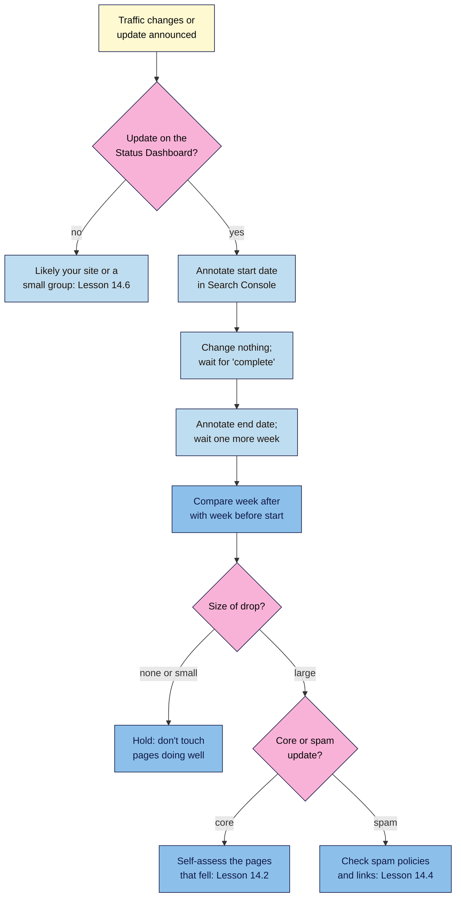

# M14.L03 — How Google Ranks and Updates: Systems, Core Updates and Spam Updates
> After this lesson you can name Google's ranking systems (and the retired ones people still blame), explain what core and spam updates are, and track every update in a dated log with Search Console annotations, so you know what to do, and not do, when one rolls out.

**Time:** ~14 min reading + ~30 min hands-on + ~10 min exercise · **Level:** L3 Advanced · **Prereqs:** M14.L02, M08.L01 · **Remediate to:** M01.L07
**Verified against:** Google Search Central *A guide to Google Search ranking systems*, *Google Search's core updates and your website*, *Google Search spam updates and your site* and *Using the Google Search Status Dashboard* (all "last updated 2025-12-10"), plus the Status Dashboard's ranking history and `incidents.json`, all checked on 2026-11-10.

> ⚠️ **Freshness flag:** the update table in this lesson ends with the **September 2026 spam update** (24 Sep – 8 Oct 2026), the latest listed on 2026-11-10. Google announces several updates a year; check the Dashboard for newer ones. Since **9 December 2025**, Google's core updates page also mentions **smaller core updates that aren't announced**. Many Search Central pages show "Last updated 2025-12-10" after a site-wide re-dating, so that date alone doesn't mean the guidance changed then.

## Learning objectives
1. **Describe** Google's named ranking systems, including retired ones. *(O1)*
2. **Explain** core and spam updates, and what to do (and not do) during one. *(O2)*
3. **Track** updates with the Status Dashboard and Search Console annotations. *(O3)*

## Why it matters
On 25 May 2026, Nila's clicks were down 18% on the week. A forum post said "the helpful content update is killing small blogs", and a freelancer offered to "fix it" by rewriting all 40 posts. But the May 2026 core update had started on 21 May and didn't finish until 2 June, and the "helpful content update" hasn't existed as a separate system since March 2024. Rewriting everything mid-rollout would have changed dozens of pages that were still doing well, and made it impossible to tell what worked.

This lesson gives you the map: which systems exist, what an update is, where Google announces them, and the waiting and comparing rules Google itself recommends. Lesson 14.6 turns this into a full traffic-drop playbook.

## Core concept
**Plain version:** Google ranks pages with many **ranking systems** working together, and changes them constantly. Most changes are small and unannounced. A few times a year Google makes a big, announced change: a **core update** (a broad change to how quality is assessed) or a **spam update** (an improvement to spam detection). Google announces both on the **Search Status Dashboard**, with start and end dates. Your job is to know when they happen, wait until they finish, compare fairly, and act only on real, large, explained drops.

**Analogy:** Google's own, from the core updates page. A friend asks for your 20 favourite restaurants, from a list you wrote in 2019. Since then, new places have opened and you've had more meals, so you update the list. "The list will change, and restaurants that move down aren't necessarily "bad"; there are just other restaurants that make your top 20." A core update re-ranks everyone; it doesn't target you.

**Precise definitions:**
- **Ranking system:** one of Google's automated systems that helps order results, such as RankBrain, the reviews system or spam detection.
- **Core update:** "Several times a year, Google makes significant, broad changes to our search algorithms and systems. We refer to these as core updates". They "don't target specific sites or individual web pages."
- **Spam update:** "While Google's automated systems to detect search spam are constantly operating, we occasionally make notable improvements to how they work. When we do, we refer to this as a spam update".
- **SpamBrain:** "our AI-based spam-prevention system."
- **Google Search Status Dashboard:** Google's public page listing ranking updates and crawling, indexing and serving incidents, with dates.

### Page level and site level
"Our ranking systems are designed to work on the page level". But "Site-wide signals and classifiers are also used". And neither decides everything: "Having some good site-wide signals does not mean that all content from a site will always rank highly, just as having some poor site-wide signals does not mean all the content from a site will rank poorly." That's why Lesson 14.2 looked for patterns across pages.

### The ranking systems Google names
The guide lists 17 current systems. You don't need all of them, but these come up in SEO conversations:

| System | What Google says it does | Why you care |
|---|---|---|
| **Deduplication** | Avoids showing near-identical results | Duplicate pages compete with each other (Module 6) |
| **Exact match domain** | Ensures "we don't give too much credit for content hosted under domains designed to exactly match particular queries" | `best-coffee-beans-india.com` isn't a shortcut |
| **Freshness** | "query deserves freshness" systems show fresher content where expected | News and new products, not your evergreen brew guide |
| **Link analysis and PageRank** | Understands how pages link to each other | Module 9 |
| **Passage ranking** | Finds relevant sections within a page | Clear headings help (Module 4) |
| **RankBrain, BERT, neural matching** | Understand language and meaning | Write naturally; synonyms are understood (Module 4) |
| **Reliable information** | Surfaces authoritative pages, demotes low-quality ones | YMYL topics (Lesson 14.1) |
| **Reviews** | Rewards "insightful analysis and original research" in reviews | Tomás's drill reviews |
| **Site diversity** | "we generally won't show more than two web page listings from the same site in our top results" | Two pages on one topic rarely both show (Module 3) |
| **Spam detection** | "a range of spam detection systems, including SpamBrain" | Lesson 14.4 |

Two notes. **MUM** is listed but "not currently used for general ranking". **Page experience** is no longer listed as a named system: Google's helpful content page says the core ranking systems "look to reward content that provides a good page experience". Teach it as something the core systems reward, not as a separate system.

### Retired systems (still blamed online)
"They've either been incorporated into successor systems or made part of our core ranking systems."

| Retired system | What happened |
|---|---|
| **Panda** (2011) | Quality; part of core ranking "in 2015" |
| **Penguin** (2012) | Link spam; "integrated into our core ranking systems in 2016" |
| **Hummingbird** (2013) | A major improvement to overall ranking |
| **Helpful content system** (2022) | "In March 2024, it evolved and became part of our core ranking systems" |

So an article in 2026 that blames "the helpful content update" is out of date. The Dashboard's last helpful content update was in September 2023.

### Core updates: what Google says to do
1. **Most sites needn't worry.** "In general, most sites don't need to worry about core updates and may not even realize one has happened."
2. **Wait for it to finish.** "Confirm that the core update has finished rolling out." Then "We recommend waiting at least a full week after a core update completes before analyzing your site in Search Console." Compare a week after with "a week before the core update started rolling out".
3. **Size the drop.** Small (Google's example: position 2 to 4): "There's no need to take drastic action (in fact, we recommend avoiding making changes to content that's already performing well)". Large (position 4 to 29): do a deeper assessment, using Lesson 14.2's self-assessment on the pages that fell.
4. **No quick fixes.** "Avoid doing "quick fix" changes (like removing some page element because you heard it was bad for SEO)." Deleting content is "a last resort".
5. **Be patient.** Improvements can take effect in days, but "it could take several months for our systems to learn and confirm that the site as a whole is now producing helpful, reliable, people-first content in the long term." Since December 2025, Google also says "you don't necessarily have to wait for a major core update", because of smaller core updates that "are not announced because they aren't widely noticeable".
6. **No guarantees.** "there's no guarantee that changes you make to your website will result in noticeable impact in search results".

### Spam updates: what's different
A spam update improves detection. If you follow the spam policies (Lesson 14.4), there's nothing to fix. If you don't, fixing the problem "may help a site improve if our automated systems learn over a period of months that the site complies with our spam policies." For link spam, it's harsher: once the effect of spammy links is removed, "Any potential ranking benefits generated by those links cannot be regained." (Module 9). Unlike a manual action, an algorithmic spam demotion sends no message (Module 1).

### Recent ranking updates (from the Status Dashboard)
| Update | Started | Finished |
|---|---|---|
| September 2026 spam update | 24 Sep 2026 | 8 Oct 2026 |
| August 2026 spam update | 18 Aug 2026 | 21 Aug 2026 |
| June 2026 spam update | 24 Jun 2026 | 26 Jun 2026 |
| May 2026 core update | 21 May 2026 | 2 Jun 2026 |
| March 2026 core update | 27 Mar 2026 | 8 Apr 2026 |
| March 2026 spam update | 24 Mar 2026 | 25 Mar 2026 |
| December 2025 core update | 11 Dec 2025 | 29 Dec 2025 |
| August 2025 spam update | 26 Aug 2025 | about 26.5 days later |
| June 2025 core update | 30 Jun 2025 | about 17 days later |
| March 2025 core update | 13 Mar 2025 | about 14 days later |

The Dashboard keeps updates "for 5 years". It also lists other changes (the February 2026 **Discover** update, for US English users) and incidents (crawling, indexing, serving problems). Not every line affects web search rankings.

## How it works

**In words:** when traffic changes, first check whether the Dashboard lists an update for those dates. If not, the cause is probably your own site or something affecting only a few sites (Lesson 14.6). If an update is running, annotate the start date and change nothing until it's complete. Annotate the end date, wait one more week, then compare that week with the week before the start. If the drop is small or there isn't one, leave well-performing pages alone. If it's large, self-assess the pages that fell after a core update, or check the spam policies and your links after a spam update.

> **Under the hood: why Google says to wait.** A rollout takes days or weeks (the May 2026 core update took about 12 days), and rankings often swing up and down while it runs *(observed practice)*. Measuring halfway through mixes old and new rankings. Waiting until it's complete, plus a week, gives you a clean "after" week to compare with a clean "before" week. Comparing the same weekdays also removes the weekday pattern you saw in Module 8 *(course explanation)*.

## Hands-on walkthrough
You'll build an **Updates** tab, subscribe to the Dashboard, annotate Search Console and check one past update against your own data.

**Before you start: which steps apply to you?**
- **Path A (your own site):** do all parts; Part D uses your real data.
- **Path B (practice site):** you may have too little data for Part D. Use the illustrative Nila figures in the exercise instead.
- **Path C (client site):** you need at least **Full** permission to add annotations. Ask the owner if you only have Restricted access.

**Part A — The Status Dashboard (8 min)**
1. Open the Google Search Status Dashboard (link in Further reading) and go to **Ranking** history.
   **Expected:** a list of updates with start dates and "rollout was complete" notes. The newest at the top was the September 2026 spam update when this lesson was checked.
   > 🖼️ **Image prompt:** The Google Search Status Dashboard's Ranking history page (1280×800), showing a list of 2026 core and spam updates with their dates. Highlight the "May 2026 core update" row with a 3px #F9B2D7 outline; blur any personal details.
   > **Alt text:** The Search Status Dashboard ranking history listing 2026 updates, with the May 2026 core update highlighted.
2. Subscribe to the Dashboard's **RSS feed** (the subscribe link on the page) in a free feed reader, or bookmark the page and check it weekly.

**Part B — The Updates tab (10 min)**
1. In an **Updates** tab in your Changes log (Module 8), add the columns **Update · Type (core / spam / other) · Start · Complete · Link · My site: before week · after week · change · Notes**.
2. Copy in every **core** and **spam** update from January 2025 to today.
   **Expected:** about 12–15 rows. If you see a "helpful content" or "reviews" update dated 2024 or later, check again: the last ones were in 2023.

**Part C — Annotate Search Console (5 min)**
1. In Search Console → **Performance**, add an annotation for the start and the end of the last two core updates (Module 8 showed how). Keep the text short: "May 2026 core update start".
   **Expected:** markers on the chart at each date. They don't show in comparison mode or 24-hour views (Module 8).

**Part D — Check one past update (7 min)**
1. Pick the most recent core update that finished at least a week ago. Set Performance to a **custom range**: the 7 days before its start date. Note clicks and average position. Then the 7 days starting a week after it finished. Note the same.
2. Fill in the before, after and change columns. Repeat for your top five pages (Pages tab).
   **Expected:** for most small sites, small moves either way, which means: hold. Write "small, no action" or "large, self-assess" for each.
   > 🖼️ **Image prompt:** A spreadsheet tab named "Updates" (1280×700) with rows for 2025–2026 core and spam updates, columns Update, Type, Start, Complete, Before week, After week, Change, Notes, and one row filled in with "-6% clicks, small, no action". Highlight that Notes cell with a 3px #F9B2D7 outline; blur any personal details.
   > **Alt text:** An Updates spreadsheet of Google core and spam updates with one before-and-after check noted as small, no action.

**Expected output:** an **Updates** tab with 2025–2026 core and spam updates, annotations in Search Console, an RSS subscription or a weekly check, and one before-and-after comparison with a decision.

## When to use / when not to
**Do this** whenever an update is announced (annotate, wait), when traffic moves sharply, and every month when you write the report (Module 8).

**Don't** change pages mid-rollout, blame retired systems, measure halfway through an update, or "fix" pages that only dropped a position or two.

**The trade-off:** waiting feels passive when traffic is down, and some losses are real. But changes made during a rollout can't be separated from the update's own swings. Google itself recommends avoiding changes "to content that's already performing well". Use the waiting time to prepare the self-assessment, not to publish changes *(course rule of thumb)*.

## Use AI for this
**Example prompt:**
> "Here are my weekly Search Console clicks and average position for 12 weeks, and the start and end dates of the May 2026 core update from Google's Status Dashboard: [paste]. Compare the week before the start with the week starting 7 days after it finished. Is the change small or large? Don't guess causes."

**What AI does well here:** date arithmetic, before-and-after comparisons, finding which pages moved most.
**Where it gets it wrong:** it often invents update names and dates, or talks about the "helpful content update" as if it were current, and it can't see the Dashboard.
**How to check:** every update name and date against the Status Dashboard; every number against Search Console.

## Common mistakes
- **Changing pages mid-rollout.** Wait for "complete", then a week.
- **Comparing the wrong weeks** (mid-rollout, or a holiday week against a normal one).
- **Blaming retired systems** (Panda, Penguin, helpful content).
- **Rewriting pages that dropped one or two positions.**
- **Assuming every drop is an update.** If the Dashboard is quiet, look at your own site first.
- **Forgetting smaller, unannounced core updates** when looking for a cause. Not every movement has a named update.
- **Not annotating**, so six months later nobody knows what happened when.

## Troubleshooting
| Symptom | Likely cause | Fix |
|---|---|---|
| Traffic fell, no update on the Dashboard | Site problem, seasonality or tracking | Use Lesson 14.6's decision tree |
| Rankings swing daily during an update | Normal during a rollout | Wait for "complete" plus a week |
| An article blames the "helpful content update" in 2026 | Out of date | It's been part of core ranking since March 2024 |
| Annotations don't appear on the chart | Comparison mode or 24-hour view | Switch to a normal date range |
| Clicks fell but positions didn't | Seasonality, SERP features or demand | Check year on year and Trends (Lesson 14.6) |
| No change after improving pages | Takes months; no guarantee | Keep the annotation and check again after the next core update |

## Exercise
**Task:** finish your **Updates** tab (Parts A–D). Then answer these. All details are illustrative.
1. The May 2026 core update ran from 21 May to 2 June. Which two weeks does Nila compare, at the earliest?
2. Nila's brew guide went from position 3 to 4. Her "best beans" listicle went from 4 to 27. What does she do with each?
3. A client says Penguin hit their site last month. What do you check?
4. Kavya's traffic fell in July 2026. The Dashboard shows nothing between 26 June and 18 August. Where does she look next?
5. Tomás bought links in 2024. After a spam update, his rankings fell and he removed the links. Will the old ranking come back?
6. Amara's client wants to rewrite all 60 product pages on day 3 of a core update. What does she advise?

**Expected outcome:** a tab, annotations and a comparison, and these answers:
- **1** 14–20 May (the week before the start) and 9–15 June (the week starting a week after it finished).
- **2** Brew guide: small drop, no action. Listicle: large drop, so a deeper assessment with the self-assessment from Lesson 14.2.
- **3** Penguin has been part of core ranking since 2016. Check the Dashboard for real updates in those dates, the Manual actions report, and the site itself.
- **4** Her own site, seasonality and tracking: Lesson 14.6.
- **5** Not the part that came from the links: "Any potential ranking benefits generated by those links cannot be regained."
- **6** Change nothing until the update is complete, wait a week, compare, and then work only on pages with large drops.

**Stretch goal:** download `incidents.json` from the Dashboard and filter it in a spreadsheet to ranking updates only, to fill your Updates tab automatically.

## Key takeaways
- Google ranks with many systems at the page level, helped by site-wide signals. Panda, Penguin, Hummingbird and the helpful content system are now part of core ranking.
- Core updates re-rank everyone broadly; spam updates improve spam detection. Both are announced on the Status Dashboard.
- Wait until an update is complete, plus a week, then compare the week before the start with a week after.
- Small drop: hold. Large drop: self-assess (core) or check the policies (spam). No quick fixes.
- Log and annotate every update, so drops can be explained later.

## Teach it back
Explain to a nervous client in 3 sentences what a core update is and why you won't change anything until it finishes.

## Glossary terms added
- Google Search Status Dashboard — added to `seo-101/glossary.md`
- Rollout (of an update) — added to `seo-101/glossary.md`
- Retired ranking systems — added to `seo-101/glossary.md`
- (Core update, Spam update and SpamBrain were already in the glossary from Module 1.)

## Further reading
*All checked 2026-11-10.*
- Google Search Central — A guide to Google Search ranking systems: https://developers.google.com/search/docs/appearance/ranking-systems-guide
- Google Search Central — Google Search's core updates and your website: https://developers.google.com/search/docs/appearance/core-updates
- Google Search Central — Google Search spam updates and your site: https://developers.google.com/search/docs/appearance/spam-updates
- Google Search Central — Using the Google Search Status Dashboard: https://developers.google.com/search/help/status-dashboard
- Google Search Status Dashboard — Ranking history: https://status.search.google.com/products/rGHU1u87FJnkP6W2GwMi/history
- Google Search Status Dashboard — JSON history: https://status.search.google.com/incidents.json
- Google Search Central blog — What web creators should know about our March 2024 core update and new spam policies (5 Mar 2024): https://developers.google.com/search/blog/2024/03/core-update-spam-policies

> ⚠️ **May change:** the update list (new updates every few months) and the list of named ranking systems.

## Refresher card
*Used by remediation when a learner fails a quiz twice on a later lesson that points back here.*
**Ranking systems** work page by page, plus site-wide signals. Named: deduplication, exact match domain, freshness, links/PageRank, passages, RankBrain/BERT/neural matching, reliable information, reviews, site diversity (max ~2 per site), spam detection (SpamBrain). **Retired into core:** Panda 2015, Penguin 2016, Hummingbird, helpful content (March 2024). **Core update:** broad re-ranking, not targeted. **Spam update:** better spam detection. **Rules:** check the Status Dashboard; annotate start and end; change nothing mid-rollout; wait "at least a full week" after completion; compare a week after with the week before; small drop = hold, large = assess; no quick fixes; deleting is a last resort; smaller core updates aren't announced. **Latest (2026-11-10):** May 2026 core (21 May–2 Jun), September 2026 spam (24 Sep–8 Oct).
