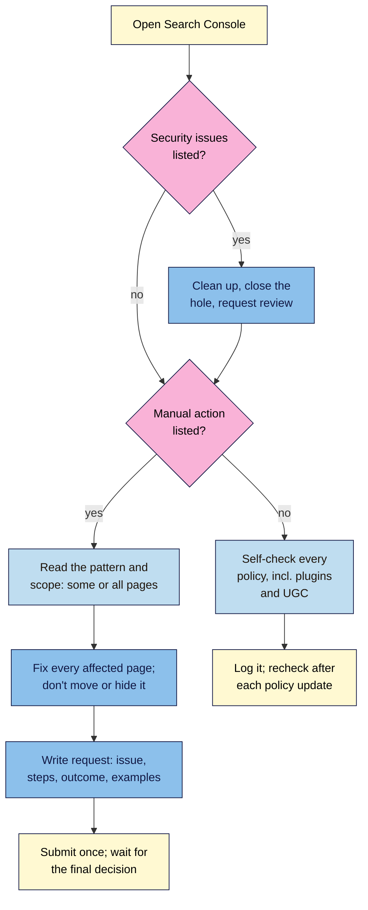

# M14.L04 — Spam Policies in Depth, Manual Actions and Reconsideration
> After this lesson you can name every Google spam policy, including those added since 2024, judge a risky SEO proposal against them, check your site's Manual actions and Security issues status, and write a reconsideration request for a non-link manual action.

**Time:** ~18 min reading + ~45 min hands-on + ~10 min exercise · **Level:** L3 Advanced · **Prereqs:** M14.L03, M09.L05, M01.L06 · **Remediate to:** M01.L06
**Verified against:** Google Search Central *Spam policies for Google web search* (last updated 2026-08-28), *Report spam, phishing, or malware* (2026-04-23), the Search Central blog posts of 5 March 2024, 13 April 2026 and 28 August 2026, and Search Console Help's *Manual actions report* and *Security issues report* (no date shown), all checked on 2026-11-10.

> ⚠️ **Freshness flag:** the spam policies change several times a year. Since 2024: **expired domain abuse** and **scaled content abuse** (March 2024); **site reputation abuse**, renamed **site reputation policy**, with new criteria and different enforcement in the **EEA from 30 August 2026**; **back button hijacking** (added 13 April 2026, enforced from **15 June 2026**); spam now explicitly includes manipulating **generative AI responses** (May 2026); and spam reports **may lead to manual actions** (April 2026). Check the policy page's "Last updated" date before you rely on this list.

## Learning objectives
1. **Identify** each spam policy, including those added since 2024 (scaled content, expired domains, site reputation, back button hijacking). *(O1)*
2. **Judge** risky proposals against the policies. *(O2)*
3. **Write** a reconsideration request for a non-link manual action. *(O3)*

## Why it matters
Tomás gets an email from an SEO agency with a "growth plan": buy an expired domain with 300 links and redirect it, publish 500 AI-written "best tools in [city]" pages, rent out a `/deals/` section to a casino affiliate, and add an exit popup that takes visitors to an offers page when they press Back. Each idea is presented as a clever tactic. Each one matches a named Google spam policy, and the last two were added or changed in 2026.

Module 1 gave you a plain-words map of the spam policies and showed the difference between a manual action and an algorithmic drop. Module 9 covered link spam and link-related manual actions. This lesson covers the rest: every policy, the 2024–2026 changes in detail, the full list of manual actions, the Security issues report, and how to ask Google to review your site after fixing a non-link problem.

## Core concept
**Plain version:** Google's spam policies list the tricks that get pages demoted or removed. They're enforced by automated systems (like SpamBrain) and, "as needed, human review that can result in a manual action". A **manual action** appears in Search Console's Manual actions report. Once you've fixed **every** affected page, you file a **reconsideration request**. Hacks and malware are a different report: **Security issues**.

**Analogy:** a sports league's rulebook. Most fouls are caught by the automatic replay system (algorithms). Some are given by a referee who writes your name in the book (a manual action). You can appeal, but only after you've stopped the foul, and you must explain what you did.

**Precise definitions:**
- **Spam (Google's definition, 2026):** "techniques used to deceive users or manipulate our Search systems into featuring content prominently, such as attempting to manipulate Search systems into ranking content highly or attempting to manipulate generative AI responses in Google Search."
- **Manual action:** a penalty applied after a human reviewer at Google finds a violation. "If a site has a manual action, some or all of that site will not be shown in Google search results."
- **Security issue:** signs that a site "was hacked, or behavior on your site that could potentially harm a visitor or their computer". Shown in the Security issues report, often with a warning in search results or the browser.
- **Reconsideration request:** a request for Google to review your site after you've fixed a manual action or security issue.
- **Policy circumvention:** "Using existing or creating new subdomains, subdirectories, or sites with the intention of continuing to violate our policies".

### Every spam policy, in one table
The page lists 16 policies, plus four "other practices that can lead to demotion or removal". Google adds that it "may act against any type of spam practices we detect", so the list isn't a loophole map.

| Policy | In plain words | Likely way a small site trips it |
|---|---|---|
| **Cloaking** | Showing search engines different content from users | A "SEO plugin" that serves keyword pages only to Googlebot |
| **Doorway abuse** | Many near-identical pages that funnel to one destination | "Plumber tools in [city]" pages that differ only by city name |
| **Expired domain abuse** | Buying an old domain to exploit its reputation with low-value content | Buying a defunct charity's domain for affiliate content |
| **Hacked content** | Content placed on a site through a security hole | An outdated WordPress plugin lets spammers add pages |
| **Hidden text and link abuse** | Text or links meant for search engines, hidden from users | White text, or links hidden in a theme footer |
| **Keyword stuffing** | Filling pages with keywords or numbers to manipulate rankings | Lists of cities or repeated phrases (Module 4) |
| **Link spam** | Manipulating links to and from your site | Bought links without `rel="sponsored"` (Module 9) |
| **Machine-generated traffic** | Automated queries sent to Google | Rank-checking bots that scrape Google results |
| **Malicious practices** | Software or behaviour that harms users, **including back button hijacking** | An ad script that traps the Back button |
| **Misleading functionality** | Pretending to offer a tool or content that doesn't work | A "free coffee calculator" that only shows ads |
| **Scaled content abuse** | Many pages made to manipulate rankings, with little value, "no matter how it's created" | 500 AI-written pages, or 500 cheaply outsourced ones |
| **Scraping** | Copying others' content without adding value | Republishing recipes from other blogs |
| **Site reputation policy** | Third-party content published mainly to exploit the host site's ranking signals | Renting `/deals/` to a casino affiliate |
| **Sneaky redirects** | Sending users somewhere different from what search engines see | Mobile visitors redirected to a spam domain |
| **Thin affiliation** | Affiliate pages with descriptions "copied directly from the original merchant" and nothing added | A coffee-machine affiliate page copying Amazon text |
| **User-generated spam** | Spam added by users: comments, forum posts, profiles | Unmoderated blog comments full of links |

**Other practices that can lead to demotion or removal:** legal removals, personal information removals, **policy circumvention**, and **scam and fraud**.

### The 2024–2026 additions in detail
**Scaled content abuse (March 2024).** "Scaled content abuse is when many pages are generated for the primary purpose of manipulating search rankings and not helping users." It's about the purpose and the value, not the tool: "no matter how it's created". One example on the page is "Using generative AI tools or other similar tools to generate many pages without adding value for users". Module 7 covered the AI angle. The key point here: hiring 20 writers to produce 500 near-identical pages is the same violation.

**Expired domain abuse (March 2024).** "Expired domain abuse is where an expired domain name is purchased and repurposed primarily to manipulate search rankings by hosting content that provides little to no value to users." Google's examples include "Casino-related content on a former elementary school site". Google's announcement was clear on intent: "Expired domain abuse isn't something people accidentally do." But also: "It's fine to use an old domain name for a new, original site that's designed to serve people first." Buying `tomashardware-old.pt` because you like the name is fine; buying a defunct school's domain for its links isn't.

**Site reputation policy (2024, changed 2026).** This is the policy that has changed most, so learn the current version:
- **What it covers:** "The site reputation policy applies where third-party content is published on a host site mainly because of that host's already-established ranking signals, which it has earned primarily from its first-party content."
- **What it doesn't:** "Having third-party content alone isn't inconsistent with the site reputation policy". The page lists wire services and press release sites, user-generated content sites, editorial columns and opinion pieces, and affiliate links or ad units handled properly as examples that aren't violations.
- **The test:** whether the content has "sufficient input, editorial oversight, or contribution from the host site to be considered fully integrated with the main site". Google looks at presentation (design, formatting, typography), quality, stated or implied authorship, and whether the same content appears on many other sites. And "not one of these factors is either necessary or sufficient on its own".
- **History, for context only:** in November 2024 Google took a harder line ("no amount of first-party involvement" made such content acceptable). The August 2026 update moved to the "fully integrated" test. Older articles quoting the 2024 line are out of date.
- **The EEA difference (from 30 August 2026):** "For users inside the EEA, the impact of the manual action won't apply." Instead, the affected section may be separated so that it ranks independently over time, and eligible sites can take disputes to mediation after a reconsideration request. Tomás's shop is in Portugal, so a searcher in Lisbon and a searcher in Mumbai could see different results for the same penalised section.

**Back button hijacking (2026).** "Back button hijacking is when a site interferes with user browser navigation by manipulating the browser history or other functionalities, preventing them from using their back button to immediately get back to the page they came from." Google published it two months before enforcement started on **15 June 2026**, and warned that "some instances of back button hijacking may originate from the site's included libraries or advertising platform". On WordPress, check ad, popup and "exit-intent" plugins: you're responsible for what they do.

**Generative AI responses (May 2026).** Spam now explicitly includes "attempting to manipulate generative AI responses in Google Search". Tricks aimed at AI Overviews or AI Mode are covered by the same policies (Lesson 14.5).

**Spam reports can lead to manual actions (April 2026).** Google's report page now says "Google may use your report to take manual action against violations." It also says the report text may be shared with the site owner if a manual action is issued. (The spam policies page still describes reports mainly as input to automated systems; the newer report page is the current position.)

### Manual actions: the full list
Search Console's Manual actions report can show (as of 2026-11-10): back button hijacking; site abused with third-party spam; user-generated spam; spammy free host; structured data issue; unnatural links to your site; unnatural links from your site; thin content with little or no added value; cloaking and/or sneaky redirects; major spam problems; cloaked images; hidden text and/or keyword stuffing; AMP content mismatch; sneaky mobile redirects; News and Discover policy violations; and site reputation policy.

Two you're most likely to meet after links:
- **Thin content with little or no added value:** "Google has detected low-quality pages or shallow pages on your site." Examples include "Thin affiliate pages", scraped content or low-quality guest posts, and doorways.
- **User-generated spam:** spam submitted by visitors, usually in comments, forums or profiles.

**How to read the report:** each action says whether it affects some pages ("Not all of the pages matching the pattern are necessarily affected") or all pages ("Affects all pages"). Use the examples to find the pattern, then fix **every** page with that pattern.

### Manual actions vs Security issues
| | Manual actions report | Security issues report |
|---|---|---|
| What it means | Attempts to manipulate the index, "not necessarily dangerous for users" | Hacked content, malware and unwanted software, social engineering |
| What users see | Usually nothing: pages rank lower or disappear | Often a warning label in results or a browser warning page |
| Typical small-site cause | Bought links, thin affiliate pages, comment spam | An outdated plugin or theme that was hacked |
| Fix, then | Reconsideration request | Clean up, close the hole, then request a review |

Google says to "rely on the Security Issues report as the source of truth" for security problems.

### Reconsideration: the rules that trip people up
1. **Fix all affected pages first.** "Fixing the issue on just some pages will not earn you a partial return to search results."
2. **Let Google see the fixes.** Affected pages "should not require a login, be behind a paywall, or be blocked by robots.txt or a noindex directive."
3. **Write the three parts** (Module 1): "Explains the exact quality issue on your site." "Describes the steps you've taken to fix the issue." "Documents the outcome of your efforts." For major spam problems, Google also asks you to "Provide examples of bad content that you removed and good content that you added."
4. **Bought the site?** Say so: Google asks you to "let us know in your reconsideration request that you recently acquired the site".
5. **Don't move the problem.** For site reputation, "Moving to a subdomain/subdirectory may be viewed as an attempt to circumvent our spam policy".
6. **Wait, once.** "Most reconsideration reviews can take several days or weeks". Don't resubmit "before you get a final decision on your outstanding request."

## How it works

**In words:** open Search Console and check Security issues first: a hack harms visitors, so clean it up and request a review. Then check Manual actions. If one is listed, read its pattern and whether it affects some pages or all of them, fix every affected page without moving or hiding the problem, write a request that explains the issue, the steps and the outcome with examples, submit it once and wait for the decision. If nothing is listed, run a self-check against every policy, including what plugins and users add, log the result, and repeat it whenever Google updates the policies.

> **Under the hood: why "fix it and move it" fails.** Google's systems try to recognise when a section of a site is independent of the rest and treat it as a separate site. If you move penalised content to a new subdomain or folder and keep the same practice, it's still the same content with the same purpose, which is why Google calls it **policy circumvention** and warns it can make things worse. Fixing means changing the practice, not the address *(course explanation, from Google's site reputation guidance)*.

## Hands-on walkthrough
You'll fill in a **Spam policy self-check** tab, record your Manual actions and Security issues status, and draft a reconsideration request.

**Before you start: which steps apply to you?**
- **Path A (your own site):** do all parts with your real Search Console.
- **Path B (practice site):** your reports will be clean. Do Part C with the fictional case in the exercise.
- **Path C (client site):** agree with the owner who submits any reconsideration request. Draft it for them; they sign off on what it promises.

**Part A — Status check (5 min)**
1. In Search Console, open **Security & Manual Actions → Manual actions**, then **Security issues**.
   **Expected:** a message in both reports that no issues were detected (the exact wording may change). Record the date and status in your Changes log.
   > 🖼️ **Image prompt:** Search Console's Manual actions report (1280×700) showing "No issues detected" with a green tick, and the left menu with "Security & Manual Actions" expanded to show Manual actions and Security issues. Highlight the "No issues detected" message with a 3px #F9B2D7 outline; blur any personal details.
   > **Alt text:** Search Console's Manual actions report showing no issues detected, with the Security and Manual Actions menu expanded.
2. If either report shows an issue, stop here and work through it with the rules above before continuing.

**Part B — Spam policy self-check (25 min)**
1. In a **Spam policy self-check** tab, list all 16 policies plus policy circumvention and scam and fraud. Add the columns **Could anything on my site look like this? (Yes / Maybe / No) · Where · Evidence · Fix · Checked on**.
2. Go through them using what you can see on your site. Pay special attention to:
   - **Plugins and scripts:** ad, popup and redirect plugins (back button hijacking, sneaky redirects, cloaking).
   - **Users:** comments, reviews, forum posts, profiles (user-generated spam).
   - **Third parties:** sponsored posts, guest posts, affiliate pages, "partner" sections (site reputation, thin affiliation, link spam).
   - **Scale:** any group of pages made from a template (doorways, scaled content).
   **Expected:** mostly "No", with one or two "Maybe" rows, often comment spam or an old affiliate page.
   > 🖼️ **Image prompt:** A spreadsheet tab named "Spam policy self-check" (1280×800) listing Google's spam policies in column A, with columns Could this be us?, Where, Evidence, Fix, Checked on, and two rows marked "Maybe" (User-generated spam: old blog comments; Malicious practices: exit-popup plugin). Highlight the two "Maybe" cells with a 3px #F9B2D7 outline; blur any personal details.
   > **Alt text:** A Spam policy self-check spreadsheet with two Maybe rows highlighted: old blog comments and an exit-popup plugin.
3. For each "Maybe", write the fix and do it, or schedule it.

**Part C — Draft a reconsideration request (15 min)**
1. Use your own action if you have one. Otherwise use the fictional case in exercise question 6.
2. Write it in three short parts:
   - **The issue:** the manual action's name, and the pattern you found (with page examples).
   - **The steps:** exactly what you changed, on how many pages, and what you put in place to stop it happening again.
   - **The outcome:** what the pages look like now, with examples of content removed and content added.
   **Expected:** under 300 words, specific, with URLs and numbers, and no excuses or promises you can't keep.

**Expected output:** a dated Manual actions and Security issues status, a completed **Spam policy self-check** tab, and a draft reconsideration request.

## When to use / when not to
**Do this** check every quarter, after any Google spam policy update, before installing ad, popup or redirect plugins, before accepting sponsored or third-party content, and when you take over or buy a site.

**Don't** accept "growth plans" built on expired domains, scaled pages, rented sections or exit scripts; move penalised content to a subdomain; submit a reconsideration request before every page is fixed; or resubmit while a decision is pending.

**The trade-off:** sponsored and third-party content can be real income for a small site. It's allowed when it's clearly labelled, links are qualified (`rel="sponsored"`), and it's fully integrated: relevant to your audience, edited by you, and presented as part of your site. If you'd only publish it because your site ranks well, that's the warning sign *(course rule of thumb)*.

## Use AI for this
**Example prompt:**
> "Here is an SEO proposal I received: [paste]. For each tactic, name the Google spam policy it could break, quote the policy name exactly as on Google's 'Spam policies for Google web search' page, and say 'safe', 'risky' or 'violation'. If unsure, say so."

**What AI does well here:** matching tactics to policy names, and drafting a clear, structured reconsideration request from your notes.
**Where it gets it wrong:** it often uses the old name "site reputation abuse" and the November 2024 rules, may not know about back button hijacking or the EEA change, and can make up manual action names.
**How to check:** every policy name against Google's current spam policies page, and every manual action name against your Search Console report.

## Common mistakes
- **Thinking "it's AI" or "it's not AI" decides scaled content abuse.** It's the purpose and the value, "no matter how it's created".
- **Buying expired domains for their links.**
- **Renting a section to a third party** that you don't edit or integrate.
- **Ignoring what plugins do.** Back button hijacking can come from an ad or popup script.
- **Fixing some pages and filing a request.** Google doesn't give partial credit.
- **Moving the problem** to a subdomain or a new site (policy circumvention).
- **Quoting the 2024 site reputation rules** in 2026.
- **Confusing Security issues with Manual actions.** Different reports, different fixes.

## Troubleshooting
| Symptom | Likely cause | Fix |
|---|---|---|
| Manual action for user-generated spam | Unmoderated comments, profiles or forum | Remove the spam, turn on moderation, add `rel="ugc"` to user links, then request a review |
| A browser warning page appears before your site loads | Security issue (social engineering, malware or a hack) | Check Security issues; clean up and update plugins; request a review |
| Request rejected | Not all pages fixed, or fixes hidden by noindex or login | Fix every page in the pattern; make them visible; resubmit after the decision |
| Back button sends users to an offers page | Ad, popup or "exit-intent" script | Remove or reconfigure the script; test in a private window |
| Ranking dropped, no manual action | Algorithmic, or not spam at all | Lesson 14.3 (updates) or 14.6 (diagnosis) |
| Section penalised outside Europe, ranks in the EEA | EEA enforcement difference from 30 Aug 2026 | Fix it everywhere anyway; the manual action still applies outside the EEA |

## Exercise
**Task:** finish Parts A–C. Then judge each item in Amara's client's proposal as **OK**, **Risky** or **Violation**, naming the policy. All details are illustrative.
1. "Buy `tomashardware-old.pt`, an expired domain with 300 links, and redirect it to the shop."
2. "Publish 500 AI pages: 'Best plumbing tools in [city]'."
3. "Host a sponsored 'best online casinos' page under `/deals/` for a monthly fee."
4. "Add an exit-intent script that loads an offers page when visitors press Back."
5. "We got a thin content manual action, so let's move the guides to `guides.tomashardware.pt`."
6. *(For Part C if you have no real case.)* Kavya's blog has a **User-generated spam** manual action. 1,800 spam comments with casino links sit on 12 posts. Draft her reconsideration request.

**Expected outcome:** the status, the self-check tab, a draft request, and these judgements:
- **1** Violation (expired domain abuse) if the domain is bought for its links. Using an old domain "for a new, original site that's designed to serve people first" is fine.
- **2** Violation: scaled content abuse (and doorway abuse).
- **3** Violation: site reputation policy (unrelated third-party content, not integrated, there because of the host's ranking signals).
- **4** Violation: back button hijacking (malicious practices), enforced since 15 June 2026.
- **5** Violation: policy circumvention, and it doesn't fix the thin content.
- **6** A good request names the action and the pattern (spam comments with casino links on 12 posts), lists the steps (deleted all 1,800 spam comments, turned on comment moderation and an anti-spam plugin, added `rel="ugc"` to commenters' links, closed comments on posts older than a year), and documents the outcome (example URLs now clean, a moderation log).

**Stretch goal:** read the worked examples on Google's site reputation policy page (the "likely", "not likely" and "unlikely to take action" cases) and write one sentence on what made the difference in each.

## Key takeaways
- Google has 16 named spam policies plus circumvention and scam rules, and "may act against any type of spam practices we detect".
- 2024–2026 additions: scaled content (any method), expired domains, site reputation ("fully integrated" test; EEA enforcement differs), back button hijacking (enforced from 15 June 2026), and AI-response manipulation.
- Check Security issues and Manual actions; they're different problems with different fixes.
- Fix every affected page, keep the fixes visible, write issue, steps and outcome, and submit once.
- Moving a problem to a subdomain or new site is circumvention, not a fix.

## Teach it back
Explain to a small-business owner in 3 sentences why renting a section of their site to a casino affiliate is risky, even though their site ranks well.

## Glossary terms added
- Site reputation policy — added to `seo-101/glossary.md`
- Back button hijacking — added to `seo-101/glossary.md`
- Policy circumvention — added to `seo-101/glossary.md`
- Security issues report — added to `seo-101/glossary.md`
- Expired domain abuse — added to `seo-101/glossary.md`

## Further reading
*All checked 2026-11-10.*
- Google Search Central — Spam policies for Google web search: https://developers.google.com/search/docs/essentials/spam-policies
- Google Search Central blog — What web creators should know about our March 2024 core update and new spam policies (5 Mar 2024): https://developers.google.com/search/blog/2024/03/core-update-spam-policies
- Google Search Central blog — Back button hijacking (13 Apr 2026): https://developers.google.com/search/blog/2026/04/back-button-hijacking
- Google Search Central blog — Update to the site reputation policy (28 Aug 2026): https://developers.google.com/search/blog/2026/08/update-site-reputation-policy
- Google Search Central — Report spam, phishing, or malware: https://developers.google.com/search/help/report-quality-issues
- Search Console Help — Manual actions report: https://support.google.com/webmasters/answer/9044175
- Search Console Help — Security issues report: https://support.google.com/webmasters/answer/9044101

> ⚠️ **May change:** the policy list, the site reputation criteria and EEA enforcement, and the manual action types. Recheck before advising a client.

## Refresher card
*Used by remediation when a learner fails a quiz twice on a later lesson that points back here.*
**16 spam policies:** cloaking, doorway, expired domain, hacked content, hidden text and links, keyword stuffing, link spam, machine-generated traffic, malicious practices (incl. back button hijacking, enforced 15 June 2026), misleading functionality, scaled content ("no matter how it's created"), scraping, site reputation policy, sneaky redirects, thin affiliation, user-generated spam. **Plus:** policy circumvention, scam and fraud, legal and personal info removals. Spam includes manipulating "generative AI responses". **Site reputation (2026):** third-party content there mainly for the host's ranking signals; test = "fully integrated with the main site"; manual action impact doesn't apply in the EEA from 30 Aug 2026. **Manual actions vs Security issues:** manipulation vs hacks and harm. **Reconsideration:** fix all pages, keep them visible, issue + steps + outcome (+ examples), say if you bought the site, don't move the problem, submit once.
