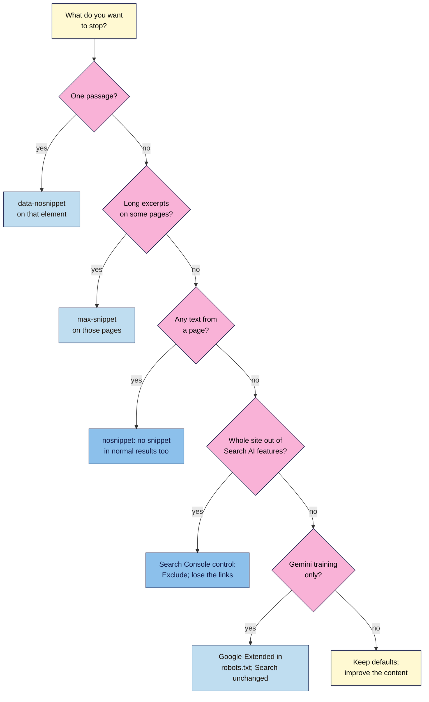

# M14.L05 — AI Search Orientation: AI Overviews, AI Mode and Your Controls
> After this lesson you can explain what Google documents about AI Overviews and AI Mode and how pages get into them, pick the right control for a goal (and know what each one costs), read AI traffic in Search Console, and turn down the "AI SEO" myths.

**Time:** ~15 min reading + ~35 min hands-on + ~10 min exercise · **Level:** L3 Advanced · **Prereqs:** M14.L04, M12.L05 · **Remediate to:** M01.L04
**Verified against:** Google Search Central *AI features and your website* (last updated 2025-12-10), *Optimizing your website for generative AI features on Google Search* (2026-07-10), *Robots meta tag, data-nosnippet, and X-Robots-Tag* (2026-03-24), *Control what you share with Google Search* (2026-10-21) and *Google common crawlers* (2026-10-30); Search Console Help pages on the *Search generative AI control*, the *Generative AI performance report* and *Performance report metrics* (no date shown), all checked on 2026-11-10.

> ⚠️ **Freshness flag:** AI search changes faster than anything else in this course. The **Search generative AI control** and the **Generative AI performance report** reached all sites worldwide on **31 August 2026**. The *AI features* page (2025-12-10) predates the control and doesn't mention it. Google says it intends to support the **AIPREF** training-preference signal "in early 2027". Recheck every control before you advise a client. This is an **orientation** lesson: AEO, GEO and AI visibility testing are taught in depth in **Modern SEO 101**.

## Learning objectives
1. **Explain** what Google documents about AI Overviews and AI Mode, and how pages become eligible. *(O1)*
2. **Choose** the right control (nosnippet, max-snippet, data-nosnippet, the Search generative AI control, Google-Extended) for a goal. *(O2)*
3. **Read** AI traffic in Search Console, and reject AI-SEO myths. *(O3)*

## Why it matters
Kavya searched "is yoga good for lower back pain" and saw an AI Overview at the top, citing a hospital site and a physiotherapy blog, not her. Two offers arrived the same week. One was a "GEO package": an `llms.txt` file, "AI schema" and content "chunked for LLMs". The other came from a friend: "Block Google-Extended so Google's AI can't steal your posts." The first costs money and, by Google's own documentation, does nothing for Google Search. The second blocks the wrong thing.

You don't need a new discipline to start. You need to know what Google says about how these features pick pages, which controls exist and what each one costs, and where the traffic shows up.

## Core concept
**Plain version:** **AI Overviews** are AI-written summaries shown above some Google results, with links to the pages they draw on. **AI Mode** is a separate, conversational search mode. Both are built on Google's normal search systems: they find pages through the same index and ranking, then write an answer. So the way in is ordinary SEO: be indexed, be allowed to show a snippet, and be the best, most original page on the topic. Your controls limit what Google may **show or use** from your pages. They don't boost you.

**Analogy:** a reference librarian. When you ask a question, they search the library's own catalogue, read a few good books and summarise them, naming their sources. To be named, your book has to be in the catalogue (indexed), on an open shelf (snippets allowed) and worth quoting (original, trustworthy). Telling the librarian "don't quote me" keeps your words out of the summary, and your name too.

**Precise definitions:**
- **AI Overview:** a generated summary on the Google results page with supporting links. "AI Overviews are only shown when our systems determine that it is additive to classic Search, and as such, often don't trigger."
- **AI Mode:** Google's conversational search experience. A follow-up question counts as a new query in Search Console.
- **Query fan-out:** "issuing multiple related searches across subtopics and data sources" to build a response. Both AI Overviews and AI Mode may use it.
- **Grounding (RAG):** improving AI answers by retrieving pages from the search index at the time of the question.
- **Search generative AI control:** a Search Console setting (**Settings > Search generative AI**) to include or exclude your site's links and content from Google's generative AI features in Search.
- **Google-Extended:** a robots.txt product token that controls whether Google may use your content to train future Gemini models and for grounding in Gemini Apps and Vertex AI. It doesn't affect Google Search.

### What Google says about getting in
| Claim | Google's words |
|---|---|
| No special requirements | "There are no additional requirements to appear in AI Overviews or AI Mode, nor other special optimizations necessary." |
| Eligibility | "To be eligible to be shown as a supporting link in AI Overviews or AI Mode, a page must be indexed and eligible to be shown in Google Search with a snippet". |
| No special files or markup | "You don't need to create new machine readable files, AI text files, or markup to appear in these features." |
| It's still SEO | "From Google Search's perspective, optimizing for generative AI search is optimizing for the search experience, and thus still SEO." |
| Tools can't see inside | "No third-party tool has access to our internal ranking or AI systems." |

Google's 2026 optimisation guide adds one useful idea: **commodity vs non-commodity content**. Commodity content is common knowledge that anyone could write ("7 tips for first-time homebuyers"). Non-commodity content "provides unique expert or experienced takes that go beyond common knowledge and the ordinary." For Nila, "5 tips for better coffee" is commodity. "We brewed our Chikmagalur beans 40 ways: what changed" isn't. That's Lesson 14.2's "originality" in AI-search terms.

### Myths Google itself rejects
The optimisation guide has a "mythbusting" section. These are things you don't need to do for Google Search:

| Myth | What Google says |
|---|---|
| "Add an `llms.txt` file and special AI markup" | Listed as a myth. On llms.txt files: "Doing so will neither harm nor help your site's visibility or rankings in Google Search, as Google Search ignores them." |
| "Chunk your content for AI" | Listed as a myth ("Chunking" content) |
| "Rewrite content just for AI systems" | Listed as a myth |
| "Get mentioned everywhere" | "Seeking inauthentic "mentions"" is listed as a myth, and manipulating AI responses is spam (Lesson 14.4) |
| "Add more structured data for AI" | "Overfocusing on structured data" is listed as a myth; structured data isn't required (Module 12) |
| "This tool shows your AI visibility score from Google" | No tool has access to Google's AI systems; tools test samples and estimate |

Other AI systems (ChatGPT, Perplexity, Copilot) have their own crawlers and rules. Modern SEO 101 covers them.

### Your controls, and what each one costs
| Goal | Control | What it does | The cost |
|---|---|---|---|
| Keep one passage out of snippets and AI answers | `data-nosnippet` on a `span`, `div` or `section` | That text isn't used as a snippet (Google's attribute for "textual parts of an HTML page") | Almost none; use it for things like a wholesale price note |
| Limit how much text is shown or used | `<meta name="robots" content="max-snippet:50">` | Limits snippets, and "how much of the content may be used as a direct input for AI Overviews and AI Mode" | Shorter snippets in normal results too |
| Keep a whole page out of snippets and AI answers | `<meta name="robots" content="nosnippet">` | No text snippet anywhere, and it will "prevent the content from being used as a direct input for AI Overviews and AI Mode" | No snippet in normal results either; usually fewer clicks |
| Keep the whole site's links and content out of Search's AI features | Search generative AI control → **Exclude** | Excludes your links and content from AI Overviews, AI Mode and generative AI features in Discover | "You won't receive any traffic or impressions from these features". "Content from other sites will still be available in those features, and it may appear similar to yours." |
| Keep content out of Gemini model training (and Gemini Apps / Vertex AI grounding) | `User-agent: Google-Extended` / `Disallow: /` in robots.txt | Controls training and those grounding uses | It "does not impact a site's inclusion in Google Search nor is it used as a ranking signal in Google Search". It does **not** remove you from AI Overviews |
| Keep a page out of Google Search entirely | `noindex` | Removes the page from Search, including AI features | No search traffic to that page at all |

Two details about the Search Console control: it's "the default control for all properties" to **include** your site, and Google says it "isn't used as a ranking or inclusion signal affecting other parts of Search". It also "doesn't affect AI training"; for that, Google points to Google-Extended. Exclusion takes "a few days".

### How AI traffic is counted in Search Console
- AI Overviews and AI Mode traffic is included in the **Performance** report under the **Web** search type. There's no separate filter there.
- **AI Overviews:** "Clicking a link to an external page in the AI Overview counts as a click." "An AI Overview occupies a single position in search results, and all links in the AI Overview are assigned that same position."
- **AI Mode:** positions follow the normal results-page method, and "If a user asks a follow-up question within AI Mode, they are essentially performing a new query."
- **Generative AI performance report** (all sites from 31 August 2026): **impressions only**, "how many times links to your site were shown to a user in a generative AI feature on Google Search", by page, country, date and device. If it's missing, "your site hasn't received enough impressions in generative AI features" (or you've excluded your site).
- Google says clicks from results pages with AI Overviews "are higher quality". That's Google's claim, without published data. Judge it with your own GA4 engagement data, not as a fact.

## How it works


**In words:** start with what you actually want to stop. For one passage, use `data-nosnippet` on that element. For long excerpts on some pages, use `max-snippet`. To stop any text being used from a page, use `nosnippet`, which also removes its snippet in normal results. To keep the whole site's links and content out of Google's AI features in Search, use the Search Console control, knowing you lose those links. If you only want to stay out of Gemini model training, use Google-Extended; your Search appearance doesn't change. If none of these is your goal, keep the defaults and work on the content.

> **Under the hood: why ordinary SEO is the way in.** Google describes its AI features as grounded in Search: they retrieve pages "from our Search index" using "our core Search ranking systems", sometimes running several related searches (query fan-out), then generate an answer with links. A page that isn't indexed, can't show a snippet or doesn't rank for any of those related searches has nothing for the AI to retrieve. That's why Google can say there are no special requirements *(course explanation, from Google's AI features and optimisation pages)*.

## Hands-on walkthrough
You'll fill in an **AI feature check** tab, look at the Generative AI performance report, read the control, and test `data-nosnippet` on a practice page.

**Before you start: which steps apply to you?**
- **Path A (your own site):** do all parts.
- **Path B (practice site):** the Generative AI report will probably be missing (not enough impressions). Do Parts A, C and D.
- **Path C (client site):** **don't change** the Search generative AI control or robots.txt. Record the settings and discuss them with the owner.

**Part A — AI feature check (12 min)**
1. In a private browser window, search five queries your site targets (from your keyword map, Module 3). Use the country your audience is in.
2. In an **AI feature check** tab, record: **Query · AI Overview shown? · Our site linked? · Sites linked · Commodity or non-commodity answer? · Our page that should answer it**.
   **Expected:** AI Overviews on some queries, not all ("often don't trigger"). Results vary by person, place and day, so treat this as a snapshot, not a ranking.
   > 🖼️ **Image prompt:** A Google results page (1280×800) for "is yoga good for lower back pain" with an AI Overview at the top and its supporting links listed on the right. Highlight the supporting links panel with a 3px #F9B2D7 outline; blur any personal details.
   > **Alt text:** A Google results page with an AI Overview and its supporting links panel highlighted.
3. For any query where your site isn't linked, check the basics first: is your page indexed (URL Inspection) and does it show a snippet in normal results?

**Part B — Read the reports (8 min)**
1. Open Search Console → **Performance** (Web). Remember that AI Overview and AI Mode clicks and impressions are already included here.
2. Open the **Generative AI performance** report, if you have it. Note your top pages by AI impressions.
   **Expected:** for a small site, often "not enough impressions" (the report is missing). That's normal, not an error.

**Part C — Read the control (5 min)**
1. Open **Settings > Search generative AI** and record the current setting in your Changes log.
   **Expected:** **Include** (the default). Don't change it in this lesson. If you or a client ever do, add an annotation and expect it to take a few days.
   > 🖼️ **Image prompt:** The Search Console Settings page (1280×700) showing the "Search generative AI" control with the Include option selected. Highlight the selected Include option with a 3px #F9B2D7 outline; blur any personal details.
   > **Alt text:** Search Console's Search generative AI setting with the default Include option selected and highlighted.
2. Open your robots.txt (`/robots.txt`) and note whether it mentions `Google-Extended`.

**Part D — `data-nosnippet` test (10 min, practice page)**
1. On a practice page, wrap one paragraph that shouldn't appear in snippets, such as "Wholesale prices on request", in a `div`:
   ```html
   <div data-nosnippet>
     <p>Wholesale prices on request: email trade@nilacoffee.in</p>
   </div>
   ```
   In WordPress, use a Custom HTML block (Module 5).
2. Run **URL Inspection → Test live URL → View tested page → HTML** and search for `data-nosnippet`.
   **Expected:** the attribute is in the HTML that Googlebot sees. The snippet itself changes only after Google recrawls the page, so this test proves the markup, not the result.

**Expected output:** an **AI feature check** tab for five queries, a note on your Generative AI report (or "not enough impressions"), the recorded control and Google-Extended status, and a working `data-nosnippet` test.

## When to use / when not to
**Do this** check every quarter for your main queries, and read the control and robots.txt whenever you take over a site.

**Don't** buy `llms.txt` or "AI schema" packages for Google, rewrite pages "for LLMs", chase fake mentions, block Google-Extended to "get out of AI Overviews", or switch on Exclude because you're annoyed that an AI summarised your topic.

**The trade-off:** limiting AI use protects content you'd rather not have summarised, but it also removes your links. Google says excluded sites get no traffic or impressions from those features, and similar content from other sites still appears. For most small businesses, being a cited source is worth more than being absent *(course rule of thumb; Modern SEO 101 goes deeper)*.

## Use AI for this
**Example prompt:**
> "Here are five search queries and the AI Overview text Google showed for each, with the sites it linked: [paste]. For each, say whether the answer is commodity (common knowledge) or non-commodity (original data or experience), and suggest one original piece of evidence my coffee business could add to our page. Don't suggest special markup or llms.txt."

**What AI does well here:** spotting what's generic in an answer and suggesting the kind of original evidence that's missing.
**Where it gets it wrong:** chatbots often recommend `llms.txt`, "AI schema" and chunking, confuse Google-Extended with AI Overviews controls, and can't see Google's results or your Search Console.
**How to check:** every control against Google's current documentation (links below); every "you're visible" claim against your own searches and reports.

## Common mistakes
- **Blocking Google-Extended to stay out of AI Overviews.** Wrong control: it covers Gemini training and grounding, not Search.
- **Adding `nosnippet` site-wide** and losing normal snippets (and clicks) too.
- **Buying `llms.txt` or "AI schema" for Google.** Google ignores llms.txt.
- **Changing the Search generative AI control without a plan** or an annotation.
- **Expecting a separate AI filter in the Performance report.** It's included under Web.
- **Treating one search as a ranking.** AI answers vary by person, place and time.
- **Treating Google's "higher quality clicks" claim as data.** Check your own engagement.

## Troubleshooting
| Symptom | Likely cause | Fix |
|---|---|---|
| Generative AI performance report is missing | Not enough impressions, or site excluded | Nothing to fix; check the control setting |
| Your page never appears in AI Overviews | Not indexed, no snippet, or not the best answer | URL Inspection; check robots meta; improve originality (Lesson 14.2) |
| Snippet still shows the `data-nosnippet` text | Not recrawled yet, or invalid HTML | Wait for a recrawl; close all tags; use span, div or section |
| Traffic fell after setting Exclude | You removed your links from AI features | Revert to Include if the trade-off isn't worth it; annotate |
| robots.txt blocks Google-Extended and the client thinks they're "out of AI" | Misunderstood control | Explain the difference; use snippet controls or the Search Console control if that's the goal |

## Exercise
**Task:** finish Parts A–D. Then answer these. All details are illustrative.
1. Kavya is offered an `llms.txt` file and "AI schema" to appear in AI Overviews. What does Google say?
2. Nila doesn't want her wholesale price line to appear in any AI answer. Which control?
3. Tomás wants his shop out of Gemini model training but still in AI Overviews. What does he do?
4. Amara's client blocked Google-Extended and expects to disappear from AI Overviews. What do you tell them?
5. A publisher sets the Search generative AI control to Exclude. What happens to AI answers about their topic?
6. Nila's AI Overview link was clicked 40 times last month. Where do those clicks appear in Search Console?

**Expected outcome:** the tab and notes, and these answers:
- **1** No special files or markup are needed, and Google Search ignores llms.txt files. Focus on indexing, snippets and original content.
- **2** `data-nosnippet` on that element.
- **3** Disallow `Google-Extended` in robots.txt. It doesn't affect Search, so he stays eligible for AI Overviews.
- **4** Google-Extended doesn't affect inclusion in Search. To limit AI Overviews, use snippet controls or the Search Console control, and weigh the cost first.
- **5** Their links and content are removed, but "Content from other sites will still be available in those features, and it may appear similar to yours."
- **6** In the Performance report under **Web**, counted as normal clicks (an AI Overview link click counts as a click).

**Stretch goal:** pick one commodity page from your AI feature check and write a plan to add one piece of non-commodity evidence (your own test, data or photos).

## Key takeaways
- AI Overviews and AI Mode use Google's index and ranking. To be eligible, a page must be indexed and able to show a snippet; nothing else is required.
- `llms.txt`, chunking, AI rewrites, fake mentions and extra structured data are myths for Google Search.
- Pick controls by goal: `data-nosnippet`, `max-snippet`, `nosnippet`, the Search Console control (site-wide, loses links), Google-Extended (training only), `noindex`.
- AI traffic is inside the Performance report's Web numbers; the Generative AI report shows impressions only.
- Original, non-commodity content is the AI-search version of people-first content.

## Teach it back
Explain to a friend in 3 sentences why blocking Google-Extended won't keep their site out of AI Overviews, and what would.

## Glossary terms added
- AI Mode — added to `seo-101/glossary.md`
- Query fan-out — added to `seo-101/glossary.md`
- Search generative AI control — added to `seo-101/glossary.md`
- Google-Extended — added to `seo-101/glossary.md`
- (`nosnippet` / `max-snippet` / `data-nosnippet` and Commodity content were already in the glossary.)

## Further reading
*All checked 2026-11-10.*
- Google Search Central — AI features and your website: https://developers.google.com/search/docs/appearance/ai-features
- Google Search Central — Optimizing your website for generative AI features on Google Search: https://developers.google.com/search/docs/fundamentals/ai-optimization-guide
- Google Search Central — Robots meta tag, data-nosnippet, and X-Robots-Tag: https://developers.google.com/search/docs/crawling-indexing/robots-meta-tag
- Google Search Central — Control what you share with Google Search: https://developers.google.com/search/docs/crawling-indexing/control-what-you-share
- Google — Google common crawlers (Google-Extended): https://developers.google.com/crawling/docs/crawlers-fetchers/google-common-crawlers
- Search Console Help — Search generative AI control: https://support.google.com/webmasters/answer/16908024
- Search Console Help — Generative AI performance report: https://support.google.com/webmasters/answer/16984139
- Search Console Help — Performance report metrics (AI Overviews and AI Mode): https://support.google.com/webmasters/answer/7042828

> ⚠️ **May change:** everything in this lesson. The Search Console control and report are new (August 2026), and Google plans AIPREF support in early 2027.

## Refresher card
*Used by remediation when a learner fails a quiz twice on a later lesson that points back here.*
**AI Overviews / AI Mode** run on Search's index and ranking (grounding, query fan-out). **Eligible** = indexed + can show a snippet; "no additional requirements". **Myths:** llms.txt (Google ignores it), chunking, AI rewrites, fake mentions, extra structured data. **Controls:** `data-nosnippet` (a passage), `max-snippet` (limit length), `nosnippet` (no snippet anywhere), Search Console **Search generative AI** control (site-wide Exclude = no links or impressions from those features; default Include; not a ranking signal), **Google-Extended** (Gemini training and grounding only; doesn't affect Search), `noindex` (out of Search). **Reporting:** included in Performance → Web; AI Overview = one position; AI Mode follow-up = new query; Generative AI report = impressions only.
