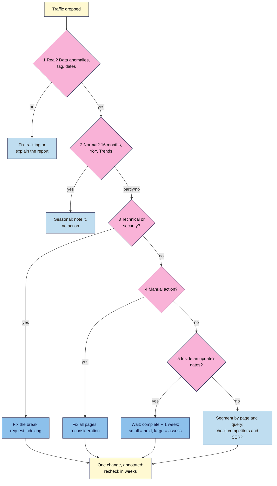

# M14.L06 — Diagnosing a Traffic Drop
> After this lesson you can work through a traffic drop in a fixed order (is it real, is it normal, is it technical, is it a penalty, is it an update), separate several causes in the same drop, and act in proportion: one change at a time, annotated, after any update has finished.

**Time:** ~14 min reading + ~45 min hands-on + ~10 min exercise · **Level:** L3 Advanced · **Prereqs:** M14.L05, M08.L04 · **Remediate to:** M08.L04
**Verified against:** Google Search Central *Debugging drops in Google Search traffic* (last updated 2025-12-10), Search Console Help *Data anomalies in Search Console* (no date shown; entries to August 2026), and the Google Search Status Dashboard ranking history, all checked on 2026-11-10.

> ⚠️ **Freshness flag:** two recent reporting changes look like drops but aren't. Search Console fixed an impressions **logging error** that ran **from May 13, 2025 until April 27, 2026**: impressions (and CTR and average position) changed, clicks didn't. And **FAQ rich results stopped appearing on 7 May 2026**, so FAQ impressions fell to zero. Always check the Data anomalies page for newer entries before you diagnose.

## Learning objectives
1. **Confirm** whether a drop is real (tracking, reporting changes, date ranges). *(O1)*
2. **Separate** seasonality, technical breaks, manual actions and updates using evidence. *(O2)*
3. **Act** proportionately: one change at a time, annotated, after the update finishes. *(O3)*

## Why it matters
Non-negotiable #14 of this course is **diagnose before you act**. A drop in a report triggers panic, and panic triggers changes: rewrite everything, delete old posts, switch plugins, change the theme. Each of those can cause the real damage, and once five things have changed at once, you can never learn what worked.

Google's own debugging page lists six common causes: algorithmic updates, technical issues, security issues, spam issues, seasonality and changing interests, and site moves. It also says to check for reporting changes first. Modules 8 and 14 have given you every tool. This lesson puts them in order, so that "traffic is down 20%" becomes a short, evidenced answer like "half seasonal, half one listicle after the May core update; tracking and indexing are fine".

## Core concept
**Plain version:** ask five questions in order, and don't skip ahead. **1. Is it real?** (reporting changes, broken tracking, the wrong dates). **2. Is it normal?** (seasonality, last year, Trends). **3. Is it technical or security?** (indexing, crawling, hacks, recent site changes). **4. Is it a penalty?** (Manual actions). **5. Is it an update?** (Status Dashboard dates, wait, size of drop). Only then act, one change at a time.

**Analogy:** a doctor with a patient who "feels worse". First check the thermometer works (is it real?). Then ask whether it's flu season (is it normal?). Then run tests for a specific problem (technical). Only after that do you prescribe, one medicine at a time, so you know which one helped.

**Precise definitions:**
- **Data anomaly:** a change in Search Console's data caused by Google's logging or processing, not by your site. Listed on the Data anomalies page.
- **Seasonality:** a repeating yearly pattern in demand (monsoon, festivals, exams, International Yoga Day on 21 June).
- **Segment:** a slice of the data (a page, a group of pages, a query, a country, a device, a search appearance) that you compare on its own.
- **Proportionate action:** a response that matches the size and cause of the drop. Often that means doing nothing.

### The five questions, and where each answer lives
| # | Question | Check | Where | Points to |
|---|---|---|---|---|
| 1 | **Is it real?** | Known logging issues; clicks vs sessions; date range and time zone; a tag change | Data anomalies page; GA4 tag health check (Module 8); Changes log | "Not a real drop": fix tracking or explain the report |
| 2 | **Is it normal?** | Same months last year; demand for the topic | Performance → **Last 16 months**, year over year; Google Trends | Seasonality or changing interest: usually no action |
| 3 | **Is it technical or security?** | Indexing, crawling, server errors, `noindex`, redirects, hacks; what changed on the site | Page indexing, Crawl stats, URL Inspection, Security issues; Changes log | Fix the break, then request indexing |
| 4 | **Is it a penalty?** | Any manual action | Manual actions report | Fix all pages, reconsideration (Lesson 14.4) |
| 5 | **Is it an update?** | Does the drop start inside an update's dates? | Status Dashboard; your Updates tab (Lesson 14.3) | Wait, compare, size it, self-assess large losers (Lesson 14.2) |

Google's page supports each step:
- **Real:** "make sure to check the Search Console Data Anomalies page to see if there is anything applicable to your site."
- **Normal:** set the date filter to "Last 16 months" to "make sure it's not a drop that happens every year due to a festivity or a trend", and use Google Trends "to understand if the drop was only for your website or throughout the web." Its own example: "Coffee is significantly more stable; it looks like people need it throughout the year." (Nila's head term may be stable while "cold brew" isn't. Check, don't assume.)
- **Technical:** a misplaced `noindex` "would depend on Google crawling the page, meaning there would be a slower drop in traffic". Check "the Crawl stats report and Page indexing report".
- **Update:** "there might not be anything fundamentally wrong with your content." And "Small fluctuations in position can happen at any time (including moving back up in position, without you needing to do anything)."

### Read the shape before the cause
Two quick readings save time:
- **Clicks down, impressions steady:** usually the results page changed (a new feature, a competitor's richer result, a weaker title or snippet), not your ranking. Google: "If your impressions remain the same but your clicks drop, you might not be generating the best page title and snippet that you could".
- **Impressions down, clicks steady:** often a reporting change (the 2025–26 logging fix, the FAQ removal) or lost visibility for queries that never got clicks anyway.
- **Both down:** work through the five questions.

Then find the **scope**: whole site, a group of pages, or "even just one very important page". Use the Performance report's Pages tab with a comparison, sorted by the difference in clicks. Google: "If it's a site-wide issue, check the Page indexing report. If the drop only affects a group of pages, use the URL inspection tool to investigate a few pages".

### Several causes at once
Real drops are often a mix. The skill is to **attribute** the loss: how many clicks came from each cause. Split the drop by page and query, give each slice its own cause and evidence, and leave the rest as "normal variation". A report that says "−310 clicks: −110 seasonal (cold brew, same dip last year), −170 one listicle after the May core update, −30 unexplained" is far more useful than "Google update hit us".

### Then act in proportion
1. **Fix what's broken** (tracking, `noindex`, server errors, hacks) straight away. These are your mistakes, not judgement calls.
2. **Do nothing** about seasonality and small update moves. Google recommends "avoiding making radical changes if your page is already performing well."
3. **Assess, then improve** the pages with large, sustained drops after an update has finished (Lessons 14.2–14.3).
4. **One change at a time**, each with a Search Console annotation and a Changes log row.
5. **Wait to judge:** "you'll likely want to wait a few weeks to analyze your site in Search Console again to see if your efforts had a beneficial effect on ranking position."

## How it works

**In words:** when traffic drops, first ask whether it's real: check the Data anomalies page, your tracking and your date range. If it isn't real, fix the tracking or explain the report. If it is, check whether it's normal for the time of year using 16 months of data, last year and Trends. If seasonality explains it all, note it and do nothing. Otherwise look for technical or security problems and fix them, then check for a manual action. If neither applies, check whether the drop falls inside an update's dates: wait until it's complete plus a week, then hold for small drops and assess large ones. If no update explains it, segment by page and query and look at competitors and the results page. Whatever you do, make one change at a time, annotate it, and recheck after a few weeks. A drop can have more than one cause, so keep going down the tree after finding the first.

> **Under the hood: why the order matters.** The checks go from cheapest and most common to rarest. A tracking or reporting problem takes minutes to rule out and explains a surprising share of "drops". Seasonality is next because it's free to check and very common. Technical breaks are your own changes and fixable today. Manual actions are rare but unambiguous. Updates come last because they're the easiest to blame and the hardest to prove. Starting with "it's an update" skips the checks most likely to find the real cause *(course explanation)*.

## Hands-on walkthrough
You'll diagnose an illustrative drop for Nila Coffee using the five questions, check seasonality in Google Trends, and write a one-paragraph finding.

**Before you start: which steps apply to you?**
- **Path A (your own site):** do Parts A–D on the dataset below, then repeat the five questions for your own site's last noticeable dip (Part E).
- **Path B (practice site):** do Parts A–D. Your own data is probably too small for Part E.
- **Path C (client site):** do Parts A–D, then Part E on the client's data. Share findings as a report, not as changes made.

**The dataset (illustrative, Nila Coffee, 2026).** Weekly Search Console clicks and impressions, GA4 organic sessions, clicks for two key queries, and indexed pages. Changes log: nothing changed on the site from April to June. Manual actions and Security issues: none. Status Dashboard: May 2026 core update, 21 May – 2 June.

| Week | GSC clicks | GSC impressions | GA4 organic sessions | "cold brew" clicks | "best coffee beans india" clicks (avg. position) | Pages indexed |
|---|---|---|---|---|---|---|
| 7–13 May | 1,540 | 41,800 | 1,430 | 310 | 205 (4.1) | 118 |
| 14–20 May | 1,500 | 40,900 | 1,395 | 290 | 200 (4.2) | 118 |
| 21–27 May | 1,380 | 39,000 | 1,280 | 250 | 150 (9.8) | 118 |
| 28 May–3 Jun | 1,290 | 37,500 | 1,200 | 220 | 60 (21.5) | 118 |
| 9–15 Jun | 1,230 | 36,800 | 1,140 | 200 | 35 (27.0) | 119 |
| *Last year, 15–21 May 2025* | — | — | — | 280 | — | — |
| *Last year, 10–16 Jun 2025* | — | — | — | 185 | — | — |

**Part A — Is it real? (5 min)**
1. Compare GSC clicks with GA4 sessions week by week.
   **Expected:** they move together (sessions are about 93% of clicks every week), so tracking is fine. Clicks fell as well as impressions, so this isn't only the impressions logging fix (which affected impressions, not clicks). Note: "Real drop."

**Part B — Is it normal? (12 min)**
1. Compare "cold brew" with last year: 280 → 185 in 2025 (−34%), 290 → 200 in 2026 (−31%).
2. Open Google Trends, set **India**, **Past 5 years**, and compare "cold brew" with "coffee". Look for the same dip each June to September (monsoon).
   **Expected:** you're looking for whether "cold brew" dips at the same time every year while "coffee" stays steadier, as Google's own coffee example suggests. Record what Trends actually shows; if there's no yearly dip, seasonality doesn't explain the loss. In this dataset, last year's figures already show the same dip, so the cold brew loss (about −90 clicks from the 14–20 May week) is treated as seasonal.
   > 🖼️ **Image prompt:** Google Trends (1280×700) comparing "cold brew" and "coffee" in India over the past 5 years, showing "cold brew" peaking each April–May and dipping June–September while "coffee" stays fairly flat. Highlight one June–September dip with a 3px #F9B2D7 outline; blur any personal details.
   > **Alt text:** Google Trends comparison showing a yearly summer peak and monsoon dip for cold brew, while coffee stays flat.

**Part C — Technical, security, penalty? (5 min)**
1. Pages indexed: 118 → 119, steady. No site changes logged. Manual actions and Security issues: none.
   **Expected:** "No technical, security or manual action cause."

**Part D — Is it an update? Attribute and decide (15 min)**
1. The listicle's position went from 4.2 to 27.0, starting inside the May 2026 core update (21 May – 2 June). That's a **large** drop.
2. Attribute the loss between the 14–20 May week (before the update) and 9–15 June (a week after it finished): total −270 clicks. Cold brew −90 (seasonal). Listicle −165 (update). The rest −15 (normal variation).
3. In a **Drop diagnosis** tab, write one row per question with **Question · Evidence · Answer · Action**, then a finding paragraph and the actions.
   **Expected finding:** "Clicks fell 18% (−270 a week). About a third is the normal monsoon dip in cold brew searches, matching last year. About 60% is one page, 'Best coffee beans in India', which fell from position 4 to 27 during the May 2026 core update. Tracking, indexing, security and manual actions are all fine. Action: no change to brew guides; self-assess the listicle (Lesson 14.2), improve it with our own tasting data and a conflict-of-interest note, annotate the change, recheck in four weeks."
   > 🖼️ **Image prompt:** A spreadsheet tab named "Drop diagnosis" (1280×800) with five rows (Real?, Normal?, Technical/security?, Manual action?, Update?) and columns Evidence, Answer, Action, plus a finding paragraph below attributing −90 clicks to seasonality and −165 to a core update. Highlight the finding paragraph with a 3px #F9B2D7 outline; blur any personal details.
   > **Alt text:** A Drop diagnosis spreadsheet answering five questions, with a finding paragraph that splits the drop between seasonality and a core update.

**Part E — Your own site (optional, Path A and C)**
1. Pick your last noticeable dip. Use Performance → **Last 16 months**, then **Compare** year over year and last 3 months to the previous period. Click through the Queries, Pages, Countries, Devices and Search appearance tabs to find the segment that dropped.
2. Answer the five questions with evidence.

**Expected output:** a **Drop diagnosis** tab with five answered questions, the attribution, a finding paragraph and proportionate actions (for the dataset, and optionally for your own site).

## When to use / when not to
**Do this** every time someone says "traffic is down", before any change, and as the "why" section of your monthly report (Module 8) when a number moves sharply.

**Don't** start with "it's an update", compare mid-rollout or mismatched dates, fix five things at once, or report a cause you can't show evidence for. "Cause unknown; checked tracking, seasonality, technical, manual actions and updates" is an honest finding.

**The trade-off:** diagnosing takes an hour or two, and the answer is often "do nothing", which can feel unsatisfying to a worried client. But one hour of diagnosis is cheaper than a month of changes that make things worse and can't be untangled *(course rule of thumb)*.

## Use AI for this
**Example prompt:**
> "Here is weekly data for my site: Search Console clicks and impressions, GA4 organic sessions, clicks for my top queries, indexed pages, last year's figures, and the dates of Google updates from the Status Dashboard: [paste]. Using five questions in order (real? normal? technical? manual action? update?), say what the evidence shows for each, and split the click loss between causes. Mark anything you can't prove as unknown."

**What AI does well here:** arithmetic, spotting which rows changed together, and drafting a clear finding from your evidence.
**Where it gets it wrong:** it jumps to "algorithm update", invents update names or dates, can't see Trends, Search Console or your site, and will happily give a confident cause for noise.
**How to check:** every date against the Dashboard and Data anomalies page; every number against your own reports; every claim against a row of evidence.

## Common mistakes
- **Starting with the update.** Check real, normal, technical and penalty first.
- **Ignoring reporting changes**, such as the impressions logging fix or the FAQ removal.
- **Comparing the wrong periods** (last month vs this month across a season change; mid-rollout weeks).
- **Looking only at site totals.** Segment by page and query to find the slice that fell.
- **One cause for a mixed drop.** Attribute the loss between causes.
- **Changing several things at once**, so nothing can be learned.
- **Judging a fix after days.** Wait a few weeks.

## Troubleshooting
| Symptom | Likely cause | Fix |
|---|---|---|
| GA4 sessions fell, GSC clicks didn't | Tracking break (consent banner, tag removed) | GA4 tag health check (Module 8); no SEO change |
| Impressions and position changed around late April 2026, clicks steady | Search Console impressions logging fix | Note it as a reporting change; no action |
| FAQ impressions vanished after 7 May 2026 | FAQ rich results retired | Not a penalty; no action |
| Slow drop over weeks on one section | A stray `noindex` or blocked section, picked up as Google recrawls | URL Inspection, Page indexing; fix and request indexing |
| Sudden site-wide drop to near zero | Site down, hacked, or a manual action | Crawl stats, Security issues, Manual actions |
| Clicks down, impressions steady | Results page changed or weaker snippet | Look at the live results; improve title and snippet (Module 4) |
| Drop after a migration | Redirects, or Google still processing | Check redirects (Module 6); medium sites "can take a few weeks" |

## Exercise
**Task:** finish Parts A–D (and E if it applies). Then diagnose these short cases. All details are illustrative.
1. Kavya's GA4 organic sessions fell 45% on 3 March. Search Console clicks are flat. Her Changes log says "switched cookie banner plugin, 2 March".
2. Tomás's impressions dropped and average position "improved" in late April 2026, while clicks stayed the same.
3. Nila's shop category pages lost traffic slowly over three weeks after a theme update. URL Inspection shows "Excluded by 'noindex' tag".
4. Amara's client's clicks dropped on 27 March 2026 and she wants to rewrite every page that day.
5. Kavya's "yoga for beginners" clicks rise every June and fall in August. This year August is down 30% from June.
6. Write the one-line annotation for the action Nila takes in Part D.

**Expected outcome:** a completed Drop diagnosis tab, and these answers:
- **1** Not real (question 1): a tracking break from the consent banner. Fix the tag; no SEO change.
- **2** Not real: the documented impressions logging fix (May 13, 2025 – April 27, 2026). Clicks weren't affected.
- **3** Technical (question 3): the theme added `noindex`. Remove it, request indexing, annotate.
- **4** The March 2026 core update started that day (27 March – 8 April). First rule out real/normal/technical/penalty, then wait until complete plus a week, compare, and act only on large drops.
- **5** Check last year: if August also fell from June (International Yoga Day is 21 June), it's seasonal. Compare August with last August, not with June.
- **6** For example: "Listicle 'Best coffee beans in India' rewritten with tasting data + disclosure (post-May core update)."

**Stretch goal:** write a one-page **Traffic-drop playbook** for your site: the five questions, where each check lives, and the annotation format. The M14 capstone builds on it.

## Key takeaways
- Diagnose before you act: real → normal → technical or security → manual action → update → act.
- Check the Data anomalies page and tracking first; the 2025–26 impressions fix and the FAQ removal look like drops.
- Use 16 months, year over year and Trends for seasonality; segment by page and query.
- Attribute a mixed drop to its causes, with evidence for each.
- Fix breaks now, leave small and seasonal moves alone, improve large losers after updates finish, one annotated change at a time, and judge in weeks.

## Teach it back
Explain to a worried client in 3 sentences why you'll check five things before changing anything on their site after a drop.

## Glossary terms added
- Data anomaly — added to `seo-101/glossary.md`
- Drop attribution — added to `seo-101/glossary.md`
- Proportionate action — added to `seo-101/glossary.md`

## Further reading
*All checked 2026-11-10.*
- Google Search Central — Debugging drops in Google Search traffic: https://developers.google.com/search/docs/monitor-debug/debugging-search-traffic-drops
- Search Console Help — Data anomalies in Search Console: https://support.google.com/webmasters/answer/6211453
- Google Search Status Dashboard — Ranking history: https://status.search.google.com/products/rGHU1u87FJnkP6W2GwMi/history
- Google Search Central — Google Search's core updates and your website: https://developers.google.com/search/docs/appearance/core-updates
- Google Trends: https://trends.google.com/

> ⚠️ **May change:** the Data anomalies list (new entries appear several times a year) and the Status Dashboard history.

## Refresher card
*Used by remediation when a learner fails a quiz twice on a later lesson that points back here.*
**Five questions in order:** (1) **Real?** Data anomalies page (impressions logging fix May 13, 2025 – April 27, 2026; FAQ rich results gone from 7 May 2026), GA4 vs GSC, dates, Changes log. (2) **Normal?** Last 16 months, YoY, Google Trends. (3) **Technical/security?** Page indexing, Crawl stats, URL Inspection, Security issues; a stray `noindex` drops slowly. (4) **Manual action?** Manual actions report. (5) **Update?** Status Dashboard dates; wait until complete + 1 week; small = hold, large = assess. **Shapes:** clicks down + impressions steady = SERP or snippet; impressions down + clicks steady = often reporting. **Scope:** site, group, one page. **Attribute** mixed drops. **Act:** fix breaks now; one change at a time; annotate; judge after a few weeks.
