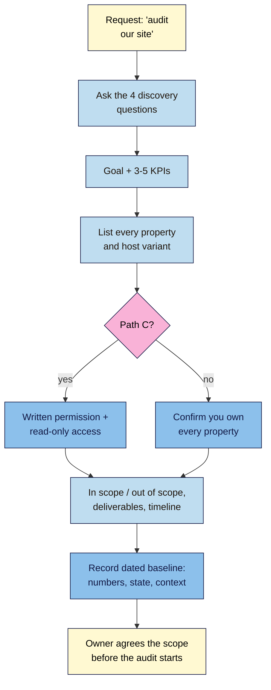

# M15.L01 — Scoping an Audit and Setting the Baseline
> After this lesson you can agree what an SEO audit will and won't cover before you start, get just the access you need for your path, and record a dated baseline so every later fix can be measured.

**Time:** ~12 min reading + ~35 min hands-on + ~10 min exercise · **Level:** L3 Advanced · **Prereqs:** M14.L06, M08.L06 · **Remediate to:** M08.L06
**Verified against:** Google Search Central *Do you need an SEO?* (last updated 2026-06-05) and Search Console Help *Managing owners, users, and permissions* (no date shown), checked on 2026-11-11.

> ⚠️ **Freshness flag:** Google doesn't publish an "SEO audit" process. The scope template and the nine-step audit order in this module are **course rules**, built from Google's documentation and earlier modules. Search Console's permission levels and their limits can change; check the permissions page before you ask a client for access.

## Learning objectives
1. **Write** a scope statement: goal, KPIs, properties, date range, deliverables and what's out of scope. *(O1)*
2. **Set up** the right access for path A, B or C (Search Console Owner, Full or Restricted user; the least access needed). *(O2)*
3. **Record** a dated baseline before any change (#2). *(O3)*

## Why it matters
A café owner in Lagos asks Amara: "Can you do an SEO audit for us?" Amara runs a crawler, exports 214 rows and sends them over. The owner reads ten, gets lost, and asks the question Amara can't answer: "So what do we do first, and will it help?" Two months later traffic is up 15%, and nobody can say whether Amara's work caused it, because nobody wrote down where things stood before.

Every module so far has given you one part of an audit. This module puts them together into something a site owner can use. That starts before any tool is opened: agree on what the audit is for, what it covers, who can see and change what, and what "before" looked like.

## Core concept
**Plain version:** an **SEO audit** is an evidence-based review of a site against a business goal, ending in a prioritised list of fixes. Google describes a good one in one sentence: "An SEO audit should be about giving you realistic estimates of improvement, and an estimate of the work involved." A **scope statement** fixes the goal, the pages, the tools, the deliverables and the limits. A **baseline** records the numbers before you change anything, with dates, so you can show what changed afterwards.

**Analogy:** a builder's survey before renovating a house. First you agree whether it's the whole house or just the kitchen, and what the budget is for. Then you photograph and measure everything as it is. Without the "before" photos, nobody can prove the renovation improved anything, and without the agreed scope, the survey turns into a list of every crack in every wall.

**Precise definitions:**
- **SEO audit:** a review of a site's indexing, crawling, structure, content, page experience, structured data, links, local or international set-up, and E-E-A-T and policy risks, against a goal, with evidence and a prioritised plan.
- **Scope statement:** a short agreed document: goal, KPIs, properties, access, date range, tools, deliverables, what's out of scope and the timeline.
- **Baseline:** dated measurements taken before any change, using the same date ranges and definitions you'll use afterwards.
- **Least access:** the lowest permission level that lets you do the job. For an audit, that's read-only.

### What Google says to expect from an audit
Google's *Do you need an SEO?* page, written for site owners hiring help, gives three lines worth building your scope on:
- **Access:** "only grant read access to Search Console (at this stage, don't grant them write access)."
- **The deliverable:** "realistic estimates of improvement, and an estimate of the work involved." In this course, that becomes the **Value** and **Effort** columns you used in Module 10.
- **No guarantees:** "If they guarantee you that their changes will give you first place in search results, find someone else."

It also lists what a good SEO should ask at the start: "Your SEO should ask questions about what makes your business unique, who your competitors are, how search results can help, and how your customers find you." Those four questions are your scoping call.

### The scope statement (course template)
| Part | What to write | Example: Kavya's studio (path A) |
|---|---|---|
| **Goal** | The business goal from Lesson 1.1, in one line | More trial-class bookings from people in Chennai |
| **KPIs** | 3–5 from Lesson 8.6 | Non-branded clicks; "book_trial" key events from organic; key pages indexed |
| **Properties** | Every host variant and tool property | Domain property in Search Console; GA4 property; Bing; Business Profile |
| **Access** | Your role in each tool | Owner everywhere (her own site) |
| **Date range** | Baseline period and comparison | Last 3 months, plus the same 3 months last year |
| **Tools** | Free tools only, named | Search Console, GA4, Screaming Frog free, PSI, Rich Results Test, Ahrefs Free, Bing |
| **In scope** | Sections, templates, languages | All 46 URLs; English only |
| **Out of scope** | What you won't do | Paid ads, a redesign, writing new posts |
| **Deliverables** | What the owner gets | Report, fix tickets, 90-day plan, dashboard, walkthrough |
| **Timeline** | Dates | Audit by 30 Nov; first fixes in December; review in March |

**Out of scope is not a formality.** It's what stops an audit from growing into "fix everything". If the owner later wants a redesign, that's a new scope, and probably a migration (Lesson 15.5).

### Access by path
Search Console has three levels. Google describes them as: **Owner** "Has full control over properties in Search Console", **Full user** "Has view rights to all data and can take some actions", and **Restricted user** "Has simple view rights on most data."

| Path | Whose site | Access you need for the audit | Access needed for fixes |
|---|---|---|---|
| **A** | Your own | You're the owner already | You |
| **B** | Your practice sites | Owner of the Blogger property; a crawl of the WordPress practice site | You |
| **C** | A friend's or client's | **Written permission**, plus **Restricted** (or Full) access to Search Console and viewer access to GA4 | The owner, or access they grant later, in writing |

For path C, ask for the least access first, as Google advises. You can view and export data with Restricted access. Some actions, such as adding annotations, need more (Module 8). Ask for more only when you need it, and only for the fix phase.

### The baseline
A baseline is two things: **numbers** and **state**. Record both, with the date, before any fix.

| Type | What to record | Where |
|---|---|---|
| **Numbers** | Clicks, impressions, CTR (Search Console, Web); organic sessions and key events (GA4); for the baseline period and the same period last year | Performance report; GA4 |
| **State** | Indexed and not-indexed page counts; Core Web Vitals status; manual actions; security issues; URLs found by a crawl; Business Profile status | Page indexing; Core Web Vitals; Manual actions; Security issues; Screaming Frog; GBP |
| **Context** | Known seasonality; recent site changes; recent Google updates; any data anomaly | Changes log; Updates tab (Lesson 14.3); Data anomalies page |

Write down **how** each number was taken: the date range, the search type (Web), filters (non-branded?), the time zone (Search Console uses Pacific Time; Module 8). A baseline you can't reproduce isn't a baseline.

## How it works

**In words:** when someone asks for an audit, start with Google's four discovery questions: what makes the business unique, who its competitors are, how search can help, and how customers find it. Turn the answers into a goal and three to five KPIs. List every property and host variant. On a client's site, get written permission and read-only access; on your own, confirm you own every property. Agree what's in and out of scope, the deliverables and the timeline. Record a dated baseline of numbers, state and context, and have the owner agree the scope before the audit begins.

> **Under the hood: why read-only first.** An audit only needs to look. Write access lets someone change settings, submit sitemaps, request removals or, for owners, add and remove users. If the person auditing makes a mistake (or isn't who they claim), read-only access limits the damage. That's why Google tells site owners to grant only read access "at this stage" *(course explanation)*.

## Hands-on walkthrough
You'll fill in a **Scope** tab, check access, and add an **audit baseline** to your **Baseline** tab (started in Lesson 1.3).

**Before you start: which steps apply to you?**
- **Path A (your own site):** do all parts.
- **Path B (practice sites):** use your Blogger property for Search Console numbers and your WordPress practice site for the crawl. Low traffic is fine; the rubric grades method, not numbers.
- **Path C (client site):** get written permission first (an email is enough), and ask for Restricted access to Search Console and viewer access to GA4.

**Part A — Discovery and scope (15 min)**
1. Answer Google's four discovery questions for your project site in one or two lines each.
2. In a **Scope** tab, fill in the ten rows from the template above.
   **Expected:** one goal, no more than five KPIs, a written "out of scope" row, and dated deliverables.
   > 🖼️ **Image prompt:** A spreadsheet tab named "Scope" (1280×800) with ten rows (Goal, KPIs, Properties, Access, Date range, Tools, In scope, Out of scope, Deliverables, Timeline) filled in for a yoga studio site. Highlight the "Out of scope" row with a 3px #F9B2D7 outline; blur any personal details.
   > **Alt text:** A Scope spreadsheet with ten filled rows for a yoga studio audit, the Out of scope row highlighted.

**Part B — Properties and access (5 min)**
1. Note your permission level in each property. Owners can see it in Search Console under **Settings > Users and permissions** (Google says that page is "visible only if you're a property owner"). On path C, ask the owner which level they gave you. List every host variant that matters (`https://`, `http://`, `www`, non-`www`) and check that a Domain property, or URL-prefix properties, cover them all (Module 1).
   **Expected:** "Owner" on path A and B; "Restricted" or "Full" on path C. No property missing.

**Part C — The baseline (15 min)**
1. In your **Baseline** tab, add a dated row block called **Audit baseline** with:
   - **Numbers:** Search Console Web clicks, impressions and CTR for the last 3 months and the same 3 months last year; GA4 organic sessions and your main key event for the same periods. Note the filters.
   - **State:** Page indexing (indexed / not indexed counts), Core Web Vitals status (mobile and desktop), Manual actions, Security issues, and the URL count from a Screaming Frog crawl with default settings.
   - **Context:** your seasons, any change in the last 3 months (Changes log), Google updates in the period (Updates tab), and any entry on the Data anomalies page.
   **Expected:** every figure has a date range and a source. If the site is new or tiny, write the real small numbers; "0 key events" is a valid baseline.
   > 🖼️ **Image prompt:** A spreadsheet tab named "Baseline" (1280×800) with an "Audit baseline — 2026-11-11" block listing Numbers (clicks, impressions, CTR, sessions, key events with date ranges), State (indexed pages, Core Web Vitals, manual actions, security issues, crawl URL count) and Context rows, each with a Source column. Highlight the Source column with a 3px #F9B2D7 outline; blur any personal details.
   > **Alt text:** A Baseline spreadsheet with a dated audit baseline block of numbers, state and context, each with a source.
2. Add a Search Console annotation: "Audit baseline recorded" (if your access allows).

**Expected output:** a **Scope** tab, a property and access list, and a dated **Audit baseline** block with numbers, state and context, each with a source.

## When to use / when not to
**Do this** at the start of every audit, before a migration or redesign (Lesson 15.5), and whenever you take over a site.

**Don't** start crawling before the goal is agreed, ask a client for owner access to "make it easier", leave "out of scope" blank, or record a baseline without date ranges and filters.

**The trade-off:** scoping takes an hour that feels like it delays the "real" work. But an audit without a goal produces findings nobody can rank, and an audit without a baseline can't prove anything it achieved *(course rule of thumb)*.

## Use AI for this
**Example prompt:**
> "Here are my notes from a scoping call with a café owner in Lagos: [paste]. Turn them into a scope statement with these rows: goal, KPIs (max 5), properties, access, date range, tools (free only), in scope, out of scope, deliverables, timeline. Mark anything I didn't say as 'to confirm'."

**What AI does well here:** turning rambling notes into a tidy template, and spotting gaps ("to confirm").
**Where it gets it wrong:** it invents KPIs that don't match the goal, promises outcomes ("increase traffic 50%"), and suggests paid tools.
**How to check:** every KPI ties to the goal; no promise of results; every "to confirm" goes back to the owner.

## Common mistakes
- **No goal**, so every issue looks equally important.
- **Too many KPIs**, or KPIs like average position that mislead (Module 8).
- **Asking for owner access** on a client site when Restricted would do.
- **Missing host variants** (an old `http://www` property with data nobody checked).
- **No "out of scope" row**, so the audit never ends.
- **A baseline without dates, filters or sources.**
- **Changing something before the baseline is saved.**

## Troubleshooting
| Symptom | Likely cause | Fix |
|---|---|---|
| The owner can't say what the goal is | The site has no clear job yet | Use the four discovery questions; pick one goal for this audit |
| You can't see Search Console data on path C | Not added as a user, or wrong property | Ask the owner to add you as Restricted to the Domain property |
| You can't add an annotation | Restricted user | Note it in the Changes log; ask the owner to add it |
| Baseline numbers look tiny | New or small site | Record them anyway; method matters more than size |
| Last year's numbers are missing | Under 16 months of data | Use what exists; note "no YoY available" |

## Exercise
**Task:** finish Parts A–C. Then answer these. All details are illustrative.
1. A client offers Amara owner access to Search Console "so you can do everything". What does she ask for instead, and why?
2. Tomás's audit scope says "Goal: better SEO." Rewrite it.
3. Kavya's KPIs are: average position, total impressions, bounce rate, word count, domain rating. Which would you keep or replace?
4. Nila wants to move domain during the audit. In scope?
5. The baseline says "Clicks: 1,240." What's missing?
6. A prospect says an agency guaranteed "page 1 in 30 days" after an audit. What does Google say?

**Expected outcome:** the three tabs, and these answers:
- **1** Restricted (read-only) access for the audit, as Google advises; more only for the fix phase, in writing.
- **2** For example: "More online orders from organic search in Portugal and Spain", with KPIs such as non-branded clicks to product pages and purchases from organic.
- **3** Replace most: average position misleads (Module 8); word count and domain rating aren't KPIs. Keep or add: non-branded clicks, booking key events from organic, key pages indexed.
- **4** Out of scope for the audit; it's a separate project with its own plan (Lesson 15.5). Record the baseline before any move.
- **5** Date range, search type, filters, source and the date it was recorded.
- **6** "If they guarantee you that their changes will give you first place in search results, find someone else."

**Stretch goal:** write a one-paragraph "audit agreement" email for a path C owner: what you'll look at, the access you need, what you won't change, and when they'll get the report.

## Key takeaways
- A good audit gives "realistic estimates of improvement, and an estimate of the work involved", never guarantees.
- Scope first: goal, KPIs, properties, access, dates, tools, in and out of scope, deliverables, timeline.
- Ask for read-only access for an audit; more only for fixes, in writing.
- Record a dated baseline of numbers, state and context, with sources and filters, before any change.

## Teach it back
Explain to a small-business owner in 3 sentences why you won't start an SEO audit until you've agreed the goal and saved a baseline.

## Glossary terms added
- SEO audit — added to `seo-101/glossary.md`
- Scope statement — added to `seo-101/glossary.md`
- Least access — added to `seo-101/glossary.md`

## Further reading
*All checked 2026-11-11.*
- Google Search Central — Do you need an SEO?: https://developers.google.com/search/docs/fundamentals/do-i-need-seo
- Search Console Help — Managing owners, users, and permissions: https://support.google.com/webmasters/answer/7687615
- Search Console Help — Data anomalies in Search Console: https://support.google.com/webmasters/answer/6211453

> ⚠️ **May change:** Search Console permission levels and the *Do you need an SEO?* page (updated June 2026).

## Refresher card
*Used by remediation when a learner fails a quiz twice on a later lesson that points back here.*
**Audit** = evidence-based review against a goal → prioritised fixes; Google: "realistic estimates of improvement, and an estimate of the work involved"; no guarantees. **Discovery:** what's unique, competitors, how search helps, how customers find you. **Scope:** goal, 3–5 KPIs, properties (all host variants), access, date range, free tools, in/out of scope, deliverables, timeline. **Access:** Owner (full control) / Full (view all, some actions) / Restricted (view most); audits need read-only ("only grant read access"). **Baseline:** numbers (GSC, GA4, period + last year), state (indexing, CWV, manual actions, security, crawl count), context (seasons, changes, updates, anomalies), each with date, filters and source.
