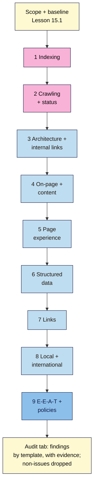

# M15.L02 — Running the Audit in Order
> After this lesson you can run a complete SEO audit in nine fixed steps, from indexing to E-E-A-T and policies, using a free tool for each, record each finding with evidence and a source, leave out the "issues" Google says not to worry about, and group repeated symptoms into template-level findings.

**Time:** ~15 min reading + ~60 min hands-on + ~10 min exercise · **Level:** L3 Advanced · **Prereqs:** M15.L01, M13.L02, M06.L06 · **Remediate to:** M06.L06
**Verified against:** Google Search Central *Google Search Essentials* (last updated 2025-12-10), *Technical requirements* (2025-12-18), *SEO Starter Guide* (2025-12-10) and *Do you need an SEO?* (2026-06-05), checked on 2026-11-11. Tool steps follow the versions verified in Modules 6–14.

> ⚠️ **Freshness flag:** Google publishes no audit order. The **nine-step order is a course rule**, built on Search Essentials (technical requirements → best practices → spam policies) and non-negotiable #7, "indexable before optimised". Tool menus and report names change; if a step's report has moved, find it from the module named in that step.

## Learning objectives
1. **Follow** the nine-step audit order and explain why indexing comes first. *(O1)*
2. **Use** the free tool for each step (Search Console, Screaming Frog free, PageSpeed Insights, Rich Results Test, Ahrefs Free, Business Profile). *(O2)*
3. **Filter out** non-issues Google says not to focus on, and group symptoms by template. *(O3)*

## Why it matters
Tomás's previous agency sent a 213-row audit. Row 1 was "Meta keywords missing on 300 pages". Row 2 was "Low word count on 180 product pages". At row 187, after "Image file names not keyword-rich", was the only thing that mattered: every shop category page had a `noindex` tag. The agency had found it. Nobody read that far.

An audit's order decides what gets fixed. Starting with what stops pages from being found, and ending with quality and policy risks, means the blocking problems surface first. Dropping the "issues" Google itself says don't matter keeps the list short enough to act on.

## Core concept
**Plain version:** check the site in nine steps, in this order: **1 indexing → 2 crawling and status → 3 architecture and internal links → 4 on-page and content → 5 page experience → 6 structured data → 7 links → 8 local and international → 9 E-E-A-T and policies.** For each, use the free tool you already know, write each finding with its evidence and a source, and stop listing the same symptom on 160 pages when it's one template.

**Analogy:** a mechanic's inspection. First: does the car start and move (indexing, crawling)? Then the steering and brakes (structure), the body and interior (content), comfort (page experience), the paperwork (structured data), its service history (links), where it's registered (local and international), and finally whether it's been modified illegally (policies). Nobody reports a scratched mirror before saying the engine won't start.

**Precise definitions:**
- **Audit order:** the fixed sequence of checks, from what stops a page being shown to what affects how well it does.
- **Finding:** one problem, with the pages or template it affects, evidence, a source and date, and a step number.
- **Template-level finding:** a problem that comes from a shared template (all product pages, all posts), fixed once for every page that uses it.
- **Non-issue:** something tools flag that Google says doesn't matter for ranking (meta keywords, word count). It may still matter for people.

### Why indexing comes first
Google's minimum bar, from the technical requirements: "Googlebot isn't blocked." "The page works, meaning that Google receives an HTTP 200 (success) status code." "The page has indexable content." Fail those, and nothing else in the audit can help the page. Pass them, and "indexing isn't guaranteed", but the page is eligible.

The good news: "most sites pass the technical requirements without even realizing it." So steps 1 and 2 are usually quick on a small site, and when they aren't, the finding goes straight to the top.

Search Essentials has three parts, and the nine steps follow them:

| Search Essentials part | Google's description | Audit steps |
|---|---|---|
| **Technical requirements** | "What Google needs from a web page to show it in Google Search." | 1–2 |
| **Key best practices** | "The main things that can help improve how your site appears in Google Search results." | 3–8 |
| **Spam policies** | "The behaviors and tactics that can lead to lower ranking or being completely omitted from Google Search results." | 9 |

### The nine steps, with the free tool for each
| Step | Question | Free tools | Module | Typical small-site finding |
|---|---|---|---|---|
| **1 Indexing** | Are the important pages indexed? If not, why? | Search Console Page indexing, URL Inspection | 6 | Category pages "Excluded by 'noindex' tag" |
| **2 Crawling and status** | Can Google reach every page, with 200s, clean redirects and a working robots.txt and sitemap? | Screaming Frog free (500 URLs), robots.txt report, Crawl stats | 6, 13 | Redirect chains from an old `http://www` host; 404s from internal links |
| **3 Architecture and internal links** | Can people and crawlers reach key pages in a few clicks? Any orphans? | Screaming Frog (crawl depth, inlinks), Content audit tab | 4, 6, 7 | Booking page 5 clicks deep; posts with no links in |
| **4 On-page and content** | One intent per page, unique titles, helpful content, no cannibalisation? | Screaming Frog (titles, H1, meta), Performance report, keyword map | 3, 4, 7, 14 | Two posts competing for one query; duplicate titles on a template |
| **5 Page experience** | HTTPS, mobile, Core Web Vitals, no intrusive popups? | PageSpeed Insights, Core Web Vitals report, HTTPS report | 12 | Mobile LCP "Poor" on the product template |
| **6 Structured data** | Valid, eligible and matching the visible page? | Rich Results Test, Enhancements reports | 12 | Product markup missing price on one template |
| **7 Links** | Who links in? Any risky patterns? Internal anchor text? | Search Console Links, Ahrefs Free (own site), Bing | 9 | Links from a paid directory without `rel="sponsored"` |
| **8 Local and international** | Profile, NAP and hreflang correct? | Business Profile, citations check, Screaming Frog hreflang | 11, 12 | Old phone number on the contact page |
| **9 E-E-A-T and policies** | Trust evidence, spam-policy risks, manual actions, security? | Rater lens, Spam policy self-check, Manual actions, Security issues | 14 | No author pages; an exit-intent plugin |

You've already built most of the tabs these steps use. The audit doesn't redo that work; it **collects** the findings into one place.

### What not to report as a problem
Google's *SEO Starter Guide* has a section called "Things we believe you shouldn't focus on". Tools still flag several of these. Leave them out of the findings, or put them last as "no SEO impact":

| Tool flag | What Google says |
|---|---|
| Missing meta keywords | "Google Search doesn't use the keywords meta tag." |
| Keyword not in domain or URL | Keywords in the domain or URL path "alone have hardly any effect beyond appearing in breadcrumbs." |
| Low word count | "there's no magical word count target, minimum or maximum, though you probably want to have at least one word" |
| Subdomain vs subfolder | "From a business point of view, do whatever makes sense for your business." |
| Duplicate content "penalty" | Content at multiple URLs is "inefficient, but it's not something that will cause a manual action." (Still worth a canonical; Module 6) |
| Headings out of order | Google says order doesn't matter to Search, but it matters "for screen readers" |

The last row is the important exception: **not a ranking issue isn't the same as not an issue.** Skipped heading levels, missing alt text and vague link text are accessibility problems (non-negotiable #3). Report them, under **people**, not under **rankings**.

Google also warns site owners about tool-driven audits: "Before making significant changes to your site based on a third-party tool's audit, be sure to check their recommendations against official guidance from Google Search". And it suggests asking: "Do they cite official Google documentation as supporting evidence for their recommendations?" That's why every finding in your audit has a **Source** column.

### Group by template
If the same symptom appears on most pages of one type (all products, all posts, all categories), it almost always comes from that type's template, plugin setting or theme. One fix solves all of them *(observed practice)*. In a crawl export, add a **Template** column (from the URL pattern, such as `/product/`, `/blog/`, `/category/`) and count each issue by template. 160 "missing alt text" rows on product pages become one finding: "Product template outputs images without alt text."

If an issue appears on a few scattered pages of one template, it's probably a page-level problem: list those pages.

## How it works

**In words:** start from the scope and baseline. Steps 1 and 2 (pink) check Google's technical requirements: whether pages are indexed, reachable and return 200s. Steps 3 to 8 check best practices: structure, content, page experience, structured data, links, and local or international set-up. Step 9 checks trust and the spam policies. Every finding goes into one Audit tab, grouped by template, with evidence and a source, and with the non-issues left out.

> **Under the hood: why the order saves time.** Each step depends on the ones before it. There's no point improving a title (step 4) on a page that isn't indexed (step 1), or measuring Core Web Vitals (step 5) for a URL that redirects twice (step 2). Checking in dependency order means a fix found early can make later findings disappear, so you don't write tickets for symptoms of a problem you've already found *(course explanation)*.

## Hands-on walkthrough
You'll build an **Audit** tab and work through all nine steps on your project site.

**Before you start: which steps apply to you?**
- **Path A (your own site):** all nine steps.
- **Path B (practice sites):** steps 1, 4, 5 and 7 on the Blogger property in Search Console; steps 2–4 and 6 with a Screaming Frog crawl of your WordPress practice site; step 8 if you set up a practice profile; step 9 on both.
- **Path C (client site):** all nine steps with read-only access. Crawl politely (default settings, Module 13). Record findings only; don't fix anything yet.

**Part A — Set up the Audit tab (5 min)**
1. Create an **Audit** tab with the columns **ID · Step (1–9) · Finding · Pages or template · Evidence · Source + date · People or rankings?** (Lesson 15.3 adds the scoring columns.)
   > 🖼️ **Image prompt:** A spreadsheet tab named "Audit" (1280×800) with columns ID, Step, Finding, Pages or template, Evidence, Source + date, People or rankings?, and eight example rows across steps 1–9 (e.g. "Category template has noindex", "Booking page 5 clicks deep", "Product template images lack alt text"). Highlight the Source + date column with a 3px #F9B2D7 outline; blur any personal details.
   > **Alt text:** An Audit spreadsheet with findings from several audit steps, each with evidence and a dated source, the source column highlighted.

**Part B — Steps 1–2: can Google find and fetch the pages? (15 min)**
1. **Step 1:** in Page indexing, list each "not indexed" reason and sort it into **intended** or **fix** (Module 6). Inspect the three most important pages with URL Inspection.
2. **Step 2:** crawl with Screaming Frog (default settings). Export 3xx, 4xx and 5xx responses, redirect chains and `noindex` pages. Check the robots.txt report and that your sitemap is submitted and read.
   **Expected:** on most small sites, few findings here. Any key page not indexed, blocked or not returning 200 is a **blocking** finding: mark it.

**Part C — Steps 3–8 (30 min)**
1. Work through each step with the tool in the table, writing one row per finding. Reuse your existing tabs: Content audit (Module 7), keyword map (Module 3), Core Web Vitals notes (Module 12), Links (Module 9), NAP check (Module 11).
2. Add a **Template** column to the crawl export, count each issue by template, and write template-level findings instead of page lists.
   **Expected:** 10–25 findings, most of them template-level.

**Part D — Step 9 and the clean-up (10 min)**
1. Copy the key results from your **Rater lens**, **Spam policy self-check**, Manual actions and Security issues checks (Module 14) into the Audit tab.
2. Go through the list and remove (or mark "no SEO impact") anything on the Starter Guide's "shouldn't focus on" list. Re-label accessibility items as **People**.
   **Expected:** a shorter list in which every row has evidence and a source you could show the owner.

**Expected output:** an **Audit** tab with findings from all nine steps (or those your path allows), grouped by template, each with evidence, a dated source and a People or Rankings label, with non-issues removed.

## When to use / when not to
**Do this** for a full audit (the final capstone), when taking over a site, and once a year for your own site. For a monthly check, do steps 1, 2 and 9 only (Lesson 15.6).

**Don't** start with the step you find most interesting, paste a tool's export as the audit, report Google's "shouldn't focus on" items as problems, or list the same template issue page by page.

**The trade-off:** a strict order can feel slow when you already suspect the cause. But skipping to step 4 because "it's obviously the content" is how Tomás's agency missed a `noindex` at row 187. If you're right, the early steps take ten minutes; if you're wrong, they save the audit *(course rule of thumb)*.

## Use AI for this
**Example prompt:**
> "Here's a crawl export with columns URL, Status, Title, H1, Meta description, Indexability, Images missing alt: [paste first 200 rows]. Add a Template column from the URL pattern (/product/, /blog/, /category/, other), then count each issue by template. Don't add issues that aren't in the data, and don't include meta keywords or word count."

**What AI does well here:** grouping and counting, spotting URL patterns, turning a long export into a short table.
**Where it gets it wrong:** it adds "best practices" that aren't problems (meta keywords, word count), invents issues not in the data, and can't see Search Console or your site.
**How to check:** spot-check three rows per finding against the crawl and the live page; every finding must have a source.

## Common mistakes
- **Skipping steps 1–2** because "the site looks fine".
- **Pasting a tool export** as the audit.
- **Reporting non-issues** (meta keywords, word count, keyword in URL) as problems.
- **Listing a template issue page by page**, so 160 rows hide one fix.
- **No source column**, so recommendations can't be checked.
- **Mixing "people" and "rankings" problems** so accessibility gets dismissed as "not an SEO issue".
- **Fixing things during the audit**, which spoils the baseline comparison.

## Troubleshooting
| Symptom | Likely cause | Fix |
|---|---|---|
| Crawl stops at 500 URLs | Screaming Frog free limit | Crawl by section (Module 13); note it in the scope |
| Page indexing shows few pages | New site or small sitemap | Normal; inspect key pages individually |
| Same issue on every product page | Template or plugin setting | One template-level finding |
| Tool says "critical: low word count" | Tool's own rule | Drop it (Starter Guide); judge helpfulness instead (Lesson 14.2) |
| Can't see Links or Manual actions on path C | Not added to the right property | Ask the owner to check the Domain property access |
| Too many findings to handle | Page-level listing or non-issues included | Group by template; remove non-issues |

## Exercise
**Task:** finish Parts A–D. Then answer these. All details are illustrative.
1. Tomás's audit has "Category pages: noindex" at row 187 and "Meta keywords missing" at row 1. Which step does each belong to, and what happens to each?
2. 160 product pages show "missing alt text". How do you write that finding, and is it People or Rankings?
3. Kavya's tool says her posts are "too short (400 words)". What does the audit say?
4. Why check steps 1–2 before step 5 (page experience)?
5. Amara's client asks "Is subdomain or subfolder better for our blog?" What do you write?
6. Which earlier tabs feed step 9?

**Expected outcome:** the Audit tab, and these answers:
- **1** `noindex` on categories is step 1 (indexing) and blocking, so it goes to the top. Meta keywords is a non-issue: drop it ("Google Search doesn't use the keywords meta tag.").
- **2** One template-level finding: "Product template outputs images without alt text (160 pages)". People (accessibility, #3), and it also helps image search.
- **3** Nothing about length: Google says there's "no magical word count target". Judge helpfulness and intent instead.
- **4** A page that isn't indexed or doesn't return 200 can't benefit from faster loading. Steps 1–2 are prerequisites.
- **5** Google: "do whatever makes sense for your business". Not an SEO finding.
- **6** Rater lens, Self-assessment and Who/How/Why, Spam policy self-check, and the Manual actions and Security issues status (Module 14).

**Stretch goal:** time each step. Note which took longest and why; Lesson 15.6 uses this to design your monthly routine.

## Key takeaways
- Audit in nine steps: indexing → crawling and status → architecture → on-page and content → page experience → structured data → links → local and international → E-E-A-T and policies.
- Steps 1–2 are Google's technical requirements; a failure there is blocking and goes first.
- Every finding needs evidence and a dated source; Google tells owners to check tool audits against official guidance.
- Drop Google's "shouldn't focus on" items, but keep accessibility issues, labelled as People.
- Group repeated symptoms by template: one fix, many pages.

## Teach it back
Explain to a client in 3 sentences why your audit has 15 findings while the agency's had 213, and why yours is more useful.

## Glossary terms added
- Audit order — added to `seo-101/glossary.md`
- Template-level finding — added to `seo-101/glossary.md`
- Search Essentials — added to `seo-101/glossary.md`

## Further reading
*All checked 2026-11-11.*
- Google Search Central — Google Search Essentials: https://developers.google.com/search/docs/essentials
- Google Search Central — Technical requirements: https://developers.google.com/search/docs/essentials/technical
- Google Search Central — SEO Starter Guide ("Things we believe you shouldn't focus on"): https://developers.google.com/search/docs/fundamentals/seo-starter-guide
- Google Search Central — Do you need an SEO?: https://developers.google.com/search/docs/fundamentals/do-i-need-seo

> ⚠️ **May change:** report names in Search Console and tool menus. The nine-step order is a course rule and doesn't depend on any one tool.

## Refresher card
*Used by remediation when a learner fails a quiz twice on a later lesson that points back here.*
**Nine steps:** 1 indexing (Page indexing, URL Inspection) → 2 crawling and status (Screaming Frog free, robots.txt, sitemap) → 3 architecture and internal links → 4 on-page and content → 5 page experience (PSI, CWV) → 6 structured data (Rich Results Test) → 7 links (GSC Links, Ahrefs Free) → 8 local and international (GBP, NAP, hreflang) → 9 E-E-A-T and policies (Module 14 tabs, Manual actions, Security). **Technical requirements:** not blocked, HTTP 200, indexable content; "most sites pass". **Non-issues:** meta keywords, keyword in URL, word count, subdomain vs subfolder, duplicate "penalty"; heading order is a People (accessibility) issue. **Finding** = step + template/pages + evidence + source/date. **Group by template.**
