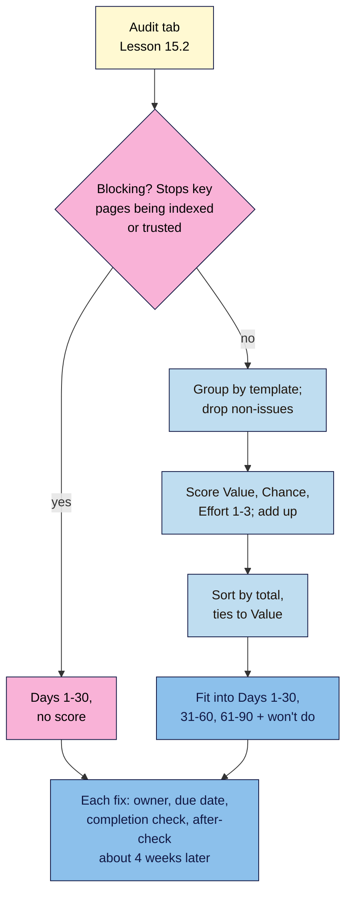

# M15.L03 — Prioritising Findings and Writing the 90-Day Plan
> After this lesson you can put blocking problems first, score every other finding with the course's Value / Chance / Effort method, turn a 200-row crawl export into about ten findings, and write a 90-day plan in three 30-day blocks, with a date to check each fix.

**Time:** ~12 min reading + ~40 min hands-on + ~10 min exercise · **Level:** L3 Advanced · **Prereqs:** M15.L02, M10.L05 · **Remediate to:** M10.L05
**Verified against:** Google Search Central *SEO Starter Guide* (last updated 2025-12-10), *Debugging drops in Google Search traffic* (2025-12-10) and *Do you need an SEO?* (2026-06-05); Sitebulb, *Enterprise SEO audit: from crawl to prioritised action plan* (Kylee Della Volpe, published 2026-10-05; observed practice). Checked on 2026-11-11.

> ⚠️ **Freshness flag:** Google doesn't publish a way to prioritise SEO fixes. The blocking gate, the audit version of Value / Chance / Effort and the 90-day shape are **course rules**. Impact × effort grids are common practice, not a Google method.

## Learning objectives
1. **Gate** blocking issues first, then score the rest with Value / Chance / Effort. *(O1)*
2. **Turn** a long crawl export into about ten findings by grouping by template. *(O2)*
3. **Build** a 90-day plan in three 30-day blocks, each fix with an "after" check date. *(O3)*

## Why it matters
Tomás's 213-row agency audit had no order except the order the tool printed. His developer, paid by the hour, started at row 1. By the time anyone reached the `noindex` on the category pages, three weeks and most of the budget had gone on meta keywords and image file names.

An audit is only as useful as its first five rows. This lesson turns your Audit tab into a ranked list and a plan the owner can say yes to: what happens this month, next month and the month after, and how you'll know each fix worked.

## Core concept
**Plain version:** prioritising happens in three moves. **Gate:** anything that stops key pages from being indexed or puts the site at risk goes first, no scoring needed. **Group:** collapse repeated symptoms into template-level findings (Lesson 15.2). **Score:** give each remaining finding a Value, Chance and Effort score from 1 to 3, add them up, and sort. Then fit the top of the list into a 90-day plan with a check date for each fix.

**Analogy:** a hospital emergency room. Triage first: anyone not breathing is treated straight away, without a queue number (the gate). Everyone else gets a score based on how serious it is, how likely treatment will help and how long it takes. The waiting room is long, but nobody with a broken arm waits behind a paper cut.

**Precise definitions:**
- **Blocking issue:** a finding that stops key pages from being crawled, indexed or trusted: a sitewide or template `noindex`, a robots.txt block on key sections, server errors (5xx), a hacked site or security issue, or a manual action. It skips the scoring.
- **Value / Chance / Effort (audit version):** the same 1–3 scores from Lessons 3.4 and 10.5, with definitions adapted for fixes (below). Total out of 9; ties go to higher Value *(course rule)*.
- **90-day plan:** the top findings fitted into three 30-day blocks, each with an owner, a due date and an "after" check date.
- **"After" check:** a dated recheck of a fix with the same tool and the same measure used for the baseline.

### Step 1: the gate
Ask one question of each finding: **"If we don't fix this, can the important pages be found and trusted at all?"** If the answer is no, it's blocking. Blocking items go into **Days 1–30**, ordered by how many key pages they affect.

| Blocking (fix first, no score) | Not blocking (score it) |
|---|---|
| Category template has `noindex` | Category titles are duplicates |
| robots.txt has `Disallow: /shop/` | Some product images are slow to load |
| Booking page returns 500 | Booking page is 5 clicks deep |
| Security issues report shows hacked content | No author pages |
| Manual action on the site | A few links from low-quality directories |

### Step 2: group
A crawl export lists symptoms, page by page. Your findings should list causes. Sitebulb's guide puts it this way: when an issue appears "across all the pages of a certain template", "there's potential for this to be a template level fix", which "typically has a bigger impact because you can roll it out across all the pages in that type at once." If it's only "here and there", it's "likely a page level issue" *(observed practice)*.

Tomás's 213 rows grouped:

| Group | Rows | Becomes |
|---|---|---|
| `noindex` on `/category/` | 24 | 1 blocking finding |
| Missing alt text, `/product/` | 160 | 1 template finding (People) |
| Duplicate titles, `/product/` variants | 12 | 1 template finding |
| 404s from old blog links | 9 | 1 page-level finding (list of 9) |
| Meta keywords missing | 1 (sitewide) | Dropped: Google doesn't use it |
| Other scattered issues | 7 | 3–4 page-level findings |

Two hundred and thirteen rows became eight findings, one of them blocking.

### Step 3: score
The scores are the ones you've used since Lesson 3.4, with definitions adapted for fixes. Google's own wording for what an audit should give is "realistic estimates of improvement, and an estimate of the work involved": that's Value and Effort. Chance is your honest confidence that the fix will make a difference.

| Score | **Value**: how much do the affected pages matter to the goal? | **Chance**: how sure are you the fix helps? | **Effort**: how much work? |
|---|---|---|---|
| **3** | Money or booking pages, or a whole key template | It breaks a Google requirement or documented guideline, with evidence | A setting or a few minutes' edit |
| **2** | Supporting pages (guides, categories) | A Google-documented best practice | A day, or one template or plugin change |
| **1** | A few low-traffic pages | A tool warning or a hunch, no Google source | Developer work, a rebuild or weeks of writing |

For **People** findings (accessibility), Chance means "how sure are you it helps visitors?" Usually that's 3. Accessibility fixes are worth doing even if they don't change rankings.

Add the three scores. Sort by total, then by Value. Write the scores' **reasons** in a notes column, so the owner can challenge them.

> **One system.** Lesson 10.5 compared this with ICE and impact × effort. They're close relatives (Value ≈ impact, Chance ≈ confidence, Effort ≈ the opposite of ease). Use Value / Chance / Effort for the list. An impact × effort sketch (Value up, Effort across) is fine as a picture for the owner, but don't keep two scores.

### Step 4: the 90-day plan
| Block | What goes in | Example (Tomás) |
|---|---|---|
| **Days 1–30** | All blocking items; then quick wins (total 8–9) | Remove category `noindex`; fix the 9 broken links |
| **Days 31–60** | Template fixes and anything scoring 6–7 | Product alt text; unique variant titles |
| **Days 61–90** | Bigger jobs: content, links, structure (scoring 5–6 or Effort 1) | Refresh the 5 lost guides; build a local link plan |
| **Won't do (for now)** | Low totals and non-issues, in writing | Meta keywords; "add 500 words to every product" |

For each item, write: **owner**, **due date**, **completion check** (Lesson 15.4) and an **"after" check date**. Google says to "wait a few weeks to assess whether your work had beneficial effects in Google Search results", and that "Some changes might take effect in a few hours, others could take several months." Set each "after" check about four weeks after the fix, and compare the same date range length and measure you used in the baseline *(course rule of thumb)*.

**Space out changes to the same pages** so you can tell which one helped. If you change the product template's titles and its images in the same week, and clicks go up, you won't know which did it. Annotate each change (Module 8).

**Be honest about uncertainty:** "there's no guarantee that changes you make to your website will result in noticeable impact in search results", in Google's words. Every plan should say so once.

## How it works

**In words:** take each finding from the Audit tab and ask whether it stops key pages from being indexed or trusted. If it does, it goes into days 1–30 without a score. Otherwise, group repeated symptoms by template and drop non-issues, then score Value, Chance and Effort from 1 to 3 and add them up. Sort by total, breaking ties by Value, and fit the list into three 30-day blocks plus a written "won't do" list. Every fix gets an owner, a due date, a completion check and an "after" check about four weeks later.

> **Under the hood: why add the scores rather than multiply.** With only three levels per score, multiplying makes one low score dominate: a crucial fix that takes a developer (3 × 3 × 1 = 9) would rank level with a trivial one (3 × 1 × 3 = 9) and below "nice to have" items that are easy (2 × 2 × 3 = 12). Adding keeps big, certain, hard fixes near the top while still rewarding quick wins. That's the same reasoning as Lesson 10.5 *(course explanation)*.

## Hands-on walkthrough
You'll score your Audit tab, sketch an impact × effort picture and write a **90-day plan** tab.

**Before you start: which steps apply to you?**
- **Path A (your own site):** do every part; you're the owner of most fixes.
- **Path B (practice sites):** do every part. You'll make the fixes yourself in Lesson 15.4 and the capstone.
- **Path C (client site):** do every part, and mark each fix's owner as "client" or "you (with access)".

**Part A — Gate and group (10 min)**
1. Add a **Blocking?** column to the Audit tab. Mark **Yes** for anything on the blocking list.
2. If you haven't already, group crawl rows by template (Lesson 15.2) and mark non-issues **Won't do**.
   **Expected:** 0–2 blocking items on most small sites; 8–20 other findings.

**Part B — Score (15 min)**
1. Add columns **Value · Chance · Effort · Total · Score notes**. Score each non-blocking row using the table above, and write one line of reasoning per score.
2. Sort: blocking first, then by Total, then by Value.
   > 🖼️ **Image prompt:** A spreadsheet tab named "Audit" (1280×800) sorted with two "Blocking: Yes" rows at the top, then rows with Value, Chance, Effort and Total columns (totals 9, 8, 7, 7, 6…) and a Score notes column. Highlight the Blocking column with a 3px #F9B2D7 outline; blur any personal details.
   > **Alt text:** An Audit spreadsheet sorted with blocking findings first, then scored findings by total, with notes explaining each score.
3. Optional: sketch an impact × effort picture (Value up, Effort across) for the owner. Don't add a second score.

**Part C — The 90-day plan (15 min)**
1. Create a **90-day plan** tab with columns **Block · Finding ID · Fix · Owner · Due · Completion check · After-check date · Status**.
2. Fill Days 1–30 with blocking items and the highest totals that fit your time; then 31–60 and 61–90. List **Won't do** items at the bottom with a reason.
3. Check that no two changes to the same template are due in the same week.
   **Expected:** each block is realistic for the hours available (a solo owner might manage 2–4 fixes a block), and every row has an after-check date.
   > 🖼️ **Image prompt:** A spreadsheet tab named "90-day plan" (1280×800) with sections "Days 1–30", "Days 31–60", "Days 61–90" and "Won't do", each fix row showing Owner, Due, Completion check and After-check date columns. Highlight the After-check date column with a 3px #F9B2D7 outline; blur any personal details.
   > **Alt text:** A 90-day plan sheet with fixes in three 30-day blocks and a won't-do list, each fix with an after-check date.

**Expected output:** a gated, grouped and scored **Audit** tab and a **90-day plan** tab with owners, dates, completion checks, after-check dates and a written "won't do" list.

## When to use / when not to
**Do this** after every audit, and again each quarter as fixes land and new findings appear.

**Don't** score blocking issues (they can't wait), keep two scoring systems, fill a 30-day block with more work than anyone can do, or schedule two changes to the same template in the same week.

**The trade-off:** scores from 1 to 3 are coarse, and you'll get ties. That's deliberate: finer scores look precise but are guesses. The notes column, not the number, is what lets an owner challenge your reasoning *(course rule of thumb)*.

## Use AI for this
**Example prompt:**
> "Here's my Audit tab as CSV, with my Value, Chance and Effort scores and notes: [paste]. Don't change my scores. Point out any score whose note doesn't support it, any two findings that look like the same cause, and any item that might be blocking (stops key pages being indexed or trusted)."

**What AI does well here:** spotting duplicate causes, inconsistent scoring, and notes that don't match a score.
**Where it gets it wrong:** it re-scores with confidence it doesn't have, inflates Chance ("this will boost rankings"), and can't see your site or data.
**How to check:** keep your scores unless the AI points to evidence you missed; check any "blocking" suggestion in Search Console yourself.

## Common mistakes
- **Scoring the blocking items** and leaving them mid-list.
- **Page-by-page rows**, so a template fix looks like 160 small jobs.
- **Chance 3 for a tool warning** with no Google source.
- **Two scoring systems** (Value / Chance / Effort and a separate impact × effort score).
- **An overloaded first month** that never gets finished.
- **No after-check dates**, so nobody knows whether fixes worked.
- **Several changes to one template in the same week**, so results can't be attributed.
- **No "won't do" list**, so dropped items keep coming back.

## Troubleshooting
| Symptom | Likely cause | Fix |
|---|---|---|
| Half the findings are "blocking" | Gate too loose | Blocking = key pages can't be indexed or trusted; everything else is scored |
| Many ties at total 6–7 | Coarse scores (normal) | Break ties by Value, then by lower Effort |
| The owner disagrees with a score | Reasoning not visible | Show the score notes and evidence; change the score if their evidence is better |
| Plan slips by a month | Too much in each block | Cut to what the owner's hours allow; move the rest |
| After-check shows no change | Too soon, seasonality or no effect | Compare like with like; wait; record "no visible effect" honestly |

## Exercise
**Task:** finish Parts A–C. Then answer these. All details are illustrative.
1. Kavya's audit has: booking page returns 500 on mobile; no author page; 30 posts missing alt text (People); meta keywords missing. Gate and sort them.
2. Score "Product variant titles are duplicates (12 pages, template fix in the theme settings)" for Tomás and explain each score.
3. Amara wants to fix a client's product titles and image sizes in the same week. What's the problem?
4. A finding's note says "Chance 3: tool says critical". What's wrong?
5. When should Kavya check whether fixing the booking page helped?
6. What goes on the "won't do" list for Tomás, and why write it down?

**Expected outcome:** the scored Audit tab and 90-day plan, and these answers:
- **1** Booking page 500: blocking, Days 1–30. Alt text: People, template or batch fix (likely Value 2, Chance 3, Effort 2 = 7). Author page: E-E-A-T, scored (e.g. 2, 2, 3 = 7). Meta keywords: won't do (non-issue).
- **2** For example: Value 3 (product pages earn sales), Chance 2 (unique titles are documented best practice), Effort 3 (a theme setting) = 8; Days 1–30 as a quick win.
- **3** If clicks change, she won't know which fix caused it. Space the changes out and annotate each.
- **4** A tool's label isn't evidence. Chance 3 needs a Google requirement or documented guideline; a tool warning alone is Chance 1.
- **5** About four weeks after the fix, with the same measure and date-range length as the baseline (Google: "wait a few weeks").
- **6** Meta keywords; "add 500 words to every product"; anything scoring low. Writing it down stops dropped items coming back and shows the owner you considered them.

**Stretch goal:** sketch an impact × effort picture from your scores (Value up, Effort across), and check that it tells the same story as your sorted list.

## Key takeaways
- Gate first: anything that stops key pages from being indexed or trusted goes into Days 1–30, unscored.
- Group symptoms by template; 213 rows can be 8 findings.
- Score Value / Chance / Effort (1–3, added, ties to Value) with a note for each score. Chance 3 needs a Google source.
- Plan in three 30-day blocks plus a "won't do" list; each fix gets an owner, a due date, a completion check and an after-check about four weeks later.
- Space out changes to the same pages, and promise nothing: Google says changes may take "several months" and may have no visible effect.

## Teach it back
Explain to a shop owner in 3 sentences why their developer shouldn't start at row 1 of a 213-row audit.

## Glossary terms added
- Blocking issue — added to `seo-101/glossary.md`
- 90-day plan — added to `seo-101/glossary.md`
- After-check — added to `seo-101/glossary.md`

## Further reading
*All checked 2026-11-11.*
- Google Search Central — SEO Starter Guide (how long changes take): https://developers.google.com/search/docs/fundamentals/seo-starter-guide
- Google Search Central — Debugging drops in Google Search traffic: https://developers.google.com/search/docs/monitor-debug/debugging-search-traffic-drops
- Google Search Central — Do you need an SEO?: https://developers.google.com/search/docs/fundamentals/do-i-need-seo
- Sitebulb — Enterprise SEO audit: from crawl to prioritised action plan (observed practice): https://sitebulb.com/resources/guides/enterprise-seo-audit-from-crawl-to-prioritised-action-plan/

> ⚠️ **May change:** Google's timing guidance ("a few weeks", "several months"). The scoring method and plan shape are course rules.

## Refresher card
*Used by remediation when a learner fails a quiz twice on a later lesson that points back here.*
**Gate:** blocking (template/sitewide `noindex`, robots block on key sections, 5xx, hacked/security issue, manual action) → Days 1–30, unscored. **Group** by template; drop non-issues. **Score 1–3, add, ties → Value:** Value = how much the pages matter to the goal (3 money/booking or whole key template); Chance = confidence the fix helps (3 Google requirement/guideline broken, 2 documented best practice, 1 tool warning only); Effort = 3 setting/minutes, 2 a day/one template, 1 developer/weeks. **90-day plan:** Days 1–30 blocking + quick wins; 31–60 template fixes; 61–90 bigger jobs; won't-do list in writing. Each fix: owner, due, completion check, after-check ~4 weeks later; space out changes to the same template; no guarantees.
