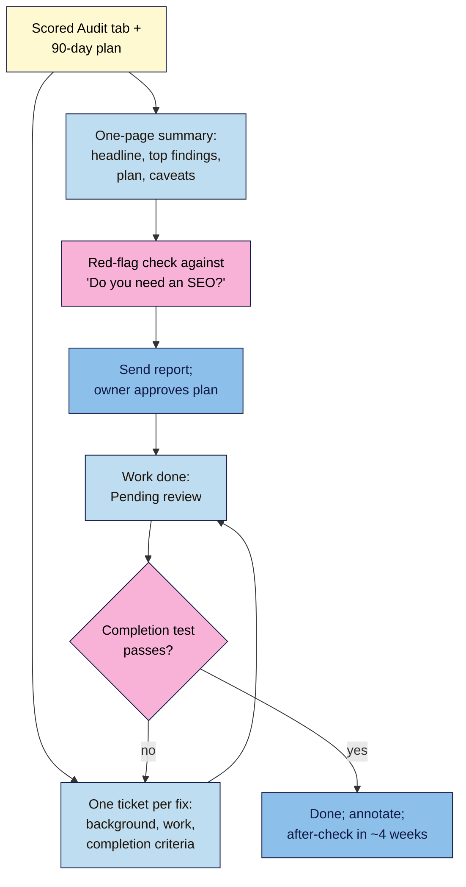

# M15.L04 — Client-Ready Report and Fix Tickets
> After this lesson you can write an audit report a busy owner can read in five minutes, turn each fix into a ticket anyone can carry out and check, and test your own report against the standards Google tells site owners to expect.

**Time:** ~12 min reading + ~45 min hands-on + ~10 min exercise · **Level:** L3 Advanced · **Prereqs:** M15.L03, M08.L06 · **Remediate to:** M08.L06
**Verified against:** Google Search Central *Do you need an SEO?* (last updated 2026-06-05) and *SEO Starter Guide* (2025-12-10); Sitebulb, *How to write the perfect SEO ticket for your devs* (Gus Pelogia, 2024-11-18) and Search Engine Journal, *user stories and acceptance criteria* (Kristina Azarenko, 2021-06-02), both observed practice. Checked on 2026-11-11.

> ⚠️ **Freshness flag:** no official format exists for SEO audit reports or tickets. The report outline and ticket template here are **course templates** built from Google's expectations and practitioner guides. Search Console labels used in completion checks (such as "URL is on Google") can change; recheck them in the tool.

## Learning objectives
1. **Write** an executive summary and findings with evidence, sources and caveats. *(O1)*
2. **Write** fix tickets with background, work to be done and testable completion criteria. *(O2)*
3. **Check** a report against Google's "Do you need an SEO?" red flags. *(O3)*

## Why it matters
Amara's first client report was 31 slides. Slide 4 said "Fix canonicalisation". The café's web developer fixed the canonical on the home page, marked it done and sent an invoice. Nine menu pages still pointed their canonicals to an old domain. Nobody had said which pages, what "fixed" looked like or how to check.

Google's advice to site owners is to ask an SEO: "Will you share with me all the changes you make to my site, and provide detailed information about your recommendations and the reasoning behind them?" A good report answers that for the owner. A good ticket answers it for whoever does the work.

## Core concept
**Plain version:** the **report** is for the decision-maker: what's wrong, what it costs them, what you recommend, and what you can't promise, on one page, with the evidence behind it. A **fix ticket** is for the person doing the work: one task, why it matters, exactly what to change on which pages, and a test that proves it's done.

**Analogy:** a doctor's letter and a prescription. The letter tells the patient what's wrong and the plan, in plain words. The prescription tells the pharmacist exactly what to give, how much and for how long. Mixing them up produces a patient who can't follow the plan and a pharmacist who can't fill it.

**Precise definitions:**
- **Executive summary:** the top of the report: the headline, the top findings in business language, the plan in one sentence, and the caveats.
- **Finding (in a report):** problem + pages or template + evidence + source and date + score + recommendation.
- **Fix ticket:** one task with Background, Work to be done and Completion criteria, plus owner, due date and status.
- **Completion criteria** (also "acceptance criteria" or "definition of done"): a test anyone can run that shows the fix is live and correct.

### The report (course template)
| Section | What goes in | Length |
|---|---|---|
| **1 Headline** | One sentence: the state of the site and the biggest opportunity | 1 line |
| **2 Top findings** | The blocking items and the top-scored findings, in business language ("Your 24 category pages can't appear in Google") | 3–5 bullets |
| **3 The plan** | Days 1–30, 31–60, 61–90 in one line each | 3 lines |
| **4 Caveats** | Timing, no guarantees, data limits | 2–3 lines |
| **5 Scope and baseline** | What you checked, how, the access you had, and the dated baseline | A short table |
| **6 Findings** | One row per finding by audit step: evidence, source + date, Value / Chance / Effort, recommendation | Table |
| **7 Checked and fine** | What you looked at and found no problem with | A short list |
| **8 Appendix** | The full Audit tab, crawl exports, screenshots | Linked |

Sections 1–4 fit on one page. That's what the owner reads. Sections 5–8 are there so anyone can check your work.

**Write findings in business language first, then technical.** "Your 24 category pages can't appear in Google, so shoppers searching 'ceramic mugs' can't find those pages. Cause: the category template has a `noindex` tag (Search Console, Page indexing, 2026-11-11)."

**"Checked and fine" builds trust.** It shows the audit covered the whole site, not just the problems, and stops the next agency "discovering" things you already cleared.

**Caveats belong on page one.** Google's own lines are good to borrow: "There are no secrets here that'll automatically rank your site first in Google (sorry!)", and changes can take "a few hours" or "several months". Add your data limits: low traffic, a data anomaly in the period, access you didn't have.

### The fix ticket (course template)
Sitebulb's ticket guide uses three headings: **Background**, **Work to be done** and **Completion criteria** *(observed practice)*. The course template adds the fields a small team needs to track progress.

| Field | What to write | Example: Tomás |
|---|---|---|
| **ID + title** | One task, one verb | T-01 Remove `noindex` from the category template |
| **Finding** | Audit row and step | A-03, step 1 (indexing), blocking |
| **Background** | Why it matters and the evidence: "Explain why this became an issue, what it solves" | 24 category pages excluded by `noindex` since the July theme update; they used to get about a fifth of organic clicks |
| **Work to be done** | Exactly what, where, with "the list of pages that need updating, before and after expected" | In the theme's SEO settings, turn off "noindex category archives". All 24 URLs in the attached list |
| **How to reproduce** | Steps to see the problem | View source of `/category/mugs/`: `<meta name="robots" content="noindex">` |
| **Completion criteria** | A test with a pass result | `noindex` gone from all 24 (Screaming Frog list mode: Indexability = Indexable); URL Inspection live test on 3 samples shows indexing allowed |
| **Owner · Due · Status** | Who, when, where it stands | Developer · 18 Nov · To do |
| **After-check** | Date and measure (Lesson 15.3) | 16 Dec: Page indexing count for categories; category clicks vs baseline |

Two rules from practitioners worth keeping *(observed practice)*:
- **One task per ticket.** Sitebulb: "It's also essential to make each request one separate ticket." "Fix canonicalisation" is a project, not a ticket.
- **Say what, not how, for developers.** In Kristina Azarenko's words, "it's up to a developer how they're going to implement it since it's their area of expertise." Your completion criteria define success; and "they can later be used for testing the implementation."

### Completion criteria you can test with free tools
| Fix | Test | Pass looks like |
|---|---|---|
| Remove `noindex` | Screaming Frog list mode; URL Inspection live test | Indexable; indexing allowed |
| Redirect old URL | `curl -I https://old-url` | One `301` to the right URL, which returns `200` |
| Fix structured data | Rich Results Test | Item detected, no errors |
| Fix 404 internal links | Re-crawl; Inlinks to the 404 | Zero internal links to the 404s |
| Unique titles on a template | Screaming Frog Page Titles → Duplicate | Zero duplicates on that template |
| Page experience | PageSpeed Insights (lab) now; Core Web Vitals report (field) at the after-check | Lab metric improved; field status later |

Status flow: **To do → In progress → Pending review → Done.** "Pending review" means the worker says it's done and you haven't tested it yet. Only your test moves it to Done.

### Check your own report against Google's red flags
*Do you need an SEO?* is written for site owners judging SEOs. Run your report through it before you send it:

| Google's question or warning | Your report passes if… |
|---|---|
| "realistic estimates of improvement, and an estimate of the work involved" | Every finding has Value and Effort, with reasons |
| "Do they cite official Google documentation as supporting evidence for their recommendations?" | Every finding has a source + date |
| "provide detailed information about your recommendations and the reasoning behind them" | Background and score notes explain why |
| "If they guarantee you that their changes will give you first place in search results, find someone else." | No promises of rankings or traffic |
| AI advice ("also known as "AEO" "GEO" services") should be "aligned with Google Search's official guidance on optimizing for generative AI features" | Any AI-search advice cites Google's AI features guidance (Module 14) |
| Check tool audits "against official guidance from Google Search" | No unsourced tool scores or "health scores" as findings |

## How it works

**In words:** from the scored Audit tab and 90-day plan, write a one-page summary (headline, top findings, plan, caveats) and one ticket for each fix. Check the report against Google's red flags before sending it, and get the owner's approval for the plan. When the work is done, the ticket goes to Pending review. If your completion test fails, it goes back with a note; if it passes, mark it Done, annotate the change and set the after-check for about four weeks later.

> **Under the hood: why tickets need tests, not descriptions.** "Fix the canonicals" can be "done" in many ways, including the wrong one. A test with a pass result ("all 9 menu URLs return a self-referencing canonical in Screaming Frog") has only one way to pass. It also lets someone who doesn't know SEO check the work, which matters when the owner, not you, signs off the invoice *(course explanation)*.

## Hands-on walkthrough
You'll write a one-page **audit report** and three **fix tickets**, then test one fix if you can make it.

**Before you start: which steps apply to you?**
- **Path A (your own site):** do every part; you're both reader and worker, so the tickets are your to-do list.
- **Path B (practice sites):** do every part, and make at least one of the fixes on the WordPress practice site.
- **Path C (client site):** write the report and tickets; send them only after the owner has agreed the scope. Don't make changes without written approval and the right access.

**Part A — The one-page summary (15 min)**
1. In a document, write sections 1–4 of the report: headline, 3–5 top findings in business language (blocking first), the plan in three lines, caveats.
2. Under them, add sections 5–7 (scope and baseline, findings table, checked and fine) and link the Audit tab as the appendix.
   > 🖼️ **Image prompt:** A one-page document (A4 portrait, 1240×1754) titled "SEO audit — summary" with a one-line headline, four bullet findings in plain language, a three-line 30/60/90 plan, and a short "What we can't promise" caveats box at the bottom. Highlight the caveats box with a 3px #F9B2D7 outline; blur any personal details.
   > **Alt text:** A one-page audit summary with headline, four plain-language findings, a three-line plan and a caveats box.

**Part B — Three fix tickets (20 min)**
1. Create a **Fix tickets** tab with the fields from the template. Write tickets for your blocking item (if any) and your next two highest-scoring findings.
2. Make sure each ticket has one task, a page list or template, and completion criteria testable with a free tool from the table.
   **Expected:** someone who has never seen your audit could do the work and check it from the ticket alone.
   > 🖼️ **Image prompt:** A spreadsheet tab named "Fix tickets" (1280×800) with three rows (T-01, T-02, T-03) and columns ID + title, Finding, Background, Work to be done, How to reproduce, Completion criteria, Owner, Due, Status ("To do", "Pending review", "Done") and After-check. Highlight the Completion criteria column with a 3px #F9B2D7 outline; blur any personal details.
   > **Alt text:** A Fix tickets sheet with three tickets, each with testable completion criteria and a status.

**Part C — Red-flag check and one test (10 min)**
1. Go through the red-flag table. Fix anything your report fails (a missing source, a promise, an unsourced tool score).
2. If you can make one fix now (paths A and B), do it, run its completion test, set the status to **Done** only if it passes, annotate it in Search Console, and set its after-check date.
   **Expected:** a pass result you could screenshot, such as `HTTP/2 301` then `HTTP/2 200` from `curl -I`, or Rich Results Test with no errors.

**Expected output:** a report with a one-page summary and supporting sections, a **Fix tickets** tab with three tickets, a passed red-flag check, and (paths A and B) one tested fix.

## When to use / when not to
**Do this** at the end of every audit, and for any change you hand to someone else, even a friend fixing your theme.

**Don't** send the raw Audit tab as the report, bundle several fixes into one ticket, write "fixed" without a test, or bury caveats at the end.

**The trade-off:** a one-page summary leaves things out, and some owners will ask for "everything". Give them the appendix. The one page is what they'll actually read and act on *(course rule of thumb)*.

## Use AI for this
**Example prompt:**
> "Here's finding A-03 with its evidence and source: [paste]. Write a fix ticket with Background, Work to be done, How to reproduce and Completion criteria. The completion criteria must be testable with free tools (Screaming Frog list mode, URL Inspection, Rich Results Test or curl -I). Don't promise ranking or traffic results."

**What AI does well here:** turning notes into clean ticket text, rewriting technical findings in business language, and spotting tickets that hide two tasks.
**Where it gets it wrong:** it promises outcomes, invents tool labels and menu paths, and writes vague tests ("verify the fix works").
**How to check:** run each completion test yourself once; check every label and path in the real tool; delete any promise.

## Common mistakes
- **The raw export as the report.**
- **Technical language in the summary** ("canonicalisation issues") instead of business impact.
- **Caveats missing or hidden** at the end.
- **No "checked and fine" section.**
- **Tickets with several tasks** ("fix all SEO issues on product pages").
- **Completion criteria that can't be tested** ("titles are better").
- **Marking Done before testing.**
- **Unsourced tool scores** presented as findings.

## Troubleshooting
| Symptom | Likely cause | Fix |
|---|---|---|
| The owner didn't read past page one | Normal | Make page one complete on its own |
| Developer marks Done but test fails | Vague criteria or wrong pages | Move back to In progress with the failed test result |
| Owner asks "will this get us to #1?" | Expected | Quote Google: no one can guarantee it; point to your estimates |
| URL Inspection still shows the old state | Google hasn't recrawled | Use the live test for the fix; the indexed result comes later |
| A ticket keeps growing | It's really a project | Split it into one ticket per task |

## Exercise
**Task:** finish Parts A–C. Then answer these. All details are illustrative.
1. Rewrite "Canonicalisation issues detected (9)" as a top finding in business language.
2. Write completion criteria for "Redirect `/old-menu/` to `/menu/`".
3. Amara's ticket says "Improve page speed on the site". What's wrong, and how would you split it?
4. Nila's report says "These changes will double your traffic by spring." What does the red-flag check say?
5. Why include "checked and fine"?
6. A developer says the `noindex` is removed, but URL Inspection still shows "Excluded by 'noindex' tag". Is the ticket failed?

**Expected outcome:** the report, tickets and test, and these answers:
- **1** For example: "Nine menu pages tell Google to show an old web address instead, so they may not appear for searches like 'café menu Lagos'. Cause: canonical tags point to the old domain (Screaming Frog crawl, 2026-11-11)."
- **2** `curl -I https://example.com/old-menu/` shows one `301` with `Location: https://example.com/menu/`, and `/menu/` returns `200`; no internal links still point to `/old-menu/` (re-crawl).
- **3** It's several tasks with no test. Split by template and metric, such as "Compress hero images on the menu template" with "PSI lab LCP on 3 sample pages under 2.5 s".
- **4** It fails: Google tells owners to walk away from guarantees. Replace with realistic estimates and caveats.
- **5** It shows the audit covered the whole site, builds trust, and stops the same checks being redone or "discovered" later.
- **6** Not necessarily. The indexed result shows Google's last crawl. Run the **live test**: if it shows indexing allowed, the fix is live; the indexed status updates after a recrawl.

**Stretch goal:** turn one ticket into a user story: "As a [role], I want [change], so that [outcome]", keeping your completion criteria as the acceptance criteria.

## Key takeaways
- Report page one: headline, 3–5 findings in business language, the plan in three lines, caveats. Everything else supports it.
- Every finding: evidence, source + date, score, recommendation. Add "checked and fine".
- One task per ticket: Background, Work to be done, How to reproduce, Completion criteria, owner, due, status, after-check.
- Completion criteria are tests with a pass result; only a passed test moves a ticket to Done.
- Check your report against Google's red flags: realistic estimates, cited sources, reasoning, no guarantees.

## Teach it back
Explain to a web developer in 3 sentences why your tickets have a "Completion criteria" field and why you'll test it before they invoice.

## Glossary terms added
- Executive summary — added to `seo-101/glossary.md`
- Fix ticket — added to `seo-101/glossary.md`
- Completion criteria — added to `seo-101/glossary.md`

## Further reading
*All checked 2026-11-11.*
- Google Search Central — Do you need an SEO?: https://developers.google.com/search/docs/fundamentals/do-i-need-seo
- Google Search Central — SEO Starter Guide: https://developers.google.com/search/docs/fundamentals/seo-starter-guide
- Sitebulb — How to write the perfect SEO ticket for your devs (observed practice): https://sitebulb.com/resources/guides/how-to-write-the-perfect-seo-ticket-for-your-devs/
- Search Engine Journal — Technical SEO buy-in with user stories (observed practice): https://www.searchenginejournal.com/technical-seo-buy-in-user-stories/408878/

> ⚠️ **May change:** Search Console status labels used in completion checks; *Do you need an SEO?* (its AI lines were added recently).

## Refresher card
*Used by remediation when a learner fails a quiz twice on a later lesson that points back here.*
**Report:** page one = headline, 3–5 findings in business language (blocking first), 30/60/90 plan in 3 lines, caveats (no guarantees; changes take weeks to months; data limits). Then scope + baseline, findings table (evidence, source + date, V/C/E, recommendation), checked and fine, appendix. **Ticket:** one task; Background · Work to be done (pages, before/after) · How to reproduce · Completion criteria (free-tool test with pass result) · owner · due · status (To do → In progress → Pending review → Done) · after-check. Say what, not how. **Red-flag check:** realistic estimates + work estimate; cites Google docs; reasoning shared; no guarantees; AI advice aligned with Google's guidance.
