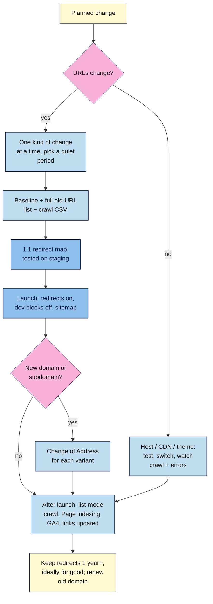

# M15.L05 — Site Migrations and Redesigns
> After this lesson you can tell which kind of site change you're facing, plan it one change at a time, build and test a redirect map before launch, use checklists for before, during and after launch, and decide when Search Console's Change of Address tool applies and how long to keep redirects and the old domain.

**Time:** ~15 min reading + ~50 min hands-on + ~10 min exercise · **Level:** L3 Advanced · **Prereqs:** M15.L04, M06.L05 · **Remediate to:** M06.L05
**Verified against:** Google Search Central *Site moves with URL changes* (last updated 2026-08-20) and *Changing your hosting* (2025-12-10); Search Console Help *Change of Address tool* (no date shown); Screaming Frog, *How to use the SEO Spider in a site migration* (observed practice). Checked on 2026-11-11.

> ⚠️ **Freshness flag:** Google's site-move page (updated August 2026) still mentions some older Search Console names, such as "Index Coverage" (now **Page indexing**) and a crawl-rate setting that was removed in 2024. Use today's reports, and note there's no crawl-rate setting to change. Screaming Frog's free version crawls up to 500 URLs, and several of its migration features (saving crawls, crawl comparison) need a paid licence; this lesson uses CSV exports instead.

## Learning objectives
1. **Classify** a change (URL changes: HTTPS, domain, paths; no URL changes: hosting, CDN) and change one thing at a time. *(O1)*
2. **Build** a one-to-one redirect map and pre-launch, launch and post-launch checklists. *(O2)*
3. **Decide** when to use Change of Address, and how long to keep redirects and the old domain. *(O3)*

## Why it matters
Nila decided to rebrand. In one October week she moved from `nilacoffee.example` to `nilaroasters.example`, switched to a new theme, renamed every product URL and launched a "fresh" blog structure. She redirected the old home page to the new one and stopped there. Within a month organic orders fell by more than half, right before the Diwali gifting season, and she couldn't tell which of the four changes did the damage.

Migrations are where a site can lose years of work in a week. Almost every disaster comes from the same few mistakes: changing everything at once, not redirecting every old URL, leaving development blocks in place, and dropping redirects too early. Each one is avoidable with a plan and a checklist.

## Core concept
**Plain version:** a **migration** is any change to where or how a site's pages live. If the URLs change, Google has to discover every new address and move each page's signals to it; your job is to make that easy with a **one-to-one redirect map** and clean signals on the new site. If the URLs don't change (new host, new CDN), the job is to keep the site reachable throughout. Either way, change one thing at a time, test before launch, and watch closely after.

**Analogy:** moving house. You don't move, repaint every room and change your name in the same week. You give the post office a forwarding address for **every** person who writes to you (not just your mother), keep the forwarding active for a long time, and keep the old phone number for a while so nobody else picks it up.

**Precise definitions:**
- **Site move with URL changes:** HTTP to HTTPS, a new domain, or new URL paths. Google: "URL changes from HTTP to HTTPS", "Domain name changes", "URL paths changes".
- **Site move without URL changes:** new hosting or a CDN. Google's guide covers "migrations that don't affect the user-visible URL".
- **Redesign:** a new theme or layout. If URLs stay the same, it's not a move, but it can still change titles, headings, internal links and content, so treat it with the same checks.
- **Redirect map:** every old URL and the single new URL it should go to (Lesson 6.5).
- **Change of Address tool:** a Search Console tool that tells Google a whole domain or subdomain has moved to another.

### Which kind of change is it?
| Change | URLs change? | Redirects | Change of Address? |
|---|---|---|---|
| HTTP → HTTPS | Yes (protocol) | All `http://` → `https://` | **No.** Google: "don't use this tool; Google will figure out your changes for you." |
| www ↔ non-www | Yes (host) | All, one way | **No.** "use canonical tagging and/or redirects without using the change of address tool." |
| New URL paths (slugs, folders) | Yes | Every changed URL | **No**: "moving paths within the same domain" doesn't need it |
| New domain or subdomain | Yes | Every URL, old → new | **Yes**, after redirects are live |
| New host or CDN | No | None | **No** |
| New theme, same URLs | No | None (unless slugs change) | **No** |

### One change at a time
Google's site-move guide is direct: "Plan your changes to your site one after the other, not everything at the same time." For a new domain, a new CMS and a new layout, "do them one at a time: move to a new domain, then change your site's layout."

The Change of Address help page explains the cost of combining them: "If you combine a site move with a redesign of the site's content and URL structure in the new location, you will probably see some traffic loss as Google might need to relearn and reassess the individual pages."

**Timing:** "If your traffic is seasonal or dips on certain weekdays, it makes sense to move your site during the recurring traffic dips." For Nila, that's not October.

**For small sites, move everything together:** "We recommend moving all URLs on your site simultaneously instead of moving one section at a time" (for small and medium sites). "One change at a time" means one **kind** of change, not one section.

### The redirect map, at migration scale
You built a redirect map in Lesson 6.5. For a migration, the list of old URLs must be complete. Google suggests collecting them from your sitemaps, analytics or logs (the pages with the most traffic), Search Console's Links report and your CMS, and to "Include images and videos" and other files. Then:
- Map each old URL to the **most relevant** new URL, in **one hop**, with a **301** (or 308).
- Don't send everything to the home page. Google warns that irrelevant redirects may be treated as soft 404s.
- Pages you're not moving should return **404 or 410** on the new site.
- On a domain move with the same paths, a single pattern ("wildcard") redirect can do it, but you still test a full list.

Google is clear that permanent redirects don't waste link value: "301 and other permanent redirects don't cause a loss in PageRank."

### Checklists
| Before launch | Launch day | After launch (first weeks) |
|---|---|---|
| Baseline recorded (Lesson 15.1); full crawl exported to CSV | Turn on redirects | Crawl the new site: everything you want ranked shows **Indexable** |
| Complete old-URL list; redirect map tested on staging | Remove dev `noindex` and robots.txt blocks | List-mode crawl of all old URLs: one 301 → 200, right target |
| New site: self-referencing canonicals, updated internal links, hreflang, structured data | Check canonicals point to the new URLs | Page indexing and Crawl stats on both properties |
| Images and PDFs moved ("Transfer images and downloads (such as PDF documents) that you host") | Submit the new sitemap | GA4 Realtime and key events working on the new site |
| Analytics tag, Search Console verification and robots.txt ready for the new site | Change of Address (domain moves only) | Update profile links: Business Profile, social bios, ads, email signatures |
| Verify **all variants** of old and new sites in Search Console | Test a sample with URL Inspection and `curl -I` | Ask the sites that link to you most to update their links |
| Server ready for heavier crawling | Annotate the launch | Fix "Not found" spikes: "We frequently see people redirecting to the wrong (non-existent) URLs on the new site." |

### Change of Address: rules worth memorising
- **When:** "after you've moved and redirected your site", for domain or subdomain moves only.
- **Who:** "You must be an owner of both the old and new properties in Search Console." A Restricted or Full user can't submit it (Lesson 15.1).
- **www and subdomains:** "The tool does not move any subdomains below the specified domain (including www)." Submit it for each verified variant you used.
- **Don't chain:** "Don't chain site moves." A → B, then B → C straight away, isn't allowed.
- **180 days:** the tool's effects last 180 days, and you can cancel within that window. That's the **tool's** window, not a deadline for removing redirects.

### How long to keep redirects and the old domain
| Source | Says |
|---|---|
| Site-move guide | "Keep the redirects for as long as possible, generally at least 1 year." "From users' perspective, consider keeping redirects indefinitely." |
| Change of Address help | "Maintain the redirects for at least 180 days--longer if you still see any traffic to them from Google Search." And keep paying for the old domain "for at least a year to prevent others from buying and using your abandoned domain for malicious purposes." |

The course rule (from Lesson 6.5): **keep redirects at least a year, ideally for good, and keep renewing the old domain.** 180 days is the minimum in one help page, not a target.

### How long does it take?
"it can take a few weeks or more for Google to gradually start showing the new URLs instead of the old ones" for medium sites, longer for large ones. Rankings may move around meanwhile: "This is normal and a site's rankings will settle down over time." Don't panic-reverse a move in week two: rolling back creates a second move.

### Moves without URL changes (new host or CDN)
The checklist is shorter. Test the new host on a temporary hostname with `noindex`. Check that firewalls and bot protection don't block Googlebot ("Make sure it does not block Googlebot's ability to reach the DNS or the hosting provider's servers"). Lower the DNS TTL "at least a week in advance". Then switch DNS, watch Crawl stats and server errors, and shut down the old host only when traffic to it has stopped.

## How it works

**In words:** first ask whether URLs will change. If not (a new host, CDN or theme with the same URLs), test the new set-up, switch, and watch crawling and errors. If they will, make one kind of change at a time, in a quiet period. Record a baseline, a full list of old URLs and a crawl export, then build a one-to-one redirect map and test it on staging. At launch, turn on redirects, remove development blocks and submit the new sitemap. Use Change of Address only for a new domain or subdomain, once for each variant. After launch, crawl the old URLs in list mode, watch Page indexing and GA4, and update links you control. Keep redirects for at least a year, ideally for good, and keep renewing the old domain.

> **Under the hood: why Google moves sites page by page.** Google says the move "takes place on a per-URL basis": each old URL is only treated as moved once Googlebot has recrawled it and followed its redirect. Popular pages are recrawled quickly; rarely visited ones can take months. That's why a redirect removed after a few months can strand pages Google hasn't revisited yet, and why the advice is a year or more *(course explanation of Google's site-move guide)*.

## Hands-on walkthrough
You'll do a **redirect map dry run**, build a **Migration checklist** tab and practise the Change of Address decision. You won't move a live site.

**Before you start: which steps apply to you?**
- **Path A (your own site):** do every part as a rehearsal for a change you might make (for example, new product slugs).
- **Path B (practice sites):** do every part on the WordPress practice site: change three slugs for real, redirect them and test.
- **Path C (client site):** do Parts A and C as a plan only. Never change a client's URLs without written approval and a launch date.

**Part A — Redirect map dry run (25 min)**
1. Build the full old-URL list: your sitemap URLs plus Screaming Frog's crawl export (HTML pages, images and PDFs). Remove duplicates. Save the crawl as a dated CSV, because the free version can't save crawls.
2. In a **Migration map** tab, map each old URL to its new URL (for a rehearsal, invent new paths for one section, such as `/shop/` → `/coffee/`). Add columns **Type (301) · Tested status · Hops · Final URL correct? · Date**.
3. **Path B:** change three slugs on the practice site and add the redirects (Lesson 6.5). Then, in Screaming Frog, switch to **Mode → List**, paste the old URLs and crawl. Check each one: one hop, 301, final status 200, correct target. Confirm a sample with `curl -I`.
   **Expected:** every old URL reaches the right new URL in one hop. Any chain, 302, 404 or redirect to the home page is a fix before launch.
   > 🖼️ **Image prompt:** Screaming Frog in List mode (1280×800) showing old URLs crawled, with columns Address, Status Code (301), Redirect URL and a final 200 status, one row showing a 302 chain flagged. Highlight the row with the chain using a 3px #F9B2D7 outline; blur any personal details.
   > **Alt text:** Screaming Frog list mode results for old URLs, all 301 to a 200 page except one flagged redirect chain.

**Part B — Migration checklist (15 min)**
1. Create a **Migration checklist** tab with three sections (Before launch, Launch day, After launch) and the items from the table, plus columns **Owner · Done (date) · Evidence**.
2. Add the after-launch watch dates: day 1, day 3, week 1, week 2, week 4, then monthly to month 12 (for redirect and domain renewal checks).
   > 🖼️ **Image prompt:** A spreadsheet tab named "Migration checklist" (1280×800) with three sections — Before launch, Launch day, After launch — each item with Owner, Done (date) and Evidence columns, and a row "Keep redirects ≥ 1 year; renew old domain" at the bottom. Highlight that row with a 3px #F9B2D7 outline; blur any personal details.
   > **Alt text:** A Migration checklist sheet in three sections with owners, dates and evidence, ending with a keep-redirects row.

**Part C — Change of Address decision drill (10 min)**
For each change, decide: redirects only, or redirects plus Change of Address? Who must submit it?
1. `http://kavyayoga.example` → `https://kavyayoga.example`
2. `nilacoffee.example` → `nilaroasters.example`
3. `www.tomasceramics.example` → `tomasceramics.example`
4. Amara's client moves from one host to another; every URL stays the same
5. `/products/mug-blue` → `/mugs/blue`

**Expected:** 1 redirects only (HTTPS). 2 redirects plus Change of Address, submitted by an owner of both properties, for each variant used (such as `www.nilacoffee.example` too). 3 redirects only (www). 4 neither: no URLs change, so no redirects and no Change of Address; follow the hosting checklist. 5 redirects only (paths).

**Expected output:** a tested **Migration map** (or a planned one on path C), a **Migration checklist** tab with watch dates, and the drill answers.

## When to use / when not to
**Do this** before any change of domain, protocol, URL paths, CMS, theme or host, and when an owner says "we're rebranding" or "we're redesigning".

**Don't** combine a domain move with a redesign, redirect everything to the home page, use Change of Address for HTTPS or www changes, remove redirects after 180 days, or let the old domain expire.

**The trade-off:** doing one change at a time takes longer, and owners often want the rebrand, new design and new shop all at once. The cost of combining them is not knowing which change caused a drop, and Google relearning every page at once. If they insist, record the baseline, keep URLs the same wherever possible, and set expectations in writing *(course rule of thumb)*.

## Use AI for this
**Example prompt:**
> "Here are 120 old URLs and 115 new URLs from a WooCommerce shop: [paste both lists]. Propose a one-to-one redirect map as a table (old, new, reason). If an old URL has no clear match, mark it 'needs decision', not the home page. Don't invent URLs that aren't in the new list."

**What AI does well here:** matching similar slugs, spotting URLs with no match, and turning a map into server redirect rules for you to check.
**Where it gets it wrong:** it sends unmatched pages to the home page or a category, invents new URLs, and writes redirect rules with subtle syntax errors.
**How to check:** test every old URL in list mode and a sample with `curl -I`; manually check that the final page is the right match.

## Common mistakes
- **Changing domain, design and URLs in the same week.**
- **Only the home page redirected**, or everything sent to the home page.
- **Redirect chains** (old → interim → new) and 302s where 301s are needed.
- **Development `noindex` or robots.txt blocks left on** after launch.
- **Canonicals and internal links still pointing to the old URLs.**
- **Images and PDFs forgotten.**
- **Change of Address used for HTTPS or www**, or submitted without the www variant on a domain move.
- **Redirects removed after 180 days**, or the old domain allowed to expire.
- **Panic rollback** in the first weeks.

## Troubleshooting
| Symptom | Likely cause | Fix |
|---|---|---|
| New pages not indexed after launch | Dev `noindex` or robots.txt block left on | Remove; check with URL Inspection live test |
| Spike in "Not found" | Redirects to wrong or non-existent URLs | List-mode crawl of old URLs; fix the map |
| Google still shows old URLs | Not recrawled yet; canonicals or internal links point to old URLs | Fix canonicals and links; wait ("a few weeks or more") |
| Change of Address won't submit | Not an owner of both, or redirects not live | Owner submits; check home page 301 |
| Traffic fell after a combined move and redesign | Several changes at once | Fix obvious breaks; don't roll back; wait and compare page groups |
| Crawl errors after a host move | Firewall or bot protection blocking Googlebot | Check Crawl stats and host logs; allow Googlebot |

## Exercise
**Task:** finish Parts A–C. Then answer these. All details are illustrative.
1. List four things Nila got wrong in her October rebrand.
2. Tomás is moving to HTTPS. Does he need Change of Address? What does he need?
3. Kavya's agency says "Redirects can go after 180 days; that's what Google says." Reply.
4. Amara's client is changing host but keeping every URL. What are the three most important checks?
5. Two weeks after a domain move, traffic is down 20%. The client wants to switch back. What do you say?
6. Who can submit a Change of Address, and what must be in place first?

**Expected outcome:** the map, checklist and drill, and these answers:
- **1** Several changes at once (domain, theme, URLs, blog structure); only the home page redirected; moved in her busiest season; no baseline or tested map. (Plus anything else from the checklist.)
- **2** No. Redirect every `http://` URL to its `https://` version in one hop, update canonicals and internal links, submit the HTTPS sitemap, and verify the HTTPS property.
- **3** 180 days is the Change of Address tool's window and a minimum ("longer if you still see any traffic"). The site-move guide says "at least 1 year" and suggests keeping them indefinitely for users. Keep them, and renew the old domain.
- **4** Test on a temporary hostname with `noindex`; make sure firewalls and bot protection don't block Googlebot; lower the DNS TTL a week ahead, then watch Crawl stats and server errors after switching.
- **5** Moves take "a few weeks or more", and rankings "will settle down over time". Check the checklist for real breaks (redirects, blocks, canonicals) and fix those; rolling back would be a second move.
- **6** An owner of both old and new properties, using the same Google account, after the redirects (at least the home page 301) are live.

**Stretch goal:** write a one-page migration brief for an owner who wants a rebrand and redesign: what happens in which order, what you'll measure and when, and what you can't promise.

## Key takeaways
- Classify first: URL changes (HTTPS, domain, paths) need a full redirect map; hosting and CDN moves don't.
- One kind of change at a time, in a quiet period. Small sites move all URLs together.
- Redirect every old URL (including images and PDFs) to its best match, one hop, 301; test in list mode and with `curl -I`.
- Change of Address only for domain or subdomain moves, by an owner of both, for each variant, after redirects are live.
- Keep redirects at least a year, ideally for good, and renew the old domain. 180 days is the tool's window, not the redirect lifetime.

## Teach it back
Explain to a business owner in 3 sentences why you won't launch their new domain and new design in the same week.

## Glossary terms added
- Site migration — added to `seo-101/glossary.md`
- Change of Address tool — added to `seo-101/glossary.md`
- Wildcard redirect — added to `seo-101/glossary.md`

## Further reading
*All checked 2026-11-11.*
- Google Search Central — Site moves with URL changes: https://developers.google.com/search/docs/crawling-indexing/site-move-with-url-changes
- Google Search Central — Changing your hosting (no URL changes): https://developers.google.com/search/docs/crawling-indexing/site-move-no-url-changes
- Search Console Help — Change of Address tool: https://support.google.com/webmasters/answer/9370220
- Screaming Frog — How to use the SEO Spider in a site migration (observed practice; some steps need a licence): https://www.screamingfrog.co.uk/seo-spider/tutorials/how-to-use-the-seo-spider-in-a-site-migration/

> ⚠️ **May change:** the site-move guide still uses some older report names; Change of Address requirements; Screaming Frog's free features.

## Refresher card
*Used by remediation when a learner fails a quiz twice on a later lesson that points back here.*
**Classify:** URL changes (HTTP→HTTPS, domain, paths) vs no URL changes (host, CDN, theme with same URLs). **One change at a time**, in a quiet period; small sites move all URLs together. **Map:** full old-URL list (sitemap, crawl, analytics, Links report, CMS, images, PDFs) → best match, one hop, 301; dropped pages 404/410; never all to home. **Launch:** redirects on, dev blocks off, canonicals/internal links new, new sitemap. **After:** list-mode crawl of old URLs, Page indexing, Crawl stats, GA4, update profile links. **Change of Address:** domain/subdomain moves only; owner of both; each variant (www); after redirects; not for HTTPS, www or paths; 180-day window. **Keep redirects** ≥1 year, ideally for good; renew old domain. Settling takes "a few weeks or more"; don't roll back.
