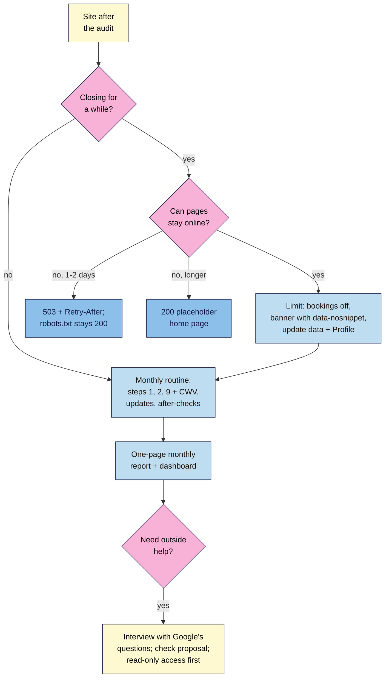

# M15.L06 — Pausing a Site, the Monthly Routine and Hiring Help
> After this lesson you can pause a business site without losing it from Google, run a short monthly SEO routine that catches problems early, and judge an SEO provider or proposal using Google's own questions.

**Time:** ~12 min reading + ~35 min hands-on + ~10 min exercise · **Level:** L3 Advanced · **Prereqs:** M15.L05, M08.L06 · **Remediate to:** M08.L06
**Verified against:** Google Search Central *Temporarily pause or disable a website* (last updated 2025-12-10), *Reduce the Google crawl rate* (2026-10-06) and *Do you need an SEO?* (2026-06-05), checked on 2026-11-11.

> ⚠️ **Freshness flag:** the monthly routine and calendar are **course rules**; Google doesn't publish one. *Do you need an SEO?* was updated in June 2026 with questions about third-party tools and AI ("AEO"/"GEO") advice; recheck it before quoting it to a client. Business Profile closure options are from Lesson 11.3; check them in the Profile before a closure.

## Learning objectives
1. **Choose** between limiting and disabling a site (503 briefly, a 200 placeholder for longer; never 404, `noindex` or Removals). *(O1)*
2. **Set up** a monthly SEO routine and calendar that builds on the M08 report and dashboard. *(O2)*
3. **Evaluate** an SEO provider or proposal with Google's "Do you need an SEO?" questions. *(O3)*

## Why it matters
Kavya closed her studio for a three-week teacher-training retreat. A friend suggested "turning the site off" so nobody booked by mistake, so she set a maintenance plugin to show a "closed" page for every URL. When she came back, her class pages had dropped out of Google, and it took weeks for them to return. All she needed was to disable bookings and add a banner.

The audit is a snapshot. What keeps a site healthy is what happens afterwards: handling closures safely, checking a few things every month, and knowing when outside help is worth paying for and how to tell good help from bad.

## Core concept
**Plain version:** to pause a business, **keep the site online and switch off the part that takes orders or bookings.** Only turn the site off for a day or two, with a 503. To keep a site healthy, run a **monthly routine**: check that Google can still find and trust the site, look at the numbers, check due after-checks, and send the one-page report. To hire help, **interview** the provider with Google's questions and **check their proposal** the way you checked your own report.

**Analogy:** a shop going on holiday puts a sign on the door ("Back on 2 December") and keeps the lights on in the window. It doesn't brick up the entrance and take the name off the street directory. And it gets its boiler serviced every year, by someone who explains what they did, not someone who promises it'll "never break".

**Precise definitions:**
- **Limit functionality:** keep pages online and indexable, but turn off the cart or bookings and add a notice. Google's recommended way to pause.
- **Disable the site:** replace pages with an error (503) or a placeholder (200). Only for short or unavoidable closures.
- **503 Service Unavailable:** a "come back later" status code; fine for a day or two.
- **`Retry-After`:** an HTTP header saying when to try again.
- **Monthly SEO routine:** a short, fixed set of checks and a one-page report, run on the same days each month.

### Pausing a site: what Google recommends
Google's guidance: "If your situation is temporary and you plan to reopen your online business, we recommend that you keep your site online and limit the functionality."

| Option | How | When | Effect in Search |
|---|---|---|---|
| **Limit functionality** (recommended) | Disable cart or bookings ("the simplest approach, and doesn't change anything for your site's visibility in Search"); add a banner (wrap it in `data-nosnippet` so it doesn't become the snippet); update structured data (availability, cancelled events, opening hours); update Business Profile hours | Most closures, any length | None |
| **503 for every page** | Server or maintenance plugin returns `503` with `Retry-After` | "urgently disable the site for 1-2 days" | Fine briefly. Several days of 503s and URLs "may be dropped from Google's index" |
| **200 placeholder home page** | One indexable page explaining the closure | Longer closures that can't use the first option | Other pages drop out; recovery takes time |
| **404, 410, 403, `noindex`** | — | **Never** for a closure | "This will remove the website's URLs from Google Search." |
| **Removals tool** | — | **Never** for a closure | "Don't use the temporary website removal tool in Search Console for closures." |

Three details that trip people up:
- **Never return 503 for robots.txt:** "Don't return a 503 HTTP response status code for the robots.txt file because this blocks all crawling."
- **Out of stock isn't closed:** "It's better to still allow that page, and mark it out of stock."
- **Recovery isn't quick:** after a full removal, "There's no fixed time for a recovery from a complete removal, and there's no mechanism to speed that up." Even "Completely closing a site even for just a few weeks can have negative consequences on Google's indexing of your site."

**For Business Profiles** (Lesson 11.3): use special hours for closures of up to six days; for seven days or more, mark the business "Temporarily closed".

**Check what your maintenance plugin really sends.** Many WordPress maintenance or "coming soon" plugins return a 503; some return a 200 page for every URL, which makes every page look like the same "closed" page. Google's own check is `curl -I -X GET "https://www.example.com/"`.

### The monthly routine (course rule)
The audit's nine steps are too many to repeat every month. The routine keeps the steps that catch silent breakage (1, 2 and 9), adds the M08 report, and moves the rest to quarterly or yearly.

| When | Check | Tool | Time |
|---|---|---|---|
| **Weekly** | Search Console messages; anything sudden in Performance | Search Console, email | 5 min |
| **Monthly** | Step 1: Page indexing changes; key pages still indexed | Page indexing, URL Inspection | 10 min |
| | Step 2: crawl for new 404s, redirect chains, stray `noindex` | Screaming Frog free | 15 min |
| | Step 9: Manual actions, Security issues | Search Console | 2 min |
| | Core Web Vitals status; Google updates and data anomalies in the month | CWV report; Status Dashboard; Data anomalies page | 5 min |
| | After-checks due; update ticket status; annotate changes | 90-day plan, Fix tickets | 10 min |
| | The one-page monthly report and dashboard (Lesson 8.6) | Data Studio, report doc | 30 min |
| **Quarterly** | Content audit (Lesson 7.6); re-score priorities (Lesson 10.5); links and Business Profile check; new 90-day plan | Content audit tab, Audit tab | 2–3 h |
| **Yearly** | Full nine-step audit (Lesson 15.2); renew domains, including old ones; check old redirects still work | Everything | 1 day |

About an hour and a half a month on a small site. If a monthly check finds something, it goes through the same flow as an audit finding: gate, score, ticket.

### Hiring help: Google's questions
Module 1 covered the red flags (guarantees, "priority submit", secret methods, cold emails). Here's the other half: what to ask. Google's *Do you need an SEO?* suggests interviewing a provider, starting with:
- "Can you show me examples of your previous work and share some success stories?"
- "Do you follow the Google Search Essentials (previously known as Webmaster Guidelines)?"
- "What kind of results do you expect to see, and in what timeframe?"
- "How do you measure your success?"
- What's their experience in your industry and your country or city? "How long have you been in business?"
- "Will you share with me all the changes you make to my site, and provide detailed information about your recommendations and the reasoning behind them?"

And three newer checks worth adding to any proposal review:
- **Tools:** "Google doesn't evaluate or endorse third-party SEO tools, and these tools don't have access to Google's internal ranking data."
- **Evidence:** "Do they cite official Google documentation as supporting evidence for their recommendations?"
- **AI search:** for "AEO" or "GEO" services, "is their advice aligned with Google Search's official guidance on optimizing for generative AI features"?

For an audit specifically, the access rule from Lesson 15.1 applies: read-only first.

**Proposal checklist (course rule):** clear scope and deliverables · baseline before work · realistic estimates and timeframe · sources for recommendations · what they'll change and how you'll be told · access requested (least first) · how success is measured (your KPIs, not "rankings") · no guarantees · no link buying or AI-content-at-scale promises · who owns the work and the accounts when the contract ends.

## How it works

**In words:** if the business is closing for a while and the pages can stay online, switch off bookings or the cart, add a banner wrapped in `data-nosnippet`, and update structured data and the Business Profile. If the site must go offline, use a 503 with Retry-After for a day or two (robots.txt keeps returning 200), or a 200 placeholder home page for longer. Either way, the monthly routine checks indexing, crawling, policies and security, Core Web Vitals, updates and due after-checks, then produces the one-page report. If you need outside help, interview the provider with Google's questions, check their proposal and give read-only access first.

> **Under the hood: why a 503 is safe for days but not weeks.** A 503 tells Google "temporarily unavailable, keep what you have". Google keeps the indexed pages and tries again later. But Google can't tell temporary from permanent forever: if a URL keeps returning 503 "for multiple days, the URL may be dropped from Google's index". A 200 page with the real content and bookings switched off has no such clock *(course explanation of Google's crawl-rate and pause guides)*.

## Hands-on walkthrough
You'll check what your site sends in "pause mode", build a **Monthly routine** calendar and review an SEO proposal.

**Before you start: which steps apply to you?**
- **Path A (your own site):** do every part.
- **Path B (practice sites):** do Part A on the WordPress practice site (turn a maintenance plugin on, then off); do Parts B and C in full.
- **Path C (client site):** don't switch the client's site into maintenance mode. Do Part A on your practice site and Parts B and C for the client.

**Part A — Pause-mode check (10 min)**
1. Run `curl -I -X GET "https://your-site.example/"` and note the status (expected `200`).
2. Turn on your maintenance or "coming soon" plugin (practice site only). Run the same command on the home page, a product or class page, and `/robots.txt`.
   **Expected:** you'll see either `503` (with or without `Retry-After`) or `200` on every page. Note which. If robots.txt returns 503, that plugin blocks all crawling while it's on.
3. Turn the plugin off and confirm `200` again. In your notes, write the plugin's behaviour and the pause option you'd use for a 3-week closure (limit functionality).
   > 🖼️ **Image prompt:** A terminal (1280×600) showing `curl -I -X GET` on a home page returning `HTTP/2 503` with a `retry-after: 3600` header, then `/robots.txt` returning `HTTP/2 200`. Highlight the retry-after line with a 3px #F9B2D7 outline; blur any personal details.
   > **Alt text:** Terminal output showing a 503 status with a Retry-After header on the home page and a 200 for robots.txt.

**Part B — Monthly routine calendar (15 min)**
1. Create a **Monthly routine** tab with the checks from the table, a **Day** column (for example, the first Monday of the month for checks, the third for the report) and a **Last done** column.
2. Add the quarterly and yearly items as dated rows, including domain renewal dates.
   **Expected:** about 90 minutes a month, on fixed days, with every row linked to the tab or report it updates.
   > 🖼️ **Image prompt:** A spreadsheet tab named "Monthly routine" (1280×800) with sections Weekly, Monthly, Quarterly and Yearly, columns Check, Tool, Day, Time and Last done, and a "Renew nilacoffee.example — 14 Mar" row in Yearly. Highlight the Monthly section with a 3px #F9B2D7 outline; blur any personal details.
   > **Alt text:** A Monthly routine sheet with weekly, monthly, quarterly and yearly checks, tools, days and last-done dates.

**Part C — Proposal review (10 min)**
Tomás receives this proposal. Review it against Google's questions and the proposal checklist:

> "We'll get you to page 1 for 'handmade ceramics' within 60 days. Our proprietary AI engine has already found 213 issues. Please give us owner access to Search Console and your WordPress admin. We'll publish 100 AI-optimised blog posts a month and build 50 high-DA backlinks. Monthly report: rankings for 20 keywords. €900/month, 12-month minimum."

**Expected:** at least seven problems. For example: a guarantee and a timeframe; a "proprietary" tool (Google doesn't endorse tools or share ranking data with them); no sources; owner access on day one; scaled AI content (spam policy risk, Lesson 14.4); bought links (link spam); rankings as the only measure, not your KPIs; a long lock-in; nothing about sharing changes or who keeps the content.

**Expected output:** a note of your plugin's pause behaviour, a **Monthly routine** tab, and a written proposal review.

## When to use / when not to
**Do this:** limit functionality for any closure; run the routine every month from now on; use the questions whenever you hire, or are hired.

**Don't** turn a site off for weeks, return 404s or `noindex` "while we're closed", use the Removals tool for a closure, skip the routine because "nothing changed", or hire anyone who guarantees rankings.

**The trade-off:** a monthly routine costs time when nothing is wrong, which is most months. The months something *is* wrong (a plugin update adding `noindex`, a hacked page, a redirect loop) are the ones that pay for it, because a problem found in four weeks costs far less than one found in four months *(course rule of thumb)*.

## Use AI for this
**Example prompt:**
> "Here's an SEO proposal I've received: [paste]. Check it against Google's 'Do you need an SEO?' questions and this checklist: [paste checklist]. List each problem with the exact sentence from the proposal. Don't judge the price."

**What AI does well here:** finding guarantees, vague promises and missing items in long proposals, and drafting polite follow-up questions.
**Where it gets it wrong:** it can be swayed by confident wording, invents "industry standards", and may misquote Google.
**How to check:** compare each flagged sentence with the proposal yourself, and quote Google only from the live page.

## Common mistakes
- **Taking the whole site offline** for a long closure.
- **`noindex`, 404s or the Removals tool** "until we reopen".
- **503 on robots.txt** from a maintenance plugin.
- **Removing out-of-stock pages** instead of marking them out of stock.
- **A routine nobody keeps**: no fixed days, too many checks.
- **Reports with only rankings**, not the KPIs from the goal.
- **Hiring on price or promises** without asking Google's questions.
- **Giving a new provider owner access** on day one.

## Troubleshooting
| Symptom | Likely cause | Fix |
|---|---|---|
| Pages dropped after a closure | Site disabled for weeks, or 404/`noindex` used | Restore 200 pages; resubmit sitemap; request indexing for key pages; wait |
| Maintenance plugin returns 200 on every URL | Plugin's "coming soon" mode | Use its maintenance (503) mode for short work, or limit functionality instead |
| Closure banner shows as the snippet | Banner text near the top of every page | Wrap it in `data-nosnippet` |
| Routine keeps slipping | Too long or no fixed day | Cut to steps 1, 2, 9 plus the report; book the days |
| Provider won't say what they changed | Secretive methods | Google: ask them to "share with me all the changes"; consider ending the contract |

## Exercise
**Task:** finish Parts A–C. Then answer these. All details are illustrative.
1. Kavya closes for three weeks. What exactly should she do on the site and the Business Profile?
2. Nila's server needs a 6-hour upgrade. What should the site return, and what about robots.txt?
3. Nila's beans are sold out for a month. Remove the product pages?
4. Which three audit steps does the monthly routine keep, and why those?
5. Amara is interviewing an agency for a client. Give four of Google's questions she should ask.
6. A provider says "our AI tool is approved by Google". What does Google say?

**Expected outcome:** Parts A–C, and these answers:
- **1** Keep the site online; disable bookings; add a banner with `data-nosnippet`; mark events cancelled or update availability in structured data; set the Business Profile to "Temporarily closed" (7+ days).
- **2** A 503 with `Retry-After` for the pages; robots.txt must keep returning 200, because a 503 there "blocks all crawling".
- **3** No: "It's better to still allow that page, and mark it out of stock."
- **4** Steps 1 (indexing), 2 (crawling and status) and 9 (manual actions and security): they catch silent breakage that can remove pages from Search quickly.
- **5** Any four: examples of previous work; following Search Essentials; expected results and timeframe; how they measure success; industry and local experience; how long in business; whether they'll share all changes and reasoning.
- **6** Google doesn't evaluate or endorse third-party SEO tools, and they "don't have access to Google's internal ranking data"; Google also warns about tools claiming to be "approved".

**Stretch goal:** write three polite follow-up questions to the proposal in Part C that would give the agency a chance to show good practice.

## Key takeaways
- To pause, keep the site online and switch off bookings or the cart; add a `data-nosnippet` banner; update structured data and the Business Profile.
- 503 with Retry-After only for a day or two; robots.txt stays 200. Never 404, `noindex` or Removals for a closure.
- Run a monthly routine: steps 1, 2 and 9, CWV, updates and anomalies, after-checks, then the one-page report. Quarterly and yearly checks cover the rest.
- Hire with Google's questions; check proposals for guarantees, sources, access, measurement and AI or link schemes.

## Teach it back
Explain to a small-business owner in 3 sentences why they shouldn't switch their website off while they're on holiday.

## Glossary terms added
- 503 Service Unavailable — added to `seo-101/glossary.md`
- Retry-After — added to `seo-101/glossary.md`
- Monthly SEO routine — added to `seo-101/glossary.md`

## Further reading
*All checked 2026-11-11.*
- Google Search Central — Temporarily pause or disable a website: https://developers.google.com/search/docs/crawling-indexing/pause-online-business
- Google Search Central — Reduce the Google crawl rate: https://developers.google.com/crawling/docs/crawlers-fetchers/reduce-crawl-rate
- Google Search Central — Do you need an SEO?: https://developers.google.com/search/docs/fundamentals/do-i-need-seo

> ⚠️ **May change:** *Do you need an SEO?* (recently updated with AI and tool questions); maintenance plugin behaviour; Business Profile closure options.

## Refresher card
*Used by remediation when a learner fails a quiz twice on a later lesson that points back here.*
**Pause:** keep site online, limit functionality (cart/bookings off, `data-nosnippet` banner, structured data and Profile hours updated; "Temporarily closed" for 7+ days). Urgent 1–2 days: 503 + Retry-After; robots.txt stays 200. Longer: 200 placeholder home page. Never 403/404/410/`noindex`/Removals. Out of stock → keep page, mark out of stock. **Monthly routine:** weekly messages; monthly steps 1, 2, 9 + CWV + updates/anomalies + after-checks + one-page report; quarterly content audit, re-score, links/Profile, new 90-day plan; yearly full audit, domain renewals, old redirects. **Hiring:** previous work; Search Essentials; results and timeframe; how success is measured; experience; share all changes and reasoning; tools not endorsed; cites Google docs; AEO/GEO aligned with Google; read-only first; no guarantees.
