# SEO 101 — Syllabus

_Lessons are added per module by `/plan-module <N>`. Source of truth for topics: `course-outline.md`._

**At a glance:** SEO only (no AEO, GEO or automation), from zero knowledge to a full technical audit · 10 modules · ~46 lessons · each lesson 15–25 min reading + a hands-on exercise and a 5–8 question quiz · one capstone (with a break-it lab) per module · one project site (own, demo or client) carried from the M02 baseline to the final "Full SEO Audit & 90-Day Plan". Prequel to Modern SEO 101.

| Module | Level | Non-negotiables taught | Planned |
|--------|-------|------------------------|---------|
| M01 How Search Works | L1 | #1 | 5 lessons + capstone |
| M02 Your SEO Toolkit: Search Console, Bing & GA4 Set-Up | L1 | #2 | — |
| M03 Keyword Research & Search Intent | L1 | #3, #4 | — |
| M04 On-Page SEO | L1 | #5 | — |
| M05 Writing SEO Blog Posts | L2 | #6 | — |
| M06 Technical SEO I: Crawling, Rendering & Indexing | L2 | #7, #8 | — |
| M07 Technical SEO II: Site Architecture, Page Experience & Structured Data | L2 | #9, #10 | — |
| M08 Links & Authority | L2 | #11 | — |
| M09 Local, International & E-commerce SEO | L3 | #12 | — |
| M10 Technical SEO Audit, Migrations & Recovery | L3 | #13 | — |
| Final capstone: Full SEO Audit & 90-Day Plan | — | all | — |

---

## M01 — How Search Works (L1)

**Goal:** know how Google and Bing find, store and rank pages, what SEO can and can't do, and what the rules are. · NN #1
**Zero install:** everything runs in a browser. No accounts needed yet; Search Console and GA4 are set up in M02.

```mermaid
flowchart LR
  %% alt: M01 lesson path: what SEO is, how search works, the results page, search operators, the rules, then the first-look capstone.
  L1[L01 What SEO is<br/>and isn't]:::cream --> L2[L02 How search works:<br/>crawl to serve]:::sky
  L2 --> L3[L03 Anatomy of a<br/>results page]:::sky
  L3 --> L4[L04 Search operators<br/>& competitors]:::blue
  L4 --> L5[L05 The rules:<br/>spam policies]:::blue
  L5 --> C[M01 Capstone:<br/>first look report]:::pink

  classDef cream fill:#FFF9D2,color:#000000,stroke:#111844
  classDef sky   fill:#BFDDF0,color:#1F150C,stroke:#111844
  classDef blue  fill:#8CC0EB,color:#111844,stroke:#111844
  classDef pink  fill:#F9B2D7,color:#000000,stroke:#111844
```

**In words:** start with what SEO is and get a first look at your site in Google, learn the five stages a page goes through, learn to read a results page, use search operators to inspect any site and its competitors, then learn the rules that keep a site safe. The capstone puts all five together into a "first look" report.

### M01.L01 — What SEO Is (and Isn't)
- **File:** `lessons/m01-l01-what-is-seo.md` · **Prereqs:** none · **Remediate to:** — (entry point; glossary) · **Hands-on:** ~25 min
- **Objectives:**
  1. **Distinguish** organic results from paid results on a real results page.
  2. **Describe** the three pillars of SEO (technical, content, links) and give one example task for each on Nila Coffee.
  3. **Choose** a project path (own site, demo site or client site) and record which of its pages Google shows with a `site:` search (the first line of the baseline).
- **Hands-on idea (first win, < 30 min):** run `site:yourdomain` in Google and Bing, count and list the pages that appear, note one page you expected but don't see; pick path A, B or C and start the project sheet.

### M01.L02 — How Search Works: Crawl → Render → Index → Rank → Serve
- **File:** `lessons/m01-l02-how-search-works.md` · **Prereqs:** L01 · **Remediate to:** L01; Web Dev 101 M01.L03 (how a page loads) · **Hands-on:** ~30 min
- **Objectives:**
  1. **Explain** the five stages a page passes through, and what can stop it at each one.
  2. **Describe** how search engines discover new URLs (links, sitemaps) and what a request and response are (status code, HTML).
  3. **Trace** one Nila Coffee page through each stage and predict where a given problem (no links in, `noindex`, slow server) would stop it.
- **Hands-on idea:** view one of your pages as Googlebot would get it (View Source vs what you see; the HTTP status in DevTools' Network panel), then map three of your pages to "how would Google find this?"; Under the hood box: what Googlebot is and how it identifies itself.

### M01.L03 — Anatomy of a Results Page
- **File:** `lessons/m01-l03-anatomy-of-results-page.md` · **Prereqs:** L02 · **Remediate to:** L02 · **Hands-on:** ~25 min
- **Objectives:**
  1. **Identify** the parts of a search result (title link, URL/breadcrumb, snippet, sitelinks) and where each comes from on the page.
  2. **Name** the main results-page features (rich results, People Also Ask, local pack, images, video, ads) and which kinds of search trigger them.
  3. **Compare** the results pages for three searches and explain why each shows different features.
- **Hands-on idea:** screenshot-and-label three results pages (an informational, a local and a product search) for your topic; find where one result's title and snippet came from on its page. Note that AI answers appear on some results and point to Modern SEO 101 (not taught here).

### M01.L04 — Search Operators & Sizing Up Competitors
- **File:** `lessons/m01-l04-search-operators.md` · **Prereqs:** L03 · **Remediate to:** L03 · **Hands-on:** ~25 min
- **Objectives:**
  1. **Use** `site:`, quotes, `-`, `intitle:` and `inurl:` to inspect a site in Google and Bing.
  2. **Explain** why `site:` counts are estimates and when to trust Search Console instead (bridge to M02).
  3. **Identify** three search competitors for your main topic, which may differ from your business competitors.
- **Hands-on idea:** run an operator checklist on your site (find duplicate titles, old pages, a staging subdomain); search your three main topics and list who ranks and with what page type; a spot-the-error task: a `site:` result that shows a page that should be hidden.

### M01.L05 — The Rules: Spam Policies, Penalties and Bad SEO Offers
- **File:** `lessons/m01-l05-seo-rules-spam-policies.md` · **Prereqs:** L02 · **Remediate to:** L02 · **Hands-on:** ~30 min
- **Objectives:**
  1. **Summarise** Google's spam policies and Bing's guidelines in plain words (link schemes, keyword stuffing, cloaking, doorways, scaled low-value content, site reputation abuse).
  2. **Distinguish** a manual action from an algorithmic change, and say where each shows up.
  3. **Evaluate** an SEO offer or agency pitch and flag the claims that break the rules or can't be promised.
- **Hands-on idea:** sort 10 example tactics into safe / risky / spam with the policy that applies; red-flag check of one real SEO offer (cold email, marketplace gig or agency page).

### M01 Capstone — "First look" report
- **File:** `capstones/m01-capstone.md` + `cheatsheets/m01-how-search-works.md`
- A one-page first look at the project site: `site:` results in Google and Bing, pages that appear and those that don't (with a guess at which stage stopped them), three search competitors and their page types, the results-page features for your main topic, and a red-flag check of one real SEO offer. **Break-it lab:** 5 planted "SEO offers" to sort into safe / risky / spam, naming the policy for each. Rubric: accuracy, evidence (screenshots), clear explanation, judgement.
