# SEO 101 — Syllabus

_Module names and order follow neps.in course 2566. Lessons are added per module by `/plan-module <N>`. Source of truth for topics: `course-outline.md`._

**At a glance:** 15 modules · ~83 lessons · each lesson 15–25 min reading + a hands-on exercise and a 5–8 question quiz · one capstone (with a break-it lab) per module · one project site (own, practice or client) carried from M01 to the M15 audit. Before Modern SEO 101.

| Module | Level | Non-negotiables taught | Planned |
|--------|-------|------------------------|---------|
| M01 Marketing & SEO Foundations | L1 | #1, #2 | 8 lessons + capstone |
| M02 Introduction to Web Development (HTML & CSS for content creators) | L1 | #3 | 10 live titles, objectives not yet planned |
| M03 Keyword Research | L1 | #4, #5 | — |
| M04 On-Page SEO | L1 | #6 | — |
| M05 WordPress for Content Creators (Content Creation & Page Builders) | L1 | — | — |
| M06 Technical SEO Fundamentals | L2 | #7, #8 | — |
| M07 Content Strategy, SEO Writing & AI Content | L2 | #9, #10 | — |
| M08 Analytics, Tracking & Reporting (GSC, GA4, GTM, Looker Studio) | L2 | — (#2 in depth) | — |
| M09 Off-Page SEO & Link Building | L2 | #11 | — |
| M10 Competitor Analysis | L2 | — | — |
| M11 Local SEO & Google Business Profile | L2 | #12 | — |
| M12 Advanced Technical SEO (Core Web Vitals, JS SEO, Schema, International) | L3 | #13 | — |
| M13 SEO Tools Mastery & WordPress SEO | L3 | — | — |
| M14 Modern SEO: E-E-A-T, Algorithms, Spam Policies & AI Search | L3 | #14 | — |
| M15 SEO Audit & Capstone Project | L3 | all (final capstone) | — |

---

## M01 — Marketing & SEO Foundations (L1)

**Goal:** see where SEO fits in marketing, how search engines work, what the results page shows, what the rules are, and set up the free tools. · NN #1, #2
**Live lessons:** posts 2569–2576 in section 15 of course 2566 (titles only; content written here).

```mermaid
flowchart LR
  %% alt: M01 lesson path: marketing, digital marketing, SEO types, how search works, SERP features, hat colours, ranking factors, tool set-up, capstone.
  L1[L01 Marketing]:::cream --> L2[L02 Digital<br/>marketing]:::cream
  L2 --> L3[L03 SEO & its<br/>three types]:::sky
  L3 --> L4[L04 How search<br/>engines work]:::sky
  L4 --> L5[L05 SERP<br/>features]:::sky
  L5 --> L6[L06 White, grey &<br/>black hat]:::blue
  L6 --> L7[L07 Ranking<br/>factors]:::blue
  L7 --> L8[L08 Practice:<br/>GSC + GA4]:::blue
  L8 --> C[M01 Capstone:<br/>marketing & search snapshot]:::pink

  classDef cream fill:#FFF9D2,color:#000000,stroke:#111844
  classDef sky   fill:#BFDDF0,color:#1F150C,stroke:#111844
  classDef blue  fill:#8CC0EB,color:#111844,stroke:#111844
  classDef pink  fill:#F9B2D7,color:#000000,stroke:#111844
```

**In words:** start with marketing and digital marketing so SEO has a purpose, then learn what SEO is and its three types, how search engines work, and what the results page shows. Next come the rules (white, grey and black hat) and what Google says about ranking. The module ends with setting up Search Console and GA4, and the capstone combines it all into one snapshot of your site.

### M01.L01 — Introduction to Marketing
- **File:** `lessons/m01-l01-introduction-to-marketing.md` · **Live post:** 2569 · **Prereqs:** none · **Remediate to:** — (entry point; glossary) · **Hands-on:** ~25 min
- **Objectives:**
  1. **Explain** marketing in plain words as finding the right people, making them an offer and telling them about it (audience, offer, message, channel).
  2. **Describe** the customer journey (awareness → consideration → decision → loyalty) and what a customer needs at each stage.
  3. **Write** a one-page marketing snapshot of your project site and choose your project path (A, B or C).
- **Hands-on idea:** **First win (< 30 min):** fill in a one-page snapshot for your site (who it's for, what it offers, the one action you want visitors to take, how people find it today); pick path A, B or C. Nila Coffee's snapshot is the worked example.

### M01.L02 — Introduction to Digital Marketing
- **File:** `lessons/m01-l02-introduction-to-digital-marketing.md` · **Live post:** 2570 · **Prereqs:** L01 · **Remediate to:** L01 · **Hands-on:** ~25 min
- **Objectives:**
  1. **Name** the main digital marketing channels (search, paid search, social, email, content, partnerships) and owned, earned and paid media.
  2. **Compare** channels by cost, speed to results and how long results last, and explain where SEO fits.
  3. **Map** your project site's current channels and the role SEO should play for it.
- **Hands-on idea:** a channel map for your project site (what you use now, what it costs, what it brings); a spot-the-error task: a marketing plan that relies on one rented channel.

### M01.L03 — Introduction to SEO & Types of SEO (On-Page, Off-Page, Technical)
- **File:** `lessons/m01-l03-introduction-to-seo.md` · **Live post:** 2571 · **Prereqs:** L01, L02 · **Remediate to:** L02 · **Hands-on:** ~25 min
- **Objectives:**
  1. **Distinguish** organic results from paid results on a real results page.
  2. **Describe** the three types of SEO (on-page, off-page, technical) and give one example task for each on Nila Coffee.
  3. **Record** which of your project site's pages Google and Bing show, using a `site:` search: baseline row 1.
- **Hands-on idea:** spot ads vs organic results; run `site:yourdomain` in Google and Bing; record baseline row 1 and one missing page. **Status: draft exists** (written 2026-11-03 as "What SEO Is (and Isn't)", remapped here).

### M01.L04 — How Search Engines Work: Crawling, Indexing and Ranking
- **File:** `lessons/m01-l04-how-search-engines-work.md` · **Live post:** 2572 · **Prereqs:** L03 · **Remediate to:** L03; Web Dev 101 M01.L03 (how a page loads) · **Hands-on:** ~30 min
- **Objectives:**
  1. **Explain** the stages a page passes through (crawl → render → index → rank → serve) and what can stop it at each.
  2. **Describe** how search engines discover URLs (links, sitemaps) and what a request and response are (status code, HTML).
  3. **Trace** one Nila Coffee page through each stage and predict where a given problem (no links in, `noindex`, slow server) would stop it.
- **Hands-on idea:** compare View Source with the page; check a status code in DevTools; map three of your pages to "how would Google find this?"; Under the hood: what Googlebot is.

### M01.L05 — SERP Features (Featured Snippets, People Also Ask, Local Pack, etc.)
- **File:** `lessons/m01-l05-serp-features.md` · **Live post:** 2573 · **Prereqs:** L04 · **Remediate to:** L04 · **Hands-on:** ~30 min
- **Objectives:**
  1. **Identify** the parts of a result (title link, URL/breadcrumb, snippet, sitelinks) and where each comes from on the page.
  2. **Name** the main SERP features (featured snippets, People Also Ask, local pack, images, video, rich results, ads) and which searches trigger them.
  3. **Compare** three results pages for your topic, and use `site:`, quotes and `intitle:` to size up search competitors.
- **Hands-on idea:** label three results pages (informational, local, product); find where one result's snippet came from; list three search competitors and their page types.

### M01.L06 — White Hat vs Black Hat vs Grey Hat SEO
- **File:** `lessons/m01-l06-white-black-grey-hat-seo.md` · **Live post:** 2574 · **Prereqs:** L03 · **Remediate to:** L03 · **Hands-on:** ~30 min
- **Objectives:**
  1. **Define** white-, grey- and black-hat SEO with examples, and summarise Google's spam policies in plain words.
  2. **Distinguish** a manual action from an algorithmic change, and say where each shows up.
  3. **Evaluate** an SEO offer or agency pitch and flag the claims that break the rules or can't be promised.
- **Hands-on idea:** sort 10 tactics into white / grey / black hat with the policy that applies; red-flag check of one real SEO offer.

### M01.L07 — Overview of Google's Ranking Factors
- **File:** `lessons/m01-l07-ranking-factors-overview.md` · **Live post:** 2575 · **Prereqs:** L04, L06 · **Remediate to:** L04 · **Hands-on:** ~25 min
- **Objectives:**
  1. **Summarise** what Google says it looks at when ranking (meaning, relevance, quality, usability, context), using its own documentation.
  2. **Separate** documented ranking factors from myths and unproven claims (e.g. word count, meta keywords, "domain authority").
  3. **Prioritise** three ranking-related improvements for your project site and say which SEO type each belongs to.
- **Hands-on idea:** fact-check 8 popular "ranking factor" claims against Google's docs (documented / myth / unproven); pick three improvements for your site.

### M01.L08 — Practice: Set Up Google Search Console + GA4 on a Test Site
- **File:** `lessons/m01-l08-practice-gsc-ga4-setup.md` · **Live post:** 2576 · **Prereqs:** L03 · **Remediate to:** L03; Web Dev 101 M06 (analytics) · **Hands-on:** ~45 min
- **Objectives:**
  1. **Set up** a test site (or use your project site) and verify it in Google Search Console as a Domain property, then import it into Bing Webmaster Tools.
  2. **Create** a GA4 property and web data stream, install the tag, and confirm it records a visit in Realtime.
  3. **Link** Search Console to GA4 and record baseline row 2 (verification status, sitemap submitted, first GA4 visit).
- **Hands-on idea:** path B learners set up the free WordPress practice site first (step-by-step); everyone verifies GSC + Bing, submits a sitemap, installs GA4 and sees their own visit in Realtime. Deep coverage of both tools is in M08.

### M01 Capstone — Marketing & search snapshot
- **File:** `capstones/m01-capstone.md` + `cheatsheets/m01-marketing-seo-foundations.md`
- One report on the project site: marketing snapshot (L01) and channel map (L02), `site:` results in Google and Bing (L03), the SERP features and three search competitors for its main topic (L05), verified Search Console + GA4 with baseline rows 1–2 (L08), and a red-flag check of one real SEO offer (L06). **Break-it lab:** 5 planted "SEO offers" to sort into white / grey / black hat, naming the policy for each. Rubric: accuracy, evidence (screenshots), clear explanation, judgement.

---

## M02 — Introduction to Web Development (HTML & CSS for content creators) (L1)
_Not yet planned. Live lesson titles (posts 2577–2586): 2.1 How websites work · 2.2 CMS vs custom-coded websites · 2.3 HTML fundamentals · 2.4 Formatting text · 2.5 Links & images · 2.6 Semantic HTML · 2.7 Tables, blockquotes & embeds · 2.8 CSS fundamentals · 2.9 Styling text & layout · 2.10 Responsive design basics. Run `/plan-module 2` to add objectives._
