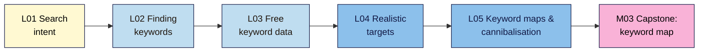

# SEO 101 — Syllabus

_Module names and order follow neps.in course 2566. Lessons are added per module by `/plan-module <N>`. Source of truth for topics: `course-outline.md`._

**At a glance:** 15 modules · ~83 lessons · each lesson 15–25 min reading + a hands-on exercise and a 5–8 question quiz · one capstone (with a break-it lab) per module · one project site (own, practice or client) carried from M01 to the M15 audit. Before Modern SEO 101.

| Module | Level | Non-negotiables taught | Planned |
|--------|-------|------------------------|---------|
| M01 Marketing & SEO Foundations | L1 | #1, #2 | 8 lessons + capstone |
| M02 Introduction to Web Development (HTML & CSS for content creators) | L1 | #3 | 10 lessons + capstone |
| M03 Keyword Research | L1 | #4, #5 | 5 lessons + capstone |
| M04 On-Page SEO | L1 | #6 | — |
| M05 WordPress for Content Creators (Content Creation & Page Builders) | L1 | — | — |
| M06 Technical SEO Fundamentals | L2 | #7, #8 | — |
| M07 Content Strategy, SEO Writing & AI Content | L2 | #9, #10 | — |
| M08 Analytics, Tracking & Reporting (GSC, GA4, GTM, Looker Studio) | L2 | — (#2 in depth) | — |
| M09 Off-Page SEO & Link Building | L2 | #11 | — |
| M10 Competitor Analysis | L2 | — | — |
| M11 Local SEO & Google Business Profile | L2 | #12 | — |
| M12 Advanced Technical SEO (Core Web Vitals, JS SEO, Schema, International) | L3 | #13 | — |
| M13 SEO Tools Mastery & WordPress SEO | L3 | — | — |
| M14 Modern SEO: E-E-A-T, Algorithms, Spam Policies & AI Search | L3 | #14 | — |
| M15 SEO Audit & Capstone Project | L3 | all (final capstone) | — |

---

## M01 — Marketing & SEO Foundations (L1)

**Goal:** see where SEO fits in marketing, how search engines work, what the results page shows, what the rules are, and set up the free tools. · NN #1, #2
**Live lessons:** posts 2569–2576 in section 15 of course 2566 (titles only; content written here).

```mermaid
flowchart LR
  %% alt: M01 lesson path: marketing, digital marketing, SEO types, how search works, SERP features, hat colours, ranking factors, tool set-up, capstone.
  L1[L01 Marketing]:::cream --> L2[L02 Digital<br/>marketing]:::cream
  L2 --> L3[L03 SEO & its<br/>three types]:::sky
  L3 --> L4[L04 How search<br/>engines work]:::sky
  L4 --> L5[L05 SERP<br/>features]:::sky
  L5 --> L6[L06 White, grey &<br/>black hat]:::blue
  L6 --> L7[L07 Ranking<br/>factors]:::blue
  L7 --> L8[L08 Practice:<br/>GSC + GA4]:::blue
  L8 --> C[M01 Capstone:<br/>marketing & search snapshot]:::pink

  classDef cream fill:#FFF9D2,color:#000000,stroke:#111844
  classDef sky   fill:#BFDDF0,color:#1F150C,stroke:#111844
  classDef blue  fill:#8CC0EB,color:#111844,stroke:#111844
  classDef pink  fill:#F9B2D7,color:#000000,stroke:#111844
```

**In words:** start with marketing and digital marketing so SEO has a purpose, then learn what SEO is and its three types, how search engines work, and what the results page shows. Next come the rules (white, grey and black hat) and what Google says about ranking. The module ends with setting up Search Console and GA4, and the capstone combines it all into one snapshot of your site.

### M01.L01 — Introduction to Marketing
- **File:** `lessons/m01-l01-introduction-to-marketing.md` · **Live post:** 2569 · **Prereqs:** none · **Remediate to:** — (entry point; glossary) · **Hands-on:** ~25 min
- **Objectives:**
  1. **Explain** marketing in plain words as finding the right people, making them an offer and telling them about it (audience, offer, message, channel).
  2. **Describe** the customer journey (awareness → consideration → decision → loyalty) and what a customer needs at each stage.
  3. **Write** a one-page marketing snapshot of your project site and choose your project path (A, B or C).
- **Hands-on idea:** **First win (< 30 min):** fill in a one-page snapshot for your site (who it's for, what it offers, the one action you want visitors to take, how people find it today); pick path A, B or C. Nila Coffee's snapshot is the worked example.

### M01.L02 — Introduction to Digital Marketing
- **File:** `lessons/m01-l02-introduction-to-digital-marketing.md` · **Live post:** 2570 · **Prereqs:** L01 · **Remediate to:** L01 · **Hands-on:** ~25 min
- **Objectives:**
  1. **Name** the main digital marketing channels (search, paid search, social, email, content, partnerships) and owned, earned and paid media.
  2. **Compare** channels by cost, speed to results and how long results last, and explain where SEO fits.
  3. **Map** your project site's current channels and the role SEO should play for it.
- **Hands-on idea:** a channel map for your project site (what you use now, what it costs, what it brings); a spot-the-error task: a marketing plan that relies on one rented channel.

### M01.L03 — Introduction to SEO & Types of SEO (On-Page, Off-Page, Technical)
- **File:** `lessons/m01-l03-introduction-to-seo.md` · **Live post:** 2571 · **Prereqs:** L01, L02 · **Remediate to:** L02 · **Hands-on:** ~25 min
- **Objectives:**
  1. **Distinguish** organic results from paid results on a real results page.
  2. **Describe** the three types of SEO (on-page, off-page, technical) and give one example task for each on Nila Coffee.
  3. **Record** which of your project site's pages Google and Bing show, using a `site:` search: baseline row 1.
- **Hands-on idea:** spot ads vs organic results; run `site:yourdomain` in Google and Bing; record baseline row 1 and one missing page. **Status: draft exists** (written 2026-11-03 as "What SEO Is (and Isn't)", remapped here).

### M01.L04 — How Search Engines Work: Crawling, Indexing and Ranking
- **File:** `lessons/m01-l04-how-search-engines-work.md` · **Live post:** 2572 · **Prereqs:** L03 · **Remediate to:** L03; Web Dev 101 M01.L03 (how a page loads) · **Hands-on:** ~30 min
- **Objectives:**
  1. **Explain** the stages a page passes through (crawl → render → index → rank → serve) and what can stop it at each.
  2. **Describe** how search engines discover URLs (links, sitemaps) and what a request and response are (status code, HTML).
  3. **Trace** one Nila Coffee page through each stage and predict where a given problem (no links in, `noindex`, slow server) would stop it.
- **Hands-on idea:** compare View Source with the page; check a status code in DevTools; map three of your pages to "how would Google find this?"; Under the hood: what Googlebot is.

### M01.L05 — SERP Features (Featured Snippets, People Also Ask, Local Pack, etc.)
- **File:** `lessons/m01-l05-serp-features.md` · **Live post:** 2573 · **Prereqs:** L04 · **Remediate to:** L04 · **Hands-on:** ~30 min
- **Objectives:**
  1. **Identify** the parts of a result (title link, URL/breadcrumb, snippet, sitelinks) and where each comes from on the page.
  2. **Name** the main SERP features (featured snippets, People Also Ask, local pack, images, video, rich results, ads) and which searches trigger them.
  3. **Compare** three results pages for your topic, and use `site:`, quotes and `intitle:` to size up search competitors.
- **Hands-on idea:** label three results pages (informational, local, product); find where one result's snippet came from; list three search competitors and their page types.

### M01.L06 — White Hat vs Black Hat vs Grey Hat SEO
- **File:** `lessons/m01-l06-white-black-grey-hat-seo.md` · **Live post:** 2574 · **Prereqs:** L03 · **Remediate to:** L03 · **Hands-on:** ~30 min
- **Objectives:**
  1. **Define** white-, grey- and black-hat SEO with examples, and summarise Google's spam policies in plain words.
  2. **Distinguish** a manual action from an algorithmic change, and say where each shows up.
  3. **Evaluate** an SEO offer or agency pitch and flag the claims that break the rules or can't be promised.
- **Hands-on idea:** sort 10 tactics into white / grey / black hat with the policy that applies; red-flag check of one real SEO offer.

### M01.L07 — Overview of Google's Ranking Factors
- **File:** `lessons/m01-l07-ranking-factors-overview.md` · **Live post:** 2575 · **Prereqs:** L04, L06 · **Remediate to:** L04 · **Hands-on:** ~25 min
- **Objectives:**
  1. **Summarise** what Google says it looks at when ranking (meaning, relevance, quality, usability, context), using its own documentation.
  2. **Separate** documented ranking factors from myths and unproven claims (e.g. word count, meta keywords, "domain authority").
  3. **Prioritise** three ranking-related improvements for your project site and say which SEO type each belongs to.
- **Hands-on idea:** fact-check 8 popular "ranking factor" claims against Google's docs (documented / myth / unproven); pick three improvements for your site.

### M01.L08 — Practice: Set Up Google Search Console + GA4 on a Test Site
- **File:** `lessons/m01-l08-practice-gsc-ga4-setup.md` · **Live post:** 2576 · **Prereqs:** L03 · **Remediate to:** L03; Web Dev 101 M06 (analytics) · **Hands-on:** ~45 min
- **Objectives:**
  1. **Set up** a test site (or use your project site) and verify it in Google Search Console as a Domain property, then import it into Bing Webmaster Tools.
  2. **Create** a GA4 property and web data stream, install the tag, and confirm it records a visit in Realtime.
  3. **Link** Search Console to GA4 and record baseline row 2 (verification status, sitemap submitted, first GA4 visit).
- **Hands-on idea:** path B learners set up the free WordPress practice site first (step-by-step); everyone verifies GSC + Bing, submits a sitemap, installs GA4 and sees their own visit in Realtime. Deep coverage of both tools is in M08.

### M01 Capstone — Marketing & search snapshot
- **File:** `capstones/m01-capstone.md` + `cheatsheets/m01-marketing-seo-foundations.md`
- One report on the project site: marketing snapshot (L01) and channel map (L02), `site:` results in Google and Bing (L03), the SERP features and three search competitors for its main topic (L05), verified Search Console + GA4 with baseline rows 1–2 (L08), and a red-flag check of one real SEO offer (L06). **Break-it lab:** 5 planted "SEO offers" to sort into white / grey / black hat, naming the policy for each. Rubric: accuracy, evidence (screenshots), clear explanation, judgement.

---

## M02 — Introduction to Web Development (HTML & CSS for content creators) (L1)

**Goal:** read and write the HTML and CSS that matter for SEO and content, so you can check what search engines actually see. · NN #3
**Live lessons:** posts 2577–2586 in course 2566 (titles only; content written here). Ten lessons, above the usual 3–6, because the live course sets the titles. Web Development 101 graduates can skip this module through the diagnostic quiz.

```mermaid
flowchart LR
  %% alt: M02 lesson path: how websites work, CMS or code, HTML basics, text, links and images, semantic HTML, tables, CSS, layout, responsive, capstone.
  L1[L01 How websites<br/>work]:::cream --> L2[L02 CMS vs<br/>custom code]:::cream
  L2 --> L3[L03 HTML<br/>fundamentals]:::sky
  L3 --> L4[L04 Formatting<br/>text]:::sky
  L4 --> L5[L05 Links &<br/>images]:::sky
  L5 --> L6[L06 Semantic<br/>HTML]:::sky
  L6 --> L7[L07 Tables, quotes<br/>& embeds]:::sky
  L7 --> L8[L08 CSS<br/>fundamentals]:::blue
  L8 --> L9[L09 Text &<br/>layout styling]:::blue
  L9 --> L10[L10 Responsive<br/>basics]:::blue
  L10 --> C[M02 Capstone:<br/>SEO-ready article page]:::pink

  classDef cream fill:#FFF9D2,color:#000000,stroke:#111844
  classDef sky   fill:#BFDDF0,color:#1F150C,stroke:#111844
  classDef blue  fill:#8CC0EB,color:#111844,stroke:#111844
  classDef pink  fill:#F9B2D7,color:#000000,stroke:#111844
```

**In words:** start with how a website reaches a browser and how it gets built, then learn HTML from page structure through text, links, images, semantic elements and tables. CSS comes next: the basics, then text and layout, then making pages work on phones. The capstone combines it all into one hand-coded article page.

### M02.L01 — How Websites Work: Browsers, Servers, Hosting, Domains and IP Addresses
- **File:** `lessons/m02-l01-how-websites-work.md` · **Live post:** 2577 · **Prereqs:** M01.L04 · **Remediate to:** M01.L04; Web Dev 101 M01.L02 (domains and DNS), M01.L03 (hosting) · **Hands-on:** ~30 min
- **Objectives:**
  1. **Explain** what browsers, servers, hosting, domains, DNS and IP addresses each do when a page loads.
  2. **Find** your project site's registrar, expiry date, nameservers, IP address and likely host using free lookup tools.
  3. **Judge** which hosting and domain problems affect SEO, separating Google's documentation from myths such as "shared hosting hurts rankings".
- **Hands-on idea:** look up your site's domain, DNS and host; fill in a new **Site facts** tab that also records who holds each login; add a domain renewal reminder.

### M02.L02 — CMS vs Custom-Coded Websites
- **File:** `lessons/m02-l02-cms-vs-custom-coded.md` · **Live post:** 2578 · **Prereqs:** L01 · **Remediate to:** L01; Web Dev 101 M01.L04 (code vs CMS vs no-code) · **Hands-on:** ~25 min
- **Objectives:**
  1. **Compare** CMSs, website builders and custom-coded sites on control, cost, skills and SEO access.
  2. **Identify** what a site is built with, using its source code and free checks.
  3. **List** which SEO settings you can and can't change on your project site's platform.
- **Hands-on idea:** identify the platform of your site and two competitors; complete an "SEO access" checklist (titles, descriptions, redirects, `robots.txt`, sitemap, code access).

### M02.L03 — HTML Fundamentals: Elements, Tags, Attributes & Page Structure
- **File:** `lessons/m02-l03-html-fundamentals.md` · **Live post:** 2579 · **Prereqs:** L01 · **Remediate to:** M01.L04; Web Dev 101 M02.L01 (anatomy of an HTML page) · **Hands-on:** ~30 min
- **Objectives:**
  1. **Label** the parts of an element: opening tag, attribute, content and closing tag.
  2. **Build** a valid page skeleton with `<!DOCTYPE>`, `<html lang>`, `<head>` and `<body>`.
  3. **Explain** what the `<title>` and meta description in `<head>` do for search results.
- **Hands-on idea:** create a page file in a free editor, open it in a browser, and read the same parts in your live site's View Source.

### M02.L04 — Formatting Text: Headings, Paragraphs, Lists, Bold & Italic
- **File:** `lessons/m02-l04-formatting-text.md` · **Live post:** 2580 · **Prereqs:** L03 · **Remediate to:** L03; Web Dev 101 M02.L02 (text, links, images and media) · **Hands-on:** ~30 min
- **Objectives:**
  1. **Structure** an article with one H1 and headings in logical order.
  2. **Choose** between paragraphs, lists, `<strong>` and `<em>` by meaning, not by looks.
  3. **Audit** a live page's heading outline and fix headings used only for styling.
- **Hands-on idea:** mark up a plain-text Nila Coffee brew guide; extract your own page's heading outline in DevTools and record what's wrong.

### M02.L05 — Links & Images: href, alt, title and New Tabs
- **File:** `lessons/m02-l05-links-and-images.md` · **Live post:** 2581 · **Prereqs:** L04 · **Remediate to:** L03; Web Dev 101 M02.L02 (text, links, images and media) · **Hands-on:** ~30 min
- **Objectives:**
  1. **Write** crawlable links with descriptive anchor text, and tell internal links from external ones.
  2. **Add** images with useful alt text, dimensions and sensible file names.
  3. **Decide** when to use `rel` values, `target="_blank"` and the `title` attribute, and when to leave them out.
- **Hands-on idea:** rewrite five weak anchors; write alt text for three images, including one decorative image; check a link's code in DevTools.

### M02.L06 — Semantic HTML for Content: article, header, nav, section, footer
- **File:** `lessons/m02-l06-semantic-html.md` · **Live post:** 2582 · **Prereqs:** L04, L05 · **Remediate to:** L04; Web Dev 101 M02.L03 (semantic HTML and heading structure) · **Hands-on:** ~30 min
- **Objectives:**
  1. **Replace** generic `
` containers with the right semantic elements.
  2. **Explain** how semantic structure helps screen readers and machines, and what Google does and doesn't say about it.
  3. **Map** the landmarks of a real page from your project site.
- **Hands-on idea:** convert a "div soup" page to semantic HTML, then map your own page's landmarks.

### M02.L07 — Tables, Blockquotes & Embeds
- **File:** `lessons/m02-l07-tables-blockquotes-embeds.md` · **Live post:** 2583 · **Prereqs:** L06 · **Remediate to:** L05; Web Dev 101 M02.L02 (text, links, images and media) · **Hands-on:** ~30 min
- **Objectives:**
  1. **Build** a data table with a caption and header cells.
  2. **Mark up** quotations with `<blockquote>` and a visible source.
  3. **Embed** a YouTube video or social post, and weigh what an embed adds against its cost in speed, privacy and text that search engines can read.
- **Hands-on idea:** add a brew-ratio table, a quotation and a video embed to the Nila Coffee article; note which embedded text appears in View Source.

### M02.L08 — CSS Fundamentals: Selectors, Properties & Ways to Add CSS
- **File:** `lessons/m02-l08-css-fundamentals.md` · **Live post:** 2584 · **Prereqs:** L03 · **Remediate to:** Web Dev 101 M03.L01 (selectors, cascade, box model) · **Hands-on:** ~30 min
- **Objectives:**
  1. **Write** CSS rules using element, class and ID selectors.
  2. **Compare** inline, internal and external CSS, and choose one for a given job.
  3. **Inspect** and temporarily change a live page's CSS in DevTools.
- **Hands-on idea:** link an external stylesheet to your article page; change a live page's styles in DevTools and see that a reload undoes it.

### M02.L09 — Styling Text & Layout: Fonts, Colours, Spacing and the Box Model
- **File:** `lessons/m02-l09-styling-text-layout.md` · **Live post:** 2585 · **Prereqs:** L08 · **Remediate to:** L08; Web Dev 101 M03.L01, M03.L02 (typography and colour) · **Hands-on:** ~35 min
- **Objectives:**
  1. **Style** readable text with font, size, line height and colour contrast.
  2. **Use** the box model (content, padding, border, margin) to control spacing.
  3. **Spot** CSS that hides content from people, and explain how hidden text can break spam policies.
- **Hands-on idea:** style the article for reading on a laptop; fix a low-contrast block; use the DevTools box model view to fix a spacing bug.

### M02.L10 — Responsive Design Basics: Viewport Meta Tag & Mobile-Friendly Layouts
- **File:** `lessons/m02-l10-responsive-design-basics.md` · **Live post:** 2586 · **Prereqs:** L08, L09 · **Remediate to:** L09; Web Dev 101 M03.L04 (responsive, mobile-first design) · **Hands-on:** ~35 min
- **Objectives:**
  1. **Add** the viewport meta tag and explain what breaks without it.
  2. **Build** a simple mobile-friendly layout with flexible widths and one media query.
  3. **Test** a page at phone widths in DevTools and check that mobile shows the same content as desktop.
- **Hands-on idea:** make the article responsive; compare your project site's phone and desktop content, because Google mainly indexes the mobile version.

### M02 Capstone — SEO-ready article page
- **File:** `capstones/m02-capstone.md` + `cheatsheets/m02-html-css-for-seo.md`
- Hand-code one Nila Coffee-style article page for your project topic: head with title and description, one H1, logical headings, a table, an image with alt text, internal and external links, semantic layout and responsive CSS. Validate it. **Break-it lab:** a planted page with two H1s, skipped heading levels, empty alt text and a missing viewport tag. Rubric: valid HTML, heading and link quality, accessibility basics, mobile layout, explanation of each fix.

## M03 — Keyword Research (L1)

**Goal:** find the words your audience really uses and decide which page should answer each one. · NN #4, #5
**Lessons:** planned from the outline's topics. The live course has no lesson titles for this section, so there are no live post numbers yet.

**In words:** start by learning to read what a search really wants, because every later choice depends on it. Then collect the words people use, check them against free data, and pick targets a new site can realistically reach. Finally, group them into topics and give each topic one page. The capstone turns all of this into a keyword map.

### M03.L01 — Search Intent: Reading the Results Page Before You Write
- **File:** `lessons/m03-l01-search-intent.md` · **Prereqs:** M01.L05, M01.L07 · **Remediate to:** M01.L05 · **Hands-on:** ~30 min
- **Objectives:**
  1. **Classify** searches as informational, navigational, commercial or transactional.
  2. **Read** a results page for intent signals: page types, formats and SERP features.
  3. **Choose** the page type that fits a search's one primary intent.
- **Hands-on idea:** run ten searches from your project site's topic, record what each results page rewards, and fill in a new **Intent check** tab.

### M03.L02 — Finding Keywords: Seed Terms, Long-Tail Phrases and Real Questions
- **File:** `lessons/m03-l02-finding-keywords.md` · **Prereqs:** M03.L01; M01.L01 · **Remediate to:** M03.L01 · **Hands-on:** ~35 min
- **Objectives:**
  1. **Build** a seed list from your audience, offer and customers' own words.
  2. **Expand** it with autocomplete, People Also Ask, related searches and forums.
  3. **Separate** real phrases people use from AI-suggested ones you can't confirm.
- **Hands-on idea:** turn five seed terms into at least 40 phrases, note where each came from, and fill in a new **Keyword ideas** tab.

### M03.L03 — Free Keyword Data: Volume, Difficulty and Seasonality
- **File:** `lessons/m03-l03-free-keyword-data.md` · **Prereqs:** M03.L02; M01.L08 · **Remediate to:** M03.L02; M01.L08 · **Hands-on:** ~40 min
- **Objectives:**
  1. **Use** free sources: Keyword Planner, Google Trends, Bing keyword research, Search Console queries and Ahrefs Webmaster Tools.
  2. **Explain** what volume, difficulty and seasonality really measure, and why tools disagree.
  3. **Check** a claimed search volume against a real source, and reject figures AI has invented.
- **Hands-on idea:** look up ten phrases in at least two sources, compare a seasonal phrase in Trends, and fill in a new **Keyword data** tab. Sites with no Search Console data yet use the other sources.

### M03.L04 — Realistic Targets: Choosing Keywords a New Site Can Win
- **File:** `lessons/m03-l04-realistic-targets.md` · **Prereqs:** M03.L01, M03.L03 · **Remediate to:** M03.L03 · **Hands-on:** ~30 min
- **Objectives:**
  1. **Judge** who ranks for a phrase and whether your site could compete with them.
  2. **Compare** phrases by intent, business value and effort, not volume alone.
  3. **Prioritise** a short list of first targets for your project site.
- **Hands-on idea:** review the results for ten phrases, score them, and pick your first five targets in a new **Targets** tab.

### M03.L05 — Keyword Maps: Grouping Topics and Spotting Cannibalisation
- **File:** `lessons/m03-l05-keyword-maps-cannibalisation.md` · **Prereqs:** M03.L04 · **Remediate to:** M03.L01, M03.L04 · **Hands-on:** ~40 min
- **Objectives:**
  1. **Group** keywords into topics, using results-page overlap to decide what belongs on one page.
  2. **Build** a keyword map that gives each topic one page.
  3. **Spot** cannibalisation with `site:` searches and Search Console, and choose a fix.
- **Hands-on idea:** group your phrases, map your first topics to existing or new pages, and check your project site for pages competing on one topic in a new **Keyword map** tab.

### M03 Capstone — Keyword map
- **File:** `capstones/m03-capstone.md` + `cheatsheets/m03-keyword-research.md`
- A keyword map for at least 15 topics: topic → keywords → intent → page type → existing or new page → priority. **Break-it lab:** two planted pages that cannibalise each other. Rubric: intent accuracy, data honesty, one page per topic, realistic priorities, explanation of the fix.
