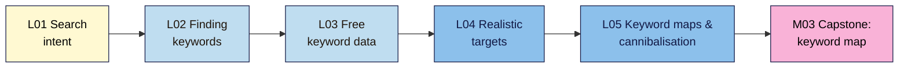

# SEO 101 — Syllabus

_Module names and order follow neps.in course 2566. Lessons are added per module by `/plan-module <N>`. Source of truth for topics: `course-outline.md`._

**At a glance:** 15 modules · ~83 lessons · each lesson 15–25 min reading + a hands-on exercise and a 5–8 question quiz · one capstone (with a break-it lab) per module · one project site (own, practice or client) carried from M01 to the M15 audit. Before Modern SEO 101.

| Module | Level | Non-negotiables taught | Planned |
|--------|-------|------------------------|---------|
| M01 Marketing & SEO Foundations | L1 | #1, #2 | 8 lessons + capstone |
| M02 Introduction to Web Development (HTML & CSS for content creators) | L1 | #3 | 10 lessons + capstone |
| M03 Keyword Research | L1 | #4, #5 | 5 lessons + capstone |
| M04 On-Page SEO | L1 | #6 | 6 lessons + capstone |
| M05 WordPress for Content Creators (Content Creation & Page Builders) | L1 | #3, #6 reinforced | 5 lessons + capstone |
| M06 Technical SEO Fundamentals | L2 | #7, #8 | 6 lessons + capstone |
| M07 Content Strategy, SEO Writing & AI Content | L2 | #9, #10 | 6 lessons + capstone |
| M08 Analytics, Tracking & Reporting (GSC, GA4, GTM, Looker Studio) | L2 | — (#2 in depth) | — |
| M09 Off-Page SEO & Link Building | L2 | #11 | — |
| M10 Competitor Analysis | L2 | — | — |
| M11 Local SEO & Google Business Profile | L2 | #12 | — |
| M12 Advanced Technical SEO (Core Web Vitals, JS SEO, Schema, International) | L3 | #13 | — |
| M13 SEO Tools Mastery & WordPress SEO | L3 | — | — |
| M14 Modern SEO: E-E-A-T, Algorithms, Spam Policies & AI Search | L3 | #14 | — |
| M15 SEO Audit & Capstone Project | L3 | all (final capstone) | — |

---

## M01 — Marketing & SEO Foundations (L1)

**Goal:** see where SEO fits in marketing, how search engines work, what the results page shows, what the rules are, and set up the free tools. · NN #1, #2
**Live lessons:** posts 2569–2576 in section 15 of course 2566 (titles only; content written here).

```mermaid
flowchart LR
  %% alt: M01 lesson path: marketing, digital marketing, SEO types, how search works, SERP features, hat colours, ranking factors, tool set-up, capstone.
  L1[L01 Marketing]:::cream --> L2[L02 Digital<br/>marketing]:::cream
  L2 --> L3[L03 SEO & its<br/>three types]:::sky
  L3 --> L4[L04 How search<br/>engines work]:::sky
  L4 --> L5[L05 SERP<br/>features]:::sky
  L5 --> L6[L06 White, grey &<br/>black hat]:::blue
  L6 --> L7[L07 Ranking<br/>factors]:::blue
  L7 --> L8[L08 Practice:<br/>GSC + GA4]:::blue
  L8 --> C[M01 Capstone:<br/>marketing & search snapshot]:::pink

  classDef cream fill:#FFF9D2,color:#000000,stroke:#111844
  classDef sky   fill:#BFDDF0,color:#1F150C,stroke:#111844
  classDef blue  fill:#8CC0EB,color:#111844,stroke:#111844
  classDef pink  fill:#F9B2D7,color:#000000,stroke:#111844
```

**In words:** start with marketing and digital marketing so SEO has a purpose, then learn what SEO is and its three types, how search engines work, and what the results page shows. Next come the rules (white, grey and black hat) and what Google says about ranking. The module ends with setting up Search Console and GA4, and the capstone combines it all into one snapshot of your site.

### M01.L01 — Introduction to Marketing
- **File:** `lessons/m01-l01-introduction-to-marketing.md` · **Live post:** 2569 · **Prereqs:** none · **Remediate to:** — (entry point; glossary) · **Hands-on:** ~25 min
- **Objectives:**
  1. **Explain** marketing in plain words as finding the right people, making them an offer and telling them about it (audience, offer, message, channel).
  2. **Describe** the customer journey (awareness → consideration → decision → loyalty) and what a customer needs at each stage.
  3. **Write** a one-page marketing snapshot of your project site and choose your project path (A, B or C).
- **Hands-on idea:** **First win (< 30 min):** fill in a one-page snapshot for your site (who it's for, what it offers, the one action you want visitors to take, how people find it today); pick path A, B or C. Nila Coffee's snapshot is the worked example.

### M01.L02 — Introduction to Digital Marketing
- **File:** `lessons/m01-l02-introduction-to-digital-marketing.md` · **Live post:** 2570 · **Prereqs:** L01 · **Remediate to:** L01 · **Hands-on:** ~25 min
- **Objectives:**
  1. **Name** the main digital marketing channels (search, paid search, social, email, content, partnerships) and owned, earned and paid media.
  2. **Compare** channels by cost, speed to results and how long results last, and explain where SEO fits.
  3. **Map** your project site's current channels and the role SEO should play for it.
- **Hands-on idea:** a channel map for your project site (what you use now, what it costs, what it brings); a spot-the-error task: a marketing plan that relies on one rented channel.

### M01.L03 — Introduction to SEO & Types of SEO (On-Page, Off-Page, Technical)
- **File:** `lessons/m01-l03-introduction-to-seo.md` · **Live post:** 2571 · **Prereqs:** L01, L02 · **Remediate to:** L02 · **Hands-on:** ~25 min
- **Objectives:**
  1. **Distinguish** organic results from paid results on a real results page.
  2. **Describe** the three types of SEO (on-page, off-page, technical) and give one example task for each on Nila Coffee.
  3. **Record** which of your project site's pages Google and Bing show, using a `site:` search: baseline row 1.
- **Hands-on idea:** spot ads vs organic results; run `site:yourdomain` in Google and Bing; record baseline row 1 and one missing page. **Status: draft exists** (written 2026-11-03 as "What SEO Is (and Isn't)", remapped here).

### M01.L04 — How Search Engines Work: Crawling, Indexing and Ranking
- **File:** `lessons/m01-l04-how-search-engines-work.md` · **Live post:** 2572 · **Prereqs:** L03 · **Remediate to:** L03; Web Dev 101 M01.L03 (how a page loads) · **Hands-on:** ~30 min
- **Objectives:**
  1. **Explain** the stages a page passes through (crawl → render → index → rank → serve) and what can stop it at each.
  2. **Describe** how search engines discover URLs (links, sitemaps) and what a request and response are (status code, HTML).
  3. **Trace** one Nila Coffee page through each stage and predict where a given problem (no links in, `noindex`, slow server) would stop it.
- **Hands-on idea:** compare View Source with the page; check a status code in DevTools; map three of your pages to "how would Google find this?"; Under the hood: what Googlebot is.

### M01.L05 — SERP Features (Featured Snippets, People Also Ask, Local Pack, etc.)
- **File:** `lessons/m01-l05-serp-features.md` · **Live post:** 2573 · **Prereqs:** L04 · **Remediate to:** L04 · **Hands-on:** ~30 min
- **Objectives:**
  1. **Identify** the parts of a result (title link, URL/breadcrumb, snippet, sitelinks) and where each comes from on the page.
  2. **Name** the main SERP features (featured snippets, People Also Ask, local pack, images, video, rich results, ads) and which searches trigger them.
  3. **Compare** three results pages for your topic, and use `site:`, quotes and `intitle:` to size up search competitors.
- **Hands-on idea:** label three results pages (informational, local, product); find where one result's snippet came from; list three search competitors and their page types.

### M01.L06 — White Hat vs Black Hat vs Grey Hat SEO
- **File:** `lessons/m01-l06-white-black-grey-hat-seo.md` · **Live post:** 2574 · **Prereqs:** L03 · **Remediate to:** L03 · **Hands-on:** ~30 min
- **Objectives:**
  1. **Define** white-, grey- and black-hat SEO with examples, and summarise Google's spam policies in plain words.
  2. **Distinguish** a manual action from an algorithmic change, and say where each shows up.
  3. **Evaluate** an SEO offer or agency pitch and flag the claims that break the rules or can't be promised.
- **Hands-on idea:** sort 10 tactics into white / grey / black hat with the policy that applies; red-flag check of one real SEO offer.

### M01.L07 — Overview of Google's Ranking Factors
- **File:** `lessons/m01-l07-ranking-factors-overview.md` · **Live post:** 2575 · **Prereqs:** L04, L06 · **Remediate to:** L04 · **Hands-on:** ~25 min
- **Objectives:**
  1. **Summarise** what Google says it looks at when ranking (meaning, relevance, quality, usability, context), using its own documentation.
  2. **Separate** documented ranking factors from myths and unproven claims (e.g. word count, meta keywords, "domain authority").
  3. **Prioritise** three ranking-related improvements for your project site and say which SEO type each belongs to.
- **Hands-on idea:** fact-check 8 popular "ranking factor" claims against Google's docs (documented / myth / unproven); pick three improvements for your site.

### M01.L08 — Practice: Set Up Google Search Console + GA4 on a Test Site
- **File:** `lessons/m01-l08-practice-gsc-ga4-setup.md` · **Live post:** 2576 · **Prereqs:** L03 · **Remediate to:** L03; Web Dev 101 M06 (analytics) · **Hands-on:** ~45 min
- **Objectives:**
  1. **Set up** a test site (or use your project site) and verify it in Google Search Console as a Domain property, then import it into Bing Webmaster Tools.
  2. **Create** a GA4 property and web data stream, install the tag, and confirm it records a visit in Realtime.
  3. **Link** Search Console to GA4 and record baseline row 2 (verification status, sitemap submitted, first GA4 visit).
- **Hands-on idea:** path B learners set up the free WordPress practice site first (step-by-step); everyone verifies GSC + Bing, submits a sitemap, installs GA4 and sees their own visit in Realtime. Deep coverage of both tools is in M08.

### M01 Capstone — Marketing & search snapshot
- **File:** `capstones/m01-capstone.md` + `cheatsheets/m01-marketing-seo-foundations.md`
- One report on the project site: marketing snapshot (L01) and channel map (L02), `site:` results in Google and Bing (L03), the SERP features and three search competitors for its main topic (L05), verified Search Console + GA4 with baseline rows 1–2 (L08), and a red-flag check of one real SEO offer (L06). **Break-it lab:** 5 planted "SEO offers" to sort into white / grey / black hat, naming the policy for each. Rubric: accuracy, evidence (screenshots), clear explanation, judgement.

---

## M02 — Introduction to Web Development (HTML & CSS for content creators) (L1)

**Goal:** read and write the HTML and CSS that matter for SEO and content, so you can check what search engines actually see. · NN #3
**Live lessons:** posts 2577–2586 in course 2566 (titles only; content written here). Ten lessons, above the usual 3–6, because the live course sets the titles. Web Development 101 graduates can skip this module through the diagnostic quiz.

```mermaid
flowchart LR
  %% alt: M02 lesson path: how websites work, CMS or code, HTML basics, text, links and images, semantic HTML, tables, CSS, layout, responsive, capstone.
  L1[L01 How websites<br/>work]:::cream --> L2[L02 CMS vs<br/>custom code]:::cream
  L2 --> L3[L03 HTML<br/>fundamentals]:::sky
  L3 --> L4[L04 Formatting<br/>text]:::sky
  L4 --> L5[L05 Links &<br/>images]:::sky
  L5 --> L6[L06 Semantic<br/>HTML]:::sky
  L6 --> L7[L07 Tables, quotes<br/>& embeds]:::sky
  L7 --> L8[L08 CSS<br/>fundamentals]:::blue
  L8 --> L9[L09 Text &<br/>layout styling]:::blue
  L9 --> L10[L10 Responsive<br/>basics]:::blue
  L10 --> C[M02 Capstone:<br/>SEO-ready article page]:::pink

  classDef cream fill:#FFF9D2,color:#000000,stroke:#111844
  classDef sky   fill:#BFDDF0,color:#1F150C,stroke:#111844
  classDef blue  fill:#8CC0EB,color:#111844,stroke:#111844
  classDef pink  fill:#F9B2D7,color:#000000,stroke:#111844
```

**In words:** start with how a website reaches a browser and how it gets built, then learn HTML from page structure through text, links, images, semantic elements and tables. CSS comes next: the basics, then text and layout, then making pages work on phones. The capstone combines it all into one hand-coded article page.

### M02.L01 — How Websites Work: Browsers, Servers, Hosting, Domains and IP Addresses
- **File:** `lessons/m02-l01-how-websites-work.md` · **Live post:** 2577 · **Prereqs:** M01.L04 · **Remediate to:** M01.L04; Web Dev 101 M01.L02 (domains and DNS), M01.L03 (hosting) · **Hands-on:** ~30 min
- **Objectives:**
  1. **Explain** what browsers, servers, hosting, domains, DNS and IP addresses each do when a page loads.
  2. **Find** your project site's registrar, expiry date, nameservers, IP address and likely host using free lookup tools.
  3. **Judge** which hosting and domain problems affect SEO, separating Google's documentation from myths such as "shared hosting hurts rankings".
- **Hands-on idea:** look up your site's domain, DNS and host; fill in a new **Site facts** tab that also records who holds each login; add a domain renewal reminder.

### M02.L02 — CMS vs Custom-Coded Websites
- **File:** `lessons/m02-l02-cms-vs-custom-coded.md` · **Live post:** 2578 · **Prereqs:** L01 · **Remediate to:** L01; Web Dev 101 M01.L04 (code vs CMS vs no-code) · **Hands-on:** ~25 min
- **Objectives:**
  1. **Compare** CMSs, website builders and custom-coded sites on control, cost, skills and SEO access.
  2. **Identify** what a site is built with, using its source code and free checks.
  3. **List** which SEO settings you can and can't change on your project site's platform.
- **Hands-on idea:** identify the platform of your site and two competitors; complete an "SEO access" checklist (titles, descriptions, redirects, `robots.txt`, sitemap, code access).

### M02.L03 — HTML Fundamentals: Elements, Tags, Attributes & Page Structure
- **File:** `lessons/m02-l03-html-fundamentals.md` · **Live post:** 2579 · **Prereqs:** L01 · **Remediate to:** M01.L04; Web Dev 101 M02.L01 (anatomy of an HTML page) · **Hands-on:** ~30 min
- **Objectives:**
  1. **Label** the parts of an element: opening tag, attribute, content and closing tag.
  2. **Build** a valid page skeleton with `<!DOCTYPE>`, `<html lang>`, `<head>` and `<body>`.
  3. **Explain** what the `<title>` and meta description in `<head>` do for search results.
- **Hands-on idea:** create a page file in a free editor, open it in a browser, and read the same parts in your live site's View Source.

### M02.L04 — Formatting Text: Headings, Paragraphs, Lists, Bold & Italic
- **File:** `lessons/m02-l04-formatting-text.md` · **Live post:** 2580 · **Prereqs:** L03 · **Remediate to:** L03; Web Dev 101 M02.L02 (text, links, images and media) · **Hands-on:** ~30 min
- **Objectives:**
  1. **Structure** an article with one H1 and headings in logical order.
  2. **Choose** between paragraphs, lists, `<strong>` and `<em>` by meaning, not by looks.
  3. **Audit** a live page's heading outline and fix headings used only for styling.
- **Hands-on idea:** mark up a plain-text Nila Coffee brew guide; extract your own page's heading outline in DevTools and record what's wrong.

### M02.L05 — Links & Images: href, alt, title and New Tabs
- **File:** `lessons/m02-l05-links-and-images.md` · **Live post:** 2581 · **Prereqs:** L04 · **Remediate to:** L03; Web Dev 101 M02.L02 (text, links, images and media) · **Hands-on:** ~30 min
- **Objectives:**
  1. **Write** crawlable links with descriptive anchor text, and tell internal links from external ones.
  2. **Add** images with useful alt text, dimensions and sensible file names.
  3. **Decide** when to use `rel` values, `target="_blank"` and the `title` attribute, and when to leave them out.
- **Hands-on idea:** rewrite five weak anchors; write alt text for three images, including one decorative image; check a link's code in DevTools.

### M02.L06 — Semantic HTML for Content: article, header, nav, section, footer
- **File:** `lessons/m02-l06-semantic-html.md` · **Live post:** 2582 · **Prereqs:** L04, L05 · **Remediate to:** L04; Web Dev 101 M02.L03 (semantic HTML and heading structure) · **Hands-on:** ~30 min
- **Objectives:**
  1. **Replace** generic `
` containers with the right semantic elements.
  2. **Explain** how semantic structure helps screen readers and machines, and what Google does and doesn't say about it.
  3. **Map** the landmarks of a real page from your project site.
- **Hands-on idea:** convert a "div soup" page to semantic HTML, then map your own page's landmarks.

### M02.L07 — Tables, Blockquotes & Embeds
- **File:** `lessons/m02-l07-tables-blockquotes-embeds.md` · **Live post:** 2583 · **Prereqs:** L06 · **Remediate to:** L05; Web Dev 101 M02.L02 (text, links, images and media) · **Hands-on:** ~30 min
- **Objectives:**
  1. **Build** a data table with a caption and header cells.
  2. **Mark up** quotations with `<blockquote>` and a visible source.
  3. **Embed** a YouTube video or social post, and weigh what an embed adds against its cost in speed, privacy and text that search engines can read.
- **Hands-on idea:** add a brew-ratio table, a quotation and a video embed to the Nila Coffee article; note which embedded text appears in View Source.

### M02.L08 — CSS Fundamentals: Selectors, Properties & Ways to Add CSS
- **File:** `lessons/m02-l08-css-fundamentals.md` · **Live post:** 2584 · **Prereqs:** L03 · **Remediate to:** Web Dev 101 M03.L01 (selectors, cascade, box model) · **Hands-on:** ~30 min
- **Objectives:**
  1. **Write** CSS rules using element, class and ID selectors.
  2. **Compare** inline, internal and external CSS, and choose one for a given job.
  3. **Inspect** and temporarily change a live page's CSS in DevTools.
- **Hands-on idea:** link an external stylesheet to your article page; change a live page's styles in DevTools and see that a reload undoes it.

### M02.L09 — Styling Text & Layout: Fonts, Colours, Spacing and the Box Model
- **File:** `lessons/m02-l09-styling-text-layout.md` · **Live post:** 2585 · **Prereqs:** L08 · **Remediate to:** L08; Web Dev 101 M03.L01, M03.L02 (typography and colour) · **Hands-on:** ~35 min
- **Objectives:**
  1. **Style** readable text with font, size, line height and colour contrast.
  2. **Use** the box model (content, padding, border, margin) to control spacing.
  3. **Spot** CSS that hides content from people, and explain how hidden text can break spam policies.
- **Hands-on idea:** style the article for reading on a laptop; fix a low-contrast block; use the DevTools box model view to fix a spacing bug.

### M02.L10 — Responsive Design Basics: Viewport Meta Tag & Mobile-Friendly Layouts
- **File:** `lessons/m02-l10-responsive-design-basics.md` · **Live post:** 2586 · **Prereqs:** L08, L09 · **Remediate to:** L09; Web Dev 101 M03.L04 (responsive, mobile-first design) · **Hands-on:** ~35 min
- **Objectives:**
  1. **Add** the viewport meta tag and explain what breaks without it.
  2. **Build** a simple mobile-friendly layout with flexible widths and one media query.
  3. **Test** a page at phone widths in DevTools and check that mobile shows the same content as desktop.
- **Hands-on idea:** make the article responsive; compare your project site's phone and desktop content, because Google mainly indexes the mobile version.

### M02 Capstone — SEO-ready article page
- **File:** `capstones/m02-capstone.md` + `cheatsheets/m02-html-css-for-seo.md`
- Hand-code one Nila Coffee-style article page for your project topic: head with title and description, one H1, logical headings, a table, an image with alt text, internal and external links, semantic layout and responsive CSS. Validate it. **Break-it lab:** a planted page with two H1s, skipped heading levels, empty alt text and a missing viewport tag. Rubric: valid HTML, heading and link quality, accessibility basics, mobile layout, explanation of each fix.

## M03 — Keyword Research (L1)

**Goal:** find the words your audience really uses and decide which page should answer each one. · NN #4, #5
**Lessons:** planned from the outline's topics. The live course has no lesson titles for this section, so there are no live post numbers yet.

**In words:** start by learning to read what a search really wants, because every later choice depends on it. Then collect the words people use, check them against free data, and pick targets a new site can realistically reach. Finally, group them into topics and give each topic one page. The capstone turns all of this into a keyword map.

### M03.L01 — Search Intent: Reading the Results Page Before You Write
- **File:** `lessons/m03-l01-search-intent.md` · **Prereqs:** M01.L05, M01.L07 · **Remediate to:** M01.L05 · **Hands-on:** ~30 min
- **Objectives:**
  1. **Classify** searches as informational, navigational, commercial or transactional.
  2. **Read** a results page for intent signals: page types, formats and SERP features.
  3. **Choose** the page type that fits a search's one primary intent.
- **Hands-on idea:** run ten searches from your project site's topic, record what each results page rewards, and fill in a new **Intent check** tab.

### M03.L02 — Finding Keywords: Seed Terms, Long-Tail Phrases and Real Questions
- **File:** `lessons/m03-l02-finding-keywords.md` · **Prereqs:** M03.L01; M01.L01 · **Remediate to:** M03.L01 · **Hands-on:** ~35 min
- **Objectives:**
  1. **Build** a seed list from your audience, offer and customers' own words.
  2. **Expand** it with autocomplete, People Also Ask, related searches and forums.
  3. **Separate** real phrases people use from AI-suggested ones you can't confirm.
- **Hands-on idea:** turn five seed terms into at least 40 phrases, note where each came from, and fill in a new **Keyword ideas** tab.

### M03.L03 — Free Keyword Data: Volume, Difficulty and Seasonality
- **File:** `lessons/m03-l03-free-keyword-data.md` · **Prereqs:** M03.L02; M01.L08 · **Remediate to:** M03.L02; M01.L08 · **Hands-on:** ~40 min
- **Objectives:**
  1. **Use** free sources: Keyword Planner, Google Trends, Bing keyword research, Search Console queries and Ahrefs Webmaster Tools.
  2. **Explain** what volume, difficulty and seasonality really measure, and why tools disagree.
  3. **Check** a claimed search volume against a real source, and reject figures AI has invented.
- **Hands-on idea:** look up ten phrases in at least two sources, compare a seasonal phrase in Trends, and fill in a new **Keyword data** tab. Sites with no Search Console data yet use the other sources.

### M03.L04 — Realistic Targets: Choosing Keywords a New Site Can Win
- **File:** `lessons/m03-l04-realistic-targets.md` · **Prereqs:** M03.L01, M03.L03 · **Remediate to:** M03.L03 · **Hands-on:** ~30 min
- **Objectives:**
  1. **Judge** who ranks for a phrase and whether your site could compete with them.
  2. **Compare** phrases by intent, business value and effort, not volume alone.
  3. **Prioritise** a short list of first targets for your project site.
- **Hands-on idea:** review the results for ten phrases, score them, and pick your first five targets in a new **Targets** tab.

### M03.L05 — Keyword Maps: Grouping Topics and Spotting Cannibalisation
- **File:** `lessons/m03-l05-keyword-maps-cannibalisation.md` · **Prereqs:** M03.L04 · **Remediate to:** M03.L01, M03.L04 · **Hands-on:** ~40 min
- **Objectives:**
  1. **Group** keywords into topics, using results-page overlap to decide what belongs on one page.
  2. **Build** a keyword map that gives each topic one page.
  3. **Spot** cannibalisation with `site:` searches and Search Console, and choose a fix.
- **Hands-on idea:** group your phrases, map your first topics to existing or new pages, and check your project site for pages competing on one topic in a new **Keyword map** tab.

### M03 Capstone — Keyword map
- **File:** `capstones/m03-capstone.md` + `cheatsheets/m03-keyword-research.md`
- A keyword map for at least 15 topics: topic → keywords → intent → page type → existing or new page → priority. **Break-it lab:** two planted pages that cannibalise each other. Rubric: intent accuracy, data honesty, one page per topic, realistic priorities, explanation of the fix.

---

## M04 — On-Page SEO (L1)

**Goal:** make each page the clearest, most helpful match for its topic. · NN #6 (+ #3, #4 reinforced)
**Lessons:** planned from the outline's topics and the research notes in `research/m04-on-page-seo.md` (2026-11-08). The live course has no lesson titles for this section, so there are no live post numbers yet.
**Planning notes from research:**
- **#6 and pagination:** Google says pages in a paginated series "don't need to follow" the unique-title advice. Teach #6 as applying to every indexable page with its own topic, with paginated category pages as the documented exception.
- **Headings:** Google says heading order "doesn't matter" for Search, while MDN advises one H1 and no skipped levels. Keep the course's one-H1 rule for readers and accessibility (#3), and say plainly that it isn't a ranking rule.
- **No Google figure for:** keyword density, "keyword in the first 100 words", title or description length, or link placement. Label any such advice as observed practice or myth.
- **Recheck before drafting:** the March 2026 AI title-link test (secondary sources only), the helpful-content page (rewritten 2026-10-05), the URL structure page (updated 2026-10-21), and Bing's guidelines, which couldn't be read.
- **Path B:** learners are still on Blogger until Module 5, so every hands-on step needs a Blogger route as well as WordPress.

```mermaid
flowchart LR
  %% alt: M04 lesson path: titles and descriptions, headings and slugs, people-first writing, images, internal links, shop pages and sharing, then the capstone.
  L1[L01 Titles &<br/>descriptions]:::cream --> L2[L02 Headings, slugs<br/>& opening]:::sky
  L2 --> L3[L03 Writing<br/>for people]:::sky
  L3 --> L4[L04 Image<br/>SEO]:::blue
  L4 --> L5[L05 Internal links<br/>& anchor text]:::blue
  L5 --> L6[L06 Shop pages<br/>& sharing]:::blue
  L6 --> C[M04 Capstone:<br/>optimise 3 pages]:::pink

  classDef cream fill:#FFF9D2,color:#000000,stroke:#111844
  classDef sky   fill:#BFDDF0,color:#1F150C,stroke:#111844
  classDef blue  fill:#8CC0EB,color:#111844,stroke:#111844
  classDef pink  fill:#F9B2D7,color:#000000,stroke:#111844
```

**In words:** start with what people see first in the results, the title and description. Then shape the page itself: its headings, its URL and its opening. Next, write for people, using natural words rather than repeated keywords. Then make images and internal links work, and finish with shop pages and how pages look when shared. The capstone applies all of this to three pages from your keyword map.

### M04.L01 — Title Tags and Meta Descriptions: What Searchers See First
- **File:** `lessons/m04-l01-titles-meta-descriptions.md` · **Prereqs:** M02.L03, M03.L05 · **Remediate to:** M02.L03 · **Hands-on:** ~35 min
- **Objectives:**
  1. **Write** a unique, descriptive title for each page type (home, guide, product, category), with the brand placed concisely.
  2. **Explain** why Google rewrites title links and snippets, and spot a rewrite on a real results page.
  3. **Write** meta descriptions that pitch the page honestly, knowing they aren't a ranking factor.
- **Hands-on idea:** run a `site:` search on your project site, compare each title link with the page's `<title>`, classify any rewrite against Google's documented reasons, and rewrite titles and descriptions for three keyword-map pages in a new **Titles** tab.

### M04.L02 — Headings, URL Slugs and the Opening Paragraph
- **File:** `lessons/m04-l02-headings-slugs-opening.md` · **Prereqs:** M04.L01, M02.L04 · **Remediate to:** M02.L04 · **Hands-on:** ~30 min
- **Objectives:**
  1. **Match** a page's H1 and outline to its title and its one intent.
  2. **Create** short, readable, hyphenated slugs, and explain why changing a live URL needs a redirect.
  3. **Write** an opening paragraph that answers the searcher's question first.
- **Hands-on idea:** list the headings of one keyword-map page, check the H1 against its title, plan a clean slug (changing it only on a practice page), and rewrite the opening in a new **Page outline** tab.

### M04.L03 — Writing for People: Natural Keywords, Synonyms and E-E-A-T Basics
- **File:** `lessons/m04-l03-people-first-writing.md` · **Prereqs:** M04.L02, M03.L01 · **Remediate to:** M03.L01 · **Hands-on:** ~35 min
- **Objectives:**
  1. **Use** a topic's main phrase, variants and synonyms naturally, and recognise keyword stuffing as Google's spam policy describes it.
  2. **Assess** a page with Google's people-first self-assessment questions and "Who, How, Why".
  3. **Explain** what E-E-A-T is and isn't (not a single ranking factor), with the full picture left to Module 14.
- **Hands-on idea:** rewrite a planted, stuffed Nila paragraph using synonyms, then score one of your own pages against 8–10 self-assessment questions in a new **People-first check** tab.

### M04.L04 — Image SEO: File Names, Alt Text, Size and Format
- **File:** `lessons/m04-l04-image-seo.md` · **Prereqs:** M02.L05, M04.L03 · **Remediate to:** M02.L05 · **Hands-on:** ~35 min
- **Objectives:**
  1. **Name** image files and write alt text that describes each image in its context.
  2. **Check** an image's real size and format against its displayed size, using the browser's DevTools.
  3. **Choose** a suitable format and loading approach (WebP or AVIF, `width` and `height`, lazy loading below the fold only).
- **Hands-on idea:** for three images on your project site, write alt text from weakest to best, find the heaviest image in DevTools, and plan a smaller version in a new **Image check** tab.

### M04.L05 — Internal Links and Anchor Text
- **File:** `lessons/m04-l05-internal-links-anchor-text.md` · **Prereqs:** M02.L05, M03.L05 · **Remediate to:** M02.L05 · **Hands-on:** ~35 min
- **Objectives:**
  1. **Write** anchor text that describes its target, avoiding generic, overlong and chained links.
  2. **Find** pages with no internal links pointing to them, by comparing your sitemap with the links on your site.
  3. **Plan** internal links between related keyword-map topics, such as from guides to products.
- **Hands-on idea:** list your sitemap's URLs, check which have no internal links pointing to them, and plan two descriptive links for each one in a new **Internal links** tab.

### M04.L06 — Shop Pages and Sharing: Product Pages, Category Pages and Open Graph
- **File:** `lessons/m04-l06-shop-pages-open-graph.md` · **Prereqs:** M04.L01, M04.L05 · **Remediate to:** M04.L05 · **Hands-on:** ~35 min
- **Objectives:**
  1. **Structure** category and product pages so each product has a crawlable link, and paginated pages have real URLs.
  2. **Improve** a product page's content with details people need to decide.
  3. **Add** Open Graph tags and check how a page looks when shared.
- **Hands-on idea:** audit one category page and one product page (Nila's if your site isn't a shop), then add the Open Graph tags to a page and check its preview in a free sharing debugger, in a new **Shop & share check** tab. Blogger learners check the tags Blogger adds itself.

### M04 Capstone — Optimise three pages
- **File:** `capstones/m04-capstone.md` + `cheatsheets/m04-on-page-seo.md`
- Optimise three pages from the keyword map, with a before/after table (title, description, H1, opening, images, internal links) and a 4-week Search Console check booked: note clicks, impressions, CTR and average position for the 28 days before, and compare the same span afterwards. **Break-it lab:** a planted page with a duplicate title, a keyword-stuffed paragraph and no internal links pointing to it, found with View Source, find-in-page, a sitemap-versus-links check and URL Inspection. Rubric: titles and descriptions, intent match, people-first content, images and links, evidence and the booked check.

## M05 — WordPress for Content Creators (Content Creation & Page Builders) (L1)

**Goal:** publish well-structured pages and posts in WordPress, with or without a page builder, without hurting SEO. · NN #3, #6 reinforced
**Lessons:** planned from the outline's topics and the research notes in `research/m05-wordpress-content.md` (2026-11-08). WordPress 101 already covers the how-to (M01–M05, M07). These lessons link to it and teach only the SEO decisions, so WordPress 101 graduates can skip to the capstone. The live course has no lesson titles for this section, so there are no live post numbers yet.
**Planning notes from research:**
- **Labels (WordPress 7.1):** the main button on a published post is **Save**, not "Update". Playground now uses the Dock, **Autosaved / Saved / Unsaved**, **Store permanently** and **Download as .zip**, and keeps only five autosaves. All labels come from 7.1 source or docs, not tested live. **WordPress 7.2 is due 2026-12-08**, so recheck editor labels if drafting or reviewing after that.
- **Permalinks:** the WordPress screen says Post name "can help your posts rank higher". Google says URL-path keywords "have hardly any effect". Teach the Google line, and give readability as the reason for Post name.
- **Tag and category archives:** core adds no `noindex` to archives and lists non-empty ones in `wp-sitemap.xml`. Google says some duplicate content "is normal". The only Google comment on tag pages is Mueller's from 2015 ("no default answer"), so flag it as dated. Frame thin tag pages as a usefulness problem, not a penalty.
- **Page builders:** no Google page names any builder. The Web Almanac 2025 gives adoption shares and only qualitative speed statements, so don't claim a percentage slowdown. "Code-to-text ratio" is a myth (Mueller, 2018). Headings used for styling are mainly a structure and accessibility problem; Google says heading order "doesn't matter" for Search.
- **Dates:** core's sitemap `lastmod` moves on any save. Google wants it to mean a "significant update". Teach "don't re-save old posts to look fresh" (inference from source, not tested).
- **Other platforms:** Shopify ticks the redirect box when a handle changes. Wix redirects pages, but **not** blog posts. The quotes came through a fetch tool, so recheck them live before quoting.
- **Path B:** Blogger learners move to WordPress in L01, by recreating 1–3 posts by hand. The Blogger Importer plugin is untested with the last three major releases. The outline's §3 still calls Path B a WordPress test site; reconcile it (flagged, not edited).
- **No overlap with M04:** image alt text, sizes and lazy loading were taught in M04.L04, and anchor text in M04.L05. Here they're only applied inside blocks. Redirects in depth wait for M06.

```mermaid
flowchart LR
  %% alt: M05 lesson path: practice site, posts and archives, block editor structure, page builders, publishing and URL changes, then the capstone.
  L1[L01 Practice site<br/>& permalinks]:::cream --> L2[L02 Posts, pages<br/>& archives]:::sky
  L2 --> L3[L03 Block editor<br/>structure]:::sky
  L3 --> L4[L04 Page builders<br/>vs blocks]:::blue
  L4 --> L5[L05 Publish & change<br/>URLs safely]:::blue
  L5 --> C[M05 Capstone:<br/>publish 2 pages + 1 post]:::pink

  classDef cream fill:#FFF9D2,color:#000000,stroke:#111844
  classDef sky   fill:#BFDDF0,color:#1F150C,stroke:#111844
  classDef blue  fill:#8CC0EB,color:#111844,stroke:#111844
  classDef pink  fill:#F9B2D7,color:#000000,stroke:#111844
```

**In words:** set up a WordPress practice site and its permalinks before writing anything. Then decide what's a post and what's a page, and keep category and tag archives useful. Next, build clean structure with blocks, and learn when a page builder is worth its cost. Finally, publish, update and change URLs without losing visitors. The capstone publishes two pages and a post, and fixes a page built badly.

### M05.L01 — Your WordPress Practice Site: Set-up, Permalinks and Moving from Blogger
- **File:** `lessons/m05-l01-wordpress-practice-site.md` · **Prereqs:** M01.L08, M02.L02 · **Remediate to:** M02.L02 · **Hands-on:** ~35 min
- **Objectives:**
  1. **Choose** a practice site (Local, Playground or hosting), and explain why a Playground site can't be indexed by Google.
  2. **Set** Post name permalinks before the first post, giving readability, not rankings, as the reason.
  3. **Recreate** one to three posts from Blogger or your project site, and save a portable backup.
- **Hands-on idea:** set up Local (or Playground with **Store permanently**), switch permalinks to **Post name**, recreate two posts by hand (Path B moves its Blogger posts), then **Download as .zip** or export, recording each step in a new **WordPress setup** tab.

### M05.L02 — Posts, Pages, Categories and Tags Without Thin Archives
- **File:** `lessons/m05-l02-posts-pages-archives.md` · **Prereqs:** M05.L01, M03.L05 · **Remediate to:** M03.L05 · **Hands-on:** ~30 min
- **Objectives:**
  1. **Decide** whether each keyword-map topic is a post or a page.
  2. **Organise** posts with one category each and a small, reused set of tags.
  3. **Audit** the archive pages in `wp-sitemap.xml`, and decide for each tag whether to keep it, merge it or `noindex` it.
- **Hands-on idea:** label every keyword-map row as post or page, then open the practice site's `wp-sitemap.xml`, list each category and tag archive with its post count, view the source of one archive to confirm core adds no `noindex`, and record decisions in a new **Archive check** tab.

### M05.L03 — Clean Structure in the Block Editor
- **File:** `lessons/m05-l03-block-editor-structure.md` · **Prereqs:** M02.L04, M04.L02 · **Remediate to:** M02.L04 · **Hands-on:** ~35 min
- **Objectives:**
  1. **Build** a heading outline with the Heading block, and check it in **Document Overview > Outline** until no heading shows as incorrect.
  2. **Use** lists, tables (with a header section and caption) and patterns for the jobs they're made for.
  3. **Apply** Module 4 inside blocks: alt text or **Mark as decorative**, image resolution, and internal links with descriptive anchors.
- **Hands-on idea:** paste a messy draft (bold lines as fake headings, an H4 "because it's smaller", a table made of spaces) into a post, fix it until the Outline is clean, and log before and after in a new **Outline check** tab.

### M05.L04 — Page Builders vs the Block Editor: When Each Makes Sense
- **File:** `lessons/m05-l04-page-builders.md` · **Prereqs:** M05.L03, M02.L09 · **Remediate to:** M05.L03 · **Hands-on:** ~35 min
- **Objectives:**
  1. **Explain** the speed and markup cost of page builders, using dated data and without claiming more than it shows.
  2. **Decide** between the block editor and a builder with a decision guide.
  3. **Replace** headings used for styling with typography settings or block CSS, and compare the outline and page weight in DevTools.
- **Hands-on idea:** in Playground, build one page with styled paragraphs as "headings", headings used for size, and a full-size hero image, then a clean version; compare View Source heading counts and the DevTools Network total in a new **Builder check** tab. Installing a free builder is an optional extension.

### M05.L05 — Publish, Update and Change URLs Safely (with Shopify and Wix Notes)
- **File:** `lessons/m05-l05-publish-update-urls.md` · **Prereqs:** M05.L04, M04.L02 · **Remediate to:** M04.L02 · **Hands-on:** ~35 min
- **Objectives:**
  1. **Run** the publishing workflow (save draft, preview, publish or schedule, save), using revisions to undo mistakes.
  2. **Show** honest published and updated dates, without changing dates to look fresh.
  3. **Predict** and test what happens to an old URL after a slug change on WordPress (posts and pages), Shopify and Wix.
- **Hands-on idea:** publish a post, change its slug and visit the old URL (expect a 301); repeat with a page (expect a 404); then predict the Shopify and Wix results from their help pages, recording everything in a new **URL change test** tab.

### M05 Capstone — Publish two pages and a post
- **File:** `capstones/m05-capstone.md` + `cheatsheets/m05-wordpress-content.md`
- Publish two optimised pages and one post from the keyword map on the practice or project site, with clean heading outlines, Post name permalinks, a category, useful alt text, internal links in and out, and a preview checked before publishing. **Break-it lab:** a planted page built like a heavy page-builder page, with headings used for styling, styled paragraphs as headings and a 4,000-pixel hero; find the problems with the Outline, View Source and DevTools, and fix the structure. Rubric: structure and headings, permalinks and URL safety, posts vs pages and archives, Module 4 applied, evidence.

## M06 — Technical SEO Fundamentals (L2)

**Goal:** make sure search engines can reach, read and index the pages you want, and skip the ones you don't. · NN #7, #8 taught
**Lessons:** planned from the outline's topics and the research notes in `research/m06-technical-seo-fundamentals.md` (2026-11-08). The suggested six-lesson split is kept, with L06 as a tools lesson, so the capstone audit isn't a repeat. The live course has no lesson titles for this section, so there are no live post numbers yet. This is the first L2 (Practitioner) module: lessons can assume Modules 1–5.
**Planning notes from research:**
- **Docs moved:** Google moved its crawling docs (status codes, robots.txt) to `developers.google.com/crawling/docs/…`. Cite the new URLs, and recheck the old ones used in M01.L04 and M02.L02. The robots.txt spec was updated on 2026-10-23, and URL structure and "control what you share" on 2026-10-21, so recheck before quoting.
- **Retired tools:** Google's robots.txt Tester was retired in late 2023 (announced November 2023; no exact date was confirmed). Use the Search Console **robots.txt report** and URL Inspection's "Crawl allowed?", plus Bing's robots.txt Tester for URL-level checks. Page indexing help still mentions the old tester and Lighthouse. Don't follow either (course rule: no Lighthouse runs).
- **Course is stricter than Google:** Google says chains of "ideally no more than 3 and fewer than 5" hops. Non-negotiable #8 says single-hop. Say so plainly.
- **Conflicts to teach carefully:** canonicals are "a hint, not a rule" (Google), whereas Screaming Frog says pages are "instructed to not index". Use Google's wording. Inspection tools and redirects: teach "inspect the final URL". Hop counts differ for pages (10) and robots.txt (at least 5). For 5xx errors, "hours are fine, days are risky".
- **Label checks:** Page indexing reason names differ from common usage ("URL blocked by robots.txt", "URL marked 'noindex'"). Use the help-doc names and say labels may differ.
- **Screaming Frog:** v25.1 (4 November 2026). The free version has a 500-URL limit, which clears the outline's "verify limit" flag. Free crawls can't be saved, so export CSVs. Whether **List mode** and the **Sitemaps** tab filters work in the free version isn't confirmed, so test before teaching or offer a manual alternative.
- **IndexNow:** Bing, Yandex and others support it. No Google documentation was found; the only Google comment is from 2021. Present it as Bing-side only.
- **New AI controls:** the robots meta tag page now mentions AI Overviews and AI Mode under `nosnippet`, and Search Console has a "Search generative AI control". Mention them only, and defer to M14 and Modern SEO 101.
- **Paths:** Local and Playground sites can't be seen by Google. Search Console steps need a public site (paths A and C, or Blogger or hosting on path B). Screaming Frog can crawl a Local site by its local address, but it isn't tested, so offer Nila's planted pages as a fallback.

```mermaid
flowchart LR
  %% alt: M06 lesson path: status codes, crawl and index controls, canonicals, sitemaps and IndexNow, redirects and structure, crawl tools, then the audit capstone.
  L1[L01 Status codes<br/>& soft 404s]:::cream --> L2[L02 robots.txt vs<br/>noindex vs passwords]:::sky
  L2 --> L3[L03 Canonicals &<br/>duplicates]:::sky
  L3 --> L4[L04 Sitemaps<br/>& IndexNow]:::blue
  L4 --> L5[L05 Redirects &<br/>site structure]:::blue
  L5 --> L6[L06 Crawl tools &<br/>Page indexing]:::blue
  L6 --> C[M06 Capstone:<br/>crawl & index audit]:::pink

  classDef cream fill:#FFF9D2,color:#000000,stroke:#111844
  classDef sky   fill:#BFDDF0,color:#1F150C,stroke:#111844
  classDef blue  fill:#8CC0EB,color:#111844,stroke:#111844
  classDef pink  fill:#F9B2D7,color:#000000,stroke:#111844
```

**In words:** start with what a server says about each page: its status code. Then learn the three ways to control crawling and indexing, and when to use each. Next, see how Google picks one URL among duplicates, and how sitemaps and IndexNow tell search engines what exists. Then handle moved pages with redirects, and shape the site so important pages are close to the home page. Finally, use crawlers and Search Console reports to find problems at scale. The capstone audits your whole site.

### M06.L01 — Status Codes, Soft 404s and the "Can It Be Indexed?" Check
- **File:** `lessons/m06-l01-status-codes-soft-404s.md` · **Prereqs:** M01.L04, M05.L05 · **Remediate to:** M01.L04 · **Hands-on:** ~30 min
- **Objectives:**
  1. **Explain** what 2xx, 3xx, 4xx and 5xx codes mean to Google, including 404 vs 410 and short vs long server errors.
  2. **Identify** soft 404s, and choose a fix (a real 404 or 410, a relevant redirect, or real content).
  3. **Apply** the "can it be indexed?" checklist (non-negotiable #7) to a page.
- **Hands-on idea:** a status-code safari in DevTools **Network** (home page, a made-up URL, an old slug, `/robots.txt`, a deleted product), recorded in a new **Status check** tab, then the indexability checklist run on one key page.

### M06.L02 — Controlling Crawling and Indexing: robots.txt vs `noindex` vs Passwords
- **File:** `lessons/m06-l02-robots-noindex-passwords.md` · **Prereqs:** M06.L01, M02.L02 · **Remediate to:** M02.L02 · **Hands-on:** ~35 min
- **Objectives:**
  1. **Read** a robots.txt file using Google's rules (most specific rule wins, least restrictive on ties, wildcards, the 500 KiB limit).
  2. **Choose** between robots.txt, `noindex` (meta or `X-Robots-Tag`) and password protection for a given page, using Google's table.
  3. **Diagnose** the "blocked and noindexed" trap and an accidentally blocked live site.
- **Hands-on idea:** a robots.txt reading drill with six URLs, confirmed in Bing's robots.txt Tester and URL Inspection's "Crawl allowed?"; then a "choose the tool" sheet for eight scenarios in a new **Crawl control** tab, and a check of the site's own `/robots.txt` and the WordPress **Search engine visibility** setting.

### M06.L03 — Canonicals and Duplicate Content
- **File:** `lessons/m06-l03-canonicals-duplicates.md` · **Prereqs:** M06.L02, M03.L05 · **Remediate to:** M03.L05 · **Hands-on:** ~30 min
- **Objectives:**
  1. **Explain** how Google groups duplicate URLs and chooses a canonical, and why a canonical tag is "a hint, not a rule".
  2. **Rank** canonical signals (redirects, `rel="canonical"`, sitemaps), and pick the right one for a case.
  3. **Diagnose** "Google chose different canonical than user", and canonicals that point to redirected or `noindex` pages.
- **Hands-on idea:** inspect three pages in URL Inspection and compare the user-declared and Google-selected canonicals; check `www`/non-`www`, `http`/`https`, trailing-slash and parameter versions of one URL in DevTools; record findings in a new **Canonical check** tab.

### M06.L04 — XML Sitemaps and IndexNow
- **File:** `lessons/m06-l04-sitemaps-indexnow.md` · **Prereqs:** M06.L03, M01.L08 · **Remediate to:** M01.L08 · **Hands-on:** ~30 min
- **Objectives:**
  1. **Build** a clean sitemap that lists only indexable, canonical, 200-status URLs within Google's limits.
  2. **Check** `lastmod` accuracy and the Sitemaps report status, knowing which tags Google ignores and that sitemap "ping" is gone.
  3. **Set up** IndexNow for Bing and other participating engines, knowing Google doesn't support it.
- **Hands-on idea:** audit `/wp-sitemap.xml` (or the plugin's sitemap): count URLs, check three random `lastmod` values against real edit dates, test five URLs for 200 and indexability, confirm the `Sitemap:` line in robots.txt and the Sitemaps report status, in a new **Sitemap audit** tab; optionally submit one URL through IndexNow and record the 200/202 response.

### M06.L05 — Redirects, Site Structure and Crawl Depth
- **File:** `lessons/m06-l05-redirects-site-structure.md` · **Prereqs:** M06.L04, M04.L05, M05.L05 · **Remediate to:** M05.L05 · **Hands-on:** ~35 min
- **Objectives:**
  1. **Choose** the right redirect (301/308 vs 302/307, server-side vs meta refresh or JavaScript), and avoid chains, loops and mass redirects to the home page.
  2. **Build** a redirect map for changed URLs, and test that each old URL reaches its new one in a single hop (non-negotiable #8).
  3. **Plan** a site structure where important pages are a few clicks from the home page, with no orphans.
- **Hands-on idea:** a redirect map spreadsheet (Old URL, New URL, Type, Reason, Tested status, Date) for ten URLs from a pretend slug change, each tested in DevTools with **Preserve log**; then a click-depth sketch of the site's top pages, in a new **Redirect map** tab. WordPress learners add redirects with the Redirection plugin (WordPress 101 Module 5, Lesson 2).

### M06.L06 — Crawl Your Site: Screaming Frog, Page Indexing and URL Inspection
- **File:** `lessons/m06-l06-crawl-tools-page-indexing.md` · **Prereqs:** M06.L05 · **Remediate to:** M06.L01 · **Hands-on:** ~45 min
- **Objectives:**
  1. **Run** a free crawl (up to 500 URLs) and export the response codes, directives, canonicals and crawl depth.
  2. **Read** the Page indexing report: sort each "not indexed" reason into intended or to fix, and use URL Inspection and **Validate fix**.
  3. **Cross-check** the crawl with Bing Webmaster Tools Site Scan.
- **Hands-on idea:** a first Screaming Frog crawl of the project site (or Nila's practice pages), exported to CSV and sorted by indexability; then Page indexing triage (intended vs fix) and one Bing Site Scan, compared in a new **Crawl findings** tab.

### M06 Capstone — Crawl and indexing audit
- **File:** `capstones/m06-capstone.md` + `cheatsheets/m06-technical-seo.md`
- Audit the project site's crawlability and indexing, using the crawl, Page indexing, URL Inspection, the sitemap and robots.txt, and produce a prioritised fix list (impact × effort) with a redirect map for any URL changes. **Break-it lab:** a planted set of Nila pages with a `noindex` in an HTTP header, a robots.txt block on a `noindex` page, a three-hop redirect chain, a canonical pointing to a redirected URL, and a soft 404, found with DevTools, a crawl and URL Inspection. Rubric: indexability checks (#7), redirects (#8), canonicals and sitemaps, evidence, prioritisation.

## M07 — Content Strategy, SEO Writing & AI Content (L2)

**Goal:** plan a content programme, write posts that rank, and use AI as a helper without breaking quality or spam rules. · NN #9, #10 taught (+ #4, #5, #6 reinforced)
**Lessons:** planned from the outline's topics and the research notes in `research/m07-content-strategy-ai.md` (2026-11-09). The research's six-lesson split is kept. M04.L03 already teaches E-E-A-T, the helpful-content questions and the word-count myth, so M07 links back to it and adds only the AI, scale, date and refresh angles. M03.L05 deferred "merging content" to this module; L06 picks it up. The live course has no lesson titles for this section, so there are no live post numbers yet.
**Planning notes from research:**
- **Fresh changes to quote carefully:** Google's gen-AI content doc gained the "generative models don't retrieve facts … critical to manually factcheck" sentences on **2026-10-01**. The helpful-content page gained a "Main content" section and a fabricated-creator paragraph on **2026-10-05**, with no update-log entry. Recheck both before quoting. The spam policy is now titled **"Site reputation policy"** (2026-08-28, with EEA-specific enforcement).
- **No Google wording for clusters:** Google's docs don't use "pillar", "topic cluster" or "topical authority". Teach clusters as a planning and internal-linking method (HubSpot 2017, labelled observed practice), backed by Google's link-importance wording. Keep clusters small (1 pillar + 4–6 posts), because Google warns against "separate content for every possible variation".
- **Briefs and checklists are industry practice:** no Google doc defines either. Tie each field to a Google or GOV.UK line instead.
- **Disclosure is "consider", not "must":** for Search, AI disclosure is advised "when it would be reasonably expected". Merchant Center product data is the exception ("must … be labeled"). No AI bylines; no fake authors.
- **Don't quote:** OpenAI help text (403, not captured), any hallucination rate (secondary only), Mueller's 2018 readability comment or 2023 "still valid" comment (secondary only), GOV.UK "reading age 9" (not found), and "410 is faster than 404" (the current doc treats all 4xx the same).
- **Conflicts to teach:** question headings (GOV.UK says no; SEO practice often yes; answer it in the first sentence either way); citing a source is required but "doesn't replace the need for original effort"; freshness is per query (QDF), not a site-wide boost.
- **AI tool use in exercises:** free tiers only, for ideas and outlines; the learner writes and checks the body. Never paste private customer data into an AI tool.

```mermaid
flowchart LR
  %% alt: M07 lesson path: strategy and clusters, briefs and formats, SEO writing, AI and fact-checking, publish checklist, refresh or retire, then the capstone.
  L1[L01 Strategy &<br/>topic clusters]:::cream --> L2[L02 Briefs &<br/>formats by intent]:::sky
  L2 --> L3[L03 SEO writing<br/>that reads well]:::sky
  L3 --> L4[L04 AI as a helper<br/>& fact-check pass]:::blue
  L4 --> L5[L05 The publish<br/>checklist]:::blue
  L5 --> L6[L06 Refresh, merge<br/>or retire]:::blue
  L6 --> C[M07 Capstone:<br/>3-month plan + 2 posts]:::pink

  classDef cream fill:#FFF9D2,color:#000000,stroke:#111844
  classDef sky   fill:#BFDDF0,color:#1F150C,stroke:#111844
  classDef blue  fill:#8CC0EB,color:#111844,stroke:#111844
  classDef pink  fill:#F9B2D7,color:#000000,stroke:#111844
```

**In words:** first decide what to publish and why: goals, audience, and a small cluster of posts from your keyword map. Then turn each idea into a brief and pick the format the results page rewards. Write the post so people can find the answer fast and trust it. Use AI for ideas and outlines, then check every claim yourself. Before anything goes live, run the publish checklist. Finally, keep old posts useful: refresh, merge or retire them. The capstone puts it all together in a 3-month plan and two published posts.

### M07.L01 — Content Strategy: Goals, Audience and Topic Clusters
- **File:** `lessons/m07-l01-content-strategy-clusters.md` · **Prereqs:** M01.L01, M03.L05, M04.L05 · **Remediate to:** M03.L05 · **Hands-on:** ~40 min
- **Objectives:**
  1. **Link** each planned post to a business goal and a persona from the M01 snapshot.
  2. **Design** a small topic cluster (1 pillar + 4–6 posts) from the keyword map, with one keyword and intent per URL and planned internal links.
  3. **Build** a realistic 3-month content calendar that one person can keep up with.
- **Hands-on idea:** a cluster map for the project site (or Nila's "Brewing coffee at home" pillar), checked against the keyword map for cannibalisation, then a 3-month calendar in a new **Content plan** tab (URL, keyword, intent, format, brief, draft, fact-check, publish date, 4-week check).

### M07.L02 — The Content Brief and Post Formats by Intent
- **File:** `lessons/m07-l02-content-brief-formats.md` · **Prereqs:** M07.L01, M03.L01 · **Remediate to:** M03.L01 · **Hands-on:** ~35 min
- **Objectives:**
  1. **Write** a content brief whose every field (keyword, intent, audience, angle, outline, questions, sources, links in and out, CTA, scope) traces to a reason.
  2. **Choose** a post format (how-to, comparison, "best X", product-led) from the formats ranking for the keyword.
  3. **Distinguish** commodity content from content with first-hand value, and set a word range as scope, not a target.
- **Hands-on idea:** a SERP format check for three cluster keywords in a private window, then one full brief for a cluster post in a new **Briefs** tab, with a "what only we can add" line.

### M07.L03 — SEO Writing That Ranks and Reads Well
- **File:** `lessons/m07-l03-seo-writing.md` · **Prereqs:** M07.L02, M04.L02, M04.L03 · **Remediate to:** M04.L03 · **Hands-on:** ~40 min
- **Objectives:**
  1. **Apply** plain-language rules (answer first, descriptive headings, short sentences and paragraphs, everyday words) to a draft.
  2. **Add** evidence of first-hand experience and cite primary sources in the sentence.
  3. **Cut** filler, and explain why word counts and readability scores aren't ranking factors.
- **Hands-on idea:** a before/after rewrite of a padded Nila brew-guide intro (ratio moved to the top, sentences over 25 words split, filler cut), then the first draft of the learner's own cluster post from the L02 brief.

### M07.L04 — AI as a Helper: Where It Helps, Where It Fails, and the Fact-Check Pass
- **File:** `lessons/m07-l04-ai-fact-check.md` · **Prereqs:** M07.L03, M01.L06 · **Remediate to:** M01.L06 · **Hands-on:** ~45 min
- **Objectives:**
  1. **Explain** Google's position on AI-generated content, and how scaled content abuse and fake authors break the spam policies.
  2. **Run** a claim-by-claim fact-check (claim, source URL, supporting sentence, date checked, verdict) on an AI-assisted draft.
  3. **Decide** when an AI disclosure is reasonably expected, and write one.
- **Hands-on idea:** ask a free AI assistant for an outline and a short section on one cluster topic, then fact-check every number, quote, name and link in a new **Fact-check log** tab (exact-phrase search, open every link, check against first-hand notes) and write a "How we made this" line.

### M07.L05 — The Publish Checklist
- **File:** `lessons/m07-l05-publish-checklist.md` · **Prereqs:** M07.L04, M04.L01, M04.L04, M06.L01 · **Remediate to:** M04.L01 · **Hands-on:** ~35 min
- **Objectives:**
  1. **Run** the publish checklist (non-negotiable #9): one keyword and intent, facts checked, sources cited, internal links in and out, title, meta and alt reviewed, byline and author page, visible date.
  2. **Set** honest "Published" and "Last updated" dates that match the structured data.
  3. **Confirm** the new post passes the M06 "can it be indexed?" check after it goes live.
- **Hands-on idea:** run the checklist on the L03/L04 draft in WordPress (or the learner's platform), fix every fail, publish, add two internal links from older posts, and record the results in a new **Publish log** tab.

### M07.L06 — Refresh, Merge or Retire: Keeping Old Content Useful
- **File:** `lessons/m07-l06-refresh-merge-retire.md` · **Prereqs:** M07.L05, M03.L05, M06.L05 · **Remediate to:** M06.L05 · **Hands-on:** ~40 min
- **Objectives:**
  1. **Spot** decaying or overlapping posts with Search Console Performance comparisons and the keyword map.
  2. **Choose** refresh, merge (with a 301) or retire (404/410 or redirect) for each post, avoiding soft 404s and fake "freshness".
  3. **Explain** when a date change is honest, and when query freshness matters.
- **Hands-on idea:** a refresh triage of five older posts (Nila's sample set or the learner's own) in a new **Content audit** tab, with one line of reasoning per decision and one real refresh done end to end.

### M07 Capstone — 3-month content plan and two published posts
- **File:** `capstones/m07-capstone.md` + `cheatsheets/m07-content-ai.md`
- A 3-month content plan for the project site (1 pillar + cluster, calendar, internal-link plan) and 2 posts published from briefs, each with an edit and fact-check log and a publish-checklist pass. **Break-it lab:** an "AI draft" of Nila's cold brew guide with an invented statistic, a fake quote, the wrong intent (a "top 10 makers" listicle), a wrong steep time, a dead source link, AI leftovers and a fake PhD byline, found with exact-phrase search, the SERP, Nila's tested recipe, link clicks and a reverse-image search. Rubric: strategy and clusters (#5), briefs and intent (#4), writing quality (#6), fact-check log and AI use (#10), publish checklist (#9).
