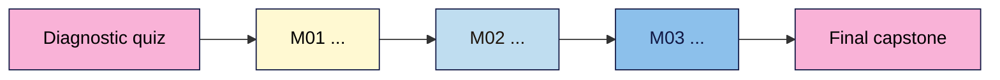

<!--
Course outline template. Copy to <course-slug>/course-outline.md and fill every section.
Delete the guidance lines (starting with >) once filled. Sections marked (required) must
not be left empty; everything else may say "n/a" with a reason.
See course-design-guide.md for formats, common gaps and what makes our courses different.
-->

# <Course title> — Course Outline

| Field | Value |
|---|---|
| Slug | `<course-slug>` |
| Version | 0.1 (see Changelog) |
| Status | draft / in production / published / under review |
| Last reviewed | YYYY-MM-DD |
| Author(s) | |
| Language | English (plain, ~grade 8–10 reading level) |
| Licence | CC BY-SA 4.0 (default, change if needed) |

---

## 1. Promise (required)
> One sentence: "After this course you can ___ without ___."

**Problem it solves:** <the pain the learner has today>
**What makes this course different:** <1–3 bullets, see design guide §3>

## 2. Who it's for (required)
**Ideal for:**
- ...

**Not for:** (saves the wrong learners from wasting time)
- ...

### Learner personas
> 2–3 short, concrete people. Every example and exercise should make sense to at least one of them.

| Persona | Background | Goal | Biggest worry | Time available |
|---|---|---|---|---|
| e.g. Priya, food blogger | Uses Instagram, no code | Own her site and email list | Breaking things | 3 h/week |

## 3. Prerequisites (required)
- **Knowledge:** ...
- **Accounts / tools to set up before Lesson 1:** ...
- **Hardware / internet:** ...
- **Not required:** (state explicitly, e.g. "no coding")

## 4. Level (required)
beginner / intermediate / advanced. Entry point → exit point (e.g. "beginner → confident self-publisher").

## 5. Learning outcomes (required)
> 3–5 outcomes using measurable verbs (build, configure, diagnose, compare, decide). Avoid "understand" and "know".

1. ...
2. ...
3. ...

## 6. Format & duration (required)
| Item | Value |
|---|---|
| Format | self-paced written + exercises (see design guide §1 for options) |
| Total learner time | ~__ hours (lessons + exercises + capstones) |
| Modules | __ (+ final capstone) |
| Lessons | ~__ · 10–25 min reading each, + exercise time |
| Exercise time per lesson | 15–45 min |
| Suggested pace | e.g. 2 lessons/week → __ weeks |
| Time to first win | Lesson 1 delivers a visible result in under 30 min |
| Output formats | Markdown (source) → web / PDF / slides / email (as needed) |

## 7. Tools & costs (required)
> Always give a free path. Learners should know the total cost before starting.

| Tool | Used for | Free option | Paid option (optional) | Approx. cost |
|---|---|---|---|---|
| | | | | |

**Minimum cost to complete the course:** ₹0 / $0 (or state it)

## 8. Non-negotiables
> Skills the learner MUST leave with. Skipping any of them costs them money, data, safety, rankings or legal standing.
> Each one is taught in one module, reinforced later, and assessed in the final capstone rubric.

| # | Non-negotiable | Why it can't be skipped | Taught | Reinforced | Assessed |
|---|---|---|---|---|---|
| 1 | | | M01 | M0_ | Final capstone |

## 9. Scope
**Nice-to-have (stretch goals / light coverage):**
- ...

**Deliberately out of scope (and where to learn it instead):**
- ...

## 10. Learning path

## 11. Diagnostic (placement) quiz
> 10–15 questions mapped to modules. Score guidance: "Got all M01 questions right? Skim M01, do its capstone, move on."

| Module | Questions | Skip rule |
|---|---|---|
| M01 | 2 | 2/2 → do the capstone only |

## 12. Running example
> One realistic project or persona scenario carried through every module, so each module adds a piece
> and the final capstone is the finished thing (e.g. "Priya's recipe site from empty domain to first sale").

## 13. Modules (required)
> Repeat per module. Lessons are planned in detail later by `/plan-module`.

### M01 — <title>
- **Goal:** one sentence
- **Topics:** 3–6 bullets
- **Non-negotiables taught:** #1, #3
- **Module capstone (artifact):** what the learner produces
- **Cheat sheet:** the one-page reference this module ends with
- **Common failure points:** what usually goes wrong here (feeds troubleshooting sections)

## 14. Assessment & completion (required)
- **Per lesson:** exercise + 5–8 question quiz (incl. 1–2 spaced-review questions from earlier lessons)
- **Per module:** capstone with rubric
- **Final capstone:** <brief>; rubric includes every non-negotiable
- **Completion means:** all module capstones submitted + final capstone at "Good" or above
- **Proof of skill:** portfolio artifact / public project / badge / certificate (state which)

## 15. Accessibility & inclusion
- Plain language; define jargon on first use (and in the glossary)
- Alt text for every image and diagram; diagrams also described in text
- Captions / transcripts for any audio or video
- Colour never the only signal; house palette meets contrast on text
- Works on mobile and low bandwidth; examples from more than one country/currency where relevant

## 16. Support, community & feedback
- **Where learners ask questions:** GitHub Discussions / forum / Discord / email
- **Errata:** GitHub issues
- **Feedback loop:** 3-question survey after each module (clarity, difficulty, time taken) + one open question
- **How feedback is used:** reviewed at each maintenance cycle and noted in the changelog

## 17. Freshness & maintenance
| Item | Value |
|---|---|
| Volatility | low / medium / high (how fast the subject changes) |
| Review cadence | e.g. every 3 months (high), 6 (medium), 12 (low) |
| Sources to watch | release notes, official docs, standards bodies |
| Version-stamped items | lessons state "verified against <product version> on <date>" |

> ⚠️ Freshness flag: <what changes fastest in this subject and must be re-verified before publishing>

## 18. Glossary & resources
- `glossary.md` in the course folder (built up as lessons are written)
- Cheat sheets: `cheatsheets/mNN-<slug>.md`
- Primary sources list

## 19. What next
> Where to go after finishing: next course in our catalog, advanced topics, communities, certifications.

## 20. Licence & attribution
- Licence: CC BY-SA 4.0 (others may reuse and adapt with credit, sharing under the same terms)
- Third-party material: list with source and licence
- Credit line: "© <year> GrandAppStudio — <course title>"

## 21. Changelog
| Version | Date | Change |
|---|---|---|
| 0.1 | YYYY-MM-DD | Outline drafted |
