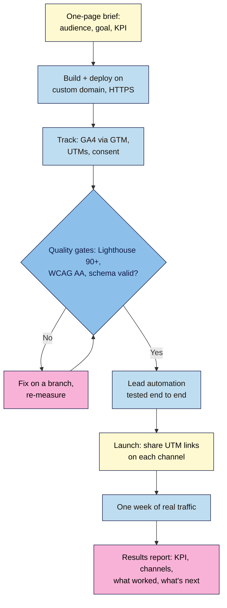

# Final Capstone — Launch Week
> By the end of this capstone you will have planned, built, launched and measured a real campaign page: on your own domain, tracked with consent, fast and accessible, described correctly to search engines, with leads handled automatically, plus an honest results report after one week of real traffic. This is your portfolio piece.

**Time:** ~6–8 hours of work, spread over about two weeks (one week to finish and launch, one week of traffic) · **Level:** L3 Advanced · **Prereqs:** all module capstones (M01–M08)
**Non-negotiables assessed:** all twelve, with the focus on #10 Measure with defined key events (taught M06, assessed here). This capstone also earns the certificate, together with every module capstone, at **Proficient** or above (course outline §6).
**Verified against:** the course outline's final-capstone brief and rubric (§5) and assessment rules (§6), and the reviewed module lessons M01–M08, whose sources and check dates still apply; checked 2026-11-03. No new tool facts are introduced here, and no live browser tests were run.

> Note: you can launch a **real** product or service, or a **fictional** one (a demo brand like Nila Coffee). Either way, the page must be live on a domain you control, and the week of traffic must be real. Small numbers are fine: 15 visits and 2 sign-ups, reported honestly, beat invented figures. If your launch can't run for a full week, report the days you have and say so.

## The brief
You're the whole launch team for one week. Pick a product, service, event or offer, and:
1. Write a **one-page brief**: audience, goal and one KPI.
2. **Build and deploy** the campaign page on a custom domain with HTTPS.
3. **Track** it: GA4 via GTM, UTM-tagged links for every channel, and a consent banner that works.
4. Reach **Lighthouse 90+** (mobile) in all four categories, pass the **WCAG 2.2 AA** checks from Module 7, and add **structured data** that validates.
5. Make **lead automation** work end to end.
6. Run it for **one week**, then write a short **results report**.

You may reuse your running project from Modules 2–8. If you do, launch a **new campaign** on it (a new offer, event or audience), so this week's numbers are about this launch.

## How it works



**In words:** decide what success means before you build. Build, deploy and track the page, then hold it to the quality gates until it passes. Test the lead flow, launch with tagged links on each channel, let real people use it for a week, and report what happened against the KPI you set at the start.

## Tasks
### 1. One-page brief (before you build)
Write it in your project note and keep it unchanged after launch, so you can't move the goalposts:

```markdown
# Launch brief — <offer name>
Launch dates: YYYY-MM-DD to YYYY-MM-DD
Audience: who, where, which language(s), on which devices
Problem → promise: one sentence each
Goal: what the page must achieve this week
KPI: the one number that says it worked (e.g. generate_lead count, or sign-up rate = generate_lead ÷ sessions)
Target: a realistic number for one week, with your reasoning
Channels: 2–4, each with its UTM link (M06.L01 naming sheet)
Risks: what could stop it working, and your plan for each
```

### 2. Build and deploy (Modules 2–5, 8)
- Semantic HTML with one H1 and a logical outline; accessible images and form; share-ready meta tags (M02).
- On-brand, responsive, mobile-first design with good contrast (M03).
- Version-controlled in Git, deployed automatically to a **custom domain with HTTPS** (M04, M08.L03).
- Working interactive parts: FAQ, form validation and sending (M05). Any AI-built code reviewed and logged (M08.L01).

### 3. Track with consent (Module 6)
- GA4 through GTM, with `generate_lead` marked as a **key event**, firing once per real sign-up.
- UTM links for every channel, consistent with your naming sheet; nothing shared without one.
- A consent banner where your audience's law requires it: no `_ga` before Accept or after Reject.
- A measurement plan: business question → key event → GA4 report you'll read.

### 4. Quality gates (Module 7)
- Lighthouse mobile **90+** in Performance, Accessibility, Best Practices and SEO (median of 3); LCP ≤ 2.5 s, CLS ≤ 0.1 in the lab.
- The keyboard and screen-reader passes, with no open level A or AA issues; `accessibility.html` published.
- Structured data that matches the page and validates with **0 errors**; `robots.txt`, sitemap, canonical and `noindex` consistent; page inspected in Search Console.

### 5. Lead automation (Module 8)
- Form → filter → duplicate check → sheet or CRM → auto-reply → team alert, with the five test leads from M08.L02 passed before launch, and a data map your privacy notice covers.
- If your audience includes a second language, the M08.L04 rules apply (own URL, reciprocal `hreflang`, switcher, reviewed translation).

### 6. Launch and run for one week
- Before you share anything, run the **launch checklist** below. Keep your GA4 **internal-traffic filter** active (Lesson 6.2), delete your test rows from the sheet afterwards, and note how many test sign-ups you made, so they don't inflate your KPI.
- Share each channel's UTM link. Don't change the page's main offer during the week; fix bugs, and note every change with its date and commit.
- Check daily (5 minutes): GA4 Realtime or the Reports for that day, the lead flow's run history, and the inbox for replies or complaints.

### 7. Results report (after day 7)
See **Deliverable** below.

## Test it: launch checklist
| Check | Expected |
|---|---|
| Open each UTM link in a private window | The right page loads over `https://`; GA4 shows the visit with the right source/medium |
| Reject, then Accept, on the consent banner | No `_ga` cookie after Reject; `_ga` after Accept; no tags firing before consent (Tag Assistant) |
| One real sign-up (your own address), with GTM Preview on | One `generate_lead` in GA4 DebugView; one row, one auto-reply and one team alert |
| Duplicate and `+test` sign-ups | No second row or reply |
| Lighthouse mobile, median of 3 | 90+ in all four categories |
| Keyboard only, then screen reader | Skip link, visible focus, named controls, labelled fields, consent banner usable |
| Rich Results Test / validator.schema.org | 0 errors; values match the page |
| Search Console URL Inspection (live test) | Available to Google; canonical as intended |
| Share preview (Sharing Debugger or Post Inspector) | Correct title, description and image |
| `git log` | Every change since the last module is committed; `main` is what's live |

## Break it and fix it: the launch-day drill
On a branch, or a preview deploy (never the live page), plant **one** bug from each list, have a classmate or friend find it without being told what it is, then swap. Record what they found, how and how long it took.

| Area | Pick one to plant |
|---|---|
| Tracking | A UTM link with `utm_source=Instagram` while the sheet says `instagram` (M06) · GA4 installed twice (M06) |
| Quality | A lazy-loaded hero image (M07) · an icon button with no accessible name (M07) |
| Automation | A renamed form field (M08) · the auto-reply step placed before the filter (M08) |

The point: on launch day, things break under pressure. Practise finding faults fast with the tools you already know.

## Deliverable: portfolio pack and results report
1. **Links:** the live page (`https://` on your domain), the repo, and the commit list for launch week.
2. **The one-page brief,** unchanged from before launch.
3. **Evidence:** launch-checklist screenshots (Lighthouse, Tag Assistant or DevTools consent check, DebugView `generate_lead`, Rich Results Test, Search Console, lead-flow run history with personal details blurred).
4. **The results report** (one page):

```markdown
# Launch Week results — <offer name>
Dates: YYYY-MM-DD to YYYY-MM-DD · Live URL: https://…

## 1. Headline
KPI: target vs actual (e.g. "Target 10 sign-ups; actual 6, from 140 sessions, 4.3%").
One sentence: did the launch meet its goal?

## 2. Channels
| Source / medium | Sessions | generate_lead | Rate | Notes |
(from GA4 Traffic acquisition, filtered to the launch dates; with basic consent mode only consented visits are counted, with advanced mode GA4 may add modelled data: say which you use)

## 3. What worked, what didn't
Three bullet points each, with evidence (a number, a recording, a quote from a reply).

## 4. Quality held?
Lighthouse at the end of the week · accessibility issues reported · lead-flow failures in the run history · changes made during the week (date, commit, why)

## 5. Limits of this data
Test sign-ups excluded (how many, and how) · Consent (basic mode: only consented visits measured; advanced mode: some figures modelled) · small numbers · ad blockers · lab vs field data · anything else you can't conclude

## 6. Next
The one change you'd make first for the next launch, and the metric that would show it worked.
```
   > 🖼️ **Image prompt:** Desktop screenshot (1440×900) of the GA4 Traffic acquisition report filtered to the seven launch dates, showing session source/medium rows (e.g. instagram / social, newsletter / email) with Sessions and the generate_lead key event column. Outline the key event column. Highlight the key element with a 3px #F9B2D7 outline; blur any personal details.
   > **Alt text:** GA4 Traffic acquisition for launch week, showing sessions and generate_lead by source and medium.

## Rubric
Six criteria from the course outline, each scored on four levels. **Proficient** or above on all six (plus every module capstone at Proficient or above) earns the certificate.

| Criterion | Exemplary (4) | Proficient (3) | Developing (2) | Beginning (1) |
|---|---|---|---|---|
| **Content structure & semantics** (NN #2, #3, #8) | One H1 and a clean outline; landmarks named; every image's alt and every field's label deliberate; meta and share preview correct; copy specific, honest and on-brief | All present; one minor gap (e.g. one weak alt text) | Skipped heading levels, missing labels or generic meta | Div soup, missing alts or labels |
| **Visual design & responsiveness** (NN #4, #5) | On-brand tokens; mobile-first layout that works from 320 px to desktop; contrast passes; a clear single CTA above the fold | Works on mobile and desktop; one layout or contrast issue fixed late | Breaks at some widths, or low-contrast CTA | Not responsive |
| **Functionality** (NN #1, #6, #7, #12) | Custom domain, HTTPS, automatic deploys from Git; form validates and sends; lead flow passed all five tests and ran without unexplained failures all week; AI changes reviewed and logged | Everything works; one failure during the week found and fixed with a commit | Manual deploys, a broken interaction, or leads lost | Not live |
| **Tracking & privacy** (NN #9, #10) | Measurement plan; `generate_lead` once per sign-up; UTMs on every shared link and consistent; consent blocks tags until Accept; data map and privacy notice cover every tool | Tracking and consent correct; one inconsistent UTM noticed and explained | Tracking before consent, duplicate events or untagged channels | No tracking |
| **Performance & accessibility** (NN #3, #11) | Lighthouse 90+ in all four categories at launch **and** at the end of the week; keyboard and screen-reader passes with no open A/AA issues; statement published; schema 0 errors | 90+ and AA passes at launch; one minor regression during the week fixed | Below 90, or only automated accessibility testing | Not measured |
| **Documentation & results report** | Brief written before launch and unchanged; report compares KPI target vs actual with channel data; evidence for every claim; limits stated honestly; a clear, testable next step; launch drill recorded | Report complete; one section thin | Numbers without context, no target, or claims without evidence | Missing |

## Self-check before you submit
- [ ] My brief was written **before** launch, with a KPI and a target.
- [ ] Every link I shared had a UTM, and the channels in my report match them.
- [ ] Consent worked all week, and my report says how consent affects the numbers (basic or advanced mode).
- [ ] Lighthouse 90+ and the AA checks held at the end of the week, not just at launch.
- [ ] Every lead got exactly one reply; no test or spam entries were answered.
- [ ] My numbers are real, my own test sign-ups are excluded, and I didn't hide a missed target.
- [ ] I can explain every line of code on the page, including any AI wrote.

## Portfolio note
Put the live link, the brief and the results report in one public page (a `case-study.html` on your site, or a portfolio post). Hiring managers and clients read the **report** more carefully than the page: it shows you can plan, ship, measure and tell the truth about results.
