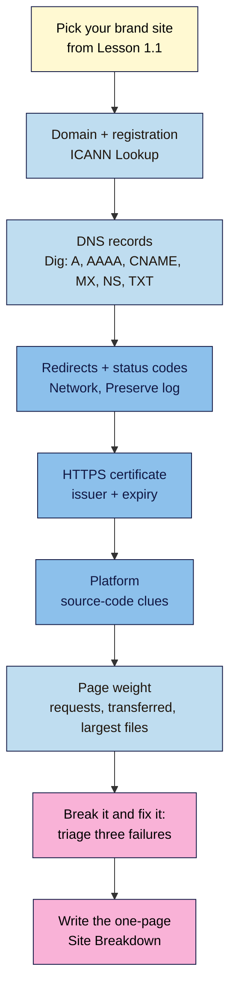

# M01 Capstone — "How this site works"
> By the end of this capstone you'll have a one-page **Site Breakdown** of a brand site you admire: who registered its domain, where its DNS and hosting live, what it's built with, how it redirects and secures itself, and how heavy its homepage is, all backed by evidence you collected yourself.

**Time:** ~60–90 min · **Level:** L1 Foundation (beginner) · **Prereqs:** M01.L01–M01.L05
**Non-negotiable assessed:** #1 A working mental model of the web (client/server, DNS, HTTP)
**Verified against:** ICANN Lookup (RDAP), Google Admin Toolbox Dig, and Chrome DevTools on 2026-11-02

## The brief
A small agency is pitching to rebuild your favourite brand's website and wants a junior strategist who "understands how sites actually work". Instead of a CV, they ask for a one-page breakdown of one real site, explained in plain language, with proof for every claim. Write that breakdown.

Use the **brand site you chose in Lesson 1.1**. Most of the evidence is already in your "Web Dev 101 — my project" note from the lesson exercises; this capstone pulls it together, fills gaps and checks it.

> Note: only look at public information with the free tools from this module. Don't try to log in to admin areas, scan the site with automated tools, or contact the brand.

## How it works



**In words:** work along the same path a page load takes. Start with the name (registration and DNS), then follow the request (redirects, status codes, HTTPS), look at what answers it (the platform), measure what comes back (page weight), and finally prove you can tell where a failure happens. Then write it up.

## Tasks

### 1. The domain (from M01.L02)
- Break the homepage URL into its parts.
- From **ICANN Lookup** (or the country registry for a ccTLD): registrar, created date, expiry date, nameservers.
- From **Dig**: the **A** and/or **AAAA** records, any **CNAME** on `www`, the **MX** servers (and which email service they suggest), and one **TXT** record with what it's for.

### 2. Hosting, redirects and HTTPS (from M01.L03)
- Test `http://`, `https://`, with and without `www`. For each: status code, where it ends up, and the number of hops.
- Certificate: issued to, issued by, valid from/to, lifetime in days.
- Your best guess at the hosting type or CDN, with the evidence (e.g. nameservers or CNAME pointing to Cloudflare, Netlify, Shopify, AWS…). "Unknown" is fine if the evidence is weak; say so.

### 3. Platform (from M01.L04)
- What it's built with (CMS, builder, framework or custom), with **two** independent clues and match counts.
- Is the homepage static, dynamic, or static with dynamic parts? One-sentence reason.

### 4. Page weight (from M01.L05)
- Homepage requests, transferred size, finish time (cache disabled, desktop).
- The three largest files: name, type, size.
- A labelled DevTools mock-up screenshot of one improvement you'd suggest (e.g. a clearer headline or a higher-contrast button).

### 5. Break it and fix it: three-failure triage
Trigger each failure on purpose, screenshot it, and write **which layer failed and how you know**:

| # | Do this | What to record |
|---|---|---|
| A | Open a domain that can't exist, using the reserved `.example` ending, e.g. `https://<brandname>-typo-test.example`. **Don't** mistype the real brand's domain: typo domains are often registered by scammers. | Error text and code (e.g. `DNS_PROBE_FINISHED_NXDOMAIN`). Layer: DNS. No server reached. |
| B | Open a made-up page on the brand's real domain (`/this-page-does-not-exist`) | Status code (Network panel) and whether the 404 page helps the visitor. Layer: server answered, page missing. |
| C | Open `http://neverssl.com` (or `http://httpforever.com` if it doesn't load) | What the browser shows (warning page / "Not secure"). Layer: no HTTPS, so no privacy, integrity or identity. |

Then, for each one, write the **first fix** you'd try if this were your own site (e.g. "A: check the domain hasn't expired and the A record exists").

## Deliverable: Site Breakdown
One page (Markdown, Google Doc or PDF) with these headings. Screenshots are the best evidence; crop out your bookmarks and personal details.

```markdown
# Site Breakdown — <brand> (<homepage URL>)
Date checked: YYYY-MM-DD · Browser: Chrome/Edge/Firefox <version>

## 1. Domain
URL parts: scheme … · subdomain … · domain … · TLD … · path …
Registrar … · created … · expires … · nameservers …
DNS: A/AAAA … · www CNAME … · MX … (→ email service: …) · TXT example … (purpose: …)

## 2. Hosting, redirects, HTTPS
http → … (code, hops) · www → … (code, hops) · final URL …
Certificate: issued by … · valid … to … (… days)
Hosting / CDN guess: … because …

## 3. Platform
Built with … · evidence: "<clue>" (n matches), "<clue>" (n matches)
Static / dynamic / mixed because …

## 4. Page weight
… requests · … transferred · finish … s
Largest files: 1) … 2) … 3) …
Suggested improvement (mock-up attached): …

## 5. Failure triage
A (typo domain): … → layer … → first fix …
B (missing page): … → layer … → first fix …
C (HTTP only): … → layer … → first fix …

## 6. How this site works, in three sentences
When someone types … , …
```

## Rubric
Score each criterion; **Good** or better on all five completes the module.

| Criterion | Excellent (4) | Good (3) | Needs work (2) | Missing (1) |
|---|---|---|---|---|
| **Domain and DNS accuracy** | Registration details and all requested records correct, with the email service and TXT purpose correctly explained | Details and records correct; one explanation thin | One or more records wrong, or WHOIS/AI output copied without checking | Section missing |
| **Request path: redirects and HTTPS** | Every URL variant tested with codes and hop counts; certificate details complete; hosting/CDN guess backed by evidence or honestly marked unknown | Variants and certificate covered; one detail missing | Redirects or certificate not tested, or guess stated as fact without evidence | Section missing |
| **Platform and page weight** | Two independent clues with counts; static/dynamic reasoning correct; weight measured with cache disabled; top-3 files and a labelled mock-up | Platform and weight correct; one item missing | One clue only, cache left on, or mock-up unlabelled | Section missing |
| **Failure triage (break it and fix it)** | All three failures reproduced, the failed layer correctly named with evidence, and a sensible first fix for each | Three reproduced and layers named; one fix weak | Layers confused (e.g. NXDOMAIN called a server crash) | Not attempted |
| **Plain-language explanation** | The three-sentence summary uses client, server, DNS, HTTPS and browser correctly and a non-technical reader would follow it | Correct and clear; slightly technical | Terms used incorrectly or unclearly | Missing |

## Self-check before you submit
- [ ] Every claim has evidence (a screenshot, a record, a match count) or is clearly marked as a guess.
- [ ] I checked any AI-generated explanations against the tools myself.
- [ ] I measured page weight with **Disable cache** ticked.
- [ ] My mock-up screenshot is labelled "Mock-up, not the live site".
- [ ] Nothing personal is visible in my screenshots.

## Running project checkpoint
Before Module 2, make sure your "Web Dev 101 — my project" note has:
- [ ] Your launch-page idea (one line) and 2–3 domain ideas (from M01.L02)
- [ ] Your hosting choice with one reason (from M01.L03)
- [ ] Your build approach with two reasons and a trade-off (from M01.L04)

In Module 2 you'll start writing the launch page's HTML.

## Module 1 cheat sheet
One-page summary of everything in this module: `webdev-101/cheatsheets/m01-how-the-web-works.md`.
