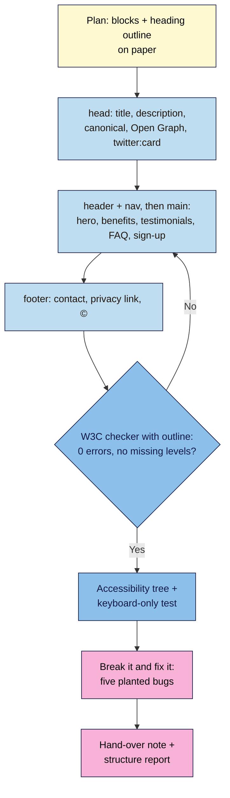

# M02 Capstone — Launch-page content skeleton
> By the end of this capstone you'll have the complete, hand-coded HTML of your launch page (hero, benefits, testimonials, FAQ and sign-up form) with clean semantics, accessible images and forms, and share-ready meta tags. It's unstyled, valid, and ready for CSS in Module 3.

**Time:** ~90–120 min · **Level:** L1 Foundation (beginner) · **Prereqs:** M02.L01–M02.L05
**Non-negotiables assessed:** #2 Semantic HTML with one H1 and a logical outline · #3 Alt text, labels and keyboard access · #8 Share-ready meta tags
**Verified against:** W3C Nu HTML Checker (with **outline**), Chrome DevTools accessibility tree, Meta Sharing Debugger and LinkedIn Post Inspector on 2026-11-02

## The brief
A founder (you, or a client) needs a launch page next month. The designer hasn't finished, but the content is ready, and the developer who styles it in Module 3 wants **clean HTML first**: every block in the right element, one clear heading outline, images and forms that work for everyone, and a `<head>` that makes the link look good when it's shared. Hand over that file.

Use the `launch.html` you've been building since Lesson 2.1. This capstone completes it, checks it and documents it.

> Note: write real content for your own launch where you can. Where you don't have something yet (a testimonial, a domain), use a clear `<!-- TODO: … -->` comment. Never invent testimonials or numbers.

## How it works



**In words:** plan the outline before typing, then write the `<head>` and each landmark in page order. Check until the validator is clean and the outline has no gaps, then test with the accessibility tree and the keyboard. Prove you can debug by fixing five planted bugs, and finish with a short hand-over note.

## Tasks

### 1. Plan (from M02.L03)
On paper or in your note, write the heading outline you want, e.g.:
`h1 Fresh beans every month` › `h2 Why subscribe` · `h2 What customers say` · `h2 Frequently asked questions` › `h3` per question · `h2 Join the launch list`.

### 2. The `<head>` (from M02.L01 and M02.L05)
`lang`, `charset`, `viewport`, a specific `<title>`, a meta description, `canonical`, `og:type`, `og:site_name`, `og:title`, `og:description`, `og:url`, `og:image` (full URL, 1200×630) with width, height and alt, `twitter:card`, and a favicon link. Placeholders for the domain are fine, with a TODO comment.

### 3. The page (from M02.L02–M02.L04)
| Block | Must include |
|---|---|
| `header` | Logo image as a home link (alt = destination) + `nav aria-label="Main"` with a `ul` of same-page links |
| Hero `section` | The only `h1`, one supporting `p`, a hero image with real `width`/`height` (not lazy), and a "Join the launch list" link to `#signup` |
| Benefits `section` | `h2` + a list of 3–5 benefits, using `strong` where it helps |
| Testimonials `section` | `h2` + 1–3 `figure`/`blockquote`/`figcaption` (real, or TODO) |
| FAQ `section` | `h2` + at least three questions as `h3` (or `details`/`summary`) with answers |
| Sign-up `section id="signup"` | Promise line, form with labelled fields, right `type`s, `name`s, `autocomplete`, `required` only where essential, a hint via `aria-describedby`, any extra use as an unticked optional checkbox, a privacy link worded as information (not "you agree to"), and a `button` that says what happens |
| `footer` | Contact (`mailto:` and/or `tel:`), privacy link, © line |

Every `section` is named with `aria-labelledby`. At least one decorative image uses `alt=""`. Below-the-fold images use `loading="lazy"`.

### 4. Check it
- W3C checker with **outline** ticked: "The document validates according to the specified schema(s)." and no `[missing]` levels. Copy the outline into your note.
- DevTools accessibility tree: banner, navigation "Main", main, one named region per section, contentinfo. Every form field shows a **Name**.
- Keyboard only: Tab from the address bar through every link and field, reach and submit the form, and use the "Join" link to jump to the form.

> 🖼️ **Image prompt:** Desktop screenshot (1440×900) of the W3C Nu HTML Checker results for a learner's launch page with "outline" ticked: the "The document validates according to the specified schema(s)." message and an outline showing h1, five h2 sections and h3 FAQ questions with no [missing] entries. Outline the success message and the outline list. Highlight the key element with a 3px #F9B2D7 outline; blur any personal details.
> **Alt text:** W3C checker confirming a valid launch page with a clean heading outline of one h1, h2 sections and h3 questions.

### 5. Break it and fix it: five planted bugs
Save a copy as `launch-broken.html` and plant these bugs **one at a time**. For each, record how you found it (tool and exact message or symptom), then fix it.

| # | Plant this | Find it with |
|---|---|---|
| A | Change an FAQ `h3` to `h4` | Validator error (skipped heading level) and `[missing]` in the outline |
| B | Delete the hero image's `alt` | Validator error: `An "img" element must have an "alt" attribute…` |
| C | Change the email label's `for` to a different case (`Email`) | Clicking the label does nothing; accessibility tree shows no Name |
| D | Remove `name` from the email input | Submit (with the practice `method="get"` from Lesson 2.4): `email=` is missing from the address bar |
| E | Make `og:image` relative (`images/share.jpg`) | Not caught by the validator. Find it by reading your `<head>` against the cheat sheet, and explain why platforms would show no image |

Bug E is the lesson: **a valid page can still be broken for sharing**, so the checklist matters as much as the checker.

## Deliverable: hand-over pack
1. `launch.html`, valid, unstyled.
2. A one-page note with these headings:

```markdown
# Launch page hand-over — <project name>
Date checked: YYYY-MM-DD · Browser: <name + version>

## 1. Heading outline (copied from the W3C checker)
…

## 2. Landmarks (from the accessibility tree)
banner · navigation "Main" · main · regions: … · contentinfo

## 3. Images
<file> — alt "…" — branch of the alt flowchart used: …  (one line each)

## 4. Form
Fields kept and why (one line each) · consent wording · privacy link target

## 5. Metadata
title · description · og:title · og:image (size, alt) · TODOs left (e.g. domain)

## 6. Break-it-and-fix-it log
A … · B … · C … · D … · E …

## 7. Notes for the designer
Three things that must survive styling (e.g. "keep the FAQ as h3s", "the button text is final").
```

## Rubric
Score each criterion; **Good** or better on all five completes the module.

| Criterion | Excellent (4) | Good (3) | Needs work (2) | Missing (1) |
|---|---|---|---|---|
| **Validity** | Validates with no errors or warnings in your own code; all five planted bugs found and fixed with the exact message or symptom recorded | Validates; one bug log entry thin | Errors remain, or bug log incomplete | Not checked |
| **Semantics and headings** | One `h1`, no skipped levels, every block in the right landmark, sections named; outline reads like a table of contents | Correct outline and landmarks; one section unnamed | Skipped levels, `div`s where landmarks belong, or bold text as headings | Not attempted |
| **Accessible images and forms** | Every image has a deliberate alt (justified per image); fields labelled, typed, named, with autocomplete; keyboard-only test passes; consent unticked and optional | All present; one justification or attribute missing | Missing alts or labels, placeholder used as a label, or pre-ticked box | Not attempted |
| **Meta completeness** | Specific title and description; canonical; full Open Graph set with an absolute 1200×630 image and alt; `twitter:card`; favicon; TODOs marked | Complete; one tag weak or missing | Title generic ("Home"), relative `og:image`, or several tags missing | Missing |
| **Content clarity** | Real, concrete copy; link and button text name the destination or action; no invented testimonials; hand-over note a designer could act on | Clear; one vague link or heading | "Click here" links, filler copy, or invented claims | Missing |

## Self-check before you submit
- [ ] The validator (with **outline**) is clean and I pasted the outline into my note.
- [ ] I can complete the form with the keyboard alone.
- [ ] Every image's alt is a choice I can explain, including at least one `alt=""`.
- [ ] `og:image` is a full `https://` URL, and I wrote a brief for a 1200×630 share image.
- [ ] No fake testimonials, prices or numbers; gaps are TODO comments.

## Running project checkpoint
Before Module 3, your "Web Dev 101 — my project" note should have:
- [ ] The hand-over pack above
- [ ] Your brand colours and fonts if you have them (a screenshot or a list is fine). Module 3 turns them into CSS.

## Module 2 cheat sheet
One-page summary of everything in this module: `webdev-101/cheatsheets/m02-html.md`.
