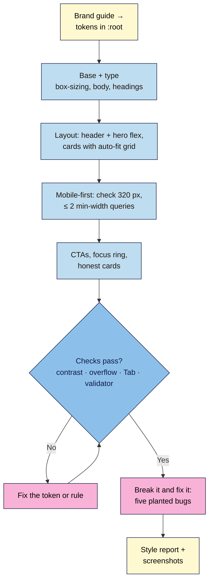

# M03 Capstone — Styled, responsive launch page
> By the end of this capstone your launch page will be on-brand, readable and comfortable to use on a 320 px phone, a tablet and a laptop. It will pass WCAG 2.2 AA contrast, show a visible keyboard focus everywhere, and make one clear, honest offer. The styling is all in one linked stylesheet built on brand tokens.

**Time:** ~2–3 hours · **Level:** L1 Foundation (beginner) · **Prereqs:** M03.L01–M03.L05 (and your M02 capstone `launch.html`)
**Non-negotiables assessed:** #4 Mobile-first, responsive layout · #5 Colour contrast and brand tokens · reinforced: #3 Alt text, labels and keyboard access (focus and tap targets)
**Verified against:** the M03 lessons' sources; the full Module 3 stylesheet validated live with the W3C CSS Validation Service (no errors; only the "CSS variables are not statically checked" warnings); all five planted bugs below reproduced in headless Chrome 156 at 320 and 1280 px, with the symptoms as described, on 2026-11-02.

> Note: no brand guide yet? Use the one-paragraph mini guide in Task 1, or keep Nila Coffee's tokens and change only the accent colour. The rubric scores how you **use** tokens and contrast, not how original the palette is.

## The brief
The content of the launch page is signed off (your Module 2 hand-over). Now the founder wants it to **look like the brand** and **work on the phone** where most visitors will see it first. The developer who publishes it in Module 4 wants a single, tidy stylesheet: brand values defined once, no inline styles, no `!important`, nothing that breaks at 320 px. Hand over the styled page plus a short **style report** that proves it's accessible and honest.

## How it works



**In words:** turn the brand guide into tokens first, then style in layers: base and type, layout, responsive rules, then buttons and cards. Run the four checks (contrast, overflow at 320 px, keyboard Tab, validator) until they all pass, prove you can debug by fixing five planted bugs, and finish with a style report a developer can trust.

## Tasks

### 1. Tokens (from M03.L02)
Write your token table first, in your project note, then as `:root` in `styles.css`. Minimum set:

| Group | Tokens |
|---|---|
| Colour (by job) | `--color-bg`, `--color-text`, `--color-heading`, `--color-muted`, `--color-cta`, `--color-on-cta`, `--color-cta-hover`, `--color-focus`, `--color-field`, `--color-line`, `--color-surface` |
| Type | `--font-body`, `--font-heading`, a 4–5 step size scale (`--text-sm` … `--text-2xl`, headings with `clamp()`), `--leading` |
| Space and shape | `--space-1` … `--space-4`, `--radius` |

**Mini brand guide (if you have none):** *"Calm and trustworthy. Off-white background, near-black text, one deep accent colour for actions (your choice), a muted grey-blue for small print. Headings in a classic serif; body in the system sans-serif."*

### 2. One tidy stylesheet (from M03.L01)
`styles.css` linked once in `<head>`, in this order, each part with a comment heading:
`0 tokens → 1 box-sizing → 2 base text → 3 headings and type → 4 page column and sections → 5 forms → 6 layout → 7 responsive → 8 components (buttons, cards)`.
Rules: **no** hex codes outside `:root`, **no** inline `style` attributes, **no** `!important`, **no** ID selectors for styling.

### 3. Layout (from M03.L03)
| Block | Must |
|---|---|
| `header` | Flexbox: brand/logo and nav on one line on wide screens, wrapping on phones; nav links in a flex row with `gap` |
| Hero | Flexbox with wrapping (text + image or text + sign-up teaser), stacked on phones |
| Benefits | `.card-grid` with `repeat(auto-fit, minmax(min(14rem, 100%), 1fr))` |
| Testimonials | The same `.card-grid` class reused (real quotes, or a clear TODO) |
| Pricing (if you sell something) | Cards with full price, period, fees note and how to cancel; one featured card made by **overriding tokens** |
Visual order = HTML order everywhere (no `order`, no `-reverse`).

### 4. Mobile-first (from M03.L04)
- Base CSS = phone layout. At most **two** `min-width` media queries in `rem`, each with a comment saying what it adds.
- `img`, `video`, `iframe` never wider than their container; embeds keep 16:9 with `aspect-ratio`.
- Tap targets: nav, footer and form controls at least 24 × 24 px or clearly spaced; main buttons about 44 px tall or more.

### 5. CTAs and honesty (from M03.L05)
- **One** filled primary CTA per section; secondary actions as outline buttons or links; button text says what happens.
- `:hover` on buttons and a `:focus-visible` outline (2–3 px, 3:1 contrast) on every link, button, field and `summary`.
- Dark-pattern audit: no false urgency, confirmshaming, drip pricing, pre-ticked boxes, hidden opt-outs or fake badges.

### 6. Check it
- **Contrast:** measure every pair in DevTools' colour picker or WebAIM: body text, headings, muted text, links, CTA label, CTA hover, field border, focus ring (and the same set inside any featured/dark card).
- **Overflow:** at **320** px, the Console finder from Lesson 3.4 prints nothing, and `document.documentElement.scrollWidth` returns 320 (the finder can't see a long word or URL spilling out of its box):
  ```js
  document.querySelectorAll('body *').forEach(el => { if (el.getBoundingClientRect().right > document.documentElement.clientWidth + 1) console.log(el); });
  ```
- **Widths and zoom:** full-size screenshots at **320, 768 and 1280** px (device toolbar → ⋮ → **Capture full size screenshot**), plus one at **200% zoom** on a normal window.
- **Keyboard:** Tab from the address bar to the submit button. Focus is always visible, never hidden behind anything, and moves in reading order.
- **Validator:** W3C CSS checker, "Congratulations! No Error Found." (variable warnings are fine). Re-run the **HTML** checker too: your Module 3 HTML edits (classes, wrappers, the pricing section) must still validate.

> 🖼️ **Image prompt:** Composite of three full-page screenshots of a styled launch page side by side, at 320 px (one column, stacked hero, single cards), 768 px (two-column cards) and 1280 px (logo and nav on one line, hero text and image side by side, three cards). Outline the hero in each width. Highlight the key element with a 3px #F9B2D7 outline; blur any personal details.
> **Alt text:** The same launch page at phone, tablet and laptop widths, with the layout adapting from one column to three.

### 7. Break it and fix it: five planted bugs
Save a copy as `styles-broken.css`, point a copy of your page (`launch-broken.html`) at it, and plant these **one at a time**. For each, record the symptom, the tool and the exact evidence (message, value or screenshot), then fix it.

| # | Plant this (at the end of the file unless stated) | Symptom (checked in Chrome) | Find it with |
|---|---|---|---|
| A | `.button { background-color: var(--color-CTA); }` | The primary button loses its background (transparent); white text vanishes on a light page | Inspect: the computed `background-color` is `rgba(0, 0, 0, 0)`; compare the token name letter by letter |
| B | `.hero > * { flex: 0 0 30rem; }` | At 320 px the hero text runs off the right edge and the page scrolls sideways | The Console finder lists the hero's `div`, `h1` and `p`; the flex overlay shows items that can't shrink |
| C | `a:focus { outline: none; }` | Tabbing through links shows no focus ring (buttons and fields still have one) | Tab test; DevTools **:hov** → force **:focus** and **:focus-visible** on a link: your outline is struck through, beaten by this rule (same specificity, later in the file) |
| D | In `:root`, change `--color-muted` to `#a07850` | Hints and captions look fine but measure **3.81:1** on cream (fails 4.5:1) | DevTools colour picker or WebAIM on the hint text |
| E | Move `class="card-grid"` from the benefits `ul` to its `section` (HTML change) | Phone looks normal; at 1280 px the `h2` sits on the left and the benefits become one bulleted card on the right | The **grid** badge is now on the `section`; only direct children (`h2`, `ul`) became grid items |

Bug D is the lesson: **a design can look fine and still fail**, so you measure. Bug E is the other one: **test at more than one width**, because some bugs only appear on big screens.

## Deliverable: style report
1. `launch.html` + `styles.css`, valid, linked, tidy (Task 2 rules).
2. Screenshots: 320, 768, 1280 px and 200% zoom.
3. A one-page note with these headings:

```markdown
# Launch page style report — <project name>
Date checked: YYYY-MM-DD · Browser: <name + version>

## 1. Tokens
Table: token · value · job (and the brand-guide line it comes from)

## 2. Contrast report
Pair · ratio · required (4.5 / 3) · pass/fail   (one line each, incl. focus ring and field border)

## 3. Layout decisions
Where you used Flexbox, where Grid, and why (one line each); your media queries and what each adds

## 4. Responsive and keyboard checks
Overflow finder at 320 px: result · tap targets checked · Tab order: <list> · 200% zoom: result

## 5. Conversion and honesty
Primary CTA per section · dark-pattern audit (six rows: none / changed) · CSS library decision (one paragraph)

## 6. Break-it-and-fix-it log
A … · B … · C … · D … · E …

## 7. Notes for Module 4 (publishing)
Files to publish (`launch.html`, `styles.css`, `images/`, any `fonts/`), anything still TODO (domain, real testimonials)
```

## Rubric
Score each criterion; **Good** or better on all five completes the module.

| Criterion | Excellent (4) | Good (3) | Needs work (2) | Missing (1) |
|---|---|---|---|---|
| **Brand tokens and consistency** | Complete token set named by job; no hex codes outside `:root`; brand guide visibly reflected; a featured or themed block made purely by overriding tokens | Tokens cover colours, type and space; one or two raw values left elsewhere | Few tokens, colours named by hue, or many hard-coded values | No tokens |
| **Responsive layout (NN #4)** | Mobile-first base, ≤ 2 commented `min-width` queries; no overflow at 320 px; clean at 768 and 1280 px and at 200% zoom; visual order = source order | Works at all three widths; one small issue (e.g. a cramped gap) | Sideways scroll at 320 px, fixed widths, or desktop-first overrides | Not responsive |
| **Contrast and focus (NN #5, #3)** | Every pair measured and passing (4.5:1 text, 3:1 large text, field borders and focus ring), including any dark card; visible `:focus-visible` everywhere; tap targets ≥ 24 px | All text passes; one non-text pair (border or ring) unmeasured | A text pair below 4.5:1, or focus removed anywhere | Not checked |
| **CSS quality** | One linked, ordered, commented stylesheet; validates; no inline styles, `!important` or ID styling; all five planted bugs found with exact evidence | Validates and tidy; one bug log entry thin | Validation errors, scattered or duplicated rules, or an incomplete bug log | Missing |
| **Conversion clarity and honesty** | One primary CTA per section; action-specific button text; honest cards (full price, true badges, real or TODO testimonials); dark-pattern audit complete; reasoned library decision | Clear and honest; one vague button or audit row missing | Competing primary buttons, "Submit"/"Click here", or any dark pattern | Missing |

## Self-check before you submit
- [ ] Searching `styles.css` for `#` finds hex codes only inside `:root`.
- [ ] The overflow finder prints nothing at 320 px.
- [ ] I can see focus on every element when I Tab, and it follows the reading order.
- [ ] Every pair in my contrast report has a measured ratio, not a guess.
- [ ] Both the CSS and the HTML validators are clean.
- [ ] Nothing on the page claims something that isn't true today.

## Running project checkpoint
Before Module 4, your "Web Dev 101 — my project" note should have:
- [ ] The style report above, with screenshots
- [ ] A list of every file the page needs (HTML, CSS, images, fonts): Module 4 puts these in a Git repository and publishes them
- [ ] A domain idea (optional; a free host subdomain is fine, see the course's zero-cost rule)

## Module 3 cheat sheet
One-page summary of everything in this module: `webdev-101/cheatsheets/m03-css.md`.
