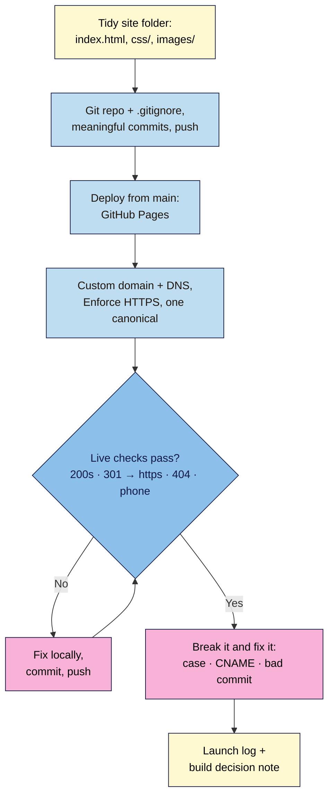

# M04 Capstone — Live, versioned launch page
> By the end of this capstone your launch page is live on the real web over HTTPS, at one canonical address, published automatically from a GitHub repository whose history tells the story of the project. You'll prove you can break it and fix it live, and you'll hand over a written decision on how to build your next project.

**Time:** ~3–4 hours (plus DNS and certificate waiting time) · **Level:** L2 Practitioner · **Prereqs:** M04.L01–M04.L05 (and your M03 capstone page)
**Non-negotiables assessed:** #6 Version control and safe deployment · #7 HTTPS and one canonical address · reinforced: #4 Mobile-first (checked live on a real phone)
**Verified against:** the M04 lessons' sources (GitHub Docs on Pages, publishing sources, limits, custom domains, verification and HTTPS; Pro Git; VS Code docs); the three planted bugs' symptoms checked live on 2026-11-02 (wrong letter case → 404 on a GitHub Pages site; a mistyped `*.github.io` CNAME target → "Site not found · GitHub Pages", 404; `git revert` + push → a new Pages deployment that restores the previous content).

> Note: a custom domain is **optional** (the course's zero-cost rule). Without one, use your `username.github.io/repo/` address, skip Task 4's DNS steps and do bug B as a read-and-explain exercise. The rubric's domain row has a no-domain column.

## The brief
The founder signed off the styled page (your Module 3 capstone). Now it has to be **live**: on an address you can print on a flyer, secure, fast, and updatable by pushing a commit, with a history that shows who changed what and a way back if something breaks. The founder also wants to know: "For our next site, should we keep hand-coding, move to WordPress, or use a builder?" Hand over the live link, a **launch log**, and a **build decision note**.

## How it works



**In words:** tidy the folder so paths work anywhere, put it under Git with a clean `.gitignore`, and push to GitHub. Publish from `main`, then add your domain and force HTTPS. Test the live site like a visitor until every check passes, fixing by commit and push. Then break it three ways on purpose and fix each, and finish with a launch log and your build decision.

## Tasks
### 1. A tidy site folder (from M04.L01)
- `index.html` at the root, `css/styles.css`, `images/`; lowercase, hyphenated file names; **relative** paths only (`css/styles.css`, not `/css/…` or `C:\…`).
- The capital-letter search from Lesson 4.1 (`(src="|href="|url\(["']?)[^"')]*[A-Z]`) leaves only external links and matching `#` links.
- Live Preview shows the page with no red requests in Network.

### 2. Version control (from M04.L02)
- `.gitignore` committed **first** (`.DS_Store`, `Thumbs.db`, `.env`, `*.zip`, editor folders); no secrets anywhere in history.
- Commit email set to your GitHub no-reply address.
- **At least five meaningful commits** with imperative messages ("Add pricing section", not "update"), including one `git revert`.
- Pushed to GitHub (public for free GitHub Pages; private if you deploy with Netlify or Cloudflare). A short `README.md`: what the site is, the live URL, how to publish (push to `main`).

### 3. Deploy (from M04.L03)
- GitHub Pages: **Settings → Pages → Deploy from a branch → main, /(root)** (or another host, with one sentence on why).
- Every push to `main` redeploys; the Actions tab shows green **pages build and deployment** runs.

### 4. Domain and HTTPS (from M04.L04)
- Domain registered in **your own** account, auto-renew and 2FA on, privacy on; renewal price noted.
- Domain verified on GitHub (TXT `_github-pages-challenge-…`); four A records on `@` (AAAA optional); CNAME `www` → `username.github.io`; MX and email TXT untouched ("before" screenshot kept); no wildcards.
- Custom domain set in the repo (the `CNAME` file pulled locally); **Enforce HTTPS** ticked after the certificate is issued.
- `canonical`, `og:url` and `og:image` updated to the final `https://` address.

### 5. Test it live
| Check | Expected |
|---|---|
| Network, **Disable cache**, reload | Every file 200; no red requests |
| `http://` and the non-canonical host (apex or `www`) | One or two 301s, ending at your canonical `https://` address |
| `/nope.html` | 404 (your custom `404.html` if you made one) |
| Padlock → certificate | Issued to your domain (or `*.github.io`) by Let's Encrypt, about 90 days, renewed automatically |
| A real phone | Mobile layout, fonts loaded, no sideways scroll (NN #4) |
| Push a small text change | Live within a few minutes, matching the latest commit |

### 6. Break it and fix it: three planted bugs
Plant these **one at a time** on the live site, record the symptom, the tool and the exact evidence (status code, message, screenshot), then fix with a commit and push.

| # | Plant this | Symptom (checked 2026-11-02) | Find it with | Fix |
|---|---|---|---|---|
| A | Change the hero `src` to `images/Beans.jpg` (file is `beans.jpg`), commit, push | Local preview on Windows/Mac still shows it; **live**, the image is missing | Network: **404** for `…/images/Beans.jpg`; compare with the file list on GitHub | Match the case, commit `Fix hero image case`, push |
| B | At your DNS host, change the `www` CNAME value to a typo (`yuorname.github.io`) | After the TTL, `www.yourdomain` shows **"Site not found · GitHub Pages"** (404); the apex may still work | Dig CNAME for `www`; compare letter by letter | Restore the value; wait for the TTL; recheck Dig |
| C | Commit and push "Remove pricing section" (delete it) | Live page loses the section after the deploy | Actions: the deploy for that commit; `git log --oneline` | `git revert HEAD --no-edit` + `git push`; a new deploy restores it |

**No domain?** For bug B, Dig your `username.github.io` address and write what you'd see with a typo and why (Lesson 4.4's table). Use a short-TTL record (e.g. 300 s) if your DNS host lets you, so bug B doesn't keep `www` broken for long.

The lesson of bug A: **live is stricter than local**. Of bug B: **DNS typos look like hosting errors**, so check the record first. Of bug C: **rolling back is a commit, not a panic**.

### 7. Build decision (from M04.L05)
`decision-notes.md` in the repo: your next project's brief, the seven checklist answers, winner and runner-up, a three-year cost sheet (vendor pages named and dated), the exit line, and a "revisit when" trigger.

## Deliverable: launch log
1. The live `https://` link and the GitHub repository link.
2. Screenshots: GitHub Pages settings (domain, DNS check, Enforce HTTPS), Network on a cached-disabled reload, the 301 chain from `http://`, the phone view.
3. A one-page note with these headings:

```markdown
# Launch log — <project name>
Date: YYYY-MM-DD · Live URL: https://… · Repo: https://github.com/…

## 1. Site structure
Folder tree · capital-letter search result · paths: all relative (yes/no)

## 2. Version control
`git log --oneline` (paste) · the revert commit and why · what .gitignore covers · commit email (no-reply: yes/no)

## 3. Deployment
Host and why · source (branch/folder) · typical deploy time you saw

## 4. Domain and DNS
Registrar · renewal price · records added (type · name · value) · records left alone (MX, TXT) · verified (yes/no)

## 5. HTTPS and canonical
Canonical address · redirects seen (http → https, apex ↔ www) · certificate issuer and expiry · canonical/og tags updated

## 6. Live test results
The Task 5 table with your actual results and the phone + browser used

## 7. Break-it-and-fix-it log
A … · B … · C …   (symptom · tool · evidence · fixing commit)

## 8. Build decision
Link to decision-notes.md and a two-line summary
```

## Rubric
Score each criterion; **Good** or better on all five completes the module.

| Criterion | Excellent (4) | Good (3) | Needs work (2) | Missing (1) |
|---|---|---|---|---|
| **Project structure** | Clean root (`index.html`, `css/`, `images/`), web-safe names, all relative paths; capital-letter search clean; README explains how to publish | Clean structure; one naming or path inconsistency that doesn't break live | Broken paths live, spaces or mixed case in names, or root-relative paths on a project address | No structure |
| **Version control (NN #6)** | `.gitignore` first; no secrets in history; ≥ 5 meaningful imperative commits incl. a revert; no-reply email; history explains the project | ≥ 5 commits incl. a revert; one vague message | Few commits, "update" messages, junk files tracked, or no revert | No repository |
| **Deployment and testing** | Auto-deploys from `main`; all Task 5 checks passed and logged with evidence, including a real phone; all three bugs found and fixed with exact evidence | Live and auto-deploying; one check or bug entry thin | Manual uploads, unchecked live 404s, or bug log incomplete | Not live |
| **Domain and HTTPS (NN #7)** | *With domain:* own account, verified, correct A/CNAME, MX intact, no wildcards, HTTPS enforced, every variant 301s to one canonical address, tags updated. *Without:* `github.io` address with HTTPS, 301 from `http://` logged, full DNS plan for a future domain | HTTPS enforced and canonical set; one record or tag detail missing | Mixed `http`/`https`, two live variants without redirects, or email broken | No HTTPS |
| **Build-approach decision** | All seven questions answered with reasons; three-year costs from dated vendor pages incl. hours and renewals; exit line; revisit trigger; recommendation readable in two minutes | Complete decision; costs partly estimated | Choice stated without reasons or costs | Missing |

## Self-check before you submit
- [ ] The live site loads over `https://` at one address, and every other variant redirects there.
- [ ] Network shows no red requests with the cache disabled, on desktop and on my phone.
- [ ] `git log --oneline` shows at least five clear commits and one revert.
- [ ] Nothing in the repo (or its history) is a password, key, `.env` file or client data.
- [ ] My DNS "before" screenshot is saved and my email still works.
- [ ] `decision-notes.md` is in the repo and pushed.

## Running project checkpoint
Before Module 5, your "Web Dev 101 — my project" note should have:
- [ ] The live URL and the repo URL
- [ ] The launch log above, with screenshots
- [ ] Your build decision (the course's next step: WordPress 101 if you chose a CMS)

## Module 4 cheat sheet
One-page summary of everything in this module: `webdev-101/cheatsheets/m04-publish.md`.
