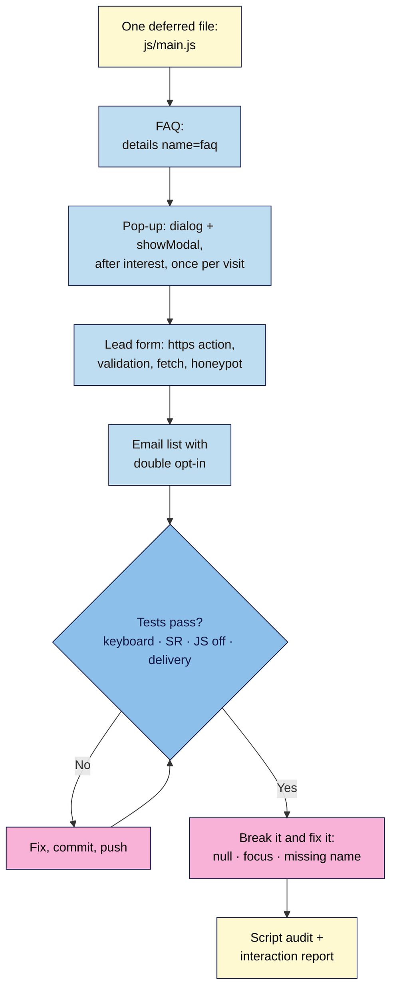

# M05 Capstone — Interactive launch page
> By the end of this capstone your live launch page has a working FAQ accordion, a polite newsletter pop-up and a lead form that really delivers to an email list, all from one small deferred script. Every piece works with a keyboard and a screen reader, nothing tricks visitors, and the page still works if JavaScript fails.

**Time:** ~3–4 hours · **Level:** L2 Practitioner · **Prereqs:** M05.L01–M05.L04 (and your live M04 launch page)
**Non-negotiables assessed:** reinforced: #3 Alt text, labels and keyboard access (every component), #6 Version control (one commit per feature), #7 HTTPS (form endpoints), #12 Review AI output (any generated code checked and logged)
**Verified against:** the M05 lessons' sources (MDN script loading, DOM, events, `<details>`, `<dialog>`, Constraint Validation, `FormData`, Fetch; WAI-ARIA Authoring Practices; WCAG 2.2 SC 2.1.2 and 2.2.2; Formspree plans and help); the three planted bugs reproduced in headless Chrome 156 on 2026-11-02 (`Cannot read properties of null (reading 'addEventListener')` from a mistyped selector; `show()` letting Tab leave the pop-up while `showModal()` keeps it inside; a field with no `name` missing from `FormData`).

> Note: no email-list account? Use Formspree for the lead form and describe in your report how you'd add double opt-in with Brevo or Mailchimp (Lesson 5.4, Part C). The rubric's delivery row has a Formspree-only path.

## The brief
The founder's launch page is live and secure (your Module 4 capstone). Now it has to **convert**: answer common questions without clutter, invite interested visitors to the launch list at the right moment, and capture leads that actually arrive. The founder has seen competitors' pop-ups that appear on load and timers that reset, and says: "I want it to work, but I don't want us to look like a scam." Hand over the improved live page and a short **interaction report**: what each script does, how you tested it, and what happens when it fails.

## How it works



**In words:** start with one deferred script file. Add the FAQ with native `<details>`, the pop-up with `<dialog>` opened after real interest, and a form that sends securely and confirms honestly, feeding an email list with double opt-in. Test everything with a keyboard, a screen reader, JavaScript off and a real submission, fixing by commit and push. Then break it three ways on purpose, audit every script on the page, and write the report.

## Tasks
### 1. One tidy script (from M05.L01–L02)
- All your JavaScript in `js/main.js`, loaded once with `<script src="js/main.js" defer></script>` in `<head>`.
- Short, commented sections (FAQ, pop-up, form…); `const` by default; `textContent` and `classList` for changes; no libraries, no inline `onclick`.
- Console clean on load and while using every feature, on the live site.

### 2. FAQ accordion (from M05.L03)
- At least three real questions in `<details name="faq"><summary>…</summary>…</details>`; one open at a time.
- A visible focus ring on `<summary>`; key facts (price, delivery) also visible outside the FAQ.

### 3. Polite newsletter pop-up (from M05.L03)
- `<dialog>` opened with `showModal()` after real interest (reaching pricing via `IntersectionObserver`, or a delay of at least 20 seconds), **never on load**, once per visit (`sessionStorage`).
- A heading, one sentence on what they'll get, a visible **No thanks** (`<form method="dialog">`), Escape closes it, focus stays inside, a `::backdrop` and a `max-width` that leaves the page visible around it on phones.
- No confirmshaming text.

### 4. A lead form that delivers (from M05.L04)
- Real `https://` endpoint in `action` with `method="post"`; works with JavaScript off.
- Every field named; only the fields you need (Lesson 2.4); a consent line with a privacy link.
- JavaScript: friendly messages linked by `aria-describedby`, `aria-invalid`, focus to the first error; `fetch()` with `FormData` and `Accept: application/json`; button disabled while sending; status in `role="status"`; thanks **only** on `response.ok`; the service's error otherwise; a `catch` for no connection.
- Honeypot field (`_gotcha` or the tool's own).
- The newsletter list with **double opt-in**, tested with an address you own.

### 5. Optional extras (from M05.L02–L03)
Any of: copy-code button (hidden until JavaScript runs, with a "Couldn't copy" fallback), character counter (limit read from `maxlength`), plan tabs (WAI-ARIA pattern), launch countdown to a fixed date with a Pause button. Each must meet the same keyboard and honesty tests.

### 6. Test it
| Check | Expected |
|---|---|
| Keyboard only (Tab, Shift+Tab, Enter, Space, Escape, arrows) | Every control reachable and usable, visible focus throughout, never trapped; after the pop-up closes, focus returns to where it was |
| Screen reader quick check (NVDA, VoiceOver or TalkBack) on the FAQ, pop-up and form | Questions announced as expandable; pop-up's heading read on open; errors and the thank-you announced |
| JavaScript disabled | FAQ readable (answers open on click), form submits via `action`, no pop-up, no dead buttons (script-only buttons stay hidden), any countdown shows the plain date, nothing blank |
| Form: empty, invalid, valid, broken endpoint | Inline messages; real thanks; real error ("Form not found"); exactly one submission arrives for the valid case |
| Pop-up: reload twice in one visit | Appears once only (to test again, open a new tab or run `sessionStorage.clear()` in the Console) |
| Lesson 5.1 script audit of **your** page | Every script listed with size, purpose and owner |

### 7. Break it and fix it: three planted bugs
Plant these **one at a time**, record the symptom, the tool and the exact evidence, then fix with a commit and push.

| # | Plant this | Symptom (checked in Chrome 156) | Find it with | Fix |
|---|---|---|---|---|
| A | Change the FAQ or form selector in `main.js` to a typo (e.g. `.signup-from`) | Console: `Uncaught TypeError: Cannot read properties of null (reading 'addEventListener')`; the feature does nothing, and (as the error stops the script) features below it may stop too | Console red line + file:line link; test the selector with `document.querySelector()` | Match the selector to the HTML; consider putting each feature's code after a check that its element exists |
| B | Open the pop-up with `newsletter.show()` instead of `showModal()` | The pop-up appears, but Tab walks out of it to the page behind; no backdrop; Escape does nothing | Keyboard test: Tab past **No thanks** | `showModal()` |
| C | Remove `name="email"` from the email field | "Thanks!" still appears (the service may even accept it), but the submission arrives with **no email** | Console: `[...new FormData(form).keys()]` doesn't list `email`; check the submission in the dashboard | Put the `name` back; re-test delivery |

The lesson of bug A: **one error can stop a whole script**, so read the Console first. Of bug B: **a pop-up that lets focus wander behind it fails keyboard users just as a trap does**, so test with Tab, not the mouse. Of bug C: **test what arrives, not what the page says.**

## Deliverable: interaction report
1. The live `https://` link and the repo link.
2. Screenshots: the open FAQ, the pop-up on a phone-sized view, the form's inline error, the thank-you message, the submission in your form service, the double opt-in confirmation email (personal details blurred).
3. A one-page note with these headings:

```markdown
# Interaction report — <project name>
Date: YYYY-MM-DD · Live URL: https://… · Browser(s) and screen reader used: …

## 1. Scripts on the page
Table: file or domain · size · purpose · owner · first- or third-party   (from the Lesson 5.1 audit)

## 2. Components
FAQ · pop-up (trigger, once-per-visit method, close options) · form (endpoint, fields, validation, spam protection) · extras

## 3. Keyboard and screen-reader test
Keys pressed and result per component · what the screen reader announced

## 4. JavaScript-off test
What still works, what's hidden, anything broken

## 5. Delivery test
Empty / invalid / valid / broken-endpoint results · where the valid submission arrived · double opt-in confirmed (yes/no)

## 6. Honesty check
Pop-up timing and wording · any timer (fixed date? pause?) · consent line · Lesson 3.5 dark-pattern audit: none / changed

## 7. Break-it-and-fix-it log
A … · B … · C …   (symptom · tool · evidence · fixing commit)

## 8. AI review (if you used AI)
What you asked · what you changed in its code and why (NN #12)
```

## Rubric
Score each criterion; **Good** or better on all five completes the module.

| Criterion | Excellent (4) | Good (3) | Needs work (2) | Missing (1) |
|---|---|---|---|---|
| **JavaScript quality and progressive enhancement** | One deferred `main.js`, tidy and commented; no libraries or inline handlers; Console clean; every feature degrades gracefully with JS off (FAQ readable, form submits); script audit complete with sizes and owners | One script, clean Console; one feature fails ungracefully with JS off, or the audit is thin | Errors in the Console, scripts in several places, or the form only works with JS | No working script |
| **Accessible components (NN #3)** | Native `<details>` and `<dialog>`/`showModal()`; WAI-ARIA pattern for any tabs; focus visible and managed; all components pass keyboard and screen-reader checks, logged with evidence | All components keyboard-usable; one screen-reader announcement missing or untested | A component needs a mouse, focus escapes the pop-up, or errors are colour-only | Not tested |
| **Form delivery and consent** | *With an email tool:* real `https://` endpoint; named, minimal fields; inline linked errors; thanks only on `response.ok`; real errors; no double submits; honeypot; double opt-in confirmed; consent line + privacy link. *Formspree only:* all of that, plus a written double opt-in plan | Delivers and confirms honestly; one item (honeypot, focus to error, or consent link) missing | Fake or unconditional thanks, `http://` endpoint, unnamed fields, or nothing arrives | No working form |
| **Honesty (no dark patterns)** | Pop-up after interest, once per visit, plain "No thanks"; any timer counts to a real fixed date, can be paused and has an end state; dark-pattern audit complete | Honest; one small issue (e.g. pop-up delay too short) | Pop-up on load, confirmshaming, or a resetting timer | Not considered |
| **Debugging evidence** | All three planted bugs found with exact evidence and fixing commits; one commit per feature; any AI code reviewed and changes explained | Bugs found and fixed; one log entry thin | Bugs fixed without evidence, or commits lumped together | Missing |

## Self-check before you submit
- [ ] The Console is clean on the live page, before and after using every feature.
- [ ] I completed the FAQ, pop-up and form with only the keyboard.
- [ ] With JavaScript disabled, the content is readable and the form still submits.
- [ ] A real test submission arrived, and my double opt-in confirmation email worked.
- [ ] The pop-up doesn't appear on load and doesn't come back in the same visit.
- [ ] Nothing on the page creates pressure that isn't true.

## Running project checkpoint
Before Module 6, your "Web Dev 101 — my project" note should have:
- [ ] The interaction report above, with screenshots
- [ ] Your list of every script on the page (Module 6 adds analytics and consent, and will ask which scripts need consent)
- [ ] The form service and email tool you use, with their free-plan limits noted

## Module 5 cheat sheet
One-page summary of everything in this module: `webdev-101/cheatsheets/m05-javascript.md`.
