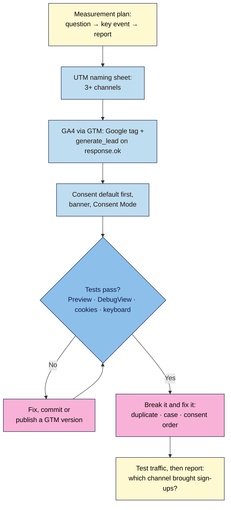

# M06 Capstone — Fully tracked launch page
> By the end of this capstone your live launch page measures what matters (page views and real sign-ups, by channel and campaign) through GA4 and Google Tag Manager, asks before it measures where the law requires it, and you can show the evidence for every claim you make about your numbers.

**Time:** ~3–4 hours (plus a few days of test traffic) · **Level:** L2 Practitioner · **Prereqs:** M06.L01–M06.L04 (and your M05 interactive launch page)
**Non-negotiables assessed:** #9 Consent before tracking where the law requires it, #10 Measure with defined key events; reinforced: #3 (the banner works with a keyboard and a screen reader), #6 (code commits and named GTM versions), #12 (any AI-generated tracking code or banner wording checked and logged)
**Verified against:** the M06 lessons' sources (Google Analytics Help on campaign URLs, default channel group, key events, DebugView, internal traffic and data retention; Tag Manager Help on installation, custom event triggers, preview and versions; Google's consent mode guides; GDPR Art. 4(11) and 7(3); the EDPB Cookie Banner Taskforce report; the CPPA FAQ), all read 2026-11-03. The three planted bugs were reproduced in headless Chrome 156 or with Node's `URL` on 2026-11-03: two Google tag installs send two `page_view` requests per load; `utm_source=Instagram` and `instagram` are different values (Google: "Parameter values are case sensitive"); a consent default placed after the Google tag lets `_ga` be set on the first load.

> Note: you need real traffic to say anything about channels, but not much. Send your UTM links to a handful of friends or colleagues over a few days (with their agreement), and say clearly in your report that it's test data. Not legal advice: if your launch targets the EU/UK at scale or runs ads, have your privacy set-up checked.

## The brief
The founder is about to spend money on the launch: a newsletter swap with a partner, Instagram posts, and maybe a small paid ad. Before a single rupee goes out, they want to know three things: "Will we be able to tell which channel brings sign-ups? Are we counting real sign-ups, not button clicks? And are we doing this legally, without creeping out our customers?" Hand over the tracked live page, a **measurement plan**, and a short **tracking and privacy report** that answers all three with evidence.

## How it works



**In words:** start with the plan (the business question, the key event that answers it, and the report you'll read). Build the UTM sheet, put GA4 into GTM with `generate_lead` fired only on confirmed sign-ups, and add the consent default, banner and Consent Mode. Test everything, fixing with commits and named GTM versions. Then break it three ways on purpose, collect a few days of test traffic, and write the report.

## Tasks
### 1. Measurement plan (from M06.L01–L02)
A one-page table:
| Business question | Key event / metric | Where it comes from | Report you'll read |
|---|---|---|---|
| Which channel brings sign-ups? | `generate_lead` (key event), session key event rate | Form success branch → `dataLayer` → GTM → GA4 | Traffic acquisition by Session source / medium and Session campaign |
| Which pages do visitors read before signing up? | `page_view` | Google tag | Pages and screens for totals; stretch: a Path or Funnel exploration ending in `generate_lead` (explorations keep only the retention period's data) |
| (your own question) | … | … | … |

Keep it to one key event (two at most) and say what you will **not** measure and why.

### 2. Campaign links (from M06.L01)
- A UTM naming sheet with a frozen rules row (lowercase, hyphens, allowed `utm_medium` values) and at least **five** links across **three or more** channels, generated by formula.
- For each row, the GA4 default channel it should land in.
- No UTMs on internal links; no personal data in any URL.

### 3. GA4 through GTM (from M06.L02–L03)
- One GTM container on every page; **no** leftover gtag.js snippet.
- **Google tag** on Initialization – All Pages; **Custom Event** trigger `generate_lead`; **Data Layer Variable** `form_name`; **GA4 Event** tag sending `generate_lead` with `lead_source`.
- The form's `response.ok` branch pushes `{ event: 'generate_lead', form_name: '…' }`; failures push nothing.
- `generate_lead` marked as a key event; data retention 14 months; internal-traffic filter defined (Testing or Active, with your reason).
- Every change published as a **named** GTM version with a description.

### 4. Consent and privacy (from M06.L04)
- The consent default (`denied` for all four signals) **first** in `<head>` on every page, with the saved choice re-applied; or a CMP from Google's partner list on the Consent Initialization trigger.
- A banner with **Accept and Reject equal on the first layer**, a privacy link, keyboard and screen-reader access, and a **Cookie settings** control that reopens it.
- Basic or advanced consent mode chosen, implemented and justified in one sentence.
- A privacy page `#cookies` section that matches the tags actually on the site.

### 5. Test it
| Check | Expected |
|---|---|
| Private window, first load, before any choice | No `_ga` cookies; `collect` requests carry `gcs=G100` (advanced) or none at all (basic) |
| Reject, then reload | Banner stays closed; still no `_ga` cookies |
| Cookie settings → Accept | `_ga` and `_ga_<ID>` appear; one `page_view` per load in Network |
| GTM Preview: a real sign-up, then a failed one (DevTools → Network → Offline, as in Lesson 5.4) | `GA4 event – generate_lead` fires once for the real sign-up and not for the failed one (an empty form never sends at all: the browser's `required` check stops it) |
| GA4 DebugView / Realtime with a UTM link | `generate_lead` with `lead_source`; the right source/medium/campaign |
| Keyboard and screen reader on the banner | Both buttons reachable and announced; focus visible; Cookie settings reopens with focus inside |
| Your own visits | Labelled by the internal-traffic filter (Testing) or excluded (Active) |

### 6. Break it and fix it: three planted bugs
Plant these **one at a time**, record the symptom, the tool and the exact evidence, then fix with a commit or a GTM version.

| # | Plant this | Symptom (checked 2026-11-03) | Find it with | Fix |
|---|---|---|---|---|
| A | Paste the Lesson 6.2 gtag.js snippet back into `<head>` alongside GTM | Two `collect` requests with `en=page_view` per load (checked with the Google tag installed twice); page views double | Network → filter `collect`; View Source shows both `gtag/js` and `gtm.js` | Remove the extra snippet: one GA4 installation |
| B | Visit with `utm_source=Instagram`, then with `utm_source=instagram` | Two separate Instagram rows in Session source (values are case sensitive, per Google; the channel grouping itself ignores case) | Traffic acquisition → Session source / medium; compare with your sheet | Fix the link at the source; `LOWER()` in the sheet; note that old rows stay split |
| C | Move the consent default script below the GTM snippet | In a private window, `_ga` is set on the first load before any choice (checked with the Google tag) | Application → Cookies on first load; Tag Assistant's consent state | Consent default first in `<head>`, before any tag |

The lesson of bug A: **count once**. Of bug B: **consistency beats cleverness; the sheet is the source of truth**. Of bug C: **order is part of consent; verify, don't trust**.

## Deliverable: tracking and privacy report
1. The live `https://` link, the repo link, and your GTM container's version list (screenshot).
2. Screenshots (personal details blurred): the banner on a phone-size view; Application → Cookies before and after Accept; Tag Assistant with `generate_lead` fired; DebugView with `lead_source`; Traffic acquisition with the Key events column set to `generate_lead`.
   > 🖼️ **Image prompt:** Desktop screenshot (1440×900) of Chrome with DevTools open on the launch page in a private window after clicking Accept: Application → Cookies showing `_ga` and `_ga_<ID>`, and the banner hidden. Outline the two cookie rows. Highlight the key element with a 3px #F9B2D7 outline; blur any personal details.
   > **Alt text:** DevTools listing the two Google Analytics cookies that appear only after the visitor clicks Accept.
3. A short note with these headings:

```markdown
# Tracking and privacy report — <project name>
Date: YYYY-MM-DD · Live URL: https://… · GTM version: vN – … · Data: test traffic from <dates>

## 1. Measurement plan
Question → key event → report table · what we deliberately don't measure

## 2. Campaign links
Naming rules · link table (source / medium / campaign / content → expected channel)

## 3. Implementation
Tag inventory (tag · vendor · what it sends · cookies · purpose · consent signal) · GTM tags, triggers, variables · retention · internal traffic filter

## 4. Consent
Basic or advanced and why · banner wording · how to withdraw · privacy page link · laws that may apply to our audience (and one question for a privacy adviser)

## 5. Test results
The test table above with what actually happened

## 6. Break-it-and-fix-it log
A … · B … · C …   (symptom · tool · evidence · fix · commit or GTM version)

## 7. Answer for the founder
"Which channel brought sign-ups?" in one or two sentences, with numbers, clearly marked as test data, and what we'd need to be confident (how much traffic, how long). Say how consent affects the count: visitors who click Reject are missing (basic mode) or only modelled (advanced mode), so the numbers are a sample.

## 8. AI review (if you used AI)
What you asked · what you changed and why (NN #12)
```

## Rubric
Score each criterion; **Good** or better on all five completes the module.

| Criterion | Excellent (4) | Good (3) | Needs work (2) | Missing (1) |
|---|---|---|---|---|
| **Measurement plan and key events (NN #10)** | Clear question → key event → report plan; `generate_lead` only on `response.ok`, starred, verified in Preview and DebugView (fires for real, not for failed); retention and internal traffic set with reasons | Plan and key event correct; one verification or setting missing | Key event counts attempts (`form_submit` or click), or no plan | No key event |
| **Tag hygiene (GTM)** | One installation; tags, triggers and variables named consistently; every change a named, described version; rollback practised; tag inventory current | One installation, named versions; inventory or naming a little thin | Duplicate install, unnamed versions, or Custom HTML used where a template exists | Not in GTM |
| **UTM consistency** | Sheet with frozen rules, 5+ links, 3+ channels, expected channels noted and confirmed in reports; no internal UTMs; no personal data in URLs | Sheet and links consistent; channel check incomplete | Mixed case, invented mediums landing in Unassigned, or internal UTMs | No UTMs |
| **Consent and privacy (NN #9)** | Default denied before any tag (proven in a private window); equal Accept/Reject on the first layer; withdraw as easy as give; accessible banner; basic/advanced justified; privacy page matches the tags; privacy checklist complete | Works and is honest; one item (e.g. privacy page detail or justification) thin | Cookies before consent, no Reject on the first layer, or no way to withdraw | No consent handling where needed |
| **Evidence and honesty of reporting** | All three planted bugs found with exact evidence; screenshots for every test; the founder's answer uses numbers, is labelled as test data and states its limits; any AI output reviewed and logged | Evidence for most checks; answer clear but limits unstated | Claims without evidence, or test data presented as real results | Missing |

## Privacy checklist
- [ ] Every tag on the page is in the inventory, with vendor, data, cookies and purpose.
- [ ] Nothing that needs consent runs or stores anything before consent (checked in a private window).
- [ ] Accept and Reject look and work the same, on the first layer; no pre-ticked choices.
- [ ] Withdrawing is as easy as giving (Cookie settings, keyboard-accessible).
- [ ] The privacy page lists the tags, cookies, purposes, retention and how to change consent, and matches the site.
- [ ] No personal data (emails, names) in URLs, UTMs or event parameters.
- [ ] I know which laws might apply to my audience and what I'd ask an adviser.

## Self-check before you submit
- [ ] One `page_view` per load; one `generate_lead` per real sign-up, none for failures.
- [ ] Every link I post comes from the UTM sheet.
- [ ] GTM's latest published version is named and contains everything I tested.
- [ ] My report's answer to the founder says it's test data and that visitors who reject cookies aren't fully counted.

## Running project checkpoint
Before Module 7, your "Web Dev 101 — my project" note should have:
- [ ] The tracking and privacy report above, with screenshots
- [ ] Your tag inventory (Module 7 measures each tag's performance cost)
- [ ] Your GTM container ID and GA4 Measurement ID, and who has access to each

## Module 6 cheat sheet
One-page summary of everything in this module: `webdev-101/cheatsheets/m06-tracking.md`.
