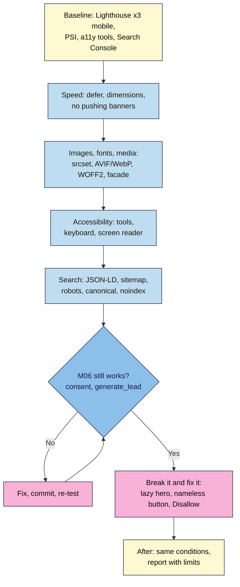

# M07 Capstone — Before/after: fast, accessible and search-ready
> By the end of this capstone your live launch page loads fast on a mid-range phone, works with a keyboard and a screen reader, is described truthfully to search and AI engines, and you have fair before/after evidence for every claim, with tracking and consent from Module 6 still working.

**Time:** ~3–4 hours (plus a week to watch Search Console) · **Level:** L3 Advanced · **Prereqs:** M07.L01–M07.L04 (and your M06 tracked launch page)
**Non-negotiables assessed:** #11 Core Web Vitals in the "good" range; #2 Semantic HTML with one H1 and a logical outline; #3 Alt text, labels and keyboard access; #5 Colour contrast; #8 Share-ready meta tags (checked alongside structured data); reinforced: #9 and #10 (consent and key events still work after every change), #6 (each fix is a commit), #12 (AI-suggested fixes and markup checked and logged)
**Verified against:** the M07 lessons' sources (web.dev Core Web Vitals pages, Lighthouse 13.6 source code, MDN image and font references, W3C WCAG 2.2 and its Understanding pages, Google Search Central robots.txt, canonical, sitemap and structured-data documentation), all read 2026-11-03. The planted bugs come from the lessons: Lighthouse's "LCP resources shouldn't use loading=lazy" and "Buttons do not have an accessible name" messages were read in Lighthouse 13.6's source code, and the robots.txt behaviour (including the roughly 24-hour cache and Request a recrawl) is from Google's documentation. No live browser tests were run for this capstone.

> Note: lab scores vary between runs and machines. Always measure on **mobile**, in an **Incognito** window, take the **median of three** runs, and keep the same settings before and after. A new page usually has **no field data**; say so honestly rather than presenting lab numbers as real-user results.

## The brief
The newsletter swap and the Instagram launch are booked for next week. The founder asks three questions: "Will the page load quickly for people on their phones, on mobile data? Can everyone use it, including people who use a keyboard or a screen reader? And when someone searches for us, or asks an AI assistant, will they find the right page with the right price?" Hand over the improved live page and a **before/after report** that answers all three with evidence, without breaking the tracking and consent you built in Module 6.

## How it works



**In words:** record a fair baseline first. Fix speed, then images, fonts and media, then accessibility, then search set-up, committing each fix. After every round, check that consent and the `generate_lead` key event from Module 6 still work. Plant three bugs on purpose and find them with the right tool. Finish with an "after" measurement under the same conditions and an honest report.

## Tasks
### 1. Baseline (from M07.L01)
- Mobile Lighthouse in Incognito, **all four categories** (Performance, Accessibility, Best Practices, SEO), **three runs**, median recorded; reports saved as JSON (the report's ⋮ menu → **Save as JSON**).
- PageSpeed Insights for the live URL: field data status ("none yet" is a valid answer).
- A first automated accessibility scan (WAVE or axe) and the number of issues.
- Network: total page weight and the five heaviest files.

### 2. Speed (from M07.L01)
- Scripts in `<head>` use `defer` (except the consent default and GTM snippets from Module 6, which stay first and unchanged).
- Every `` has its real `width` and `height`.
- Nothing pushes content down after load: the consent banner overlays (`position: fixed`), embeds have reserved space.
- Unused third-party tags removed in GTM, published as a named version.

### 3. Images, fonts and media (from M07.L02)
- Hero in AVIF/WebP with a JPEG fallback in `<picture>`, `srcset` + a `sizes` value that matches your layout, `fetchpriority="high"`, **no** `loading="lazy"`.
- Other images: `srcset` where useful, `loading="lazy"` below the fold; logos and icons as SVG.
- Fonts: self-hosted WOFF2, only the weights you use, `font-display: swap`, a tuned fallback with `size-adjust`.
- Video: `preload="none"` with a poster, or a YouTube facade.

### 4. Accessibility (from M07.L03)
- `a11y-audit.md` with the automated, keyboard and screen-reader passes (tools, screen reader, browser, date), each issue mapped to a WCAG 2.2 criterion and re-tested after its fix.
- Skip link; visible focus everywhere; no focus hidden by the sticky header or consent banner (`scroll-padding`).
- Names on icon buttons, labels on inputs, text errors linked with `aria-describedby`, contrast 4.5:1 (text) and 3:1 (large text and UI parts), one H1 and a logical outline, `lang` set.
- `accessibility.html` linked in the footer, matching the log.

### 5. Search-ready (from M07.L04)
- JSON-LD: `Organization` (or `Person`), plus `Product` + `Offer` only if a price is visible, matching the page exactly; Rich Results Test and validator.schema.org with **0 errors**.
- `robots.txt` (allows crawling, with a `Sitemap:` line) and `sitemap.xml` listing only indexable pages.
- Self-referencing canonical on every indexable page; `noindex` on the thank-you and test pages (kept crawlable); `http://` and `www` variants redirect to the canonical URL.
- Search Console: Domain property verified, sitemap submitted, URL Inspection live test done.
- Title, meta description and Open Graph tags from Lesson 2.5 still correct (NN #8).

### 6. Test it
| Check | Expected |
|---|---|
| Lighthouse mobile, median of 3, all categories | **90+** in Performance, Accessibility, Best Practices and SEO |
| Lab LCP / TBT / CLS (median) | LCP ≤ 2.5 s, CLS ≤ 0.1, TBT as low as your tags allow (TBT is the lab's stand-in for INP) |
| Network at 390 px (DPR 2) vs 1440 px | A smaller hero file on the phone view |
| Keyboard only | Skip link first; every control reachable and visible; nothing hidden under sticky elements; Esc closes dialogs |
| Screen reader script (Lesson 7.3) | Title, one H1, landmarks, link and button names, form labels and errors, consent banner all make sense |
| Rich Results Test + validator.schema.org | 0 errors; values match the visible page |
| Search Console URL Inspection (live test) | Available to Google; structured data detected; canonical as intended |
| M06 regression: private window | No `_ga` before consent or after Reject; `_ga` after Accept; one `page_view` per load; `generate_lead` fires once for a real sign-up |

### 7. Break it and fix it: three planted bugs
Plant these **one at a time**, record the symptom, the tool and the exact evidence, then fix with a commit.

| # | Plant this | Symptom | Find it with | Fix |
|---|---|---|---|---|
| A | `loading="lazy"` on the hero `` | LCP gets later; Lighthouse's **LCP request discovery** says "LCP resources shouldn't use loading=lazy" | Lighthouse (mobile, median of 3) | Remove `lazy`; keep `fetchpriority="high"` |
| B | Change the pop-up's `<button>Close</button>` to an icon only (`<button><svg>…</svg></button>`) | Screen reader announces just "button"; Lighthouse: "Buttons do not have an accessible name" | Lighthouse Accessibility, WAVE, screen reader **B** key | `aria-label="Close"` on the button; `aria-hidden="true"` on the SVG |
| C | Deploy `robots.txt` with `User-agent: *` / `Disallow: /` (as if copied from a staging site) | Search Console URL Inspection live test reports the page as blocked by robots.txt; it can't be crawled or show its structured data | Open `/robots.txt`; Search Console URL Inspection → Test live URL | `Allow: /`; redeploy; re-test the live URL |

> ⚠️ **Bug C on a live site:** keep it planted for a few minutes only, and do it before you've requested indexing. Google caches `robots.txt` and refreshes it about every 24 hours, so after you revert, open Search Console → **Settings → robots.txt** and use **Request a recrawl**; if a test still shows the old file, that's the cache, not your fix (Google Search Central, "Update your robots.txt file").

The lesson of bug A: **the most important image must load first**. Of bug B: **a tool score isn't the whole story; listen to the page**. Of bug C: **one line can make a perfect page invisible; check what Google actually sees**.

## Deliverable: before/after report
1. The live `https://` link, the repo link, and the commit list for this module.
2. Screenshots or saved JSON: Lighthouse before and after (all four categories, mobile); Network before and after (page weight); WAVE or axe before and after; Rich Results Test; Search Console URL Inspection and Sitemaps (personal details blurred).
   > 🖼️ **Image prompt:** Desktop screenshot (1440×900) showing two Lighthouse mobile reports side by side, "before" and "after", with the four category scores (Performance, Accessibility, Best Practices, SEO) and the LCP, TBT and CLS values visible. Outline the four "after" scores. Highlight the key element with a 3px #F9B2D7 outline; blur any personal details.
   > **Alt text:** Before and after Lighthouse mobile reports for the launch page, showing improved category scores and metrics.
3. A short note with these headings:

```markdown
# Before/after report — <project name>
Date: YYYY-MM-DD · Live URL: https://… · Test settings: Lighthouse <version>, mobile, Incognito, median of 3

## 1. Summary for the founder
Three sentences: fast on phones? usable by everyone? findable with the right price? Plus what lab numbers can't prove yet.

## 2. Speed and Core Web Vitals
Before/after table (score, LCP, TBT, CLS, page weight) · field data status · fixes with commits

## 3. Images, fonts and media
Heaviest files before/after · formats and sizes used · what the phone downloads now

## 4. Accessibility
Audit log summary (issues found by tools / keyboard / screen reader, fixed, open) · link to accessibility.html

## 5. Search and AI readiness
Structured data types and validation results · robots.txt, sitemap, canonical, noindex decisions · Search Console status

## 6. Module 6 regression check
Consent and generate_lead results after all changes

## 7. Break-it-and-fix-it log
A … · B … · C …   (symptom · tool · evidence · fix · commit)

## 8. AI review (if you used AI)
What you asked · what you changed or rejected and why (NN #12)
```

## Rubric
Score each criterion; **Good** or better on all five completes the module.

| Criterion | Excellent (4) | Good (3) | Needs work (2) | Missing (1) |
|---|---|---|---|---|
| **Performance and Core Web Vitals (NN #11)** | Fair before/after (mobile, Incognito, median of 3, same settings); Performance 90+; LCP ≤ 2.5 s and CLS ≤ 0.1 in the lab; each fix its own commit with its effect measured; field-data status stated honestly | 90+ and good LCP/CLS; one measurement detail (runs or settings) loose | Below 90 or LCP/CLS not good, or before/after not comparable | No measurement |
| **Images, fonts and media** | Phone gets a phone-sized modern-format hero with fallback; correct `sizes`; hero prioritised, others lazy; fonts trimmed with tuned fallback; embeds deferred; page weight reduced and shown | Most of these in place; one gap (e.g. fallback font not tuned) | Hero lazy-loaded, no `srcset`, or camera-sized images | Unchanged |
| **Accessibility (NN #2, #3, #5)** | Three-way audit logged with WCAG criteria; no open A/AA issues found; skip link, visible and unobscured focus, named controls, labelled fields, text errors, contrast; statement published and honest; Accessibility 90+ | Audit done and main fixes in; a minor issue open and logged | Only automated testing, or focus/labels/names failing | No audit |
| **Technical SEO and structured data (NN #8)** | JSON-LD matches the page with 0 errors; robots.txt, sitemap, canonical and noindex consistent; redirects agree; Search Console verified with sitemap and live test; meta and OG tags still right; SEO 90+ | All in place; one consistency gap (e.g. sitemap includes a noindex page) | Markup errors or mismatched price, blocked crawling, or wrong canonical | Missing |
| **Evidence and honesty** | All three planted bugs found with exact evidence; screenshots/JSON for every claim; lab vs field clearly separated; M06 regression check passed and shown; AI use logged; no score-chasing that removes tracking, consent or accessibility | Evidence for most checks; limits mentioned briefly | Claims without evidence, lab numbers presented as real-user results, or M06 broken | Missing |

## Self-check before you submit
- [ ] Before and after measured the same way (mobile, Incognito, median of 3, same Lighthouse version).
- [ ] The phone view downloads a phone-sized hero; the hero isn't lazy-loaded.
- [ ] I completed the keyboard and screen-reader passes myself, not just the tools.
- [ ] Structured data matches the visible page, including the price.
- [ ] `robots.txt` allows crawling, and Search Console's live test agrees.
- [ ] Consent and `generate_lead` still work exactly as in Module 6.
- [ ] My report says what lab numbers can't prove yet.

## Running project checkpoint
Before Module 8, your "Web Dev 101 — my project" note should have:
- [ ] The before/after report above, with screenshots or JSON
- [ ] `a11y-audit.md` and the live `accessibility.html`
- [ ] Your Search Console property, and a reminder to check Pages, Enhancements and Core Web Vitals in a week

## Module 7 cheat sheet
One-page summary of everything in this module: `webdev-101/cheatsheets/m07-fast-accessible-search.md`.
