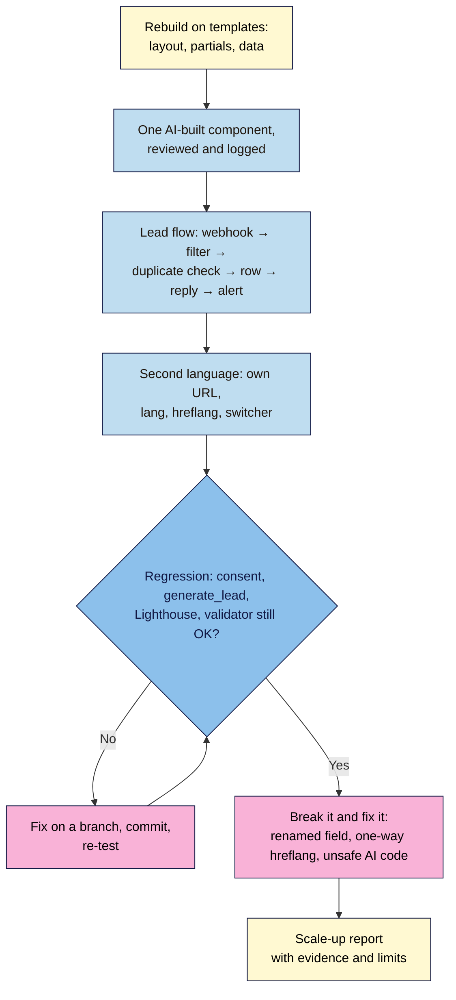

# M08 Capstone — Automated leads and a second language
> By the end of this capstone your launch page is built from templates, every real sign-up flows automatically into a sheet or CRM with an auto-reply and a team alert, a reviewed second-language version is live with correct `hreflang`, and you can show that AI-written code, tracking, consent, accessibility and speed all survived the changes.

**Time:** ~4–5 hours · **Level:** L3 Advanced · **Prereqs:** M08.L01–M08.L04 (and your M07 fast, accessible, search-ready page)
**Non-negotiables assessed:** #12 Review AI output before shipping; reinforced: #6 (every change on a branch and committed, AI changes logged), #9 (lead data moved only where your privacy notice covers it; consent still works), #2, #3 and #8 (structure, accessibility and meta tags survive templates and translation), #10 (`generate_lead` fires once per real sign-up), #11 (Core Web Vitals still good)
**Verified against:** the M08 lessons' sources (Make Help "Webhooks" and Make's default "Accepted" reply; Formspree's paid-only webhooks and Zapier link; Eleventy 3.1.7 docs and real builds; GitHub Pages custom workflows; Google Search Central "Tell Google about localized versions of your page" and "Managing multi-regional and multilingual sites"; WCAG 2.2; MDN `innerHTML`, `textContent` and `Intl`), all read 2026-11-03. Planted bug B's symptoms come from a real Eleventy 3.1.7 build. Planted bug A's Make behaviour was not checked in the app. No live browser tests were run for this capstone.

> Note: free-plan limits for automation tools change often. Before you choose, check the vendor's own pricing page and write the limit and the date in your report. If you can't use Make, Zapier or n8n, the same flow can be shown with any tool that receives a webhook; the rubric judges the flow, the tests and the evidence, not the brand.

## The brief
The launch is in two weeks. The founder has three requests: "I don't want to copy sign-ups into a spreadsheet by hand or forget to reply to anyone. I want our Hindi-speaking customers (or your second market) to find a page in their language. And I keep hearing AI wrote half our code. Can you show me it's safe?" Hand over the rebuilt site, the working lead flow and a **scale-up report** with evidence for all three, without breaking anything from Modules 6 and 7.

## How it works



**In words:** move the page onto templates first, so the second language is cheap. Add one AI-built component and review it. Build and test the lead flow. Publish the second language with correct `hreflang`. After every step, check that consent, `generate_lead`, Lighthouse and the validator still pass. Plant three bugs and find them, then write the report.

## Tasks
### 1. Templates (from M08.L03)
- The site builds with Eleventy (or Astro) from a base layout, header and footer partials and at least one data file with a loop; per-page title, description, canonical and `noindex` come from front matter.
- `robots.txt`, `sitemap.xml` and the favicon reach the live site (passthrough copy); existing URLs such as `/thank-you.html` are kept with `permalink`.
- Deploys automatically on push (GitHub Actions to Pages, or the host's build command and `_site`).

### 2. One AI-built component (from M08.L01)
- A countdown, testimonial carousel, sticky CTA or back-to-top button, requested with a five-part structured prompt.
- Reviewed with the checklist (valid, accessible, secure, fast, private, truthful); each finding recorded with evidence; accept, fix or reject.
- Built on a branch, with an `ai-log.md` row per AI change in this module.

### 3. Lead flow (from M08.L02)
- A data map: every field, where it goes, why your privacy notice covers it; the notice names each tool.
- Webhook (or the tool's form trigger) → filter (honeypot empty, valid email, not `+test`) → duplicate check on the cleaned email (`lower(trim())`) → sheet or CRM row → auto-reply → team notification. No API keys or tokens in your HTML or JS.
- Hidden `utm_source` and `utm_campaign` fields copied from the URL into each row.

### 4. Second language (from M08.L04)
- Its own URL (e.g. `/hi/`), `<html lang>` (and `dir` if right-to-left), self-canonical, translated title, description and Open Graph tags.
- Reciprocal, self-referencing `hreflang` with `x-default`, generated by the template from a shared `translationKey`, with full `https://` URLs and valid ISO codes.
- A visible language switcher (names in their own language, `lang` on each link, `aria-current` on the current one), no automatic redirects.
- Localized prices and dates (`Intl`), and translated form, errors, consent banner, auto-reply and privacy notice. Each form has a hidden `lang` field (`en`, `hi`) so the lead flow stores the language and sends the auto-reply in it.
- Search Console (Lesson 7.4): the second-language URL added to the sitemap, inspected with URL Inspection → Test live URL, and indexing requested.
- A fluent-speaker review, with their changes recorded.

### 5. Test it
| Check | Expected |
|---|---|
| Five test leads (real, duplicate, `+test`, bot with `_gotcha` filled, no first name) | One row, one reply, one alert for the real lead only; nothing for the duplicate, test or bot; a natural greeting with no name. Shown in the run history |
| A real lead from the second-language page | Row records the language; the auto-reply is in that language |
| View Source on both language URLs | Same `hreflang` set (each language + `x-default`) on both; each canonical points to itself; correct `lang` |
| W3C checker with **outline** on both built pages | Valid; same heading structure as before the conversion |
| `grep -rh "<title>" _site` | One different title per page |
| Keyboard and screen reader on the AI component and the switcher | Reachable, named, operable; nothing moving more than 5 s without a pause |
| M06 regression, private window | No `_ga` before consent or after Reject; `_ga` after Accept; `generate_lead` once per real sign-up, on both languages |
| Search Console URL Inspection on the second-language URL | Live test shows the page available to Google; the user-declared canonical is the page itself |
| M07 regression, Lighthouse mobile (median of 3) | Still 90+ in all four categories; LCP ≤ 2.5 s, CLS ≤ 0.1 |

### 6. Break it and fix it: three planted bugs
Plant these **one at a time** on a branch and test **locally** (bug A still posts to your live webhook, so delete its test rows afterwards; never deploy bug C), record the symptom, how you found it and the exact evidence, then fix with a commit.

| # | Plant this | Symptom | Find it with | Fix |
|---|---|---|---|---|
| A | Rename the form's `name="email"` to `email_address` | Runs arrive, but the email column is empty and no auto-reply is sent (or the filter stops every run) | The run history: compare payload keys with the mapping | Restore the name, or redetermine the data structure and remap every module |
| B | Remove `translationKey` from the second-language page | The main page lists only its own `hreflang` and `x-default`; the second-language page lists none and loses its switcher | `grep hreflang` in `_site/*.html` and `_site/hi/index.html` | Put the key back; rebuild |
| C | Accept an AI snippet that writes a URL parameter with `innerHTML` (e.g. a "Hi {name}" greeting) | `?name=` shows an alert locally: DOM-based XSS | The Lesson 8.1 checklist: search for `innerHTML`; the local test URL | Use `textContent`; log the rejection in `ai-log.md` |

The lesson of bug A: **renaming a field breaks everything downstream**. Of bug B: **generate `hreflang` from one template so it can't drift**. Of bug C: **"it works" isn't "it's safe"; review every AI change**.

## Deliverable: scale-up report
1. The live `https://` links for both languages, the repo link, and the commit list for this module.
2. Evidence: the Actions (or host) deploy run; the lead-flow scenario and five test runs in its history; the sheet with personal details blurred; View Source of both `hreflang` sets; validator results; consent and `generate_lead` checks; Lighthouse before and after.
   > 🖼️ **Image prompt:** Desktop screenshot (1440×900) of a Make scenario's History tab listing five recent runs, with the filter "Real, new, not spam" showing which runs passed (one) and which stopped (four), next to a Google Sheet with one new lead row (email blurred). Outline the passed run and the new row. Highlight the key element with a 3px #F9B2D7 outline; blur any personal details.
   > **Alt text:** Lead-flow run history with one passed and four filtered runs beside a sheet showing a single new, blurred lead row.
3. A short note with these headings:

```markdown
# Scale-up report — <project name>
Date: YYYY-MM-DD · Live URLs: https://… (main), https://…/hi/ (second language)

## 1. Summary for the founder
Three sentences: are leads handled automatically? can the second market find a page in its language? is the AI-written code safe? Plus what still needs a human (e.g. translation updates).

## 2. Templates and deploy
Generator and version · layout/partials/data files · URLs kept · deploy method · per-page title check

## 3. Lead flow
Tool and free-plan limit (with the date checked) · data map · flow steps · five test results · where personal data is stored and for how long

## 4. Second language
URL structure and why · hreflang table (page → languages listed) · Search Console inspection result · switcher · what was localized · fluent-speaker review: who, what changed

## 5. AI use
ai-log.md summary: components, accepted / fixed / rejected, the most important finding

## 6. Regression checks
Consent and generate_lead (both languages) · Lighthouse before/after · validator and outline

## 7. Break-it-and-fix-it log
A … · B … · C …   (symptom · tool · evidence · fix · commit)
```

## Rubric
Score each criterion; **Good** or better on all five completes the module.

| Criterion | Excellent (4) | Good (3) | Needs work (2) | Missing (1) |
|---|---|---|---|---|
| **Automation reliability and data minimisation (NN #9)** | Flow order filter → duplicate check → store → reply → notify; all five tests behave as expected with run-history evidence; second-language lead gets a reply in its language; data map complete, privacy notice names every tool; no keys in front-end code; tool chosen with a dated free-limit check | Flow works and tests pass; one gap (e.g. no language-specific reply, or data map missing one field) | Duplicates or test entries get replies, a field arrives empty, or personal data goes somewhere the notice doesn't cover | No working flow |
| **Templates and maintainability (NN #6)** | Layout, partials and data files with no repeated markup; per-page meta from front matter; URLs, robots.txt and sitemap preserved; automatic deploy; every change on a branch and committed | Templates and deploy work; one hard-coded per-page value or one missing passthrough file found and fixed | Copy-pasted pages, broken URLs, or manual uploads | Not converted |
| **Internationalization and hreflang** | Own URL, `lang`/`dir`, self-canonical; reciprocal template-generated `hreflang` with `x-default`, valid codes and full URLs; accessible switcher, no redirects; prices, dates, forms, consent, auto-reply and privacy text localized; fluent-speaker review recorded | All structural parts right; one area still in the original language, or review informal | Missing or one-way `hreflang`, invalid codes, canonical to the other language, or automatic redirects | No second language |
| **AI review and logging (NN #12)** | Structured prompt saved; checklist applied with evidence for each area; unsafe or unrequested code rejected; every AI change logged with a commit; planted bug C found by review, not luck | Review and log done; one area's evidence thin | AI code shipped without a recorded review, or log incomplete | No AI review |
| **Evidence and regressions (#2, #3, #8, #10, #11)** | All three planted bugs found with exact evidence; validator, outline, per-page titles, consent, `generate_lead` (both languages) and Lighthouse 90+ shown before and after; limits stated honestly | Evidence for most checks; one regression check missing | Claims without evidence, or a regression left unfixed (consent, tracking, accessibility or speed) | Missing |

## Self-check before you submit
- [ ] Only the real test lead produced a row, a reply and an alert; duplicates, tests and bots produced nothing.
- [ ] No API key or token appears anywhere in View Source.
- [ ] Both language pages list the same `hreflang` set, and each canonical points to itself.
- [ ] A fluent speaker read the second-language page, form and auto-reply.
- [ ] Every AI change has an `ai-log.md` row and a commit.
- [ ] Consent, `generate_lead` and Lighthouse 90+ still hold on both languages.
- [ ] My report says what still needs a human, and which free-plan limits I checked and when.

## Running project checkpoint
Before the final "Launch Week" capstone, your "Web Dev 101 — my project" note should have:
- [ ] The scale-up report above, with screenshots or exports
- [ ] `ai-log.md` and the data map
- [ ] A one-page launch-week plan: audience, goal, KPI (your `generate_lead` count), channels with UTM links, and who answers leads in each language

## Module 8 cheat sheet
One-page summary of everything in this module: `webdev-101/cheatsheets/m08-ai-automation-scale.md`.
