# M01 Cheat Sheet — How the Web Works
*Web Development 101 · Module 1 · checked 2026-11-03*

## The big picture

```mermaid
flowchart LR
  %% alt: One page load: URL, DNS finds the IP, HTTPS connection, request and status code, files returned, browser renders the DOM.
  A[URL typed]:::cream --> B[DNS: name → IP]:::sky
  B --> C[HTTPS connection<br/>+ certificate check]:::sky
  C --> D[Request → status code<br/>200 / 301 / 404 / 500]:::blue
  D --> E[HTML, then CSS, JS, images]:::blue
  E --> F[Browser renders the DOM]:::pink

  classDef cream fill:#FFF9D2,color:#000000,stroke:#111844
  classDef sky   fill:#BFDDF0,color:#1F150C,stroke:#111844
  classDef blue  fill:#8CC0EB,color:#111844,stroke:#111844
  classDef pink  fill:#F9B2D7,color:#000000,stroke:#111844
```

## Key ideas (L01)
- **Internet** = the network (roads). **Web** = pages with URLs over HTTP(S), shown in browsers. Rule: *URL + browser = Web.*
- **Client** asks · **server** answers · **browser** renders code into a page.
- Browser-style error page = no server reached. The site's own error page = server answered.

## Read any URL (L02)
`https://shop.nilacoffee.example/subscriptions/monthly?utm_source=instagram&utm_campaign=launch#pricing`
scheme · subdomain · domain · TLD · path · **query (UTMs here)** · **fragment (never sent to the server)**

## DNS records (L02)
| Record | Means | Typical use |
|---|---|---|
| A / AAAA | name → IPv4 / IPv6 | point domain at host |
| CNAME | name → another name | `www` → host address |
| MX | email servers | Google Workspace, Microsoft 365 |
| NS | who holds the records | moving DNS |
| TXT | text proof / email rules | Search Console, SPF/DKIM/DMARC |

**TTL** = how long answers are cached. **NXDOMAIN** = no such domain.

## Status codes (L03)
**2xx** ok · **3xx** redirect · **4xx** request problem (usually a wrong URL) · **5xx** server problem
`200` OK · `301` moved for good · `302/307` moved for now · `304` use your cache · `404` not found · `410` gone · `500` server error · `503` overloaded/maintenance

## HTTPS (L03)
Privacy + integrity + identity. Not proof the site is honest. Certificates are free and expire fast (max 200 days in 2026 → 47 days by 2029), so **auto-renew**. Chrome 154+ asks before opening HTTP-only public sites.

## Choose how to build (L04)
| Need | Pick |
|---|---|
| Small, fast, rarely changes | Hand-coded + static hosting (free) |
| Lots of content, many editors | CMS (WordPress) |
| Zero tech, fast launch | Builder (Wix, Squarespace) |
| Design-led marketing site | Webflow, Framer |
| Online store | Shopify (or WooCommerce) |
Ask: **who edits, how often, how do we leave?**

**Detect a platform:** View Source → Ctrl+F: `/wp-content/` WordPress · `cdn.shopify.com` Shopify · `wixstatic.com` Wix · `squarespace` Squarespace · `data-wf-site` Webflow · `framerusercontent.com` Framer · `name="generator"`.

## DevTools shortcuts (L05)
| Action | Windows / Linux | Mac |
|---|---|---|
| Open DevTools | F12 / Ctrl+Shift+I | Cmd+Option+I |
| Inspect element | Ctrl+Shift+C | Cmd+Shift+C |
| Console | Ctrl+Shift+J | Cmd+Option+J |
| View Source | Ctrl+U | Cmd+Option+U (Chrome/Edge) · Cmd+U (Firefox) |
| Device toolbar (DevTools open) | Ctrl+Shift+M | Cmd+Shift+M |
Edits change only your **DOM**; reload resets. **Page weight:** Network → Disable cache → reload → read *transferred*; sort by Size.

## Free tools
Google Admin Toolbox Dig `toolbox.googleapps.com/apps/dig/` · ICANN Lookup (RDAP) `lookup.icann.org` · Google Public DNS cache flush `developers.google.com/speed/public-dns/cache` · `neverssl.com` / `httpforever.com` (HTTP test) · `info.cern.ch` (the first website)

## Diagnose fast
| You see | Layer | First check |
|---|---|---|
| `DNS_PROBE_FINISHED_NXDOMAIN` | DNS | Spelling, expiry, A/CNAME records |
| Browser "No internet" | Your connection | Wi-Fi / network |
| Site's own 404 page | Server ok, page missing | Link or 301 redirect |
| `NET::ERR_CERT_…` | HTTPS certificate | Device clock, certificate expiry/domains |
| 500 / 503 | Server | Contact host or developer |
| Page loads but looks broken | HTML/CSS/JS | DevTools (Modules 2–5) |
