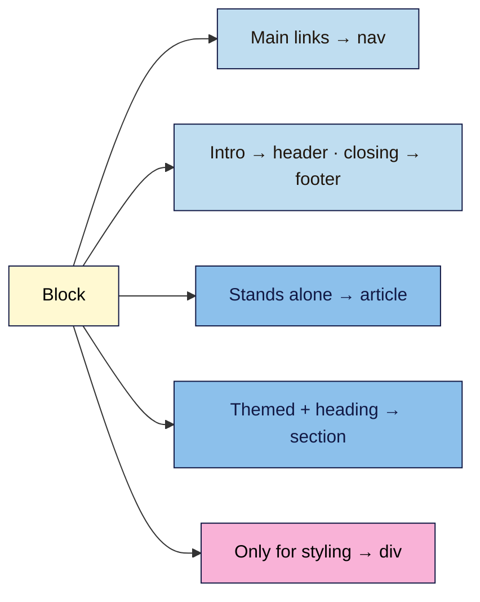

# M02 Cheat Sheet — HTML: The Structure of Content
*Web Development 101 · Module 2 · checked 2026-11-02*

## Page skeleton (L01)
```html
<!DOCTYPE html>
<html lang="en">
  <head>
    <meta charset="utf-8">
    <meta name="viewport" content="width=device-width, initial-scale=1">
    <title>Topic first | Brand</title>
  </head>
  <body> … </body>
</html>
```
**Element** = start tag + content + end tag. **Void** elements have no end tag: `img`, `meta`, `link`, `br`, `input`. Close tags in reverse order of opening. **Fix the first validator error first.**

## Choose the element (L03)

One `main` per page. Name sections: `<section aria-labelledby="x"><h2 id="x">…`. **Headings:** one `h1`, no skipped levels going down, levels by structure not size. The "h1 in every section" outline algorithm was removed from the spec in 2022.

## Text (L02)
`ul`/`ol` + `li` · `strong` (important) · `em` (stress) · testimonial = `figure` > `blockquote` + `figcaption` · `br` only inside addresses/poems.

## Links (L02)
| Need | Code |
|---|---|
| Other site | `href="https://…"` |
| Your file | `href="about.html"` · from the root: `href="/pricing"` |
| Same page | `href="#signup"` + `id="signup"` (case-sensitive, unique) |
| Email / phone | `mailto:hello@…` · `tel:+919876543210` |
| Paid / affiliate | `rel="sponsored"` + visible "(affiliate link)" |
| New tab (rarely) | `target="_blank"` (modern browsers imply `noopener`) |
Link text names the destination. Never "Click here".

## Images and media (L02)
`` · `loading="lazy"` only below the fold.
**Alt:** decorative → `alt=""` · sole content of a link → destination · image of text → the text · otherwise → short description of what it adds. Don't start with "Image of".
Embeds: add `title` and `loading="lazy"`; YouTube privacy-enhanced = `youtube-nocookie.com`. `<video controls>` + `<track kind="captions">`.

## Forms (L04)
```html
<label for="email">Email address</label>
<input type="email" id="email" name="email" autocomplete="email" required aria-describedby="email-hint">
<span id="email-hint">Launch news only. Unsubscribe any time.</span>
<button type="submit">Join the launch list</button>
```
`for` = `id` · no `name` = not sent · placeholder ≠ label · `tel` not `number` for phones · radios share one `name` inside `fieldset` + `legend` · GET puts data in the URL (practice only); real forms POST to a service (L5.4) · empty `action=""` is an error.
**Ask less.** Extra uses = separate **unticked** optional box (GDPR Recital 32). Not legal advice.

## Head metadata (L05)
```html
<meta name="description" content="Accurate summary + one concrete detail + reason to click.">
<link rel="canonical" href="https://site.example/">
<meta property="og:type" content="website">
<meta property="og:title" content="…">
<meta property="og:description" content="…">
<meta property="og:url" content="https://site.example/">
<meta property="og:image" content="https://site.example/images/share-1200x630.jpg">
<meta property="og:image:alt" content="…">
<meta name="twitter:card" content="summary_large_image">
<link rel="icon" href="/icon.svg" type="image/svg+xml">
```
Share image: **full https URL**, 1200×630 (min 600×315), under 8 MB, key content centred. Google may rewrite titles and descriptions (no length limit, truncated to fit). Previews are **cached**: Sharing Debugger → Scrape Again; Post Inspector → Inspect.

## Check it
| Tool | Shows |
|---|---|
| W3C Nu checker `validator.w3.org/nu/#textarea` (tick **outline**) | Errors, heading outline, `[missing]` levels |
| DevTools → Elements → Accessibility (full-page tree) | Landmarks, accessible names of fields and links |
| Keyboard: Tab / Shift+Tab / Space / Enter / arrows | Focus order and reachability |
| Screen reader: Narrator (Ctrl+Win+Enter), VoiceOver (Cmd+F5), NVDA (free) | What a blind user hears |
| Meta Sharing Debugger · LinkedIn Post Inspector | Preview cards and cache refresh |

## Diagnose fast
| You see | Likely cause |
|---|---|
| Broken-image icon + 404 in Network | Wrong path or file-name case |
| `#link` doesn't jump | `id` missing, misspelt or different case |
| Clicking a label does nothing | `for` ≠ `id` |
| Field missing after submit | No `name` |
| "skipping N heading levels" error | e.g. `h2` → `h4` |
| Share preview has no image | Relative or private `og:image` |
| Old preview after a fix | Platform cache: re-scrape |
