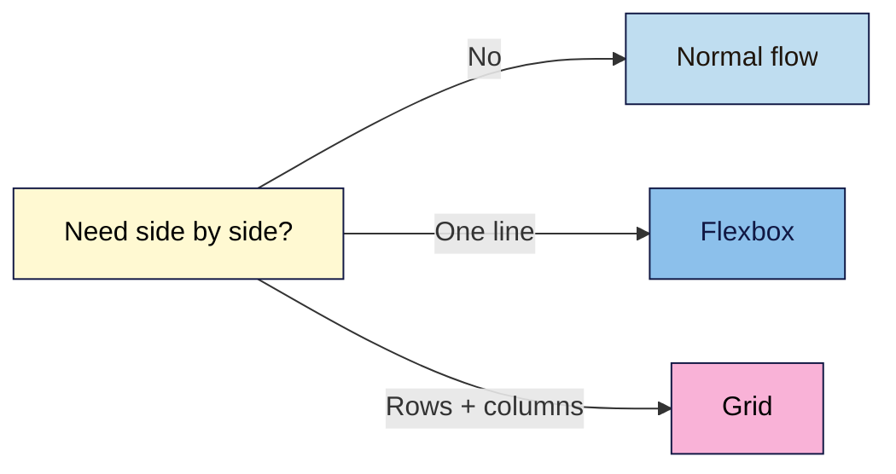

# M03 Cheat Sheet — CSS: Design, Brand & Layout
*Web Development 101 · Module 3 · checked 2026-11-02*

## Rules, selectors and the cascade (L01)
`selector { property: value; }` · link once in `<head>`: `<link rel="stylesheet" href="styles.css">`.
| Selector | Example | Specificity |
|---|---|---|
| Type | `p` | 0-0-1 |
| Class / attribute / pseudo-class | `.button` · `input[type="email"]` · `a:hover` | 0-1-0 |
| ID (avoid for styling) | `#signup` | 1-0-0 |
| Descendant / child | `footer a` · `.hero > *` | add the parts |
**Who wins:** `!important` → (inline `style`) → specificity → later rule. Text properties inherit (`color`, `font-*`, `line-height`); box properties don't.
**Box model:** content → padding → border → margin. Start with `*, *::before, *::after { box-sizing: border-box; }`.
**Debug:** red failed request in Network (`ERR_FILE_NOT_FOUND` locally, 404 live) = not loading · struck through + ⚠ = typo/invalid · struck through = lost (hover the selector for specificity).

## Tokens, type and contrast (L02)
```css
:root {
  --color-text: #2b1d14;  --color-bg: #fffaf2;
  --color-cta: #b45309;   --color-on-cta: #ffffff;
  --font-body: system-ui, -apple-system, "Segoe UI", Roboto, sans-serif;
  --font-heading: "Lora", Georgia, serif;
  --text-2xl: clamp(2rem, 1.75rem + 1vw, 3rem);
  --space-2: 1rem;
}
body { color: var(--color-text); background-color: var(--color-bg); }
```
Name tokens by **job**, not hue; case-sensitive. Body `1rem`+, line height 1.5–1.6, `max-width: 65ch`. Web fonts: ≤ 2 families, few weights, `display=swap`; self-host for EU visitors.
| WCAG 2.2 AA | Minimum |
|---|---|
| Normal text, placeholders, button labels | **4.5:1** |
| Large text (24 px, or ~18.66 px bold) | 3:1 |
| Field borders, focus rings, meaningful icons (1.4.11) | 3:1 |
Measure in DevTools' colour picker or WebAIM; never trust a guessed or AI-stated ratio.

## Layout (L03)

```css
header  { display: flex; flex-wrap: wrap; justify-content: space-between; align-items: center; gap: 1rem; }
.hero   { display: flex; flex-wrap: wrap; align-items: center; gap: 2rem; }
.hero > * { flex: 1 1 18rem; }
.card-grid { display: grid; grid-template-columns: repeat(auto-fit, minmax(min(14rem, 100%), 1fr)); gap: 1rem; }
```
`display: flex/grid` goes on the **container**; direct children are the items. Use `gap`, not margins. **Never reorder** with `order` / `-reverse`: change the HTML.

## Responsive, mobile-first (L04)
Viewport tag: `width=device-width, initial-scale=1` (never `user-scalable=no`). Base CSS = phone; add with `@media (min-width: 48rem) { … }` **after** the base rules.
```css
img { max-width: 100%; height: auto; }
iframe { width: 100%; height: auto; aspect-ratio: 16 / 9; }
body { overflow-wrap: break-word; }
```
Test 320 · 768 · 1280 px + 200% zoom. **Reflow (1.4.10):** no sideways scroll at 320 px. **Target size (2.5.8):** ≥ 24 × 24 px or spaced; main buttons ~44 px.
**Overflow finder (Console):**
```js
document.querySelectorAll('body *').forEach(el => { if (el.getBoundingClientRect().right > document.documentElement.clientWidth + 1) console.log(el); });
```
Find, don't hide: no `overflow-x: hidden` on `body`.

## Conversion UI (L05)
One filled **primary** CTA per view; secondary = outline button or link; text says what happens.
```css
.button:hover { background-color: var(--color-cta-hover); }
a:focus-visible, button:focus-visible, input:focus-visible, summary:focus-visible {
  outline: 3px solid var(--color-focus); outline-offset: 2px;
}
.plan-featured { --color-surface: var(--color-inverse-bg); --color-text: var(--color-inverse-text); color: var(--color-text); }
```
Never `outline: none` without a replacement (SC 2.4.7). Don't let sticky headers cover focus (2.4.11).
**Dark patterns to avoid:** false urgency · confirmshaming · interface interference · drip pricing · pre-ticked boxes / basket sneaking · subscription traps (India CCPA 2023, EU DSA Art. 25, US FTC).
**CSS libraries:** exact version (`@2.1.1`), `integrity` + `crossorigin`, licence check, contrast re-check, self-host when live, load **before** `styles.css`.

## Before you hand over
- [ ] Hex codes only inside `:root`; no inline styles, `!important` or ID styling
- [ ] Every text pair ≥ 4.5:1, borders and focus ring ≥ 3:1 (measured)
- [ ] Overflow finder silent at 320 px; layout checked at 768 and 1280 px and at 200% zoom
- [ ] Visible focus on every link, button and field, in reading order
- [ ] W3C CSS checker: no errors; HTML checker still clean
