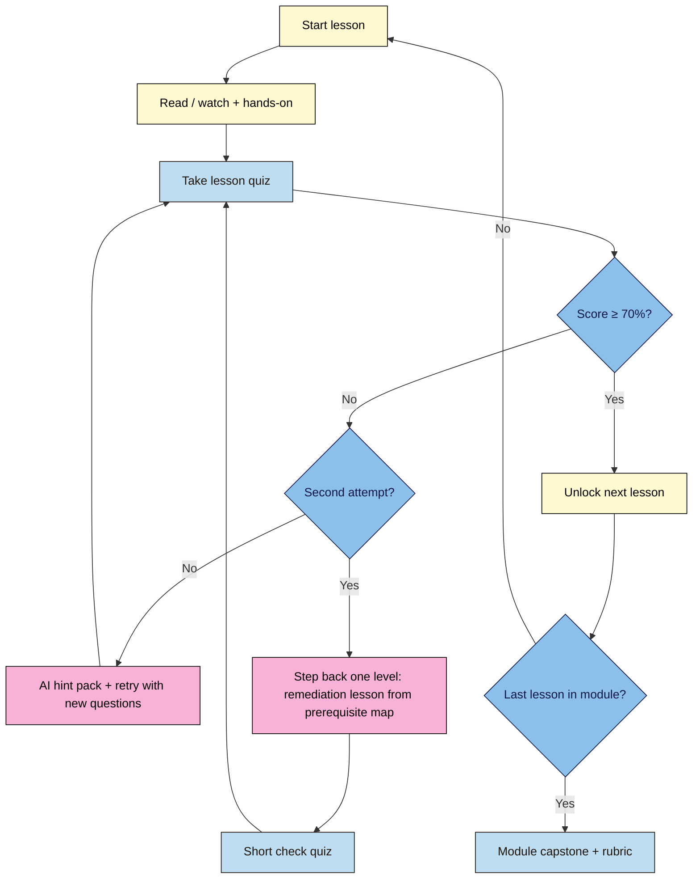

# Web Development 101 — for Marketers & Content Creators

**Course slug:** `web-development-101`
**Promise:** After this course you can build, publish, track and improve a fast, accessible campaign page yourself — and talk to developers as an equal.
**Role in the catalogue:** Prerequisite for **WordPress 101**; feeds into **Modern SEO** (Module 7 is the bridge).

---

## 1. Who this is for

| Persona | What they want | What they usually lack |
|---|---|---|
| Content creator / blogger | Own their site, fix layout issues, embed media | How pages are built and published |
| Digital / performance marketer | Landing pages, tracking, faster experiments | HTML/CSS/JS basics, tag & analytics plumbing |
| Social media / brand manager | Link-in-bio pages, social previews, brand consistency | Meta tags, CSS, hosting |
| Small business owner / solo founder | A site that converts without hiring for every change | End-to-end picture: domain → page → analytics |

**Prerequisites:** none. A laptop or desktop with a modern browser. (Mobile-only learners can follow Modules 1–2 in a browser playground; Module 3 onwards needs a larger screen.)

**Not in scope:** back-end programming, databases, frameworks like React (mentioned only in Module 8), WordPress internals (covered in WordPress 101), deep SEO strategy (covered in Modern SEO).

---

## 2. Recommended structure for a global audience

These are the design decisions behind the outline. Apply them to every lesson.

**Three levels, one spine.** Every lesson is tagged with a level so the AI remediation can step a learner back one level when they fail a quiz:
- **L1 Foundation** (Modules 1–3): concepts and the core building blocks
- **L2 Practitioner** (Modules 4–6): publishing, interactivity, tracking — real marketing work
- **L3 Advanced** (Modules 7–8): performance, accessibility, technical SEO, AI and automation

**Project-based, one running project.** Learners build a single site from Module 2 to the final capstone (a personal brand or product launch page). Each module adds a layer, so progress is visible and the final portfolio piece is real.

**Zero-install start.** Modules 1–3 run entirely in the browser (CodePen / StackBlitz / the browser's own DevTools). Local tools (VS Code, Git) arrive in Module 4, once motivation is high. This removes the biggest drop-off point for non-developers.

**Free tools only.** Everything taught has a free tier available worldwide (GitHub Pages, Netlify or Cloudflare Pages, Google Analytics 4, Google Tag Manager, Google Search Console). Paid tools are mentioned as alternatives only.

**Built for low bandwidth and many languages.**
- Videos of 6–10 minutes, always with a text transcript and captions; every lesson must be completable from the text alone
- Plain international English (short sentences, no idioms, no slang), so machine translation works well
- Code examples use neutral, culturally diverse sample content (names, products, currencies, date formats)
- Downloadable lesson PDFs and starter files for offline study

**Region-aware where the law differs.** Privacy and consent lessons cover GDPR (EU/UK), CCPA/CPRA (California), India's DPDP Act, and Brazil's LGPD side by side, with a "check your local rules" note.

**Accessible by default.** The course platform and every example meet WCAG 2.2 AA. Accessibility is taught inside the lessons as they go, then consolidated in Module 7, not saved for the end.

**Pacing.** About 36 lessons × 45–60 min = roughly 30–35 hours. Suggested schedule: 2 lessons a week (about 18 weeks) self-paced, or a 6-week cohort with 6 lessons a week.

**Learner path (quiz → remediation decision):**

---

## 3. Course map

| # | Module | Level | Lessons | Running project milestone |
|---|---|---|---|---|
| 1 | How the Web Works | L1 | 5 | Map the journey of your own favourite site |
| 2 | HTML: The Structure of Content | L1 | 5 | Content skeleton of your launch page |
| 3 | CSS: Design, Brand & Layout | L1 | 5 | Styled, responsive, on-brand page |
| 4 | Publish It: Tools, Hosting & Domains | L2 | 5 | Page live on your own domain with HTTPS |
| 5 | JavaScript for Marketers | L2 | 4 | Interactive FAQ, modal and working lead form |
| 6 | Tracking, Analytics & Consent | L2 | 4 | Tracked page with UTMs, GA4 events and consent banner |
| 7 | Fast, Accessible & Search-Ready | L3 | 4 | Lighthouse 90+, WCAG checks pass, schema added |
| 8 | Advanced: AI, Automation & Scale | L3 | 4 | Automated lead flow + multilingual version |
| — | **Final capstone** | — | — | Launch a full campaign page and present the results |

---

## 4. Modules and lessons

Each lesson follows the course framework template (promise → objectives → why it matters → concept → diagram → walkthrough → mistakes → exercise → takeaways → further reading) and has a 5–8 question quiz. "Remediate to" tells the AI where to send a learner who fails twice.

### Module 1 — How the Web Works (L1)
*Goal: a clear mental model of what happens between typing a URL and seeing a page.*

| Lesson | Title | After this lesson you can… | Remediate to |
|---|---|---|---|
| 1.1 | The Internet vs the Web | Explain clients, servers, and what a browser actually does | — (entry point: plain-language glossary) |
| 1.2 | URLs, Domains & DNS | Read any URL part by part and explain how a domain finds its server | 1.1 |
| 1.3 | Hosting & How a Page Loads | Describe request → response, HTTP vs HTTPS, and what "hosting" means | 1.2 |
| 1.4 | Static vs Dynamic, Code vs CMS vs No-Code | Compare hand-coded sites, WordPress, and builders like Webflow/Wix, and when each fits | 1.3 |
| 1.5 | Your First Look at DevTools | Inspect any page, change text live, and view its source | 1.1 |

**Capstone 1:** Write a one-page "how this site works" breakdown of a brand site you admire (domain, host, CMS, page weight), using DevTools and free lookup tools.

### Module 2 — HTML: The Structure of Content (L1)
*Goal: write clean, meaningful HTML for real marketing content.*

| Lesson | Title | After this lesson you can… | Remediate to |
|---|---|---|---|
| 2.1 | Anatomy of an HTML Page | Build a valid page with `head` and `body`, tags, and attributes | 1.5 |
| 2.2 | Text, Links, Images & Media | Mark up headings, lists, links, images (with alt text), video and embeds | 2.1 |
| 2.3 | Semantic HTML & Heading Structure | Use `header`, `main`, `section` and a logical H1–H6 outline that helps readers, screen readers and search engines | 2.2 |
| 2.4 | Forms for Lead Capture | Build a sign-up form with labels, input types, and required fields | 2.2 |
| 2.5 | Meta Tags & Social Previews | Write title, meta description, Open Graph and social card tags, and test link previews | 2.1 |

**Capstone 2:** Hand-code the full content skeleton of your launch page (hero, benefits, testimonials, FAQ, sign-up form) with correct semantics and share-ready meta tags. Rubric: validity, semantics, accessibility of images/forms, meta completeness.

### Module 3 — CSS: Design, Brand & Layout (L1)
*Goal: turn the skeleton into an on-brand page that works on every screen.*

| Lesson | Title | After this lesson you can… | Remediate to |
|---|---|---|---|
| 3.1 | How CSS Works: Selectors, Cascade, Box Model | Target elements and control spacing with margin, padding and border | 2.1 |
| 3.2 | Typography, Color & Brand Tokens | Apply brand fonts and colors with CSS variables and check color contrast | 3.1 |
| 3.3 | Layout with Flexbox & Grid | Build hero sections, card grids and nav bars | 3.1 |
| 3.4 | Responsive, Mobile-First Design | Use media queries and fluid units so pages work on phones first | 3.3 |
| 3.5 | Conversion-Focused UI Patterns | Style buttons, CTAs, pricing tables and testimonials, and use a ready-made CSS library safely | 3.3 |

**Capstone 3:** Style your launch page to a given brand guide; it must pass a mobile/tablet/desktop check and color-contrast check.

### Module 4 — Publish It: Tools, Hosting & Domains (L2)
*Goal: move from playground to a real, live site you control.*

| Lesson | Title | After this lesson you can… | Remediate to |
|---|---|---|---|
| 4.1 | Your Toolkit: VS Code, Files & Folders | Set up a project folder, edit files and preview locally | 1.5 |
| 4.2 | Git & GitHub Without Fear | Commit, push and roll back changes; understand version history | 4.1 |
| 4.3 | Deploy to Free Hosting | Publish to GitHub Pages, Netlify or Cloudflare Pages | 4.2 |
| 4.4 | Custom Domains, DNS Records & HTTPS | Connect a domain, set A/CNAME records, and enable SSL | 1.2 |
| 4.5 | Choosing How to Build: Code, CMS or No-Code | Pick the right approach for a project using a decision checklist (bridge to WordPress 101) | 1.4 |

**Capstone 4:** Your launch page live on a custom domain with HTTPS, version-controlled on GitHub, with a short written decision on code vs CMS vs no-code for your next project.

### Module 5 — JavaScript for Marketers (L2)
*Goal: add interactivity and understand the scripts that marketing tools inject.*

| Lesson | Title | After this lesson you can… | Remediate to |
|---|---|---|---|
| 5.1 | What JavaScript Does (and Breaks) | Explain JS's role, read the console, and spot script errors | 1.5 |
| 5.2 | JS Basics: Variables, Functions, Events | Write small scripts that react to clicks and scrolls | 5.1 |
| 5.3 | Interactive Components | Build an FAQ accordion, tabs, a modal pop-up and a countdown timer | 5.2 |
| 5.4 | Forms That Work: Validation & Sending Data | Validate inputs and send leads to a form service or email tool (Formspree, Mailchimp, Brevo) | 2.4 |

**Capstone 5:** Add a working FAQ accordion, a timed newsletter modal and a live lead form that delivers to an email list.

### Module 6 — Tracking, Analytics & Consent (L2)
*Goal: measure what matters, legally.*

| Lesson | Title | After this lesson you can… | Remediate to |
|---|---|---|---|
| 6.1 | Tags, Pixels & UTMs | Explain how tracking scripts work and build consistent UTM links | 5.1 |
| 6.2 | Google Analytics 4 & Key Events | Install GA4, define conversions and read the core reports | 6.1 |
| 6.3 | Google Tag Manager | Manage tags, triggers and variables without editing code each time | 6.2 |
| 6.4 | Privacy, Cookies & Consent Around the World | Add a consent banner, set up Consent Mode, and compare GDPR, CCPA, DPDP and LGPD basics | 6.1 |

**Capstone 6:** Fully tracked launch page: GA4 via GTM, form submissions as key events, UTM-tagged campaign links, working consent banner. Rubric includes a privacy checklist.

### Module 7 — Fast, Accessible & Search-Ready (L3)
*Goal: make pages that load fast, work for everyone, and are understood by search and AI engines.*

| Lesson | Title | After this lesson you can… | Remediate to |
|---|---|---|---|
| 7.1 | Performance & Core Web Vitals | Read Lighthouse/PageSpeed reports and fix LCP, INP and CLS issues | 3.4 |
| 7.2 | Images, Fonts & Media Optimization | Use modern formats (WebP/AVIF), responsive images, lazy loading and font loading | 2.2 |
| 7.3 | Accessibility in Practice (WCAG 2.2) | Audit with keyboard, screen reader and automated tools, and fix common failures | 2.3 |
| 7.4 | Technical SEO Foundations | Add structured data (schema.org), sitemap, robots.txt and canonicals, and verify in Search Console (bridge to Modern SEO) | 2.5 |

**Capstone 7:** Raise your page to Lighthouse 90+ in all categories, pass an accessibility audit, and add validated schema. Submit before/after reports.

### Module 8 — Advanced: AI, Automation & Scale (L3)
*Goal: work faster and scale beyond one page.*

| Lesson | Title | After this lesson you can… | Remediate to |
|---|---|---|---|
| 8.1 | Building with AI Assistants | Prompt AI tools for HTML/CSS/JS, review the output critically, and spot security/accessibility problems | 5.2 |
| 8.2 | APIs, Webhooks & No-Code Automation | Connect forms to a CRM or sheet via webhooks and Zapier/Make/n8n | 5.4 |
| 8.3 | Templates, Static Site Generators & Headless CMS | Reuse components and understand when Astro/Eleventy or a headless CMS beats hand-coding | 4.5 |
| 8.4 | Going Global: Multilingual & Multi-Region Sites | Structure translated pages, set `lang` and `hreflang`, and localize dates, currency and content | 7.4 |

**Capstone 8:** Lead form → automation → CRM/sheet → auto-reply email, plus a second-language version of the page with correct hreflang.

---

## 5. Final capstone — "Launch Week"

Plan, build and launch a campaign page for a real or fictional product:
1. One-page brief (audience, goal, KPI)
2. Built and deployed on a custom domain
3. Tracked (GA4 + GTM + UTMs) with consent
4. Lighthouse 90+, WCAG 2.2 AA checks passed, schema present
5. Lead automation working
6. A short results report after one week of traffic (even small traffic counts)

**Rubric (criteria × 4 levels: Beginning / Developing / Proficient / Exemplary):** content structure & semantics · visual design & responsiveness · functionality · tracking & privacy · performance & accessibility · documentation & results report.

---

## 6. Assessment & remediation design

- **Lesson quizzes:** 5–8 MCQs, 40% recall / 40% scenario / 20% spot-the-error (e.g. "find the bug in this code snippet", "which UTM is malformed?"). Pass mark 70%.
- **AI-generated dynamic quizzes:** a fresh question set on each retry, drawn from the lesson objectives; each question tagged with an objective ID so failures point at the exact concept.
- **Remediation:** fail twice → the "Remediate to" lesson's summary plus a 3-question check quiz, then return. Each lesson keeps a one-page "refresher card" for this purpose.
- **Module capstones:** peer review plus rubric; optional AI feedback on code against the rubric.
- **Certificate:** all module capstones + final capstone at Proficient or above.

---

## 7. Lesson production checklist

- [ ] Follows the 10-part lesson template
- [ ] Level tag (L1/L2/L3) and "Remediate to" link set
- [ ] Video 6–10 min, captions, transcript; lesson works from text alone
- [ ] Starter and solution files (CodePen link + downloadable ZIP)
- [ ] Plain international English; examples culturally neutral
- [ ] Accessible examples (alt text, contrast, keyboard)
- [ ] Quiz with explanations and hints, tagged by objective
- [ ] Further reading from primary sources (MDN, web.dev, W3C/WAI, Google developer docs)

---

## 8. Progress log

> Lesson-level status lives in `../progress.md` (the source of truth that `/next-lesson` reads). This table is a module summary only.

| Module | Lesson | Status (todo/draft/reviewed/published) | Date |
|---|---|---|---|
| — | Course outline | draft | 2026-11-02 |
| 1 | 1.1–1.5 | todo | — |
| 2 | 2.1–2.5 | todo | — |
| 3 | 3.1–3.5 | todo | — |
| 4 | 4.1–4.5 | todo | — |
| 5 | 5.1–5.4 | todo | — |
| 6 | 6.1–6.4 | todo | — |
| 7 | 7.1–7.4 | todo | — |
| 8 | 8.1–8.4 | todo | — |

---

## 9. Learning outcomes

By the end of the course a learner can:
1. **Explain** what happens between typing a URL and seeing a page (DNS, HTTP/HTTPS, hosting, rendering) in plain words.
2. **Build** a semantic, valid, accessible HTML page with forms and share-ready meta tags.
3. **Style** that page to a brand guide with CSS (variables, Flexbox, Grid) so it works from 320 px phones to desktops.
4. **Publish** a version-controlled site on free hosting with a custom domain and HTTPS.
5. **Add** interactivity and a working lead form with JavaScript, and read console errors.
6. **Track** conversions with GA4 and GTM, UTM-tagged links and a working consent banner.
7. **Raise** a page to Lighthouse 90+ and WCAG 2.2 AA, with validated structured data.
8. **Review** AI-generated code critically and automate a lead workflow with webhooks.

## 10. Tools & costs (free path for everything)

| Job | Free path (default) | Paid alternatives (optional) | First used |
|---|---|---|---|
| Browser + DevTools | Chrome, Edge or Firefox | — | M01 |
| Playground editor | CodePen (free), StackBlitz | CodePen Pro | M02 |
| Code editor | VS Code | — | M04 |
| Version control | Git + GitHub (free account) | — | M04 |
| Hosting | GitHub Pages, Netlify or Cloudflare Pages (free tiers) | Paid tiers | M04 |
| Domain | Optional: a free subdomain from the host (`*.github.io`, `*.netlify.app`, `*.pages.dev`) | Own domain ≈ $10–15 / ₹800–1,200 a year (the only cost a learner may choose) | M04 |
| Forms | Formspree / Netlify Forms (free tiers) | Paid tiers | M05 |
| Email list | Brevo or Mailchimp free plans | Paid plans | M05 |
| Analytics & tags | GA4, Google Tag Manager, Search Console | — | M06–M07 |
| Audits | Lighthouse, PageSpeed Insights, WAVE, axe DevTools (free) | — | M07 |
| Automation | n8n (self-host or free trial), Zapier / Make free tiers | Paid tiers | M08 |

**Zero-cost rule:** a learner can finish every capstone, including "Launch Week", on a free host subdomain. A custom domain is recommended, not required. The rubric never penalises using the free subdomain.

## 11. Non-negotiables

Skills a learner can't skip. Each is **taught** once, **reinforced** later, and **assessed** in a capstone rubric.

| # | Non-negotiable | Why it can't be skipped | Taught | Reinforced | Assessed |
|---|---|---|---|---|---|
| 1 | **A working mental model of the web** (client/server, DNS, HTTP) | Every later fix ("it works on my laptop but not live") depends on it | M01 | M04 | Cap 1, Cap 4 |
| 2 | **Semantic HTML with one H1 and a logical outline** | Screen readers, search and AI engines read structure, not looks | M02 | M07 | Cap 2, Cap 7 |
| 3 | **Alt text, labels and keyboard access** | Excludes disabled users and fails WCAG if missing | M02 | M03, M05, M07 | Cap 2, Cap 7 |
| 4 | **Mobile-first, responsive layout** | Most traffic is mobile; Google indexes the mobile version | M03 | M07 | Cap 3 |
| 5 | **Colour contrast and brand tokens** | Unreadable CTAs lose conversions and fail WCAG | M03 | M07 | Cap 3 |
| 6 | **Version control before you deploy** | One bad edit without history can't be undone | M04 | M08 | Cap 4 |
| 7 | **HTTPS on every page** | Browsers flag HTTP pages "Not secure"; forms leak data | M04 | — | Cap 4 |
| 8 | **Share-ready meta tags** (title, description, Open Graph) | A link without a preview gets fewer clicks on every platform | M02 | M07 | Cap 2 |
| 9 | **Consent before tracking where the law requires it** | GDPR, DPDP, LGPD and CPRA fines; lost trust | M06 | M08 | Cap 6 |
| 10 | **Measure with defined key events** | You can't improve a page you don't measure | M06 | Final | Cap 6, Final |
| 11 | **Core Web Vitals in the "good" range** | Slow pages lose visitors and rankings | M07 | — | Cap 7 |
| 12 | **Review AI output before shipping** | AI code often has accessibility and security bugs | M08 (with a "Use AI for this" section in every lesson) | All | Cap 8 |

## 12. Running example

**Course demo (taught in the lessons):** *Nila Coffee*, a small roaster launching a monthly coffee subscription box. Prices are shown in ₹ and $; customers come from several countries. Each lesson shows the step on Nila Coffee's launch page first.

**Learner project (built in the capstones):** the learner's own **launch page**, either a personal brand page (creator, freelancer, consultant) or a product/service launch. It starts as an idea in M01, gets its HTML skeleton in M02, and goes live, tracked and fast by M07. M08 adds automation and a second language. The final "Launch Week" capstone is the portfolio piece.

## 13. Diagnostic (placement) quiz

A 15-question placement quiz before Module 1 (`webdev-101/diagnostic-quiz.md`, to be written after M03 is drafted):
- 5 questions on M01 (web concepts), 5 on M02 (HTML), 5 on M03 (CSS), with one spot-the-error item each.
- **Skip rules:** 5/5 on a module's block → skip that module's lessons but **do the capstone**. 4/5 → skim the module's cheat sheet, take each lesson quiz, and skip any lesson you pass first time. ≤3/5 → take the module in full.
- Modules 4–8 have no skip route. Each one's capstone adds a required layer to the running project.

## 14. Accessibility & inclusion

- Every example meets WCAG 2.2 AA (contrast, labels, focus order, alt text). Lesson quizzes include accessibility spot-the-error items.
- Mermaid diagrams carry a one-sentence `%% alt:` line plus an "In words" paragraph; every image prompt has alt text.
- Plain international English, metric and imperial where relevant, ₹ and $ prices, names from many cultures.
- Every lesson can be completed from text alone (video is optional).

## 15. Support, community & feedback

- Errata and questions: GitHub issues on the course repo. A survey link at the end of every module capstone.
- Peer review for capstones (the rubric is shared), with optional AI feedback against the rubric.

## 16. Freshness & maintenance

> ⚠️ **Freshness flag: medium.** HTML/CSS basics are stable. Hosting free tiers, GA4/GTM screens, Consent Mode, Core Web Vitals thresholds, privacy laws and AI tools change often.

- Every lesson carries a **Verified against** stamp (browser/tool versions + date).
- **Review cadence:** M04, M06 and M08 every 6 months; M07 and the privacy lesson (6.4) when Google or a regulator announces a change; M01–M03 once a year.

## 17. What next, licence & changelog

- **What next:** WordPress 101 for Content Creators (a CMS for a whole blog/site), then Modern SEO (Module 7 is the bridge).
- **Licence:** CC BY-SA 4.0. Code samples: MIT.
- **Changelog:**
  - 2026-11-02: outline filled against `templates/course-outline-template.md` (outcomes, tools & costs, non-negotiables, running example, diagnostic plan, accessibility, freshness). Module 1 planned.
