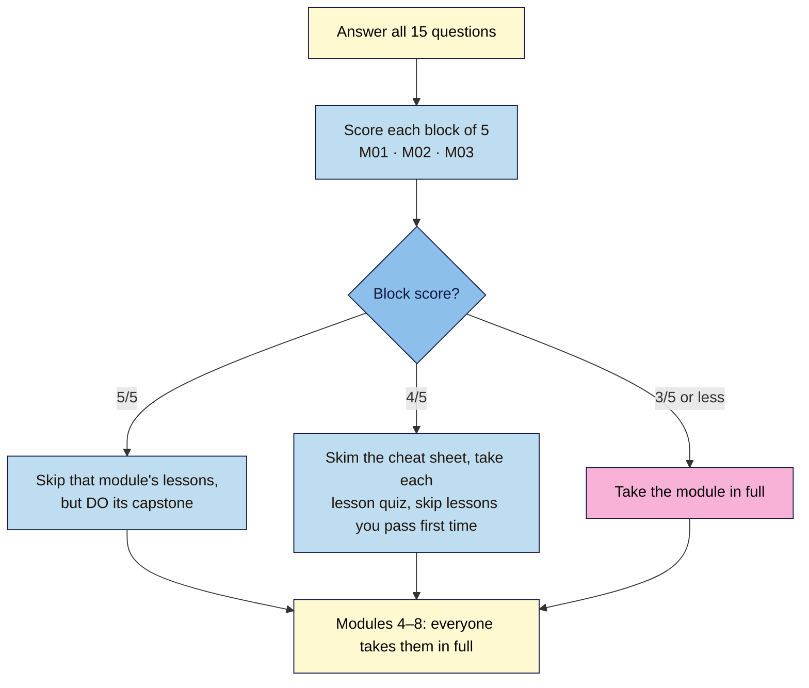

# Web Development 101 — Diagnostic (placement) quiz
> 15 questions, about 15 minutes. Take it **before Module 1** to find out which of Modules 1–3 you can skip or skim. There's no pass or fail: it only tells you where to start. Answer without looking anything up; a guess you're unsure of should count as wrong.

**Covers:** Module 1 (how the web works), Module 2 (HTML) and Module 3 (CSS). 5 questions each, including one spot-the-error item per block.
**Verified against:** the M01–M03 lessons and their primary sources (MDN, W3C WCAG 2.2 Understanding docs, RFC 9110 status codes); every answer re-checked against the reviewed M01 and M03 lessons and the M02 drafts, on 2026-11-02.

## How to use your score



**In words:** score each block of five separately. **5/5:** skip that module's lessons but still do its capstone, because each capstone adds a required piece to your launch page. **4/5:** skim the module's cheat sheet, take each lesson quiz, and skip any lesson you pass first time. **3/5 or less:** take the module in full. Modules 4–8 have no skip route.

Write your answers down first (for example `1b 2d 3a …`), then check them against the answers below each question.

---

## Block 1 — How the web works (Module 1)

### Q1. Which of these is part of the **Web**, rather than just the internet? *(M01.L01 · recall)*
- a) A WhatsApp voice call between two phones on mobile data
- b) An email sent from a phone's mail app to an office address
- c) A page at `https://example.com/about` opened in a browser
- d) A smart speaker updating its software in the background overnight

**Answer:** c
**Explanation:** The internet is the network; the Web is pages with URLs, fetched over HTTP(S) and shown in a browser. Calls, email and device updates all use the internet but aren't the Web. Rule of thumb: URL + browser = Web.
**Hint:** Which one has a URL and a browser?

### Q2. In `https://shop.nilacoffee.example/plans?utm_source=instagram#faq`, which part is **never sent** to the server? *(M01.L02 · recall)*
- a) `#faq`, the fragment that points to a spot on the page
- b) `?utm_source=instagram`, the query string with tracking tags
- c) `shop`, the subdomain in front of the main domain name
- d) `/plans`, the path that names the page on the website

**Answer:** a
**Explanation:** The browser keeps the fragment (`#…`) to itself and uses it to jump to the matching `id` on the page. The query string, including UTM tags, is sent with the request, which is why analytics tools can read it.
**Hint:** Which part only matters once the page has already arrived?

### Q3. You type a shop's address and the browser shows `DNS_PROBE_FINISHED_NXDOMAIN`. What's the most likely cause? *(M01.L03 · scenario)*
- a) The page was moved and the server sent a 301 redirect
- b) The web server crashed and returned a 500 error page
- c) The site's HTTPS certificate expired a few days ago
- d) The domain is misspelt, expired or has no DNS record

**Answer:** d
**Explanation:** NXDOMAIN means "no such domain": the name couldn't be turned into an IP address, so no server was ever reached. A 301 or 500 would come from a server that answered, and an expired certificate shows a `NET::ERR_CERT_…` warning instead.
**Hint:** Did the browser even find a server to talk to?

### Q4. A café owner who updates a menu twice a year and wants the lowest cost asks you how to build a five-page site. What's the best fit? *(M01.L04 · scenario)*
- a) A hand-coded static site on a free static host
- b) A custom app with its own database and login system
- c) A full online store platform with a monthly plan
- d) A WordPress site with a dozen plugins on a paid server

**Answer:** a
**Explanation:** Small, rarely changing sites suit static hosting: fast, secure and often free. A CMS or store platform makes sense with many editors, lots of content or products. Ask: who edits, how often, and how do we leave?
**Hint:** Small, rarely edited, cheapest to run.

### Q5. Spot the error. A colleague writes: "I changed the headline in DevTools and it looked perfect, so the live site is fixed." What's wrong? *(M01.L05 · spot-the-error)*
- a) DevTools edits are saved to the server only after you press Ctrl+S
- b) DevTools only changes your own copy of the page until you reload
- c) Headlines can't be edited in DevTools; only colours and sizes can
- d) The change is live, but other visitors must clear their cache first

**Answer:** b
**Explanation:** DevTools edits change the DOM in your own browser tab only. Nobody else sees them, and a reload brings back the real page. To change the site you edit the files (or the CMS) and publish.
**Hint:** What happens when you press reload?

---

## Block 2 — HTML (Module 2)

### Q6. Which element should wrap the site's main menu of links? *(M02.L03 · recall)*
- a) `<section>`, because the menu is one section of the page
- b) `<div class="menu">`, because menus are only for styling
- c) `<header>`, because every link list belongs in the header
- d) `<nav>`, which marks a block of main navigation links

**Answer:** d
**Explanation:** `<nav>` is the landmark for major navigation, so screen-reader users can jump straight to it. A `div` adds no meaning, `section` is for a themed group with a heading, and the nav may sit inside the header but the header isn't the menu itself.
**Hint:** Which element's name describes the job?

### Q7. A logo image is the only content of a link back to the home page. What's the best `alt` text? *(M02.L02 · scenario)*
- a) `alt=""`, because logos are decorative and add nothing
- b) `alt="Nila Coffee home"`, naming where the link goes
- c) `alt="Image of the round Nila Coffee logo in brown"`
- d) `alt="logo.png"`, so the file name is read out loud

**Answer:** b
**Explanation:** When an image is the only thing inside a link, its alt text becomes the link's name, so it should say where the link goes. Empty alt would leave a link with no name, "Image of…" repeats what screen readers already announce, and a file name means nothing to a listener.
**Hint:** What does a screen-reader user need to hear before following the link?

### Q8. Your sign-up form arrives without the visitor's email address, although they typed one. Which attribute is missing from the email `input`? *(M02.L04 · scenario)*
- a) `name`, which labels the value when the form is sent
- b) `placeholder`, which shows an example address in the field
- c) `autocomplete`, which lets the browser fill the field in
- d) `required`, which stops the form sending an empty field

**Answer:** a
**Explanation:** Only fields with a `name` are sent with the form. `placeholder` and `autocomplete` help the visitor, and `required` blocks empty submissions, but none of them makes a typed value get sent.
**Hint:** How would the receiving service know what to call the value?

### Q9. Where does a share preview's title, description and image come from when someone posts your link on LinkedIn or WhatsApp? *(M02.L05 · recall)*
- a) From the first heading and the first image in the page body
- b) From the page's `alt` texts and file names, read in order
- c) From `og:` meta tags in the page's head, when present
- d) From a profile setting on each platform, not from your page

**Answer:** c
**Explanation:** Platforms read the Open Graph tags (`og:title`, `og:description`, `og:image`) in the `<head>`. Without them they guess, often badly. `og:image` must be a full `https://` URL, and previews are cached, so re-scrape after a change.
**Hint:** Which part of the page do visitors never see but platforms read?

### Q10. Spot the error. The validator reports "skipping heading levels". Which line causes it? *(M02.L03 · spot-the-error)*
```html
<h1>Fresh beans every month</h1>
<h2>How it works</h2>
<h4>Pick your roast</h4>
<h2>Questions</h2>
```
- a) `<h1>`, because a page should start with an `<h2>` heading
- b) The second `<h2>`, because two `h2`s can't share one page
- c) `<h4>`, which jumps from `h2` to `h4` and skips `h3`
- d) None; heading levels are only about how big the text looks

**Answer:** c
**Explanation:** Going down, each level should be one step deeper: `h2` → `h3`, not `h2` → `h4`. One `h1` per page is right, several `h2`s are normal, and levels describe structure, not size (CSS handles size).
**Hint:** Count the steps down from the line above it.

---

## Block 3 — CSS (Module 3)

### Q11. The sign-up link `<a class="button">` sits inside `<section id="signup">`. Two rules target it: `#signup a { color: yellow; }` and, **later** in the file, `.button { color: white; }`. What colour is the text? *(M03.L01 · scenario)*
- a) White, because the later rule always wins in CSS
- b) Yellow, because an ID selector beats a class selector
- c) White, because class names are read before ID names
- d) Neither; the conflict makes the browser use its default

**Answer:** b
**Explanation:** Specificity is checked before source order. `#signup a` (1-0-1) beats `.button` (0-1-0), so "later wins" only breaks ties between equally specific rules.
**Hint:** In the cascade, what's compared before "which comes last"?

### Q12. What's the WCAG 2.2 AA minimum contrast ratio for normal-size body text? *(M03.L02 · recall)*
- a) 3:1, the same as for large headings and icons
- b) 7:1 for every piece of text on every page
- c) 2:1 if the text is set in a bold weight
- d) 4.5:1, with 3:1 allowed for large text

**Answer:** d
**Explanation:** SC 1.4.3 asks for 4.5:1 for normal text and 3:1 for large text (24 px, or about 18.66 px bold). 7:1 is the stricter AAA level. Measure with DevTools' colour picker or WebAIM; don't guess.
**Hint:** AA has two numbers for text. Which one is for ordinary paragraphs?

### Q13. Six testimonial cards should sit in neat, equal columns: one on a phone, more on wider screens, with no media queries. Which CSS fits? *(M03.L03 · scenario)*
- a) Grid with `repeat(auto-fit, minmax(min(16rem, 100%), 1fr))` columns
- b) `display: flex` on the container, with no wrapping or other settings
- c) `float: left; width: 400px;` on each card so they line up in a row
- d) `display: block` on each card, then `order: 1` to move them into columns

**Answer:** a
**Explanation:** The `auto-fit` / `minmax` grid creates as many equal columns as fit, each at least 16rem (or the full width on a narrow screen). Flexbox without wrapping squashes six cards into one row, fixed 400 px floats overflow a phone, and `order` only reorders items, which harms keyboard order.
**Hint:** Rows *and* columns of equal boxes is a job for which layout tool?

### Q14. In a mobile-first stylesheet, which media query adds extra spacing for tablets and wider screens? *(M03.L04 · recall)*
- a) `@media (max-width: 48rem) { … }` above the phone styles
- b) `@media (min-width: 48rem) { … }` after the phone styles
- c) `@media (device: tablet) { … }` in a separate stylesheet
- d) `@media (min-width: 48rem) { … }` before the phone styles

**Answer:** b
**Explanation:** Mobile-first means the base CSS (no query) is the phone layout, and `min-width` queries add to it. They go after the base rules so they win ties. `max-width` is the desktop-first pattern, and there's no `device: tablet` feature.
**Hint:** "This wide or wider", and where must a rule sit to win a tie?

### Q15. Spot the error. Keyboard users say they can't see which link they're on. Which line causes it? *(M03.L05 · spot-the-error)*
```css
.button { background-color: var(--color-cta); color: var(--color-on-cta); }
.button:hover { background-color: var(--color-cta-hover); }
a:focus { outline: none; }
.plan { display: flex; flex-direction: column; }
```
- a) `.plan` with `flex-direction: column`, which hides the focus
- b) `.button:hover`, because hover styles block keyboard focus
- c) `a:focus { outline: none; }` with nothing in its place
- d) `var(--color-cta)`, because tokens can't be used on links

**Answer:** c
**Explanation:** Removing the outline with nothing in its place hides the focus indicator and fails WCAG 2.2 SC 2.4.7 Focus Visible. Use a `:focus-visible` outline of 2–3 px with at least 3:1 contrast instead. Hover styles, flex columns and tokens don't affect keyboard focus.
**Hint:** Which line even mentions focus?

---

## Score sheet
| Block | Questions | Your score | Your route |
|---|---|---|---|
| Module 1 — How the web works | Q1–Q5 | /5 | 5 skip lessons + do capstone · 4 skim + lesson quizzes · ≤3 full module |
| Module 2 — HTML | Q6–Q10 | /5 | same rule |
| Module 3 — CSS | Q11–Q15 | /5 | same rule |

**Answer key:** 1c 2a 3d 4a 5b · 6d 7b 8a 9c 10c · 11b 12d 13a 14b 15c

**Skipping a module?** Still do its capstone: Module 1's project note, Module 2's `launch.html`, and Module 3's `styles.css` are the base every later module builds on. If a capstone task stumps you, open that lesson; the skip is a shortcut, not a rule.
