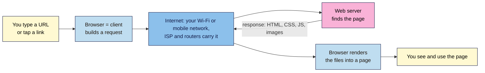

# M01.L01 — The Internet vs the Web
> After this lesson you can explain the difference between the Internet and the Web, say what clients, servers and browsers each do, and you'll have made your first web page with nothing but your browser.

**Time:** ~15 min reading + ~20 min exercise · **Level:** L1 Foundation (beginner) · **Prereqs:** none · **Remediate to:** — (entry point: see `webdev-101/glossary.md`)
**Verified against:** MDN Learn web development ("How the web works", "How does the Internet work?", "What is a web server?") and CERN's "A short history of the Web" on 2026-11-02. Browser steps are written for current desktop Chrome, Edge, Firefox and Safari.

## Learning objectives
1. **Distinguish** the Internet (the network) from the Web (one service that runs on it), using everyday examples. *(O1)*
2. **Explain** what a client, a server and a browser each do when a page loads. *(O2)*
3. **Demonstrate** that a browser turns code into a page, by rendering HTML you type into the address bar. *(O3)*

## Why it matters
Amara runs social media for a skincare brand. On launch day the landing page "is down". The developer asks: "Is it down for everyone, or just you? Do you get a browser error or our 404 page?" Amara doesn't know what the question means, so the fix waits an hour while messages go back and forth. Marketers don't need to build servers. But they need the right words and a simple mental model, so they can tell *where* a problem is and describe it in one sentence. This lesson gives you that model, and every later lesson builds on it.

## Core concept
**Plain version:** the **Internet** is the road network. The **Web** is one kind of traffic on those roads: pages and files you reach with a web address (a URL) and look at in a browser. Email, video calls, online games and messaging apps also use the roads, but they aren't "the Web".

**Analogy:** think of the Internet as the postal system: roads, sorting offices, addresses. The Web is a giant library that uses the post. You (the **client**) send a request card: "please send me page X". The library (the **server**) posts the page back. Your **browser** is the reader that opens the parcel and lays the page out so you can read it.

**Precise definitions:**
- **Internet:** a worldwide network of networks. Computers connect through cables, Wi-Fi, mobile networks and routers, and they share data using common rules called **TCP/IP**. It began as ARPANET in 1969 and switched to TCP/IP on 1 January 1983.
- **World Wide Web (the Web):** a system of linked documents and apps. Each one has an address (**URL**), is sent using **HTTP or HTTPS**, and is usually written in **HTML, CSS and JavaScript**. Tim Berners-Lee proposed it at CERN in 1989. The first website (`info.cern.ch`) went live at the end of 1990, and CERN made the software free for everyone on 30 April 1993.
- **Client:** the device and software that *asks* for something. On the Web it's usually your browser.
- **Server:** a computer (and its software) that *answers* requests by sending files or data. MDN notes that "web server" can mean the hardware, the software, or both together.
- **Browser:** the program that requests pages and then **renders** them. It reads the HTML, CSS and JavaScript and draws the page on screen. Examples: Chrome, Edge, Firefox, Safari, Samsung Internet. Underneath they use a few **browser engines** (Blink, Gecko, WebKit), which is why a page can look slightly different from one browser to the next.

### Internet or Web? A quick sorting guide
| You… | Uses the Internet? | Is it "the Web"? | Why |
|---|---|---|---|
| Read a news site in Chrome | ✅ | ✅ | A URL, HTTP(S), shown in a browser |
| Open Gmail in a browser tab | ✅ | ✅ | Gmail is a *web app*; it talks to email servers for you |
| Send email from the Outlook or Apple Mail app | ✅ | ❌ | Email uses its own protocols (SMTP, IMAP), not web pages |
| Video call on WhatsApp or Zoom app | ✅ | ❌ | Real-time voice/video protocols, not web pages |
| Play an online game on a console | ✅ | ❌ | Game traffic, not pages |
| Scroll Instagram in the app | ✅ | 🟡 grey area | The app isn't a browser, but it fetches data over HTTPS from web servers |

> **Grey area, honestly:** many phone apps use the Web's protocols (HTTPS) behind the scenes. So the line is blurry. A useful working rule for this course: **if it has a URL and opens in a browser, it's the Web.**

## How it works



**In words:** you ask, the browser sends a request, the Internet carries it to a server, and the server sends files back. Your browser then does the last big job: it turns those files into the page you see. Two details are left out on purpose. How the browser finds the *right* server (DNS) is Lesson 1.2. What the request and response look like (HTTP, status codes, HTTPS) is Lesson 1.3.

## Hands-on walkthrough

No installs and no accounts. Use a laptop or desktop browser. Phones work for Parts A and D; Parts B and C are easier on a larger screen.

**Part A: sort your day (5 min)**
1. Write down 10 things you did online in the last 24 hours (for example: "checked bank app", "watched YouTube in Chrome", "WhatsApp voice call").
2. Next to each, write **Web** (has a URL, opened in a browser), **Internet, not Web**, or **Grey area** (an app using web servers behind the scenes). Use the sorting guide above.
   **Expected output:** a list of 10 with labels. Most people find that half or more of their day is "the Web" in a browser, and that many apps are grey areas.

**Part B: be the browser's author (7 min)**
1. Open a new tab in Chrome, Edge or Firefox. Click the address bar, paste the line below exactly, then press **Enter**:
   ```
   data:text/html,<h1>Nila Coffee</h1><p>Fresh beans every month. Launching soon.</p>
   ```
   **Expected:** a page with a large heading "Nila Coffee" and a line of normal text under it. You just made a web page. No server was involved: the whole page was inside the address itself, and your browser rendered it.
   > 🖼️ **Image prompt:** Desktop browser screenshot (1280×720) of a Chrome tab whose address bar shows `data:text/html,<h1>Nila Coffee</h1>…` and whose page shows a large "Nila Coffee" heading and one paragraph in default black serif text. Highlight the address bar with a 3px #F9B2D7 outline; blur any personal details (bookmarks, profile icon).
   > **Alt text:** Browser rendering a heading "Nila Coffee" and one paragraph from HTML typed into the address bar.
2. Change the words between `<h1>` and `</h1>` to your own name or brand, then press **Enter** again.
   **Expected:** the heading changes. The browser re-reads your code and redraws the page.
3. Now remove the closing `</h1>` and press **Enter**.
   **Expected:** the paragraph is probably big and bold too. The browser didn't show an error. It *guessed* where the heading ended, and guessed wrong. Browsers are forgiving, which is why broken HTML often "looks fine" in one place and breaks in another. Module 2 teaches you to write it correctly.
4. Open any real website, for example `https://info.cern.ch` (the first website, restored by CERN). Press **Ctrl+U** (Windows/Linux) or **Cmd+Option+U** (Mac, Chrome/Firefox) to view its source.
   **Expected:** a tab full of code with the same kind of tags (`<h1>`, `<p>`, `<a>`). Every site you visit arrives as code like this. Real sites just have more of it.

**Part C: who is talking, the browser or the server? (5 min)**
1. Visit a page that doesn't exist on a real site, for example `https://developer.mozilla.org/en-US/this-page-does-not-exist`.
   **Expected:** a styled "Page not found" page with MDN's own logo and design. The **server answered**: "I got your request, but I don't have that page" (a 404, more in Lesson 1.3).
2. Turn off Wi-Fi (or switch on airplane mode), then open a website you haven't visited today.
   **Expected:** a plain error page in your *browser's* own style, such as "No internet" or "Hmm. We're having trouble finding that site." **No server was reached.** The browser is telling you the request never got out.
   > 🖼️ **Image prompt:** Two browser screenshots side by side (each 640×400): left, MDN's styled 404 "Page not found" page; right, Chrome's offline error page "No internet". Label them "Server answered (404)" and "No server reached (offline)". Highlight the page titles with a 3px #F9B2D7 outline; blur any personal details.
   > **Alt text:** Side by side: a website's own 404 page, where the server answered, and a browser offline error, where no server was reached.
3. Turn Wi-Fi back on.

**Part D: set up your running project (3 min)**
1. Create a note or document called **"Web Dev 101 — my project"**.
2. Write the name and URL of **one brand site you admire**. You'll take it apart in the Module 1 capstone.
3. Write one line about **your launch page**: a personal brand page or a product/service launch, for example: "A launch page for my weekend baking classes in Lagos, prices in ₦." You'll build it from Module 2 onwards.
   **Expected output:** a note with one brand URL and one launch-page idea.

## When to use / when not to
This lesson is about *naming the layer* where something happens. Use the model like this:
- **Browser-style error page** (offline, "site can't be reached") → the problem is the connection or the address, *before* the server. Check Wi-Fi, the URL, or later (Lesson 1.2) DNS.
- **The site's own error page** (404, styled "oops") → the server is fine and reachable. The page or link is wrong.
- **The page loads but looks broken** → the server sent files, but something in the HTML, CSS or JavaScript is off (Modules 2–5).

**Trade-off:** the simple "post office" model leaves out caching, CDNs and apps that act like browsers. It's accurate enough to diagnose most marketing-page problems and to talk to developers. You'll add detail in Lessons 1.2–1.3 instead of learning everything at once.

## Use AI for this
**Example prompt:**
> "I'm a marketer with no coding background. Explain the difference between the Internet and the World Wide Web using an analogy from [my industry, e.g. retail / restaurants]. Then give me 5 everyday activities and say for each whether it is the Web, the Internet but not the Web, or a grey area, with a one-line reason."

**What AI does well here:** fresh analogies matched to your world, and endless practice examples to sort.
**Where it gets it wrong:** AI often states history as neat facts that don't match the record. "Tim Berners-Lee invented the Internet" is a common example (he invented the Web, not the Internet). It may also call every app "the Web", or call every app "not the Web", without mentioning the grey area.
**How to check:** compare any date or "who invented" claim with a primary source such as CERN's history page or MDN (see Further reading). For sorting, apply this course's working rule: URL + browser = Web.

## Common mistakes
- **Using "Internet" and "Web" as the same word.** It sounds harmless, but in a support conversation "the internet is down" (no connection) and "the website is down" (server problem) send people looking in different places.
- **Thinking the browser just "shows" a page.** The browser *builds* the page from code. That's why the same page can look different in two browsers.
- **Thinking a website lives "in the cloud" with no physical home.** Every site sits on real computers (servers) somewhere, often copied to many places.
- **Assuming no error means correct code.** Browsers guess and recover from mistakes, as you saw in Part B step 3. "It looks fine on my screen" is not a test.
- **Saying "Tim Berners-Lee invented the Internet."** He invented the Web in 1989. The Internet already existed.

## Troubleshooting
| Symptom | Likely cause | Fix |
|---|---|---|
| Typing the `data:` line runs a web search instead | The browser treated it as search text (common on mobile and in Safari) | Paste it into a desktop Chrome, Edge or Firefox address bar, and make sure it starts exactly with `data:text/html,` |
| The page shows only part of your text | You used a `#` character; browsers treat everything after `#` as a fragment, not page content | Avoid `#` in Part B (no colour codes or hashtags) |
| Page shows the code as plain text | The start was typed as `data:text/plain` or has a space before `data:` | Re-paste the line exactly as shown |
| Ctrl+U / Cmd+Option+U does nothing in Safari | Safari hides developer features by default | Safari → Settings → Advanced → turn on "Show features for web developers", then use Develop → Show Page Source |
| Offline test still loads the site | The browser showed a saved (cached) copy of a page you visited earlier | Try a site you haven't visited today, or hard-refresh (Ctrl+Shift+R / Cmd+Shift+R) while offline |

## Exercise
**Task:** write a 3-sentence explanation of how *your* chosen brand site reaches your screen, using the words **client**, **server**, **Internet** and **browser** correctly. Then make a `data:` page that shows your launch-page idea as an `<h1>` heading and one `<p>` sentence, and take a screenshot of it.
**Expected outcome:** three accurate sentences, for example: "When I type nike.com, my browser (the client) sends a request across the Internet to Nike's server. The server sends back HTML, CSS, JavaScript and images. My browser renders those files into the page I see." Plus a screenshot of your own heading in the browser.
**Stretch goal:** add a link to your `data:` page with `<a href="https://info.cern.ch">The first website</a>` and click it. You've just used the Web's original idea: linking one page to another.

## Key takeaways
- The **Internet** is the network; the **Web** is one service on it: pages with URLs, sent over HTTP(S), shown in browsers.
- A **client** asks, a **server** answers, and the **browser** turns the answer (code) into the page you see.
- Browser-style error = the request never reached a server. The site's own error page = the server answered.
- Browsers forgive broken code, so "it looks fine" doesn't prove it's right.
- Every web page, however fancy, arrives as text code you can view.

## Teach it back
Explain to a friend in 3 sentences why "the internet is down" and "our website is down" are different problems, and what each one would make you check first.

## Glossary terms added
- Internet — added to `webdev-101/glossary.md`
- World Wide Web (the Web) — added to `webdev-101/glossary.md`
- Client — added to `webdev-101/glossary.md`
- Server / web server — added to `webdev-101/glossary.md`
- Browser — added to `webdev-101/glossary.md`
- Browser engine — added to `webdev-101/glossary.md`
- Render — added to `webdev-101/glossary.md`
- TCP/IP — added to `webdev-101/glossary.md`
- HTML, CSS, JavaScript (first mention) — added to `webdev-101/glossary.md`
- Data URL — added to `webdev-101/glossary.md`

## Further reading
*All checked 2026-11-02.*
- MDN — How the web works: https://developer.mozilla.org/en-US/docs/Learn_web_development/Getting_started/Web_standards/How_the_web_works
- MDN — How does the Internet work?: https://developer.mozilla.org/en-US/docs/Learn_web_development/Howto/Web_mechanics/How_does_the_Internet_work
- MDN — What is a web server?: https://developer.mozilla.org/en-US/docs/Learn_web_development/Howto/Web_mechanics/What_is_a_web_server
- MDN — Browsing the web: https://developer.mozilla.org/en-US/docs/Learn_web_development/Getting_started/Environment_setup/Browsing_the_web
- CERN — A short history of the Web: https://home.cern/science/computing/the-birth-of-the-web/short-history-web/
- CERN — The first website, restored: https://info.cern.ch

## Refresher card
*Used by remediation when a learner fails a quiz twice on a later lesson that points back here.*
**Internet** = the roads (network of networks, TCP/IP). **Web** = pages with URLs over HTTP(S), shown in a browser. **Client** asks → **server** answers → **browser** renders code into a page. Browser-style error = no server reached; the site's own error page = server reached, page missing.
