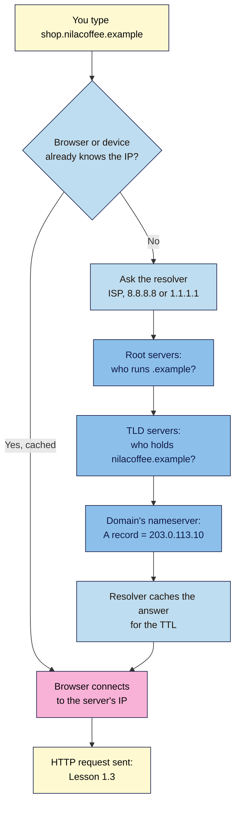

# M01.L02 — URLs, Domains & DNS
> After this lesson you can read any URL part by part, explain how a domain name finds its server, and look up the DNS records and registration details of a real domain.

**Time:** ~18 min reading + ~25 min exercise · **Level:** L1 Foundation (beginner) · **Prereqs:** M01.L01 · **Remediate to:** M01.L01
**Verified against:** MDN "What is a URL?" and "What is a domain name?", ICANN's RDAP announcement (27 Jan 2025) and lookup.icann.org, Google Admin Toolbox Dig, and the GA4 campaign-URL help page, on 2026-11-02.

> Note: the course's demo brand uses `nilacoffee.example`. Domains ending in `.example` are reserved for documentation (RFC 2606), so they never point at a real business.

> ⚠️ **Freshness flag:** domain lookups changed in January 2025, when ICANN replaced WHOIS with **RDAP** for generic domains like `.com` and `.org`. Many older guides still say "do a WHOIS lookup". Tool screens below were checked on 2026-11-02.

## Learning objectives
1. **Break down** any URL into scheme, subdomain, domain, top-level domain, path, query string (including UTM tags) and fragment. *(O1)*
2. **Explain** how DNS turns a domain name into an IP address, and what A, AAAA, CNAME, MX, NS and TXT records do. *(O2)*
3. **Look up** the DNS records and registration details of a real domain with free browser tools. *(O3)*

## Why it matters
Diego plans a newsletter campaign for a café chain. He sends the designer a link: `https://www.cafe.example/menu?utm_source=newsletter&utm_campaign=autumn#desserts`. The analytics team says the campaign "didn't track" for half the clicks, because someone shortened the link and dropped everything after the `?`. Then the IT contractor says the new landing page "needs a CNAME". Diego nods and doesn't know what to ask next. URLs and DNS are where marketing work and technical work meet. If you can read a URL and know what a DNS record does, you can catch broken campaign links before launch and give clear instructions when you connect a domain in Module 4.

## Core concept
**Plain version:** a **URL** is the full address of one page or file. The **domain name** is the human-friendly part of that address. **DNS** is the Internet's phone book: it turns the name into the numeric **IP address** of the server, so your browser knows where to send the request.

**Analogy (from MDN):** in a postal address, the scheme is the postal service you choose, the domain is the city, the path is the building, the query is extra delivery instructions, and the fragment is the person inside you want to reach. DNS is the directory office that tells the post van which street the city's address actually is on.

### The parts of a URL
```
https://shop.nilacoffee.example/subscriptions/monthly?utm_source=instagram&utm_medium=social&utm_campaign=launch#pricing
```
Read it left to right: **`https`** (scheme) · **`shop`** (subdomain) · **`nilacoffee.example`** (domain + TLD) · **`/subscriptions/monthly`** (path) · **`?utm_source=…&utm_campaign=launch`** (query string) · **`#pricing`** (fragment).

| Part | Example | What it does |
|---|---|---|
| **Scheme** | `https` | Which protocol to use. `https` is encrypted (Lesson 1.3). Others exist, e.g. `mailto:` or the `data:` you used in L01. |
| **Subdomain** | `shop` | An optional label before the domain, often for a section or a different service: `www`, `shop`, `blog`, `help`. |
| **Domain** (registrable domain) | `nilacoffee` + `.example` | The name you buy and renew from a **registrar**. It's the part that's yours. |
| **Top-level domain (TLD)** | `.example`, `.com`, `.in`, `.com.br` | The last part. Generic TLDs (`.com`, `.org`, `.shop`, `.coffee`) and country-code TLDs (`.in`, `.ng`, `.br`, `.uk`). Some countries use second-level endings like `.co.uk` or `.com.br`. |
| **Path** | `/subscriptions/monthly` | Which page on that site. Readable paths help people and search engines (Module 7). |
| **Query string** | `?utm_source=instagram&utm_medium=social&utm_campaign=launch` | Starts with `?`; `key=value` pairs joined by `&`. The server or scripts can read them. **UTM tags** live here; analytics tools use them to tell which campaign brought a visitor. |
| **Fragment** | `#pricing` | Starts with `#`; jumps to a spot on the page. **It is never sent to the server**, which is why the `#` in Lesson 1.1's `data:` page cut your text short. |

There is also an optional **port** (`:443`) after the domain. You'll almost never see it, because browsers use 443 for HTTPS and 80 for HTTP by default.

### How DNS finds the server
- **IP address:** the numeric address of a device on the Internet. IPv4 looks like `203.0.113.10`; the newer IPv6 looks like `2001:db8:85a3::8a2e:370:7334`. (Both examples come from ranges reserved for documentation.)
- **DNS (Domain Name System):** a worldwide, layered directory. No single computer knows every name; each layer knows who to ask next.
- **Resolver:** the server that does the looking up for you, usually run by your Internet provider, or a public one such as Google (8.8.8.8) or Cloudflare (1.1.1.1).
- **Nameserver (authoritative):** the server that holds the official records for one domain, usually run by your registrar, host or a DNS service like Cloudflare.
- **TTL (time to live):** how long resolvers may remember (cache) an answer, in seconds. This is why DNS changes can take minutes to hours to show up everywhere.
- **Registrar vs registry:** you rent a domain from a *registrar* (GoDaddy, Namecheap, Porkbun, Hostinger, a local company). The *registry* runs the whole TLD (for example, Verisign runs `.com`).

### The DNS records marketers meet
| Record | Plain meaning | Where you'll use it |
|---|---|---|
| **A** | "This name lives at this IPv4 address." | Pointing your domain at a host (M04) |
| **AAAA** | Same, for an IPv6 address. | Same, on modern hosts |
| **CNAME** | "This name is an alias of that other name." | `www` → your host's address, e.g. `yourname.github.io` (M04) |
| **MX** | "Email for this domain goes to these mail servers." | Google Workspace, Microsoft 365, Zoho Mail. **Change carefully: wrong MX = lost email.** |
| **NS** | "These nameservers hold the official records." | Moving DNS to a new provider |
| **TXT** | Free text, used to prove ownership and protect email. | Search Console verification (M07), SPF/DKIM/DMARC for email tools like Brevo or Mailchimp (M05) |

## How it works



**In words:** your browser first checks whether it already knows the address. If not, a resolver asks three layers in turn. The **root** points to the TLD's servers, the **TLD** servers point to the domain's own **nameserver**, and that nameserver gives the answer (the A or AAAA record). The resolver remembers the answer for the TTL, so the next visitor gets it instantly. This whole trip usually takes a few milliseconds. When it fails, you get the *browser-style* error from Lesson 1.1, because no server was ever found.

## Hands-on walkthrough

All free and in the browser. Parts A, D and E work on a phone; B and C are easier on a larger screen.

**Part A: dissect three URLs (8 min)**
1. Copy this table into your notes and fill in each part. Write "—" where a part is missing.

   | URL | Scheme | Subdomain | Domain + TLD | Path | Query | Fragment |
   |---|---|---|---|---|---|---|
   | `https://www.bbc.co.uk/news/technology` | | | | | | |
   | `https://shop.nilacoffee.example/subscriptions/monthly?utm_source=instagram&utm_medium=social&utm_campaign=launch#pricing` | | | | | | |
   | `http://blog.example.org/?p=42` | | | | | | |

   **Expected output:**
   - Row 1: `https` · `www` · `bbc.co.uk` (TLD `.co.uk`) · `/news/technology` · — · —
   - Row 2: `https` · `shop` · `nilacoffee.example` · `/subscriptions/monthly` · the three `utm_` pairs · `pricing`
   - Row 3: `http` (not encrypted, a warning sign) · `blog` · `example.org` · `/` · `p=42` · —
2. Look at Row 2's query string. Write the three UTM tags as plain sentences, for example "source = Instagram".
   **Expected:** source = instagram, medium = social, campaign = launch. You'll build these properly in Lesson 6.1.

**Part B: look up a domain's DNS records (7 min)**
1. Open **Google Admin Toolbox Dig**: `https://toolbox.googleapps.com/apps/dig/`.
2. Type `wikipedia.org` in the **Name** box and choose **A**.
   **Expected:** one or more lines containing `wikipedia.org.`, a number (the TTL in seconds), `IN A`, and an IPv4 address.
   > 🖼️ **Image prompt:** Desktop screenshot (1280×720) of Google Admin Toolbox Dig with `wikipedia.org` in the Name box, record type A selected, and the result line showing `IN A` and an IPv4 address. Outline the TTL number and the IP address. Highlight the key element with a 3px #F9B2D7 outline; blur any personal details.
   > **Alt text:** Google Admin Toolbox Dig showing the A record for wikipedia.org with its TTL and IPv4 address highlighted.
3. Now choose **AAAA**, then **MX**, then **NS**, then **TXT**, noting one result from each.
   **Expected:** AAAA shows an IPv6 address; MX lists mail servers with a priority number; NS lists nameservers; TXT shows text lines, often starting with `v=spf1` (email protection) or `google-site-verification=` (proof of ownership).
4. Try `www.github.com` with record type **CNAME**.
   **Expected:** a CNAME answer pointing `www.github.com` to `github.com`. That's an alias: one name pointing to another name, not to an IP.

**Part C: who owns the domain? (5 min)**
1. Open **ICANN Lookup**: `https://lookup.icann.org/` and enter the domain of the brand site you chose in Lesson 1.1 (if it's a country-code domain like `.in` and nothing shows, try a `.com` brand first; see Troubleshooting).
2. Find: the **registrar**, the **created** and **expiry** dates, and the **nameservers**.
   **Expected:** a registration record from RDAP. Personal contact details are usually **redacted** for privacy. That's normal, not an error.
   > 🖼️ **Image prompt:** Screenshot (1280×800) of an ICANN Lookup (lookup.icann.org) result for a well-known .com domain, showing Registrar, Creation Date, Registry Expiry Date and Name Servers; redacted contact fields visible. Highlight the Registrar and Name Servers fields with a 3px #F9B2D7 outline; blur any personal details.
   > **Alt text:** ICANN Lookup RDAP result showing registrar, creation and expiry dates, and name servers for a domain.
3. Compare the nameservers with what you saw in Part B, step 3 (NS records).
   **Expected:** they match. The registry tells the world which nameservers hold the records, and those nameservers answer.

**Part D: break it and read the error (3 min)**
1. In your browser, open `https://nilacoffee.example` and then a misspelt real domain such as `https://wikipediaa-typo-test.org`.
   **Expected:** a browser-style error. Chrome and Edge show "This site can't be reached" with **`DNS_PROBE_FINISHED_NXDOMAIN`**; Firefox says "Hmm. We're having trouble finding that site." NXDOMAIN means **"no such domain"**: DNS found no record, so no request was ever sent to a server.
2. Write one sentence in your notes: "NXDOMAIN means …".

**Part E: your launch page's address (2 min)**
1. In your "Web Dev 101 — my project" note, write 2–3 domain ideas for your launch page (for example `kemibakes.com`, `kemibakes.ng`).
2. Optional: check availability on any registrar's search box. **Don't buy yet.** You'll choose a domain, or use a free host subdomain, in Lesson 4.4.

## When to use / when not to
- **Use a subdomain** (`shop.`, `blog.`, `go.`) when a section runs on a different service, such as a shop platform or a link-in-bio tool, but should still carry your brand. **Trade-off:** each subdomain is a separate DNS record to manage and may need its own analytics setup.
- **Use a path** (`/shop`, `/blog`) when it's the same site on the same host. It's simpler, and search engines treat it as one site.
- **Use UTM tags** on links you share *outside* your site (email, social, ads). **Don't** put UTMs on links *within* your own site: they overwrite the real source of the visit in analytics.
- **Prefer a country-code TLD** (`.in`, `.ng`, `.de`) when you serve one country and want to look local; prefer `.com` or a generic TLD for an international audience.

## Use AI for this
**Example prompt:**
> "Here is a campaign URL: [paste]. Split it into scheme, subdomain, domain, TLD, path, each query parameter and fragment, in a table. Then tell me if anything looks wrong for tracking, such as a missing utm_source, spaces, or UTMs after the # sign."

**What AI does well here:** splitting long URLs reliably and spotting obvious problems like a second `?` or spaces.
**Where it gets it wrong:** it often says "do a WHOIS lookup" (outdated for gTLDs since January 2025), invents DNS record values it can't see, and may confuse the subdomain with the domain on endings like `.co.uk`.
**How to check:** look up real records yourself with Dig (Part B) and ICANN Lookup (Part C). Never copy DNS values from an AI answer into your registrar: copy them from your host's own setup screen.

## Common mistakes
- **Putting UTM tags after the `#`.** Anything after `#` is never sent to the server, and many analytics setups won't see it. UTMs go in the query string, *before* the fragment.
- **Treating `www.brand.com` and `brand.com` as automatically the same.** They're two different names in DNS. Each needs a record, and one should redirect to the other (Lesson 1.3, Module 4).
- **Editing MX records while "fixing the website".** MX controls email, not the site. Change it only on purpose.
- **Expecting DNS changes to show instantly.** Resolvers keep the old answer until its TTL runs out.
- **Letting a domain expire.** Anyone can register it after expiry, along with your links and reputation. Turn on auto-renew and keep the registrar login safe.

## Troubleshooting
| Symptom | Likely cause | Fix |
|---|---|---|
| `DNS_PROBE_FINISHED_NXDOMAIN` | Typo in the domain, the domain has expired, or it has no records yet | Check the spelling; look up the domain in ICANN Lookup; check its A/CNAME records in Dig |
| Dig shows a new record, but your browser still shows the old site | Your device or resolver cached the old answer | Wait for the TTL, try another network or phone data, or flush Google Public DNS's cache at `https://developers.google.com/speed/public-dns/cache` |
| ICANN Lookup returns nothing for a `.in`, `.de` or other country domain | Some country-code registries don't offer RDAP through ICANN | Use the country registry's own lookup (for example `registry.in` for `.in`) |
| Dig shows no CNAME for a `www` name | It has an A record instead, or the brand uses a different setup | Try record type **A**; both are valid ways to point a name |
| A campaign link opens the right page but analytics shows "direct" | UTMs were removed by a link shortener, put after `#`, or misspelt (`utm-source`) | Test the final link: the address bar must still show `?utm_source=…` |

## Exercise
**Task:** take one real link from a brand email or ad you've received (or the Row 2 link above). In your notes:
1. Break it into its parts in a table.
2. Look up its domain's **A**, **MX** and **TXT** records in Dig, and its **registrar** and **expiry date** in ICANN Lookup.
3. Write two sentences: who registered the domain through which registrar, and which email service the domain uses (hint: the MX servers' names often give it away, e.g. `google.com` or `outlook.com`).

**Expected outcome:** a URL table, three DNS findings and two sentences. Example: "nilacoffee.example is registered through Example Registrar until 2027-03-10. Its MX records point to `aspmx.l.google.com`, so it uses Google Workspace for email."
**Stretch goal:** find a TXT record starting with `v=spf1` on any brand domain and list the services it names (for example `include:_spf.google.com`, `include:spf.brevo.com`). These are the services allowed to send email as that brand.

## Key takeaways
- A URL = scheme + (subdomain) + domain + TLD + path + query + fragment; you can now read any of them.
- The **fragment** (`#…`) never reaches the server; **UTMs** belong in the query string before it.
- **DNS** turns names into IP addresses through a resolver, root, TLD and the domain's nameserver, then caches the answer for the **TTL**.
- **A/AAAA** point to IPs, **CNAME** points to another name, **MX** is email, **TXT** proves ownership and protects email.
- Domain registration details now come from **RDAP** (ICANN Lookup), not WHOIS, for generic TLDs.

## Teach it back
Explain to a friend in 3 sentences what happens between typing `shop.nilacoffee.example` and your browser knowing which server to contact, and why a change to DNS might not show up straight away.

## Glossary terms added
- URL (and its parts: scheme, subdomain, path, query string, fragment) — added to `webdev-101/glossary.md`
- Domain name / registrable domain — added to `webdev-101/glossary.md`
- Top-level domain (TLD), gTLD, ccTLD — added to `webdev-101/glossary.md`
- UTM tags — added to `webdev-101/glossary.md`
- IP address (IPv4, IPv6) — added to `webdev-101/glossary.md`
- DNS, resolver, nameserver — added to `webdev-101/glossary.md`
- TTL — added to `webdev-101/glossary.md`
- Registrar vs registry — added to `webdev-101/glossary.md`
- A, AAAA, CNAME, MX, NS, TXT records — added to `webdev-101/glossary.md`
- RDAP — added to `webdev-101/glossary.md`
- NXDOMAIN — added to `webdev-101/glossary.md`

## Further reading
*All checked 2026-11-02.*
- MDN — What is a URL?: https://developer.mozilla.org/en-US/docs/Learn_web_development/Howto/Web_mechanics/What_is_a_URL
- MDN — What is a domain name?: https://developer.mozilla.org/en-US/docs/Learn_web_development/Howto/Web_mechanics/What_is_a_domain_name
- MDN — URI fragment (never sent to the server): https://developer.mozilla.org/en-US/docs/Web/URI/Reference/Fragment
- ICANN — Launching RDAP; Sunsetting WHOIS (27 Jan 2025): https://www.icann.org/en/announcements/details/icann-update-launching-rdap-sunsetting-whois-27-01-2025-en
- ICANN Lookup (RDAP): https://lookup.icann.org/
- Google Admin Toolbox Dig: https://toolbox.googleapps.com/apps/dig/
- Google Public DNS — Flush cache: https://developers.google.com/speed/public-dns/cache
- IANA — Root Zone Database (every TLD): https://www.iana.org/domains/root/db
- Google Analytics Help — Collect campaign data with custom URLs: https://support.google.com/analytics/answer/10917952
- RFC 2606 — Reserved top-level DNS names (`.example`): https://www.rfc-editor.org/rfc/rfc2606

## Refresher card
*Used by remediation when a learner fails a quiz twice on a later lesson that points back here.*
**URL** = `scheme://subdomain.domain.TLD/path?query#fragment`. Query holds UTMs; the fragment never reaches the server. **DNS** turns a name into an IP: resolver → root → TLD → nameserver → answer cached for the TTL. **A/AAAA** = IP, **CNAME** = alias to a name, **MX** = email, **NS** = who holds the records, **TXT** = verification and email protection. Look up records in Dig; registration in ICANN Lookup (RDAP). **NXDOMAIN** = no such domain.
