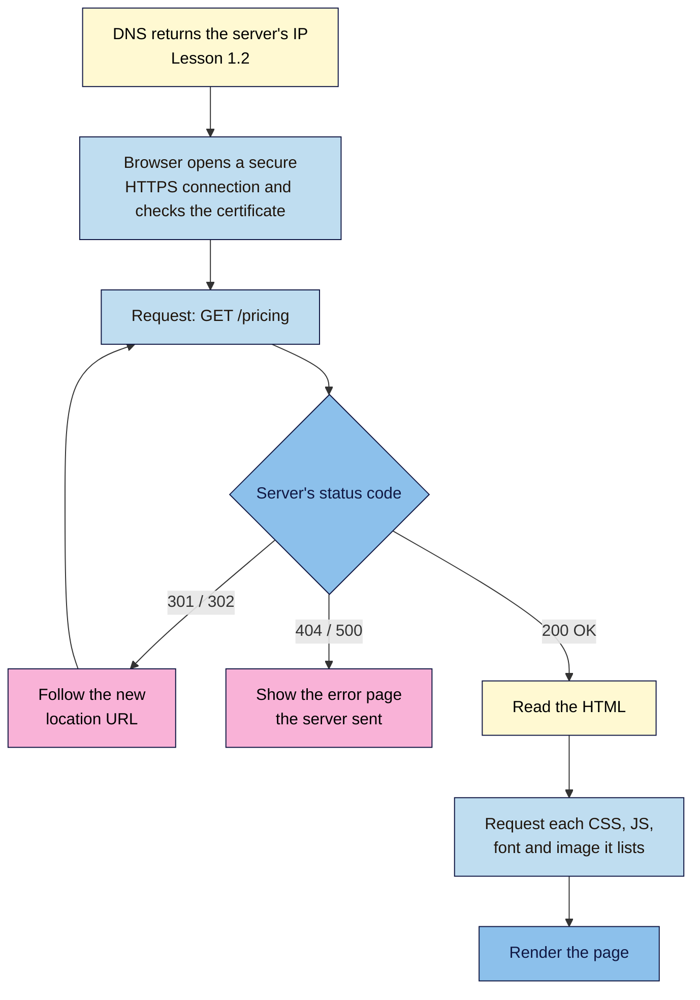

# M01.L03 — Hosting & How a Page Loads
> After this lesson you can describe the request → response cycle, read the status codes marketers meet most, explain what HTTPS adds, and choose a sensible type of hosting for a launch page.

**Time:** ~18 min reading + ~25 min exercise · **Level:** L1 Foundation (beginner) · **Prereqs:** M01.L02 · **Remediate to:** M01.L02
**Verified against:** MDN HTTP status code reference and redirections guide, Google's "HTTPS by default" announcement (Oct 2025) and Chrome 154 release notes, CA/Browser Forum ballot SC-081v3, and ISRG/Let's Encrypt's "From 90 to 45" post, on 2026-11-02. DevTools steps written for current desktop Chrome and Edge, with Firefox notes.

> Note: Part A uses the browser's DevTools **Network** panel as a quick preview. Lesson 1.5 teaches DevTools properly, so follow the steps exactly and don't worry about the other panels yet.

> ⚠️ **Freshness flag:** browser HTTPS rules and certificate lifetimes are changing in 2026–2029. Since Chrome 154 (October 2026), **"Always Use Secure Connections"** is on by default for public sites, so Chrome asks before opening an HTTP-only site (listed in the Chrome 154 release notes as "Ask before HTTP on by default"). Users and company admins can still turn it off; check `chrome://settings/security` on your own browser. Maximum certificate lifetimes drop from 200 days (since March 2026) to 100 days (March 2027) and 47 days (March 2029).

## Learning objectives
1. **Describe** the request → response cycle and what status codes 200, 301, 302, 404 and 500 mean. *(O1)*
2. **Explain** what HTTPS adds over HTTP, what the padlock does and doesn't prove, and why browsers warn on HTTP pages. *(O2)*
3. **Compare** hosting types (static, shared, managed, cloud, with or without a CDN) by cost, effort and fit for a marketing page. *(O3)*

## Why it matters
Mei Ling moves her consultancy site to a new host. She doesn't add redirects, so every old link in two years of LinkedIn posts now shows "Page not found". Search traffic drops by half in a month. A week later, a client says Chrome shows "Not secure" on her contact form, because the new host's free certificate was never turned on. Neither problem needs code to fix. Both need someone who knows that a server answers with a **status code**, and that HTTPS is a setting you must check, not something that happens by magic. That someone can be you.

## Core concept
**Plain version:** loading a page is a conversation. Your browser sends a **request** ("GET me `/pricing`, please"). The server sends a **response** with a **status code** (a three-digit result), some information about the file, and the file itself. A single page usually takes dozens of these conversations: one for the HTML, then more for each stylesheet, script, font and image it lists. **Hosting** is renting space on a server that's always on, so these conversations can happen for anyone, any time.

**Analogy:** a restaurant order. You order (request), and the kitchen replies: "Here's your dish" (**200 OK**), "That dish moved to our other branch" (**301 Moved Permanently**), "We've never had that dish" (**404 Not Found**), or "The kitchen's on fire" (**500 Internal Server Error**). The main course (HTML) comes first, and side dishes (CSS, images) follow because the main course asks for them. **HTTPS** is having that conversation in a private booth. Nobody can listen in or swap your dish on the way, and the waiter shows ID proving this really is the restaurant you meant.

### The request and the response
| Request (browser → server) | Response (server → browser) |
|---|---|
| **Method:** usually `GET` (fetch a page); `POST` sends data, e.g. a form | **Status code:** e.g. `200`, `301`, `404` |
| **URL:** `https://nilacoffee.example/pricing` | **Headers:** facts about the file, e.g. `content-type: text/html`, how long to cache it, and for redirects the new `location` |
| **Headers:** facts about the browser, e.g. language, accepted formats, cookies | **Body:** the file itself: HTML, CSS, an image… |

### Status codes marketers meet most
| Code | Meaning | What it means for you |
|---|---|---|
| **200 OK** | Here's the file. | Normal. |
| **301 Moved Permanently** | It lives at a new URL for good; go there. | Use when you change a page's URL or domain. Search engines move the old URL's signals to the new one. |
| **302 Found** (and **307**) | It's at another URL *for now*. | Temporary moves only, e.g. a short campaign. Search engines keep the old URL. |
| **304 Not Modified** | You already have the latest copy. | Normal; the browser reuses its cached copy. |
| **404 Not Found** | No file at this URL. | Broken link or deleted page. Fix the link or add a 301. |
| **410 Gone** | Removed on purpose, for good. | A clear signal when a page is gone forever. |
| **500 Internal Server Error** | Something broke on the server. | Not your browser. Contact the host or developer. |
| **503 Service Unavailable** | The server is overloaded or down for maintenance. | Often temporary; common during traffic spikes. |

The first digit tells you the family: **2xx** success, **3xx** redirect, **4xx** problem with the request (usually a wrong URL), **5xx** problem on the server.

### HTTP vs HTTPS
- **HTTP** sends everything as readable text. Anyone on the same café Wi-Fi, or along the route, can read or change it.
- **HTTPS** is HTTP inside an encrypted connection (TLS). It gives you three things:
  1. **Privacy:** nobody along the way can read the data (form fields, passwords).
  2. **Integrity:** nobody can change the page on the way, for example by injecting ads.
  3. **Identity:** a **certificate** proves the server really belongs to the domain in the address bar.
- A **certificate** is issued by a **certificate authority (CA)**. Free, automatic certificates from Let's Encrypt (and similar CAs) are now normal, and almost every host turns one on for you. Certificates expire and must be renewed. Lifetimes are getting shorter, so **automatic renewal** is the only safe setup.
- **What HTTPS does not prove:** that the site is honest. Scam sites have valid certificates too. HTTPS means "the connection is private and this really is `nilacoffee.example`", not "Nila Coffee is trustworthy". (This is one reason Chrome replaced the padlock with a neutral "tune" icon in 2023.)

### Hosting types
| Type | What you get | Typical cost | Effort | Good fit for |
|---|---|---|---|---|
| **Static hosting** (GitHub Pages, Netlify, Cloudflare Pages) | Serves files you upload as they are. HTTPS and a global CDN usually included | **Free** tier for small sites | Low once set up (Module 4) | Launch pages, portfolios, link-in-bio pages: **this course** |
| **Shared hosting** | A slice of one server with hundreds of other sites; runs PHP/WordPress | ≈ ₹150–600 / $2–8 a month | Medium: you manage the app and updates | Small WordPress sites on a budget |
| **Managed hosting** (e.g. managed WordPress) | The host runs updates, backups, caching and security for you | ≈ ₹1,000–3,000 / $15–35 a month | Low | Business sites where your time matters more than cost |
| **Cloud / VPS** (AWS, Google Cloud, DigitalOcean) | A whole virtual server or services you configure | From a few $ a month to a lot | High: needs technical skills | Custom apps, developers, high traffic |
| **Website builders** (Wix, Squarespace, Webflow) | Hosting + editor in one package | ≈ $15–40 a month | Lowest | People who never want to touch code (Lesson 1.4) |

A **CDN (content delivery network)** keeps copies of your files on servers around the world, so a visitor in Nairobi gets them from nearby instead of from a single server in Frankfurt. Static hosts usually include one. Prices above are rough ranges checked 2026-11-02; they vary by country and change often.

## How it works

**In words:** once DNS has found the server, the browser opens a secure connection and checks the certificate. It asks for the page. A redirect sends it to a new URL and it asks again; an error code means it shows whatever error page the server sent; a 200 delivers the HTML. The HTML then lists the other files the page needs, so the browser asks for each of those too before it can draw the full page. Every redirect and every extra file adds waiting time, which is why Module 7 cares about both.

## Hands-on walkthrough

Use desktop Chrome or Edge (Firefox works too; its labels are noted). Close other tabs on the same sites first so cached copies don't confuse the results.

**Part A: watch one page take many requests (7 min)**
1. Open `https://info.cern.ch` (from Lesson 1.1). Press **F12** (Windows/Linux) or **Cmd+Option+I** (Mac) to open DevTools, then click the **Network** tab.
2. Tick **Disable cache**, then reload the page with **Ctrl+R** / **Cmd+R**.
   **Expected:** a short list of rows. The first row (type **document**) shows status **200**. The bottom bar shows the number of **requests** and how much was **transferred**.
3. Now open `https://www.wikipedia.org` in the same tab and reload with the Network panel still open.
   **Expected:** many more rows: the document, then stylesheets, scripts, images and fonts, each with its own status code. A modern brand homepage can make well over 100 requests.
   > 🖼️ **Image prompt:** Desktop screenshot (1440×900) of Chrome DevTools Network panel after loading www.wikipedia.org, with the Status, Type and Size columns visible and the bottom summary bar showing request count and transferred size. Outline the first "document" row and the summary bar. Highlight the key element with a 3px #F9B2D7 outline; blur any personal details.
   > **Alt text:** Chrome DevTools Network panel listing many requests for Wikipedia, with the first document row and the request summary highlighted.
4. Write down both request counts in your notes.

**Part B: catch a redirect and a 404 (6 min)**
1. In the Network panel, tick **Preserve log** (Firefox: **Persist Logs** in the settings cog), so the list doesn't clear when the page changes.
2. Type `https://www.github.com` in the address bar and press **Enter**.
   **Expected:** the first `document` row is `www.github.com` with status **301**, followed by a row for `github.com` with **200**. GitHub has picked one version of its address (without `www`) and permanently redirects the other to it.
3. Type `http://wikipedia.org` (note: **http**, no **s**) and press **Enter**.
   **Expected:** a redirect to `https://www.wikipedia.org/`. You may see **301** (the server redirected) or **307 Internal Redirect** (your *browser* upgraded to HTTPS on its own, because Wikipedia told browsers in the past to always use HTTPS). Either way you end up on HTTPS.
4. Open `https://developer.mozilla.org/en-US/this-page-does-not-exist` (from Lesson 1.1).
   **Expected:** the document row shows **404**. The styled page you see is the server's answer to "not found".

**Part C: inspect a certificate (5 min)**
1. Go to `https://www.wikipedia.org`. Click the icon to the left of the address (Chrome's **tune** icon, two sliders), then **Connection is secure** → **Certificate is valid**. In Firefox: padlock → **Connection secure** → **More information** → **View Certificate**.
2. Find: **Issued to** (which domains), **Issued by** (the CA), and **Validity period** (from/to dates).
   **Expected:** the certificate covers `wikipedia.org` and related names, comes from a public CA, and is valid for a few months at most.
   > 🖼️ **Image prompt:** Screenshot (900×700) of Chrome's certificate viewer for www.wikipedia.org showing Issued To, Issued By and Validity Period (Issued On / Expires On). Outline the Validity Period section. Highlight the key element with a 3px #F9B2D7 outline; blur any personal details.
   > **Alt text:** Chrome certificate viewer for Wikipedia with the certificate authority and validity dates highlighted.
3. Calculate the lifetime (expiry date minus issue date) and write it down.

**Part D: see what an HTTP-only site looks like (3 min)**
1. Open `http://neverssl.com`, a site deliberately kept on plain HTTP so people can test this.
   **Expected:** the address bar says **Not secure**. With "Always Use Secure Connections" on (the Chrome default since version 154), Chrome first shows a warning page and asks whether to continue. Click **Continue to site** only for this test site.
2. Note in one sentence why you'd never put a sign-up form on a page like this.

**Part E: your hosting choice (4 min)**
In your "Web Dev 101 — my project" note, answer:
1. Will your launch page need a database or logins? (Most launch pages don't.)
2. Based on the hosting table, which type fits? Write one line, e.g. "Static hosting on Netlify's free tier, because my launch page is a few files and a form service."
   **Expected:** for nearly every learner's launch page, static hosting. You'll set it up in Lesson 4.3.

## When to use / when not to
- **Static hosting:** choose it when the page is the same for every visitor (launch pages, portfolios, docs). **Trade-off:** no server code. Forms, logins and dynamic content need outside services (Module 5, Module 8).
- **Shared or managed hosting:** choose it when you run a CMS such as WordPress. Pay for managed when downtime or hacking would cost more than the hosting.
- **301 vs 302:** use **301** for any permanent change (new URL, new domain, HTTP → HTTPS, www → non-www). Use **302/307** only when the old URL will come back, such as a short sale page. **Trade-off:** a mistaken 302 keeps search engines on the old URL; a mistaken 301 is cached by browsers and is hard to undo.
- **HTTPS:** always. There's no longer a valid reason to serve a public page over HTTP.

## Use AI for this
**Example prompt:**
> "I'm moving my site from `old.example` to `new.example` on a new host. Here are my 10 most-visited old URLs: [list]. Write a redirect plan as a table with: old URL, new URL, status code (301 or 302) and why. Then list three checks I should run after the move."

**What AI does well here:** mapping long lists of old URLs to new ones and remembering the post-move checks (status codes, HTTPS, broken links).
**Where it gets it wrong:** it may pick 302 where you need 301, write redirect rules for the wrong server type (an Apache `.htaccess` file when your host uses Netlify's `_redirects` file), and quote old certificate lifetimes (e.g. "certificates last a year").
**How to check:** after the move, test each old URL with DevTools **Preserve log** (Part B) and confirm one hop, a **301**, and a **200** at the end. For hosting-specific syntax, use your host's own documentation.

## Common mistakes
- **Changing URLs or domains without 301 redirects.** Old links, bookmarks and search results all hit 404s, and the old pages' search signals are lost.
- **Redirect chains:** `http://www.brand.com` → `https://www.brand.com` → `https://brand.com` → `https://brand.com/home`. Each hop adds delay. Redirect straight to the final URL.
- **Using 302 for a permanent move,** often because it's a tool's default setting.
- **Thinking the padlock means "safe site".** It means "private connection to this exact domain". Scam sites can have certificates.
- **Mixed content:** an HTTPS page that loads an image or script over `http://`. Browsers block or warn about it, and the page can look broken.
- **Choosing hosting on price alone.** The cheapest shared plan may have no automatic backups or free certificate, and those cost more later.

## Troubleshooting
| Symptom | Likely cause | Fix |
|---|---|---|
| Network panel is empty | DevTools was opened after the page loaded | Keep DevTools open and reload the page |
| The redirect row disappears | The list clears when the page changes | Tick **Preserve log** (Firefox: **Persist Logs**) |
| You see **307 Internal Redirect** instead of 301 | Your browser upgraded to HTTPS itself (HSTS or HTTPS-first mode) | Normal; it means the browser already knew to use HTTPS |
| Lots of **304** or "(memory cache)" rows | The browser reused cached copies | Tick **Disable cache** and reload |
| "Your connection is not private" (`NET::ERR_CERT_…`) | The certificate expired, doesn't cover this domain, or your device clock is wrong | Check your date and time; if it's your site, renew the certificate or fix the domain list at your host |
| A page you redirected still shows the old version | Browsers cache 301s | Test in a private window or another browser |

## Exercise
**Task:** check your capstone brand site (from Lesson 1.1) and write a short "load report" in your notes:
1. Does `http://` redirect to `https://`? With which status code, and in how many hops?
2. Does `www.` redirect to the version without it (or the other way round)? Which version did the brand choose?
3. On the homepage: how many requests, and how much transferred (Network panel, cache disabled)?
4. Certificate: who issued it, and when does it expire?
5. Open a made-up page on the site (e.g. `/this-page-does-not-exist`): what status code comes back, and is the 404 page helpful (search box, links home)?

**Expected outcome:** five short answers with numbers, for example: "http → https in 1 hop (301); www → non-www (301); 87 requests, 2.4 MB transferred; certificate from Let's Encrypt, expires 2027-01-14; 404 page has a search box and a link to the shop."
**Stretch goal:** find a redirect chain of two or more hops on any well-known site (try combinations of `http`, `www` and a trailing `/`), and write what the single direct redirect should be.

## Key takeaways
- A page load is many **request → response** pairs: HTML first, then everything it lists.
- Status codes: **2xx** ok, **3xx** redirect, **4xx** wrong URL, **5xx** server problem. **301** = permanent, **302/307** = temporary, **404** = not found.
- **HTTPS** gives privacy, integrity and identity. It doesn't prove a site is honest.
- Certificates are free and expire faster each year, so **automatic renewal** is a must.
- For a launch page, **static hosting** on a free tier is usually the right choice.

## Teach it back
Explain to a friend in 3 sentences what a 301 redirect is, when you'd need one, and what happens to your old links and search traffic if you forget it.

## Glossary terms added
- Request / response — added to `webdev-101/glossary.md`
- HTTP method (GET, POST) — added to `webdev-101/glossary.md`
- Headers — added to `webdev-101/glossary.md`
- Status code (200, 301, 302/307, 304, 404, 410, 500, 503) — added to `webdev-101/glossary.md`
- Redirect / redirect chain — added to `webdev-101/glossary.md`
- HTTPS / TLS — added to `webdev-101/glossary.md`
- Certificate / certificate authority (CA) — added to `webdev-101/glossary.md`
- Mixed content — added to `webdev-101/glossary.md`
- HSTS — added to `webdev-101/glossary.md`
- Hosting (static, shared, managed, cloud/VPS) — added to `webdev-101/glossary.md`
- CDN — added to `webdev-101/glossary.md`
- Cache — added to `webdev-101/glossary.md`

## Further reading
*All checked 2026-11-02.*
- MDN — HTTP response status codes: https://developer.mozilla.org/en-US/docs/Web/HTTP/Reference/Status
- MDN — 301 Moved Permanently: https://developer.mozilla.org/en-US/docs/Web/HTTP/Reference/Status/301
- MDN — Redirections in HTTP: https://developer.mozilla.org/en-US/docs/Web/HTTP/Guides/Redirections
- MDN — A typical HTTP session: https://developer.mozilla.org/en-US/docs/Web/HTTP/Guides/Session
- Google Search Central — Redirects and Google Search: https://developers.google.com/search/docs/crawling-indexing/301-redirects
- Google Online Security Blog — HTTPS by default (28 Oct 2025; Chrome 154 plan): https://security.googleblog.com/2025/10/https-by-default.html
- ISRG / Let's Encrypt — From 90 to 45 (shorter certificate lifetimes): https://isrg.org/post/from-90-to-45/
- Chrome 154 release notes ("Ask before HTTP on by default"): https://developer.chrome.com/release-notes/154
- Google Search Central — Site moves with URL changes: https://developers.google.com/search/docs/crawling-indexing/site-move-with-url-changes

## Refresher card
*Used by remediation when a learner fails a quiz twice on a later lesson that points back here.*
A page load = many **requests** (method + URL + headers) and **responses** (status code + headers + body): HTML first, then CSS, JS, images. **2xx** ok · **3xx** redirect (**301** permanent, **302/307** temporary) · **4xx** wrong URL (**404**) · **5xx** server problem (**500**). **HTTPS** = privacy + integrity + identity (certificate from a CA, auto-renewed); not proof of honesty. **Static hosting** (free, with CDN) suits launch pages; shared/managed hosting suits WordPress.
