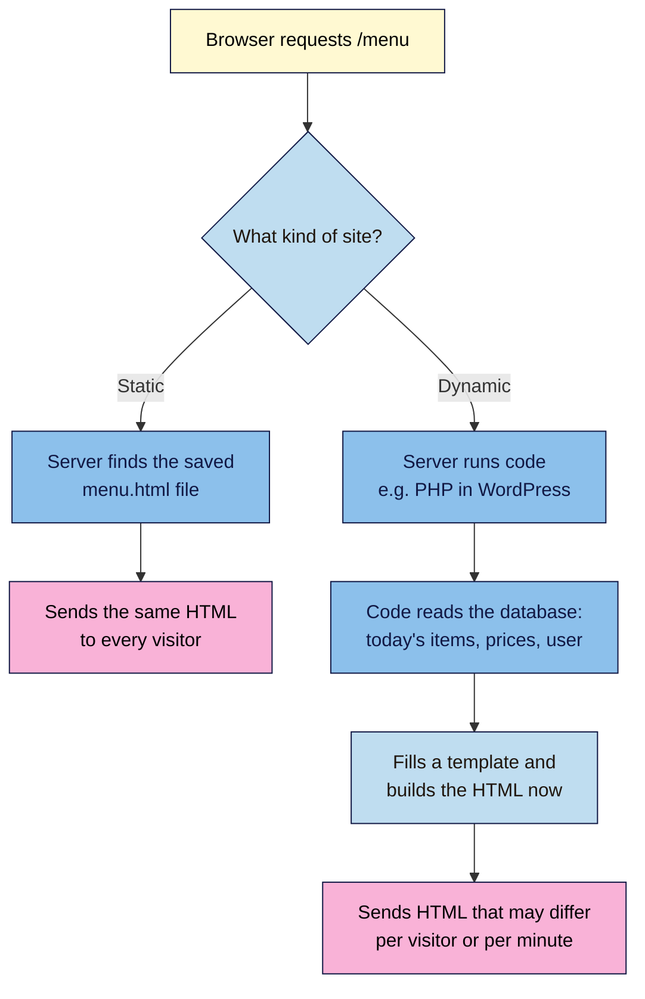

# M01.L04 — Static vs Dynamic, Code vs CMS vs No-Code
> After this lesson you can tell a static page from a dynamic one, compare hand-coding, WordPress and no-code builders for a real brief, and work out what any website is built with.

**Time:** ~16 min reading + ~20 min exercise · **Level:** L1 Foundation (beginner) · **Prereqs:** M01.L03 · **Remediate to:** M01.L03
**Verified against:** MDN "What is a web server?" (static vs dynamic), W3Techs CMS usage statistics, and the source code of public WordPress, Shopify, Wix, Squarespace, Webflow and Framer sites, on 2026-11-02.

> Note: detection tools such as Wappalyzer, BuiltWith and WhatRuns change their free limits often (sources disagreed when this lesson was written), so the main method here needs no tool at all: view the source and look for clues. The extensions are optional extras.

> ⚠️ **Freshness flag:** builder prices, plans and market shares change several times a year. Shares below come from W3Techs (autumn 2026); prices are rough ranges. Check each vendor's pricing page before you choose.

## Learning objectives
1. **Explain** the difference between a static page and a dynamically generated page, with an example of each. *(O1)*
2. **Compare** hand-coded sites, a CMS (WordPress) and no-code builders (Wix, Squarespace, Webflow, Framer, Shopify) on cost, control, speed to launch and lock-in. *(O2)*
3. **Identify** what a site is built with, using clues in its source code and free detection tools. *(O3)*

## Why it matters
Tomás leads marketing at a language school in Lisbon. The agency quotes €8,000 for a custom-coded site; a freelancer offers a €900 Wix site; IT says "just use WordPress". All three are reasonable, and all three are wrong for *some* schools. The real question is: who will update it, how often, what must it do, and how hard is it to leave? Lesson 4.5 gives you a full decision checklist. This lesson gives you the model behind it, and the detective skill to see what your competitors chose.

## Core concept
**Plain version:** a **static** page is a finished file, the same for everyone, sent exactly as it was saved. A **dynamic** page is put together at the moment someone asks for it, usually by a program that reads a **database** and fills a template. Separately, there are three ways to *make* a site: write the code yourself, use a **CMS** (content management system) like WordPress, or use a **no-code builder** like Wix or Webflow, where hosting, editing and design come in one package.

**Analogy:** a static page is a printed leaflet: printed once, handed out unchanged. A dynamic page is a café barista: each order is made fresh from ingredients (the database) following a recipe (the template). A CMS is a franchise kitchen you run yourself; a no-code builder is a food court stall where the landlord supplies the kitchen, the sign and the rules.

**Precise definitions:**
- **Static site:** a set of HTML, CSS, JavaScript and image files served as they are. Fast, cheap, secure (nothing runs on the server), and perfect for static hosting (Lesson 1.3).
- **Dynamic site:** the server runs code (PHP, Python, Node.js…) to build each page, often from a database. Needed for logins, shopping carts, search results, or many authors editing content in a browser.
- **Database:** an organised store of content and data (posts, products, users) that a dynamic site reads from and writes to.
- **CMS (content management system):** software that lets non-developers create and edit content in a browser while the system builds the pages. WordPress powers roughly **40% of all websites** (W3Techs, autumn 2026), though its share has slipped since mid-2025 as Shopify, Wix and others grew.
- **No-code / website builder:** a hosted service combining a visual editor, templates, hosting and often a CMS. Wix and Squarespace focus on ease; Webflow and Framer on design control; Shopify on online stores.
- **Lock-in:** how hard it is to move your site elsewhere. Builders vary: some export only some content, some let you export HTML/CSS but not their CMS features, some offer no code export at all.

> **The line is blurry, on purpose.** Many modern sites are *static pages built automatically from a CMS* (static site generators like Astro or Eleventy, Module 8), or static pages that fetch dynamic bits with JavaScript (a form service, a reviews widget). What matters for you is: who edits it, what has to run on a server, and how to leave.

### Code vs CMS vs no-code at a glance
| | **Hand-coded** (this course) | **CMS: WordPress** | **Builders: Wix, Squarespace** | **Design builders: Webflow, Framer** | **Shopify** |
|---|---|---|---|---|---|
| **Typical cost** | Free hosting (static) + domain | Hosting ≈ $3–35 / ₹200–3,000 a month + domain | ≈ $15–40 a month | ≈ $15–40+ a month per site | ≈ $30+ a month + transaction fees |
| **Speed to first page** | Hours (once you've learnt it) | Hours | Minutes | Hours | Hours |
| **Who can edit** | People who can edit code (or via a CMS added later) | Anyone with a login | Anyone with a login | Designers; editors via its CMS | Anyone with a login |
| **Design control** | Total | High (themes, blocks) | Medium (inside templates) | High (visual, pixel-level) | Medium (themes) |
| **Speed & weight** | Can be the fastest | Depends on theme and plugins | Often heavy | Usually good | Usually good |
| **Lock-in / export** | None: they're your files | Low: full export, any host | High: limited export | Medium: code export on some plans, CMS features don't come with it | Medium: product/customer CSV exports |
| **Best for** | Launch pages, portfolios, learning how the web really works | Blogs, content sites, many authors | Small businesses wanting zero tech | Brand and marketing sites with a design team | Online stores |

## How it works

**In words:** for a static site, the server's job is simple: find the file, send it. For a dynamic site, the server runs a program that reads the database, fills a template, and builds the HTML on the spot. That's more powerful (logins, carts, live prices) but slower and with more to maintain and secure. Caching (Lesson 1.3) often saves a copy of a dynamic page so the next visitor gets it as fast as a static one. From the browser's side, both arrive as HTML. That's why you need clues to tell them apart.

## Hands-on walkthrough

Zero install. Desktop is easier because you'll use **View Source** (Ctrl+U; on a Mac Cmd+Option+U in Chrome/Edge or Cmd+U in Firefox, Lesson 1.1) and **Find** (Ctrl+F / Cmd+F).

**Part A: static or dynamic? (5 min)**
Sort these six pages in your notes as **Static**, **Dynamic** or **Static + dynamic parts**, with a one-line reason:
1. A one-page wedding photographer portfolio that changes twice a year
2. Your bank's account balance page after you log in
3. An online shop's search results for "blue trainers"
4. A launch page with a sign-up form sent to Formspree
5. A news homepage that shows the latest stories every few minutes
6. The first website, `info.cern.ch`

**Expected output:** 1 Static · 2 Dynamic (different for every user) · 3 Dynamic (built from a product database per search) · 4 Static + dynamic parts (the page is static; the form service runs elsewhere) · 5 Dynamic (or cached dynamic) · 6 Static.

**Part B: be a website detective (10 min)**
1. Open a brand site you know. Press **Ctrl+U** (Mac: **Cmd+Option+U** in Chrome/Edge, **Cmd+U** in Firefox) to view its source.
2. Press **Ctrl+F** / **Cmd+F** and search for each clue below, one at a time.

   | Search the source for… | Strongly suggests |
   |---|---|
   | `/wp-content/` or `wp-json` | WordPress |
   | `cdn.shopify.com` or `Shopify.theme` | Shopify |
   | `wixstatic.com` or `wix.com` | Wix |
   | `squarespace` (e.g. `static1.squarespace.com`) | Squarespace |
   | `data-wf-site` or `data-wf-page` | Webflow |
   | `framerusercontent.com` | Framer |
   | `name="generator"` | Many CMSs announce themselves here, e.g. `content="WordPress 7.1"` or `content="Ghost 6.x"` |
   | `/_next/` | A custom site built with Next.js (a developer framework, Module 8) |

   **Expected:** for most brand sites, one clue gets many matches. Write down your verdict and the clue that proved it, e.g. "WordPress: 214 matches for `/wp-content/`".
   > 🖼️ **Image prompt:** Desktop screenshot (1440×900) of Chrome's view-source page for a WordPress site with the find bar open, searching for `/wp-content/`, showing the match count (e.g. "1/214") and several highlighted matches in the code. Highlight the find bar and match count with a 3px #F9B2D7 outline; blur any personal details.
   > **Alt text:** View-source page with the browser's find bar showing many matches for /wp-content/, proving the site runs WordPress.
3. Repeat for two more brand sites, ideally different kinds: a blog or news site, a shop, a design-led startup.
4. If no clue matches, write "Custom or unknown". Large brands often build their own, or hide the clues. That's a valid answer.
5. *(Optional)* Install a free detection extension such as **Wappalyzer** or **WhatRuns**, or use **BuiltWith**'s free lookup at `https://builtwith.com`, and compare its verdict with yours.
   **Expected:** the tools usually agree with your source-code clues, and list extras such as analytics, fonts and a CDN. Free limits change, so if a tool asks you to pay or sign up, your manual verdict is enough.

**Part C: match a brief to an approach (5 min)**
Read this brief and pick an approach from the table, with two reasons and one trade-off:
> *A yoga teacher in Nairobi wants a 4-page site (home, classes, about, contact) she can update herself every week, prices in KSh, a booking link, and a budget under $20 a month. She never wants to see code.*

**Expected output (one reasonable answer):** "Squarespace or Wix: she can edit it herself with no code, and it's inside her budget. Trade-off: limited export if she outgrows it." WordPress on managed hosting is also defensible if she's willing to learn its dashboard. Hand-coding is the weakest fit, because she'd need help for every weekly change.

## When to use / when not to
- **Hand-code** a page when it's small, changes rarely, must be very fast, or when you want to *understand* the web (which is why this course does). **Trade-off:** every edit needs someone comfortable with code, unless you later add a CMS.
- **Use a CMS (WordPress)** when lots of content changes often, several people publish, or you need plugins (SEO, forms, memberships). **Trade-off:** updates, backups and security are your job (WordPress 101 covers all three).
- **Use a builder** when speed to launch and zero maintenance matter more than control or portability. **Trade-off:** monthly fees forever and the hardest exit.
- **Use Shopify** (or a similar commerce platform) when selling products is the main job. Don't hand-build a shop.

## Use AI for this
**Example prompt:**
> "Here is a website's HTML source (first 200 lines): [paste]. What CMS, website builder or framework does it most likely use? Quote the exact lines that are your evidence. If the evidence is weak, say 'unknown'."

**What AI does well here:** spotting patterns in a wall of code quickly, and explaining what a clue means.
**Where it gets it wrong:** it guesses confidently from weak evidence (one Google Fonts link "proves" nothing), and it may claim a builder "can't export" or "costs $X" based on old information.
**How to check:** ask for the exact evidence lines and search for them yourself with Ctrl+F (Part B). For prices and export features, check the vendor's own pricing and help pages.

## Common mistakes
- **Choosing on day-one price only.** A $0 setup that needs a paid developer for every change can cost more than a $25-a-month builder within months.
- **Ignoring the exit.** Ask "how would we move away?" *before* building. Lock-in is cheap to avoid at the start and expensive later.
- **Using a CMS for a page that never changes,** then paying for hosting, updates and security on something that could be three static files.
- **Thinking "static" means "no interactivity".** Static pages can run JavaScript, accordions, animations and forms through outside services (Module 5).
- **Trusting a single detection clue.** A site can load a WordPress-hosted image without being WordPress. Look for several matching clues.

## Troubleshooting
| Symptom | Likely cause | Fix |
|---|---|---|
| View source shows very little HTML, mostly `<script>` tags | The page is built in the browser by JavaScript (common with app-like sites) | Look for framework clues (`/_next/`, `framerusercontent.com`) or use a detection extension |
| Ctrl+F finds nothing for any clue | Custom-built site, clues removed, or you searched the live page instead of the source | Make sure you're in the `view-source:` tab; otherwise record "custom or unknown" |
| Detection tools disagree with each other | Sites use several services (e.g. a WordPress blog on a Shopify store) | Note both; check which domain or subdomain each one runs on |
| A detection extension asks you to pay | Free limits were reached or changed | Use the manual method in Part B |
| View Source is blocked on a school or work computer | Admin policy disables developer features | Try your own device, or prefix the address with `view-source:` (e.g. `view-source:https://info.cern.ch`) |

## Exercise
**Task:** for your **capstone brand site** (from Lesson 1.1), find out:
1. Is it built on a CMS, a builder, or custom code? Name it, and give the evidence (clue + match count).
2. Is the homepage mostly static, dynamic, or static with dynamic parts? One-sentence reason.
3. For **your own launch page** (from your project note), pick an approach from the comparison table and write two reasons and one trade-off.

**Expected outcome:** three short answers, for example: "1) Shopify: 96 matches for `cdn.shopify.com`. 2) Dynamic: the cart count and prices come from Shopify's database. 3) Hand-coded on static hosting: it's one page, I want to learn, and it's free. Trade-off: I'll need to edit code for every change."
**Stretch goal:** check three competitors in your own industry and count which approach is most common. Does it match the W3Techs picture, or is your industry different?

## Key takeaways
- **Static** = the same saved file for everyone. **Dynamic** = built per request from code and a database. Many sites mix both.
- Hand-code for small, fast, rarely changing pages; CMS for content-heavy, often-updated sites; builders for speed and zero maintenance; Shopify for stores.
- The two questions that decide it: **who edits, how often?** and **how hard is it to leave?**
- WordPress runs about 40% of the web, but builders are growing. Pick by brief, not popularity.
- You can identify most sites' platforms from clues in their source code, no tool needed.

## Teach it back
Explain to a friend in 3 sentences the difference between a static and a dynamic page, and why a small business might choose a website builder even though it's harder to leave.

## Glossary terms added
- Static site — added to `webdev-101/glossary.md`
- Dynamic site — added to `webdev-101/glossary.md`
- Database — added to `webdev-101/glossary.md`
- CMS (content management system) — added to `webdev-101/glossary.md`
- No-code / website builder — added to `webdev-101/glossary.md`
- Template — added to `webdev-101/glossary.md`
- Lock-in — added to `webdev-101/glossary.md`
- Framework — added to `webdev-101/glossary.md`
- View source — added to `webdev-101/glossary.md`
- Generator meta tag — added to `webdev-101/glossary.md`

## Further reading
*All checked 2026-11-02.*
- MDN — What is a web server? (static vs dynamic): https://developer.mozilla.org/en-US/docs/Learn_web_development/Howto/Web_mechanics/What_is_a_web_server
- W3Techs — Usage statistics of content management systems: https://w3techs.com/technologies/overview/content_management
- WordPress.org — About WordPress: https://wordpress.org/about/
- Wappalyzer (free browser extension; limits change): https://www.wappalyzer.com/
- BuiltWith free lookup: https://builtwith.com/
- *Bridge:* WordPress 101 for Content Creators, M01.L01 (choosing a platform), in this repo: `wordpress-101/lessons/m01-l01-choose-your-platform.md`

## Refresher card
*Used by remediation when a learner fails a quiz twice on a later lesson that points back here.*
**Static** = saved files, same for everyone, served as-is (fast, cheap, secure). **Dynamic** = server code + database build each page (logins, carts, search). **Hand-code** small, fast, rarely changing pages; **CMS (WordPress)** for frequent content and many editors; **builders (Wix, Squarespace, Webflow, Framer)** for speed and no maintenance, with more lock-in; **Shopify** for stores. Ask: who edits, how often, and how do we leave? Identify a site by searching its source for clues (`/wp-content/`, `cdn.shopify.com`, `wixstatic.com`, `data-wf-site`).
