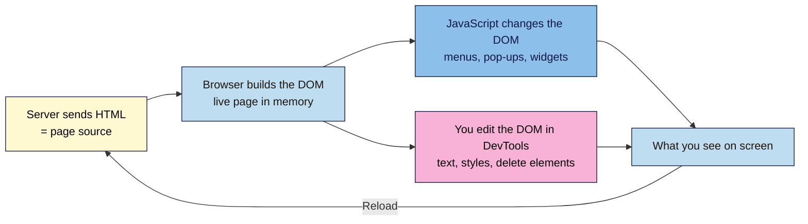

# M01.L05 — Your First Look at DevTools
> After this lesson you can open your browser's developer tools, inspect and live-edit any page's text and styles, explain the difference between page source and the live page, and measure how heavy a page is.

**Time:** ~15 min reading + ~30 min exercise · **Level:** L1 Foundation (beginner) · **Prereqs:** M01.L01 · **Remediate to:** M01.L01
**Verified against:** Chrome for Developers DevTools docs ("Open Chrome DevTools", "Network panel"), MDN "What are browser developer tools?", on 2026-11-02. Steps written for current desktop Chrome and Edge (same DevTools); Firefox and Safari differences are noted.

> Note: DevTools needs a laptop or desktop. On a phone you can still read along, but Parts A–E need a larger screen with a keyboard.

## Learning objectives
1. **Open** DevTools and use the **Elements** panel to inspect and live-edit a page's text and styles. *(O1)*
2. **Explain** how **View Source** (what the server sent) differs from the **live DOM** (what the browser is showing now). *(O2)*
3. **Use** the **Network** panel to find a page's number of requests, transfer size and largest file. *(O3)*

## Why it matters
Nadia manages a campaign landing page built by an agency. The client wants to see the headline "a bit shorter" and the button "more orange" before paying for changes. Nadia opens DevTools, types the new headline and colour straight into the live page, and screenshots three options in ten minutes. No ticket, no waiting. The same afternoon she spots, in the Network panel, that the hero image is a 6 MB file. That one finding later cuts load time in half. DevTools is the marketer's X-ray: it shows how any page is built, lets you try changes safely, and gives you numbers to take to a developer.

## Core concept
**Plain version:** every desktop browser has a hidden toolbox called **DevTools**. It shows the page's code and lets you change it, but only in *your* browser and only until you reload. Nothing you do in DevTools changes the real website.

**Analogy:** the website is a printed brochure the server mails you (Lesson 1.1). DevTools gives you a pencil and tracing paper over your own copy: you can scribble, rearrange and measure, but the printer's original never changes, and a fresh copy arrives every time you reload.

**Precise definitions:**
- **DevTools (developer tools):** panels built into Chrome, Edge, Firefox and Safari for inspecting and debugging pages. Chrome and Edge share the same DevTools because both use the Blink engine.
- **DOM (Document Object Model):** the browser's live, in-memory version of the page, built from the HTML and then changed by JavaScript and by you. The **Elements** panel (Firefox: **Inspector**) shows the DOM.
- **Page source:** the original HTML exactly as the server sent it (View Source, Ctrl+U). It doesn't change after it arrives.
- **Elements panel:** the page's DOM as a tree of elements, plus a **Styles** pane showing the CSS rules for the selected element.
- **Network panel:** a log of every request the page makes (Lesson 1.3), with status, type, size and timing.
- **Console panel:** where the browser reports errors and where you can run JavaScript. You'll use it properly in Lesson 5.1.
- **Transferred vs resources:** *transferred* is how much data actually came over the network (often compressed); *resources* is the full, uncompressed size of the files.

### Open DevTools
| Do this | Windows / Linux | Mac |
|---|---|---|
| Open DevTools (last panel used) | **F12** or **Ctrl+Shift+I** | **Cmd+Option+I** |
| Inspect one element | Right-click it → **Inspect**, or **Ctrl+Shift+C** then click | Right-click → **Inspect**, or **Cmd+Shift+C** then click |
| Open the Console | **Ctrl+Shift+J** | **Cmd+Option+J** |
| View page source | **Ctrl+U** | **Cmd+Option+U** (Chrome/Edge) · **Cmd+U** (Firefox) |

**Safari:** first turn on Safari → Settings → Advanced → **Show features for web developers**. Then use **Cmd+Option+I**.

## How it works

**In words:** the server's HTML is the starting point. The browser turns it into the DOM, the live page. Scripts on the page and your DevTools edits both change the DOM, never the server's file. Reloading throws the DOM away, asks the server again, and builds a fresh one. That's why your edits vanish on reload, and why View Source sometimes shows less than you see on screen.

## Hands-on walkthrough

Use desktop Chrome or Edge. Pick a brand site with a clear headline and a button, ideally your capstone brand site from Lesson 1.1.

**Part A: inspect and edit text (6 min)**
1. Right-click the main headline and choose **Inspect**.
   **Expected:** DevTools opens with the **Elements** panel, and the headline's element (often an `<h1>`) is highlighted in the tree. Hovering over lines in the tree highlights the matching parts of the page.
2. Double-click the headline **text** inside the element in the Elements panel, type a new headline, and press **Enter**.
   **Expected:** the headline on the page changes instantly.
   > 🖼️ **Image prompt:** Desktop screenshot (1440×900) of a brand homepage with Chrome DevTools docked on the right, Elements panel open, an `<h1>` element selected with its text being edited, and the changed headline visible on the page. Outline the edited text in the Elements tree and the headline on the page. Highlight the key element with a 3px #F9B2D7 outline; blur any personal details.
   > **Alt text:** Chrome DevTools Elements panel with an h1 headline being edited, and the new headline shown live on the page.
3. Edit one more piece of text, such as a button label or a price.

**Part B: edit a style (6 min)**
1. Right-click the main button (for example "Shop now" or "Sign up") → **Inspect**.
2. In the **Styles** pane (usually right of or below the tree), find a rule containing `background-color` or `background`. Click its value and type a new colour, such as `orange` or `#e85d04`, then press **Enter**.
   **Expected:** the button changes colour. If the value has a small coloured square next to it, clicking the square opens a colour picker. That picker also shows a **contrast ratio** for text colours, which you'll use in Lesson 3.2.
3. Find `font-size` on the headline (or add it: click inside the rule's braces and type `font-size: 24px`).
   **Expected:** the headline resizes.
4. Take a screenshot of your "redesign".

**Part C: source vs live page (5 min)**
1. Press **Ctrl+U** (Mac: **Cmd+Option+U** in Chrome/Edge, **Cmd+U** in Firefox) to open View Source in a new tab. Press **Ctrl+F** / **Cmd+F** and search for the *new* headline you typed in Part A.
   **Expected:** **no match.** The source is what the server sent; your edit only exists in the DOM.
2. Search the source for the *original* headline.
   **Expected:** it's there (unless the site builds its content with JavaScript, in which case it may be missing from the source too. That's the "mostly `<script>` tags" case from Lesson 1.4).
3. Go back to the page tab and reload it (**Ctrl+R** / **Cmd+R**).
   **Expected:** your headline, button colour and font size are all gone. The browser fetched the original again.

**Part D: measure the page's weight (8 min)**
1. Open the **Network** panel. Tick **Disable cache**. Reload the page.
2. Read the **summary bar** at the bottom.
   **Expected:** something like `112 requests | 2.4 MB transferred | 6.8 MB resources | Finish: 3.1 s`. Write down the requests, transferred size and finish time.
3. Click the **Size** column header to sort by size (click again to sort largest first).
   **Expected:** the biggest files rise to the top. On many brand sites the largest is a hero image, a video or a big JavaScript file.
   > 🖼️ **Image prompt:** Desktop screenshot (1440×900) of the Chrome DevTools Network panel for a brand homepage, sorted by Size with the largest file (a hero image) at the top, Disable cache ticked, and the summary bar showing requests, transferred and resources. Outline the top row and the summary bar. Highlight the key element with a 3px #F9B2D7 outline; blur any personal details.
   > **Alt text:** Network panel sorted by size, with the largest file at the top and the total requests and transferred size highlighted.
4. Click the **Img** filter (in the filter bar above the list) to show only images, then **All** to show everything again.
5. Click the largest file's name. In the panel that opens, check **Headers** → **Request URL** and **content-type**, and **Preview** to see it.
   **Expected:** you can name the largest file and its type (e.g. "hero.jpg, image/jpeg, 1.8 MB"). Anything over about 500 KB for one image is worth a question to the developer (Module 7 shows how to fix it).

**Part E: break it and fix it (5 min)**
1. Back in **Elements**, select a big section, such as the hero banner or the navigation (click its line in the tree so it's highlighted).
2. Press **Delete**.
   **Expected:** the section vanishes from the page and the layout may shift or break.
3. Press **Ctrl+Z** / **Cmd+Z** while the Elements panel is focused.
   **Expected:** the section comes back (undo). If it doesn't, reload: the original page always returns.
4. In your notes, answer: "Why does reloading always fix anything I break in DevTools?" (Answer: edits change only my browser's DOM; reload fetches the server's original HTML and rebuilds it.)

## When to use / when not to
- **Use DevTools edits** to try headline, colour and spacing ideas, to make quick mock-ups for discussion, and to show a developer *exactly* which element you mean ("the `<button>` with class `cta-primary`").
- **Use the Network panel** to get hard numbers (page weight, largest file, broken requests) before asking for changes.
- **Don't** treat a DevTools edit as a fix. It disappears on reload and nobody else sees it. Real changes go into the site's files or CMS (Module 4 onwards). **Trade-off:** instant and risk-free, but nothing is saved.
- **Don't** use edited screenshots as evidence or to mislead: anyone can fake a price, a review or a follower count this way. Label mock-ups as mock-ups.

## Use AI for this
**Example prompt:**
> "I copied this from the Chrome DevTools Network panel for my landing page: [paste the summary bar and the top 10 rows sorted by size: name, type, size, time]. In plain language, what are the three biggest problems for load speed, and what should I ask my developer to change? Don't assume anything not in the data."

**What AI does well here:** turning raw numbers into a short, prioritised list, and explaining file types you don't recognise.
**Where it gets it wrong:** it may invent fixes for your platform it can't see, or confuse *transferred* with *resources* size. It can also suggest DevTools menu paths that have moved in newer browser versions.
**How to check:** confirm each claim against the actual row in the Network panel (size, type, URL). For menu paths, use Chrome's own DevTools docs (Further reading).

## Common mistakes
- **Thinking a DevTools edit changed the live site.** It changed only your copy. Reload proves it.
- **Measuring weight with the cache on.** Repeat visits load from cache and look tiny. Tick **Disable cache** for a first-visit measurement.
- **Opening DevTools after the page loaded,** then finding the Network panel empty. Open it first, then reload.
- **Comparing *resources* with another site's *transferred*.** Compare like with like; *transferred* is what visitors actually download.
- **Forgetting that DevTools is docked and squashing the page.** A narrow window can trigger the mobile layout. Undock DevTools (⋮ → **Dock side**) or make it smaller when you judge the design.

## Troubleshooting
| Symptom | Likely cause | Fix |
|---|---|---|
| Nothing happens when you press F12 | Laptop function keys need **Fn**, or a policy blocks DevTools | Try **Fn+F12**, **Ctrl+Shift+I** / **Cmd+Option+I**, or the browser menu → **More tools** → **Developer tools** |
| Double-clicking text in Elements doesn't let you edit | You double-clicked the tag name, not the text | Expand the element (▶) and double-click the text node, or right-click → **Edit as HTML** |
| Your style change has no effect | Another rule overrides it (it appears crossed out), or you edited the wrong element | Make sure the right element is selected; add the rule in **element.style** at the top of the Styles pane |
| The page reloads by itself and your edits vanish | The site refreshes or rebuilds parts with JavaScript | Edit, screenshot quickly, or try another page |
| Inspect is missing from the right-click menu (Safari) | Developer features are off | Safari → Settings → Advanced → **Show features for web developers** |
| The summary bar shows no "resources" figure | Older browser version or a narrow DevTools window | Widen DevTools; use the *transferred* figure, which is the one that matters most |

## Exercise
**Task:** for your **capstone brand site** (from Lesson 1.1), produce a "DevTools evidence pack" in your notes:
1. A screenshot of the homepage with your own headline and CTA colour, labelled "Mock-up, not the live site".
2. The homepage's **requests**, **transferred size** and **finish time** (cache disabled).
3. The **three largest files**: name, type and size.
4. One sentence: what you'd ask the brand's developer to look at first, and why.

**Expected outcome:** a labelled mock-up screenshot, three numbers, a top-3 list and one sentence, for example: "Ask them to compress `hero-video.mp4` (4.2 MB), because it's over half the page's 7.8 MB transfer."
**Stretch goal:** open the **Device toolbar** (**Ctrl+Shift+M** / **Cmd+Shift+M**) and choose a phone size. Does the layout change? Measure the Network numbers again in phone view. Are they smaller, the same or bigger? (Module 3 and Module 7 explain why.)

## Key takeaways
- **DevTools** is built into every desktop browser: **F12**, **Ctrl+Shift+I** or **Cmd+Option+I**, or right-click → **Inspect**.
- **Elements** shows and edits the live **DOM**; edits are local and vanish on reload.
- **View Source** shows what the server sent; the **DOM** shows the page now, after JavaScript and your edits.
- **Network**, with cache disabled, gives you requests, transferred size and the largest files: hard numbers for conversations with developers.
- Use DevTools to explore and mock up, never as the fix itself, and never to fake evidence.

## Teach it back
Explain to a friend in 3 sentences why changing a headline in DevTools doesn't change the website for anyone else, and when it's still useful.

## Glossary terms added
- DevTools (developer tools) — added to `webdev-101/glossary.md`
- DOM (Document Object Model) — added to `webdev-101/glossary.md`
- Elements panel / Styles pane — added to `webdev-101/glossary.md`
- Network panel — added to `webdev-101/glossary.md`
- Console — added to `webdev-101/glossary.md`
- Transferred vs resources (page weight) — added to `webdev-101/glossary.md`
- Device toolbar — added to `webdev-101/glossary.md`

## Further reading
*All checked 2026-11-02.*
- Chrome for Developers — Open Chrome DevTools: https://developer.chrome.com/docs/devtools/open
- Chrome for Developers — Network panel overview: https://developer.chrome.com/docs/devtools/network/overview
- Chrome for Developers — Inspect network activity: https://developer.chrome.com/docs/devtools/network
- Chrome for Developers — DevTools home (Elements, Styles, Console guides): https://developer.chrome.com/docs/devtools/
- MDN — What are browser developer tools?: https://developer.mozilla.org/en-US/docs/Learn_web_development/Howto/Tools_and_setup/What_are_browser_developer_tools

## Refresher card
*Used by remediation when a learner fails a quiz twice on a later lesson that points back here.*
Open **DevTools** with F12 / Ctrl+Shift+I / Cmd+Option+I, or right-click → **Inspect**. **Elements** = the live **DOM**: double-click text to edit, change CSS in **Styles**; edits are local and reload resets them. **View Source** = the HTML the server sent; the DOM = the page now. **Network** (tick Disable cache, reload): bottom bar = requests + transferred size; sort by Size to find the largest file.
