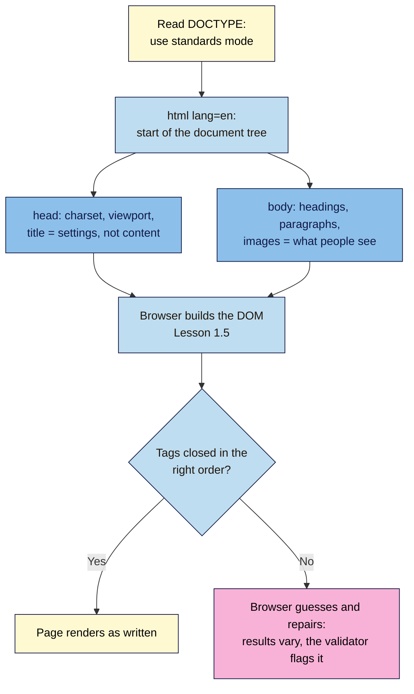

# M02.L01 — Anatomy of an HTML Page
> After this lesson you can write a complete, valid HTML page from a blank file, explain what every line of it does, and use the W3C validator to find and fix mistakes.

**Time:** ~16 min reading + ~25 min exercise · **Level:** L1 Foundation (beginner) · **Prereqs:** M01.L01, M01.L05 · **Remediate to:** M01.L05
**Verified against:** MDN "Basic HTML syntax", the W3C Nu HTML Checker (live checks of this lesson's examples) and CodePen's preview-document docs, on 2026-11-02.

> Note: CodePen's HTML panel only fills the page's `<body>`. CodePen writes the doctype and `<head>` for you. So Part A uses CodePen for a quick first win, and Part B writes the *whole* page in your computer's built-in text editor (Notepad or TextEdit), which needs no installs. VS Code arrives in Module 4.

## Learning objectives
1. **Build** a valid HTML page with `<!DOCTYPE html>`, `<html lang>`, a `<head>` (charset, viewport, title) and a `<body>`. *(O1)*
2. **Explain** elements, tags, attributes and nesting, and recognise empty (void) elements. *(O2)*
3. **Validate** a page with the W3C Nu HTML Checker and fix the errors it reports. *(O3)*

## Why it matters
Kofi copies a landing page template from a blog post into his email tool's "custom HTML" box. On his laptop it looks fine. On phones the text is tiny, the price shows as `₹499` instead of `₹499`, and the browser tab says "Untitled". Three missing lines cause all three problems: the viewport tag, the character set and the title. HTML is forgiving (you saw that in Lesson 1.1), so mistakes hide until a different browser, device or tool shows them. A page that starts from a correct skeleton and passes the validator avoids a whole class of "it works for me" problems before they cost you clicks.

## Core concept
**Plain version:** an HTML page is text with labels around each piece of content. The labels are **tags**: `<h1>` says "this is the main heading", `<p>` says "this is a paragraph". Every page has the same skeleton: a line saying "this is modern HTML", then a **head** (information *about* the page) and a **body** (the content people see).

**Analogy:** think of a parcel. The **head** is the shipping label: who it's for, what language it's in, how to handle it. Nobody reads it as content, but the delivery fails without it. The **body** is what's inside the box. **Tags** are the dividers and labels inside the box, and boxes can sit inside other boxes, which is **nesting**.

### The parts of an element
```html
<a href="https://nilacoffee.example/subscribe" class="cta">Start my subscription</a>
```
| Part | In the example | What it does |
|---|---|---|
| **Start tag** | `<a …>` | Opens the element and names it (`a` = link) |
| **Attribute** | `href="https://…"`, `class="cta"` | Extra information as `name="value"`; always in the start tag |
| **Content** | `Start my subscription` | What the element contains: text and/or other elements |
| **End tag** | `</a>` | Closes the element; same name with a `/` |
| **Element** | the whole thing | Start tag + content + end tag |

**Void (empty) elements** have no content and no end tag: `<meta>`, `<link>`, ``, `<br>`, `<hr>`, `<input>`. You may see them written `` in older code; in HTML the `/` is optional and does nothing.

**Nesting:** elements go inside each other like boxes, and **the last one opened is the first one closed**:
- ✅ `<p>Launching <strong>soon</strong>.</p>`
- ❌ `<p>Launching <strong>soon.</p></strong>`. The boxes cross over, so the browser has to guess.

### The skeleton, line by line
```html
<!DOCTYPE html>
<html lang="en">
  <head>
    <meta charset="utf-8">
    <meta name="viewport" content="width=device-width, initial-scale=1">
    <title>Nila Coffee — Fresh beans every month</title>
  </head>
  <body>
    <h1>Nila Coffee</h1>
    <p>Freshly roasted beans, delivered every month. <strong>Launching soon.</strong></p>
    <p>Prices from ₹499 / $6 a month.</p>
  </body>
</html>
```
| Line | Why it's there | What breaks without it |
|---|---|---|
| `<!DOCTYPE html>` | Tells the browser "modern HTML, use standards mode" | The browser falls back to old "quirks mode", and layouts behave strangely |
| `<html lang="en">` | Wraps everything; `lang` names the page's language (`en`, `hi`, `pt-BR`, `sw`…) | Screen readers may read with the wrong accent, and translation tools guess the language |
| `<head>` … `</head>` | Information about the page, not shown on it | — |
| `<meta charset="utf-8">` | Text encoding that covers every language and symbol (₹, ₦, €, é, 中) | Symbols turn into nonsense like `₹` |
| `<meta name="viewport" …>` | Tells phones to use the real screen width | Phones show a zoomed-out desktop page with tiny text |
| `<title>` | The text in the browser tab, bookmarks and usually search results | The tab shows the file name or "Untitled"; the validator reports an error |
| `<body>` … `</body>` | Everything visitors see | — |

**House style for this course:** lowercase tag and attribute names, always quote attribute values (`class="cta"`, not `class=cta`), and indent nested elements by two spaces. Browsers don't need indentation; humans do. Notes for yourself go in **comments**, which browsers ignore: `<!-- hero section starts here -->`.

## How it works



**In words:** the doctype switches on standards mode. The `html` element becomes the root of the DOM tree you met in DevTools. The head sets things up (encoding, mobile width, title), and the body holds the content. When the tags are written correctly, the page renders as you wrote it. When they aren't, the browser silently repairs them, and different tools may repair them differently. The validator tells you exactly where.

## Hands-on walkthrough

**Part A: your first pen (5 min, works on a phone)**
1. Open **https://codepen.io/pen/**. You can type without an account. A free account lets you **Save**.
2. In the **HTML** panel, type:
   ```html
   <h1>Nila Coffee</h1>
   <p>Freshly roasted beans, delivered every month.</p>
   ```
   **Expected:** the preview below (or beside) the editor shows a large heading and a paragraph, updating as you type.
   > 🖼️ **Image prompt:** Desktop screenshot (1440×900) of a new CodePen pen with the two lines of HTML in the HTML panel and the preview showing "Nila Coffee" as a large heading and one paragraph. Outline the HTML panel and the preview. Highlight the key element with a 3px #F9B2D7 outline; blur any personal details.
   > **Alt text:** CodePen editor with an h1 and a paragraph in the HTML panel and the rendered heading in the preview.
3. Notice you didn't write `<!DOCTYPE>`, `<head>` or `<body>`. CodePen adds them behind the scenes (in **Settings → HTML → Stuff for &lt;head&gt;** you'd add head tags). That's convenient for practice, but a real site needs you to write them, which you'll do next.

**Part B: a whole page in a plain text editor (10 min, laptop or desktop)**
1. Make a folder called `webdev-101` on your computer (Desktop or Documents).
2. Open your built-in plain text editor:
   - **Windows:** Notepad.
   - **Mac:** TextEdit, then **Format → Make Plain Text** (important: rich text adds hidden formatting).
   - **Linux / ChromeOS:** any text editor (e.g. Text Editor, or the Text app on ChromeOS).
3. Type (or copy) the skeleton from **The skeleton, line by line** above. Change the title, heading and paragraph to Nila Coffee or your own brand.
4. **Save as** `index.html` inside `webdev-101`. In Notepad, set **Save as type** to **All files** and **Encoding** to **UTF-8**. In TextEdit, if asked, choose **Use .html**.
   **Expected:** a file called `index.html` (not `index.html.txt`) with a browser icon.
5. Double-click the file.
   **Expected:** it opens in your browser. The address bar starts with `file:///…/webdev-101/index.html`, the **tab shows your `<title>`**, the heading and paragraphs appear, and `₹` shows correctly. This page has no server, so it's on your computer only (Module 4 publishes it).
6. Press **F12** and look at the **Elements** panel (Lesson 1.5).
   **Expected:** the same tree you wrote: `html` › `head` and `body`, with your elements nested inside.

**Part C: validate, break it and fix it (10 min, any device)**
1. Open the **W3C Nu HTML Checker** text box: **https://validator.w3.org/nu/#textarea**.
2. Paste your whole page and click **Check**.
   **Expected:** a message that the document checking is complete with **no errors or warnings to show**. If you see messages, fix them using the table in step 4.
3. Now paste this broken version and click **Check**:
   ```html
   <!DOCTYPE html>
   <html>
     <head>
       <meta charset="utf-8">
     </head>
     <body>
       <h1>Nila Coffee</h1>
       <p>Freshly roasted beans. <strong>Launching soon.</p></strong>
       
     </body>
   </html>
   ```
   **Expected:** five **errors** and one **warning** (checked on 2026-11-02), each with a line number:
   > 🖼️ **Image prompt:** Desktop screenshot (1440×900) of the W3C Nu HTML Checker results page after checking the broken example, showing the red "Error" entries (missing title, end tag p, unclosed strong, missing alt) and the "Warning" about the lang attribute, each with its highlighted code extract. Outline the first error and the lang warning. Highlight the key element with a 3px #F9B2D7 outline; blur any personal details.
   > **Alt text:** W3C validator results listing five errors and one warning for the broken Nila Coffee page.
4. Match each message to its fix:

   | The checker says | What it means | Fix |
   |---|---|---|
   | Element "head" is missing a required instance of child element "title". | Every page needs a `<title>` | Add `<title>Nila Coffee</title>` inside `<head>` |
   | End tag "p" seen, but there were open elements. · Unclosed element "strong". · No "strong" element in scope but a "strong" end tag seen. | One nesting mistake creates **three** messages | Close in reverse order: `…<strong>Launching soon.</strong></p>` |
   | An "img" element must have an "alt" attribute… | Images need a text alternative | Add `alt="A handful of dark roasted coffee beans"` (Lesson 2.2 covers good alt text) |
   | Consider adding a "lang" attribute to the "html" start tag… | A warning, not an error, but this course treats it as required | `<html lang="en">` |
   | *(not reported: missing viewport)* | The validator doesn't check for it, but phones need it | Add the viewport `<meta>` anyway |
5. Fix all of them in the text box and check again.
   **Expected:** no errors or warnings. Note the lesson: **fix the first error first and re-check**, because one mistake can cause several messages.

**Part D: start your launch page (3 min)**
1. In your `webdev-101` folder, save a second file, `launch.html`, using the same skeleton.
2. Give it your launch page's real `<title>`, an `<h1>` with your brand or offer, and one `<p>` sentence. Use the right `lang` code for the page's language.
3. Validate it until it's clean.
   **Expected:** a valid `launch.html` that opens in your browser. Every lesson in this module adds to this file.

## When to use / when not to
- **Write the full skeleton** for any real page: your site, a landing page, a "custom HTML" email or page template.
- **Body-only snippets are fine** inside tools that supply their own head: CodePen, a WordPress Custom HTML block, an email builder's HTML block. Pasting a whole `<!DOCTYPE>…</html>` into those creates a page inside a page. **Trade-off:** snippets are quicker, but you rely on the tool's head (language, viewport, title). Check that it sets them.
- **Validate** before every launch and after big template changes. Don't chase perfection on pages you don't control: third-party embeds often produce warnings you can't fix.

## Use AI for this
**Example prompt:**
> "Write a minimal, valid HTML5 page for a coffee subscription launch, in English, with charset, viewport, a title under 60 characters, an h1 and two short paragraphs. Use lowercase tags, quoted attributes and 2-space indentation. No CSS or JavaScript. Then list each line of the head and say in one sentence why it's there."

**What AI does well here:** producing a clean skeleton fast and explaining each line in plain words.
**Where it gets it wrong:** it often adds outdated or pointless tags (`<meta http-equiv="X-UA-Compatible" content="IE=edge">` for long-dead Internet Explorer, `type="text/javascript"`), forgets `lang` or uses the wrong code, and sometimes "closes" void elements as `</img>`.
**How to check:** paste its output into the W3C Nu HTML Checker, and compare the head against the skeleton table above. Delete anything you can't explain.

## Common mistakes
- **Saving as `index.html.txt`.** Windows hides extensions by default, so the file looks right but opens as text. Choose **All files** in Notepad, or turn on **File name extensions** in File Explorer's **View** menu.
- **Using a word processor** (Word, Google Docs, TextEdit in rich-text mode). It adds hidden formatting and "smart quotes" (`“` instead of `"`) that break attributes.
- **Crossing nested tags** (`<b><i>…</b></i>`). Close the last-opened tag first.
- **Leaving out `lang`, charset or viewport** because "it looks fine on my laptop". They matter on other devices, in other languages and for screen readers.
- **Multiple `<title>` tags or none.** Exactly one, inside `<head>`.
- **Putting visible content in the `<head>`.** Browsers move it into the body, and the structure you think you wrote isn't the one you get.

## Troubleshooting
| Symptom | Likely cause | Fix |
|---|---|---|
| Double-clicking shows the code as plain text | The file is really `index.html.txt`, or TextEdit saved rich text | Show file extensions and rename; in TextEdit use **Format → Make Plain Text** before saving |
| TextEdit opens your `.html` file as a formatted page instead of code | TextEdit's default for HTML files | TextEdit → Settings → **Open and Save** → tick **Display HTML files as HTML code instead of formatted text** |
| `₹` or `é` shows as `₹` or `é` | Missing `<meta charset="utf-8">`, or the file wasn't saved as UTF-8 | Add the meta tag as the **first** line in `<head>`; save with **UTF-8** encoding |
| Browser tab shows `index.html` | No `<title>`, or it's outside `<head>` | Add one title inside `<head>` |
| Validator shows many errors from one line | One unclosed or crossed tag | Fix the first error, check again |
| Attribute values break strangely | Smart quotes `“ ”` from a word processor, or missing quotes | Retype them as straight quotes `" "` in a plain text editor |
| CodePen ignores your `<title>` | CodePen's HTML panel is the body only | Use **Settings → HTML → Stuff for &lt;head&gt;** in CodePen, or work in your own file (Part B) |

## Exercise
**Task:** create `about-me.html` (or `about-brand.html`) from a blank file **without copying**: type the skeleton from memory, then add an `<h1>`, two `<p>` paragraphs, one `<strong>` phrase and one link: `<a href="https://info.cern.ch">the first website</a>`. Validate it, then break it on purpose in two different ways (for example, cross two tags and delete the title), note the checker's exact messages, and fix them.
**Expected outcome:** a valid page that opens in your browser with your title in the tab, plus a note listing your two deliberate errors, the checker's message for each, and your fix.
**Stretch goal:** set `lang` to a second language you know (e.g. `hi`, `es`, `sw`), translate the paragraph, and ask your browser to translate the page. Then set `lang` to the wrong language and see whether the browser's translate offer changes.

## Key takeaways
- Every page = `<!DOCTYPE html>` + `<html lang>` + `<head>` (charset, viewport, title) + `<body>`.
- An **element** = start tag + content + end tag; **attributes** add `name="value"` information; **void** elements (`img`, `meta`, `input`…) have no end tag.
- Nest like boxes: **last opened, first closed**.
- Browsers repair broken HTML silently; the **W3C Nu HTML Checker** shows you where. Fix the first error first.
- Use a plain text editor and save as UTF-8 `.html`, never a word processor.

## Teach it back
Explain to a friend in 3 sentences what the `<head>` of a page is for, and name two things that go wrong on phones or in other languages if it's missing.

## Glossary terms added
- Tag (start tag, end tag) — added to `webdev-101/glossary.md`
- Element — added to `webdev-101/glossary.md`
- Attribute — added to `webdev-101/glossary.md`
- Void element — added to `webdev-101/glossary.md`
- Nesting — added to `webdev-101/glossary.md`
- Doctype / standards mode / quirks mode — added to `webdev-101/glossary.md`
- `<head>` and `<body>` — added to `webdev-101/glossary.md`
- `lang` attribute — added to `webdev-101/glossary.md`
- Character encoding (UTF-8) — added to `webdev-101/glossary.md`
- Viewport meta tag — added to `webdev-101/glossary.md`
- HTML comment — added to `webdev-101/glossary.md`
- Validator (W3C Nu HTML Checker) — added to `webdev-101/glossary.md`

## Further reading
*All checked 2026-11-02.*
- MDN — Basic HTML syntax: https://developer.mozilla.org/en-US/docs/Learn_web_development/Core/Structuring_content/Basic_HTML_syntax
- MDN — Structuring content with HTML (module): https://developer.mozilla.org/en-US/docs/Learn_web_development/Core/Structuring_content
- W3C Nu HTML Checker (paste-in text box): https://validator.w3.org/nu/#textarea
- WHATWG HTML Living Standard (the official HTML spec): https://html.spec.whatwg.org/
- CodePen docs — The Pen preview document (what CodePen adds for you): https://blog.codepen.io/documentation/preview-template/
- W3C — Language tags in HTML (choosing `lang` codes): https://www.w3.org/International/articles/language-tags/

## Refresher card
*Used by remediation when a learner fails a quiz twice on a later lesson that points back here.*
Skeleton: `<!DOCTYPE html>` → `<html lang="en">` → `<head>` with `<meta charset="utf-8">`, the viewport meta and one `<title>` → `<body>` with the content. Element = `<tag attribute="value">content</tag>`; void elements (`img`, `meta`, `input`, `br`, `link`, `hr`) have no end tag. Nest like boxes: last opened, first closed. Check at validator.w3.org/nu; fix the first error first. Plain text editor, UTF-8, `.html`.
