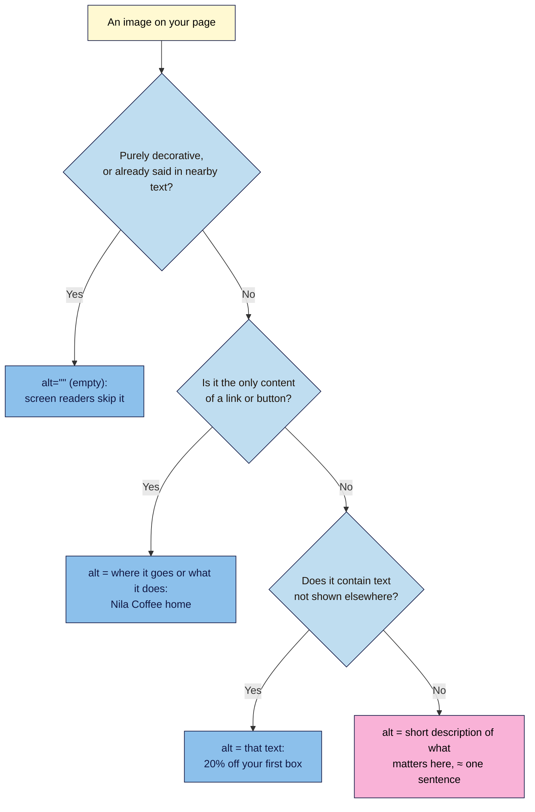

# M02.L02 — Text, Links, Images & Media
> After this lesson you can mark up real marketing copy (headings, lists, quotes), create every kind of link a campaign page needs, and add images and video that are accessible and don't break the layout.

**Time:** ~20 min reading + ~30 min exercise · **Level:** L1 Foundation (beginner) · **Prereqs:** M02.L01 · **Remediate to:** M02.L01
**Verified against:** MDN `<a>`, ``, `<video>` and "Creating links" pages, W3C WAI Images Tutorial and alt decision tree, Google Search Central "Qualify outbound links", YouTube Help (privacy-enhanced embeds), and a live W3C Nu HTML Checker run on this lesson's code, on 2026-11-02.

## Learning objectives
1. **Mark up** headings, paragraphs, lists, emphasis and quotes for real marketing copy. *(O1)*
2. **Create** links (absolute, relative, same-page, `mailto:`, `tel:`, new tab, sponsored) with descriptive link text. *(O2)*
3. **Add** images with useful `alt` text and `width`/`height`, and embed video accessibly. *(O3)*

## Why it matters
Sofia's skincare launch page has a "Click here" button, a hero image with `alt="IMG_4482.jpg"`, a YouTube demo that a screen reader announces only as "frame", and an affiliate link to a partner shop with no label. A blind customer can't tell where any link goes. On slow mobile connections the text jumps down when the hero image finally loads, and visitors tap the wrong button. Google's guidance says affiliate links should be marked as sponsored. None of this is visible in a quick look on Sofia's laptop. All of it is fixed with a few attributes, and that is what this lesson teaches.

## Core concept
**Plain version:** HTML has a tag for each *kind* of content. Use the tag that says what the content **is** (a list, a quote, a link), not what it should look like. Looks come from CSS in Module 3. Links and images need extra attributes that tell people and machines where a link goes and what an image shows.

**Analogy:** a well-marked-up page is like a well-labelled supermarket. Aisles (headings), shelves (lists) and price tags (attributes) let anyone find what they need, including someone who can't see the shelves and asks a helper to read the labels aloud. A screen reader is that helper.

### Text
| You want… | Use | Not |
|---|---|---|
| Main heading, then section headings | `<h1>` once, then `<h2>`, `<h3>`… (Lesson 2.3 goes deeper) | Bold `<p>` text that only *looks* like a heading |
| A paragraph | `<p>` | Lines split with `<br>` |
| Bullet points (order doesn't matter) | `<ul>` with `<li>` items | Typed "•" or "-" characters |
| Steps (order matters) | `<ol>` with `<li>` items | "1." typed by hand |
| Important words | `<strong>` | `<b>`, unless it's just visual |
| Stressed words ("*every* month") | `<em>` | `<i>`, unless it's a title or foreign word |
| A testimonial | `<figure>` with `<blockquote>` and `<figcaption>` | A paragraph in quote marks |
| A line break inside an address or poem | `<br>` | `<br><br>` for spacing (use CSS) |

### Links: `<a href="…">`
| Kind | Example | Use for |
|---|---|---|
| **Absolute** | `href="https://partner.example/beans"` | Other sites |
| **Root-relative** | `href="/pricing"` | Your own site, from the domain root (works once published, Module 4) |
| **Relative** | `href="about.html"`, `href="images/beans.jpg"` | Files next to or below this one, as on your computer now |
| **Same-page** | `href="#signup"` + `id="signup"` on the target | "Jump to sign-up" buttons, FAQ menus |
| **Email** | `href="mailto:hello@nilacoffee.example"` | Contact links (they open the visitor's email app) |
| **Phone** | `href="tel:+919876543210"` | Tap-to-call on phones; always use the international `+` format |
| **New tab** | `target="_blank"` | Only when leaving would lose the visitor's work (e.g. a help link inside a form). Modern browsers add `noopener` protection automatically; adding `rel="noopener"` also protects old browsers |
| **Sponsored / affiliate** | `rel="sponsored"` | Paid or affiliate links, as Google asks. `rel="nofollow"` is also accepted |

**Link text** should make sense on its own: "See subscription prices", not "Click here". Screen-reader users often jump from link to link and hear only the link text. Search engines also read it to understand the target page.

### Images: ``
```html

```
- **`src`:** where the file is (a relative path while you work locally).
- **`alt`:** the text alternative, read by screen readers and shown if the image fails to load. Write it for *this* page's purpose (see the flowchart below).
- **`width` and `height`:** the image's real pixel size. The browser reserves the space before the file arrives, so the text doesn't jump (that jump is "layout shift", measured in Module 7). CSS can still resize the image.
- **`loading="lazy"`:** for images further down the page, so they load only when the visitor scrolls near them. Don't lazy-load the hero image at the top.
- **`<figure>` + `<figcaption>`:** when the image needs a visible caption.

### Video and embeds
- **Your own file:** `<video controls width="1280" height="720" poster="images/video-cover.jpg">` with a `<source>` and a `<track kind="captions">` for captions. Always include `controls`. Autoplay only works when the video is `muted`, and visitors rarely like it.
- **YouTube / Vimeo:** paste the platform's `<iframe>` embed code, then **add a `title`** describing the video (otherwise screen readers announce just "frame") and `loading="lazy"`. YouTube offers a **privacy-enhanced mode**: an embed address on `www.youtube-nocookie.com`. YouTube says views of videos embedded this way aren't used to personalise the viewer's browsing on YouTube; check its help page for exactly what is and isn't stored. You'll need it for consent rules in Lesson 6.4.

## How it works



**In words:** this is a short version of W3C's alt decision tree. Decorative images get an *empty* alt (`alt=""`, never a missing one). An image that is the whole link describes the destination. An image of text repeats the text. Every other informative image gets a short description of what it adds *on this page*. Don't start with "Image of…", because screen readers already say "image". Graphs and complex images need a fuller text explanation nearby, covered in Lesson 7.3.

## Hands-on walkthrough

Work in the `launch.html` file from Lesson 2.1 (or a fresh copy of the skeleton). Keep the page open in your browser and reload after each step.

**Part A: benefits and a testimonial (8 min)**
1. Inside `<body>`, under your `<h1>`, add a section heading and a bullet list. The Nila Coffee version:
   ```html
   <h2>Why subscribe</h2>
   <ul>
     <li><strong>Roasted this week</strong>: beans ship within 3 days of roasting.</li>
     <li>Pause or cancel any time, no fees.</li>
     <li>Free delivery in India; from $4 worldwide.</li>
   </ul>
   ```
2. Add a testimonial:
   ```html
   <figure>
     <blockquote>
       <p>The freshest coffee I've had outside a café. I order every month.</p>
     </blockquote>
     <figcaption>Thandiwe M., Johannesburg</figcaption>
   </figure>
   ```
   **Expected:** a bulleted list and an indented quote with the name beneath it. It's plain-looking. That's correct for now; CSS comes in Module 3.
3. Replace the Nila text with **your own** three benefits and one testimonial. If you don't have a real testimonial yet, write `<!-- TODO: real testimonial -->` instead of inventing one. Fake reviews break consumer law in many countries.

**Part B: links (7 min)**
1. Give your future sign-up section a target. Add `<h2 id="signup">Join the launch list</h2>` near the bottom.
2. Near the top, add a same-page link: `<p><a href="#signup">Join the launch list</a></p>`. Click it.
   **Expected:** the page jumps to the sign-up heading, and the address bar now ends in `#signup`.
3. Add a contact line:
   ```html
   <p>Questions? Email <a href="mailto:hello@nilacoffee.example">hello@nilacoffee.example</a>
      or call <a href="tel:+919876543210">+91 98765 43210</a>.</p>
   ```
   **Expected:** clicking the email link opens your email app (or asks which app to use).
4. Add one external link with descriptive text, and one marked as sponsored if you recommend partner products:
   ```html
   <p>We roast with beans from <a href="https://www.example.org/farm">our partner farm in Coorg</a>.</p>
   <p>Our favourite grinder: <a href="https://shop.example/grinder" rel="sponsored">Burr Grinder 200 (affiliate link)</a>.</p>
   ```
   Note the visible "(affiliate link)" too. Lesson 6.4 and WordPress 101 M08.L04 (affiliate and sponsor disclosures) explain why readers must be told, not just search engines.

**Part C: an image, and a break-it-and-fix-it (8 min)**
1. Inside your `webdev-101` folder, create a folder `images`. Put one photo in it that you have the right to use (your own photo is best), and rename it to a short, lowercase name with hyphens, e.g. `beans.jpg`.
2. Find its pixel size (Windows: right-click → **Properties → Details**; Mac: open in Preview → **Tools → Show Inspector**).
3. Add it under your heading, with your real numbers and an alt text written using the flowchart:
   ```html
   
   ```
   **Expected:** the image appears, probably very large. CSS will size it in Module 3.
4. **Break it:** change `src` to `images/bean.jpg` (one letter missing) and reload.
   **Expected:** a broken-image icon with your **alt text** shown in its place. That's what visitors see on a failed load, and roughly what a screen reader user hears every time.
   > 🖼️ **Image prompt:** Desktop browser screenshot (1280×720) of a plain unstyled HTML page with a heading, a broken-image icon and the alt text "A handful of dark roasted coffee beans" shown in its place, plus DevTools Network panel showing `bean.jpg` with status 404. Outline the alt text and the 404 row. Highlight the key element with a 3px #F9B2D7 outline; blur any personal details.
   > **Alt text:** Broken image showing its alt text in the page, with a 404 for the misspelt file in the Network panel.
5. Open DevTools → **Network** and reload. Find the image row.
   **Expected:** `bean.jpg` with status **404**. That's the Lesson 1.3 status code, now for an image on your own page.
6. **Fix it:** restore the correct file name and reload.

**Part D: embed a video (5 min)**
1. On YouTube, open any video you're allowed to share (your brand's, or a public one). Click **Share → Embed**, tick **Enable privacy-enhanced mode** if it's offered, and copy the code.
2. Paste it into your page, then add a `title` and `loading="lazy"` to the `<iframe>` if they're missing:
   ```html
   <iframe width="560" height="315"
     src="https://www.youtube-nocookie.com/embed/VIDEO_ID"
     title="How Nila Coffee roasts each batch (2 min)"
     loading="lazy"
     allow="accelerometer; autoplay; clipboard-write; encrypted-media; gyroscope; picture-in-picture"
     allowfullscreen></iframe>
   ```
   **Expected:** the video player appears in your page; the address starts with `youtube-nocookie.com` if you ticked privacy-enhanced mode.
   > 🖼️ **Image prompt:** Desktop browser screenshot (1280×800) of the unstyled launch page with a YouTube embed, and DevTools Elements panel showing the `<iframe>` with its `title` and `src="https://www.youtube-nocookie.com/embed/…"` attributes. Outline the title attribute and the nocookie domain. Highlight the key element with a 3px #F9B2D7 outline; blur any personal details.
   > **Alt text:** YouTube embed on the launch page with the iframe's title and privacy-enhanced nocookie address highlighted in DevTools.
3. Paste your whole page into **https://validator.w3.org/nu/#textarea** and fix anything it reports.
   **Expected:** no errors. (YouTube's code sometimes includes attributes the checker warns about; warnings from code you didn't write can be left, but understand each one.)

## When to use / when not to
- **New tabs (`target="_blank"`):** use them rarely, for links where leaving would lose the visitor's progress, such as a help or terms link inside a form. Don't use them for every external link. **Trade-off:** it can keep visitors "on your site", but it breaks the Back button and surprises keyboard and screen-reader users. If you use it, say so in the link text ("opens in a new tab").
- **Self-hosted `<video>` vs YouTube:** host it yourself for short, silent hero loops or when you can't accept YouTube's branding and tracking. Use YouTube or Vimeo for longer videos: they handle streaming at the right quality for each connection. WordPress 101 M03.L05 covers this trade-off in depth.
- **Images with text in them** ("20% off!" banners): avoid them for important messages. Real text is translatable, searchable and readable at any zoom. If you must, the alt text repeats the words.

## Use AI for this
**Example prompt:**
> "Here are 5 images on my coffee subscription launch page, with what each one shows and where it is: [list]. Using W3C's alt decision tree, write alt text for each (or say it should be empty, alt=""), max 125 characters, without starting with 'image of'. Explain each choice in one line."

**What AI does well here:** applying the decision tree consistently and drafting concise alt text for many images at once.
**Where it gets it wrong:** it can't see what *matters* about the image on *your* page unless you tell it, so it often describes everything ("a white mug on a wooden table next to a window with…") or stuffs keywords in ("best coffee beans India buy coffee online"). Image-recognition tools may also misidentify products or people.
**How to check:** read each alt text with the image hidden. Does it give the same information or function? Keep it short, cut keywords that aren't really in the image, and fix anything wrong about your product.

## Common mistakes
- **Missing `alt`** (the validator flags it) or **useless `alt`** (`alt="image"`, `alt="IMG_4482.jpg"`). Decorative images still need `alt=""`.
- **"Click here" and "Read more" links.** Name the destination.
- **Headings chosen by size.** Using `<h4>` because it "looks right" breaks the outline (Lesson 2.3). Size comes from CSS.
- **Leaving out `width` and `height`,** so the page jumps as images load.
- **Unlabelled affiliate links.** Use `rel="sponsored"` *and* a visible disclosure.
- **Copying an embed without a `title`.** Screen readers announce "frame" with no clue what it is.
- **File names with spaces or capitals** (`Hero Image FINAL.JPG`). They break on many servers and are hard to type. Use `hero-image.jpg`.

## Troubleshooting
| Symptom | Likely cause | Fix |
|---|---|---|
| Broken-image icon | Wrong path, misspelt or wrong-case file name (`Beans.JPG` vs `beans.jpg`), or the file isn't in `images/` | Check the Network panel's 404 row for the exact URL requested; match the name and case exactly |
| Image is huge | Expected until Module 3 | Leave it; CSS sets the display size. Don't shrink it with a smaller `width` that doesn't match the file |
| `#signup` link doesn't jump | The `id` is missing, misspelt, or duplicated on the page | Exactly one element with `id="signup"`; ids are case-sensitive |
| `tel:` link does nothing on a laptop | No calling app is set up | Normal; it works on phones |
| YouTube shows "Video unavailable" in the embed | The owner disabled embedding | Choose another video or link to it instead |
| Validator flags old attributes in YouTube's code (e.g. `frameborder`) | YouTube's embed code uses obsolete attributes | Remove `frameborder="0"` (CSS handles borders); keep everything else |

## Exercise
**Task:** add a complete **benefits + proof + contact** block to `launch.html`:
1. An `<h2>` and a list of 3–5 benefits.
2. One testimonial in `<figure>`/`<blockquote>`/`<figcaption>` (real, or a TODO comment).
3. One image with width, height and alt text you can justify with the flowchart, plus one decorative image with `alt=""`.
4. A same-page "Join the launch list" link, a `mailto:` link and one external link with descriptive text.
5. A clean result in the W3C checker.

**Expected outcome:** a valid page where every link makes sense out of context and every image has a deliberate `alt`. For each image, write one line in your project note explaining which flowchart branch you used.
**Stretch goal:** turn your screen reader on for one minute and listen to your page (Windows: **Narrator**, Ctrl+Win+Enter; Mac: **VoiceOver**, Cmd+F5; ChromeOS: **ChromeVox**, Ctrl+Alt+Z). Press **Tab** to move between links. Does each link and image make sense by sound alone?

## Key takeaways
- Choose tags by **meaning**: lists for lists, `<blockquote>` for quotes, `<strong>`/`<em>` for importance and stress. Looks come from CSS.
- Link text should name the destination. Use `#id` for same-page links, `mailto:`/`tel:` (with `+` country code) for contact, and `rel="sponsored"` for paid links.
- Every image needs a deliberate `alt`: a description, the link's destination, the text in the image, or empty for decoration.
- `width` and `height` stop layout jumps; `loading="lazy"` only below the fold.
- Embeds need a `title`; consider YouTube's privacy-enhanced mode.

## Teach it back
Explain to a friend in 3 sentences why a decorative image should have `alt=""` instead of no alt at all, and what alt text a logo that links to the homepage should have.

## Glossary terms added
- Alt text (informative, decorative, functional) — updated in `webdev-101/glossary.md`
- Absolute vs relative URL — added to `webdev-101/glossary.md`
- Anchor link / `id` — added to `webdev-101/glossary.md`
- `mailto:` and `tel:` links — added to `webdev-101/glossary.md`
- `target="_blank"` and `rel="noopener"` — added to `webdev-101/glossary.md`
- `rel="sponsored"` / `nofollow` / `ugc` — added to `webdev-101/glossary.md`
- Link text — added to `webdev-101/glossary.md`
- Lazy loading — added to `webdev-101/glossary.md`
- Layout shift — added to `webdev-101/glossary.md`
- `<figure>` / `<figcaption>` / `<blockquote>` — added to `webdev-101/glossary.md`
- `iframe` / embed — added to `webdev-101/glossary.md`
- Privacy-enhanced mode (youtube-nocookie.com) — added to `webdev-101/glossary.md`
- Screen reader — added to `webdev-101/glossary.md`

## Further reading
*All checked 2026-11-02.*
- MDN — Creating links: https://developer.mozilla.org/en-US/docs/Learn_web_development/Core/Structuring_content/Creating_links
- MDN — `<a>` element (including `target` and implicit `noopener`): https://developer.mozilla.org/en-US/docs/Web/HTML/Reference/Elements/a
- MDN — `` element: https://developer.mozilla.org/en-US/docs/Web/HTML/Reference/Elements/img
- MDN — `<video>` element: https://developer.mozilla.org/en-US/docs/Web/HTML/Reference/Elements/video
- W3C WAI — Images Tutorial: https://www.w3.org/WAI/tutorials/images/
- W3C WAI — An alt Decision Tree: https://www.w3.org/WAI/tutorials/images/decision-tree/
- Google Search Central — Qualify your outbound links: https://developers.google.com/search/docs/crawling-indexing/qualify-outbound-links
- YouTube Help — Embed videos & playlists (privacy-enhanced mode): https://support.google.com/youtube/answer/171780

## Refresher card
*Used by remediation when a learner fails a quiz twice on a later lesson that points back here.*
Tags by meaning: `ul`/`ol` + `li`, `strong`, `em`, `figure` + `blockquote` + `figcaption`. Links: `<a href>`; absolute for other sites, relative for your files, `#id` for same page, `mailto:`, `tel:+…`, `rel="sponsored"` for paid links, `target="_blank"` rarely. Link text names the destination. Images: `src`, deliberate `alt` (description / destination / text in image / `""` if decorative), `width` + `height`, `loading="lazy"` below the fold. Embeds: add `title`; YouTube privacy-enhanced = `youtube-nocookie.com`.
