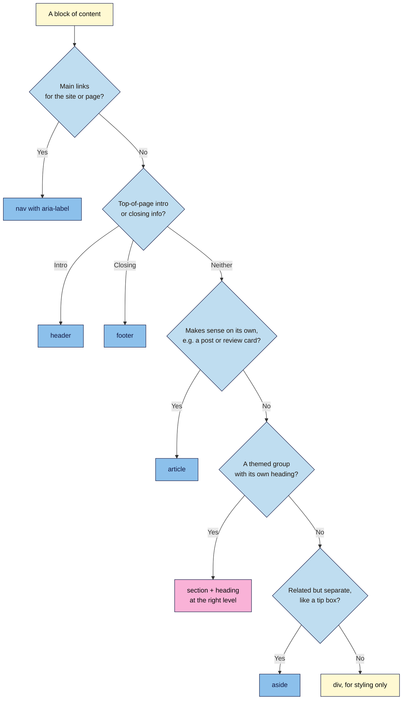

# M02.L03 — Semantic HTML & Heading Structure
> After this lesson you can turn a pile of `<div>`s into a page with clear landmarks and a logical heading outline, one that screen readers, search engines and AI answer engines can follow, and prove it with free tools.

**Time:** ~17 min reading + ~25 min exercise · **Level:** L1 Foundation (beginner) · **Prereqs:** M02.L02 · **Remediate to:** M02.L02
**Verified against:** MDN "Structuring documents" and "Headings and paragraphs", the WHATWG HTML spec (headings and landmarks), W3C WAI landmark guidance, and live W3C Nu HTML Checker runs (version 26.11.1, with its **outline** option) on this lesson's two example pages, on 2026-11-02.

> ⚠️ **Freshness flag:** older tutorials say "every `<section>` can start again with its own `<h1>`". That relied on a "document outline algorithm" that no browser or screen reader ever implemented, and it was removed from the HTML spec in 2022. Today **only the heading level (h1–h6) sets the structure**. The W3C checker now reports skipped heading levels as an error.

## Learning objectives
1. **Use** landmark elements (`header`, `nav`, `main`, `section`, `article`, `aside`, `footer`) instead of generic `div`s where they fit. *(O1)*
2. **Write** one `<h1>` and a logical H2–H6 outline that matches the page's content, not its font sizes. *(O2)*
3. **Check** structure with the validator's heading outline and a screen reader's or DevTools' landmark list. *(O3)*

## Why it matters
Wanjiru inherits a product page built from 140 `<div>`s. Its biggest text is an `<h3>`, the "How it works" heading is an `<h1>` halfway down, and the FAQ questions are bold paragraphs. A screen-reader user who presses "next heading" lands in the middle of the page. Search Console shows the page ranking for the wrong phrases. When Wanjiru asks an AI assistant to summarise the page, it mixes up the sections. Nothing *looks* broken, but every machine that reads structure (screen readers, search crawlers, AI answer engines) gets a confused map. Semantic HTML is the map. It costs nothing extra to write, and it's the base for accessibility (Module 7) and search visibility (Lesson 7.4 and Modern SEO).

## Core concept
**Plain version:** **semantic** means "carries meaning". A `<div>` says nothing about its content. A `<nav>` says "these are the main links"; a `<main>` says "the real content starts here"; an `<h2>` says "a new topic starts here, one level below the page title". Use the element that describes the content, and the page explains itself to people and machines.

**Analogy:** a book. The **title** on the cover is the `<h1>`. **Chapters** are `<h2>`, **sub-sections** are `<h3>`. The table of contents is built from those levels, not from font sizes. The **front matter** (publisher, contents) is `<header>` and `<nav>`, the **story** is `<main>`, a **sidebar box** is `<aside>`, and the **copyright page** is `<footer>`. You'd never number chapter 1 as "1.1.1" because you liked the smaller print.

### Landmark elements
| Element | Meaning | Typical use on a launch page | Screen readers call it |
|---|---|---|---|
| `<header>` | Introductory content | Logo + main menu at the top | "banner" (when it's the page header, not inside a section) |
| `<nav>` | A block of major navigation links | Main menu; footer menu (label each: `aria-label="Main"`) | "navigation" |
| `<main>` | The page's main content. **Exactly one** per page | Everything between header and footer | "main" |
| `<section>` | A themed group with its own heading | Hero, benefits, how it works, FAQ, sign-up | "region" **only if** it has a name, e.g. `aria-labelledby` pointing to its heading |
| `<article>` | Self-contained content that makes sense alone | A blog post, a review card, a news item | "article" |
| `<aside>` | Related but separate | "Related posts", a pull-out tip | "complementary" |
| `<footer>` | Closing info | Copyright, legal links, contact | "content info" (for the page footer) |
| `<div>` | No meaning at all | Wrapping things **only for styling** (Module 3) | Nothing |

### Heading rules
1. **One `<h1>` per page,** stating what the page is about. It's usually the hero's main line.
2. **Don't skip levels going down:** `h1 → h2 → h3`. Going back up (`h3 → h2`) is fine when a new section starts.
3. **Headings describe the content below them.** "Questions" is weak; "Frequently asked questions" or "Shipping questions" is clearer.
4. **Choose the level by structure, never by size.** Make an `<h2>` small or huge with CSS (Module 3).
5. **Headings are not decoration.** A slogan styled big, with no content under it, is a `<p>`.

> **Search and AI note (observed practice):** Google's documentation sets no fixed rule on the number of `<h1>`s, and Google staff have said publicly that several `<h1>`s don't cause ranking problems. Clear headings do help people and machines understand a page. This course still uses one `<h1>`, because it's clearer for screen-reader users and easier to audit. Clear, descriptive headings also make it easier for AI answer engines to quote the right section. Lesson 7.4 and the Modern SEO course cover this.

## How it works



**In words:** ask what the block *is*, in order. Main navigation → `nav`. Page intro or closing → `header` / `footer`. Stands alone → `article`. A themed group with a heading → `section`. Related aside → `aside`. Only when none fits, use a `div`, and then it's for styling only. Everything between the header and footer sits inside one `main`.

## Hands-on walkthrough

**Part A: diagnose the "div soup" (8 min)**
1. Open **https://validator.w3.org/nu/#textarea**. Under the text box, tick **outline**.
2. Paste this page and click **Check**:
   ```html
   <!DOCTYPE html>
   <html lang="en">
   <head><meta charset="utf-8"><meta name="viewport" content="width=device-width, initial-scale=1"><title>Nila Coffee — Fresh beans every month</title></head>
   <body>
   <div class="top">
     <div class="logo"></div>
     <div class="menu"><a href="#how">How it works</a> <a href="#faq">FAQ</a> <a href="#signup">Join</a></div>
   </div>
   <div class="hero">
     <h3>Fresh beans every month</h3>
     <div class="big">Roasted this week, at your door in 3 days.</div>
   </div>
   <div id="how">
     <h1>How it works</h1>
     <p>Choose a roast, choose a size, pause any time.</p>
   </div>
   <div id="faq">
     <h4>Questions</h4>
     <p><b>Can I pause?</b> Yes, any time.</p>
   </div>
   <div id="signup"><h2>Join the launch list</h2></div>
   <div class="bottom">© 2026 Nila Coffee</div>
   </body></html>
   ```
   **Expected (checked 2026-11-02):** one **error**: *The heading "h4" (with computed level 4) follows the heading "h1" (with computed level 1), skipping 2 heading levels.* The **Outline** section shows gaps marked **[missing]**: `[missing] h1 › [missing] h2 › h3 Fresh beans every month`, then `h1 How it works`, then more `[missing]` levels before `h4 Questions`.
   > 🖼️ **Image prompt:** Desktop screenshot (1440×900) of the W3C Nu HTML Checker results for the div-soup page with the "outline" option ticked: the heading-level error at the top and the Outline section below showing several "[missing]" heading levels. Outline the error message and the [missing] entries. Highlight the key element with a 3px #F9B2D7 outline; blur any personal details.
   > **Alt text:** W3C checker showing a skipped-heading-level error and an outline with several missing heading levels for the div-soup page.
3. In your notes, list what's wrong *beyond* the error: the main heading is an `h3`; "How it works" is the only `h1`; the FAQ question is bold text, not a heading; nothing marks the menu, the main content or the footer.

**Part B: rebuild it semantically (10 min)**
1. Rewrite the page using the landmark table and heading rules, then check it again with **outline** ticked. One correct version:
   ```html
   <body>
   <header>
     <a href="/"></a>
     <nav aria-label="Main">
       <ul>
         <li><a href="#how">How it works</a></li>
         <li><a href="#faq">FAQ</a></li>
         <li><a href="#signup">Join</a></li>
       </ul>
     </nav>
   </header>
   <main>
     <section aria-labelledby="hero-title">
       <h1 id="hero-title">Fresh beans every month</h1>
       <p>Roasted this week, at your door in 3 days.</p>
     </section>
     <section id="how" aria-labelledby="how-title">
       <h2 id="how-title">How it works</h2>
       <ol>
         <li>Choose a roast.</li>
         <li>Choose a size.</li>
         <li>Pause or cancel any time.</li>
       </ol>
     </section>
     <section id="faq" aria-labelledby="faq-title">
       <h2 id="faq-title">Questions</h2>
       <h3>Can I pause my subscription?</h3>
       <p>Yes, any time, from your account page.</p>
       <h3>Do you ship outside India?</h3>
       <p>Yes, to 30 countries, from $4.</p>
     </section>
     <section id="signup" aria-labelledby="signup-title">
       <h2 id="signup-title">Join the launch list</h2>
     </section>
   </main>
   <footer>
     <p>© 2026 Nila Coffee</p>
   </footer>
   </body>
   ```
   **Expected (checked 2026-11-02):** "The document validates according to the specified schema(s)." The **Outline** is now clean: `h1 Fresh beans every month` › `h2 How it works` · `h2 Questions` › `h3 Can I pause my subscription?` · `h3 Do you ship outside India?` · `h2 Join the launch list`.
2. Notice three details: the menu became a **list** inside `nav` (it *is* a list of links); each `section` is **named** by its heading through `aria-labelledby`, so screen readers announce it as a region; and the old `div class="big"` became a plain `<p>`, because it was never a heading.

**Part C: see the landmarks the way assistive tech does (5 min)**
1. Save the semantic version as `semantic-test.html` in your `webdev-101` folder (with the full skeleton) and open it in Chrome or Edge.
2. Press **F12** → **Elements** → open the **Accessibility** tab in the side pane (⋮ or **»** if hidden). Tick **Enable full-page accessibility tree** (DevTools may ask you to reload it), then click the accessibility-tree icon that appears at the top of the Elements panel.
   **Expected:** a tree with **banner**, **navigation "Main"**, **main**, several **region** entries named after their headings, and **contentinfo**. That's the map a screen reader works from.
   > 🖼️ **Image prompt:** Desktop screenshot (1440×900) of Chrome DevTools with the full-page accessibility tree shown for the semantic Nila Coffee page, listing banner, navigation "Main", main, regions named "Fresh beans every month", "How it works", "Questions", "Join the launch list", and contentinfo. Outline the landmark entries. Highlight the key element with a 3px #F9B2D7 outline; blur any personal details.
   > **Alt text:** Chrome DevTools accessibility tree listing the page's banner, navigation, main, named regions and contentinfo landmarks.
3. *(Optional, 2 min)* With a screen reader: on Mac, start **VoiceOver** (Cmd+F5), press **Control+Option+U** for the rotor, and use the arrow keys to switch to **Landmarks** and **Headings**. On Windows, install the free **NVDA** screen reader and press **D** (landmarks) or **H** (headings), or use **Narrator** (Ctrl+Win+Enter) in scan mode with the same keys.
   **Expected:** you can jump straight to "main" or to any heading. Screen-reader users navigate this way all the time.

**Part D: structure your launch page (5 min)**
1. In `launch.html`, wrap your content: `header` (logo, a small `nav`), `main` with one `section` per block (hero, benefits, testimonials, FAQ, sign-up), and a `footer`.
2. Make your hero's main line the only `<h1>`; every block gets an `<h2>`; FAQ questions get `<h3>`.
3. Check with **outline** ticked until there are no errors and no `[missing]` levels.
   **Expected:** a clean outline you could read aloud as a table of contents for your page.

## When to use / when not to
- **`section` vs `div`:** use `section` when the block has a heading and a theme. Use `div` for purely visual wrappers (a row, a background band). **Trade-off:** too many unnamed `section`s add no value; too few leave screen-reader users without landmarks. Name the important ones with `aria-labelledby`.
- **`article`:** use it for repeatable, stand-alone items (blog cards, reviews), not for the whole page by default.
- **Native `<details>` / `<summary>` for FAQs:** a no-JavaScript, accessible open/close FAQ. Use it if you want collapsible answers now; Lesson 5.3 builds a custom accordion and compares the two.
- **ARIA roles (`role="navigation"` on a `div`):** only when you *can't* use the native element (e.g. a CMS template you can't change). The first rule of ARIA is to use native HTML first.

## Use AI for this
**Example prompt:**
> "Here is my landing page HTML: [paste]. Without changing any visible text, rewrite it with semantic HTML: header, nav (with aria-label), one main, sections named with aria-labelledby, footer. Use exactly one h1 and no skipped heading levels. Then list every heading as an indented outline so I can check it."

**What AI does well here:** converting div soup quickly, and producing an outline you can compare.
**Where it gets it wrong:** it sometimes *changes* your copy or heading wording, adds unnecessary ARIA (`role="main"` on `<main>`, `role="banner"` on `<header>`), wraps every single paragraph in its own `section`, or follows the old "h1 in every section" advice.
**How to check:** run the result through the W3C checker with **outline** ticked, compare the visible text with your original, and delete ARIA roles that just repeat what the element already means.

## Common mistakes
- **Picking heading levels by size.** The "small" `<h4>` that should be an `<h2>`.
- **No `<h1>`, or the logo as the `<h1>` on every page.** The `<h1>` should say what *this* page is about.
- **Bold paragraphs as headings** (`<p><b>Can I pause?</b></p>`). Screen-reader users can't jump to them, and search engines treat them as ordinary text.
- **Two `<main>` elements, or none.** Exactly one visible `main`.
- **A menu as loose links with spaces between them.** Put it in a `nav` with a `ul`.
- **Using `section` as a styling wrapper with no heading.**
- **Repeating ARIA that native elements already provide** (`<nav role="navigation">`). It's harmless but noisy, and it's a sign of copied code.

## Troubleshooting
| Symptom | Likely cause | Fix |
|---|---|---|
| No **Outline** section in the checker results | The **outline** box wasn't ticked before **Check** | Tick it and check again |
| Outline shows **[missing]** | A level was skipped (h1 → h3) or the page starts below h1 | Change levels so each step down is by one |
| Error: the heading … skipping heading levels | Same as above (current checker versions report this as an error) | Fix the level, not the font size |
| Accessibility tree shows "region" missing for a section | The section has no accessible name | Add `aria-labelledby="…"` pointing to the section's heading `id` |
| Two "banner" or "contentinfo" landmarks | `header`/`footer` used at the top level twice | Keep one page `header` and one page `footer`; headers inside `article` or `section` don't count |
| VoiceOver rotor shows no landmarks | Using Safari with a different focus, or rotor on another list | Click inside the page, then Control+Option+U and press ← / → to switch lists |

## Exercise
**Task:** produce a "structure report" for `launch.html`:
1. Paste the validator's **Outline** (copy the text) into your project note.
2. List your landmarks as they appear in the DevTools accessibility tree (banner, navigation, main, regions, contentinfo).
3. **Break it and fix it:** change one `<h2>` to `<h4>`, check again, copy the exact error message, then fix it.
4. Do the same audit, read-only, on your **capstone brand site** from Module 1: in DevTools, run `[...document.querySelectorAll('h1,h2,h3,h4,h5,h6')].map(h => h.tagName + ' ' + h.textContent.trim())` in the **Console** to list its headings, and note one structural problem if you find one.

**Expected outcome:** your page has one `h1`, no skipped levels, and named landmarks; plus a note with the error you caused, your fix, and one observation about the brand site (e.g. "two h1s: the logo and the hero" or "FAQ questions are bold paragraphs").
**Stretch goal:** turn your FAQ into native `<details><summary>Question</summary><p>Answer</p></details>` blocks and test them with the keyboard only (Tab to focus, Enter or Space to open).

## Key takeaways
- **Semantic HTML** = elements that say what content *is*: `header`, `nav`, `main`, `section`, `article`, `aside`, `footer`; `div` is for styling only.
- **One `<h1>`, no skipped levels going down,** and levels chosen by structure, never by size.
- The old "h1 in every section" outline algorithm is **gone** (removed 2022); only h1–h6 levels count.
- Name important sections with `aria-labelledby` so screen readers list them as regions.
- Check with the validator's **outline** and the DevTools **accessibility tree**.

## Teach it back
Explain to a friend in 3 sentences why making a heading "smaller" should be done with CSS rather than by changing `<h2>` to `<h4>`, and who is affected if you get it wrong.

## Glossary terms added
- Semantic HTML — added to `webdev-101/glossary.md`
- Landmark (banner, navigation, main, region, complementary, contentinfo) — added to `webdev-101/glossary.md`
- `header`, `nav`, `main`, `section`, `article`, `aside`, `footer` — added to `webdev-101/glossary.md`
- Heading outline / heading levels — added to `webdev-101/glossary.md`
- Document outline algorithm (removed) — added to `webdev-101/glossary.md`
- ARIA, `aria-label`, `aria-labelledby` — added to `webdev-101/glossary.md`
- Accessibility tree — added to `webdev-101/glossary.md`
- `<details>` / `<summary>` — added to `webdev-101/glossary.md`

## Further reading
*All checked 2026-11-02.*
- MDN — Structuring documents: https://developer.mozilla.org/en-US/docs/Learn_web_development/Core/Structuring_content/Structuring_documents
- MDN — Headings and paragraphs: https://developer.mozilla.org/en-US/docs/Learn_web_development/Core/Structuring_content/Headings_and_paragraphs
- MDN blog — Default styles for h1 elements are changing (outline algorithm removal): https://developer.mozilla.org/en-US/blog/h1-element-styles/
- W3C WAI — Page structure tutorial: regions and headings: https://www.w3.org/WAI/tutorials/page-structure/
- W3C WAI-ARIA Authoring Practices — Landmark regions: https://www.w3.org/WAI/ARIA/apg/practices/landmark-regions/
- W3C Nu HTML Checker (tick **outline**): https://validator.w3.org/nu/#textarea
- Google Search Central — SEO starter guide (headings and page structure): https://developers.google.com/search/docs/fundamentals/seo-starter-guide
- NVDA screen reader (free, Windows): https://www.nvaccess.org/download/

## Refresher card
*Used by remediation when a learner fails a quiz twice on a later lesson that points back here.*
Use elements for meaning: `header` (banner), `nav` + `aria-label` (navigation), one `main`, `section` + heading + `aria-labelledby` (region), `article` (stand-alone item), `aside`, `footer` (contentinfo); `div` only for styling. Headings: one `h1`, no skipped levels going down, levels by structure not size. The "h1 per section" outline algorithm was removed in 2022. Check with the W3C checker's **outline** option and the DevTools accessibility tree.
