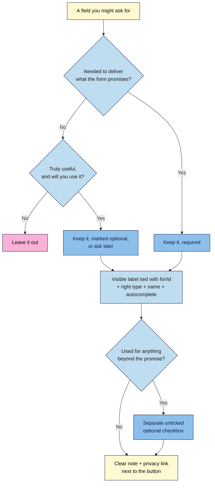

# M02.L04 — Forms for Lead Capture
> After this lesson you can build a sign-up form that works with the keyboard and screen readers, checks basic input on its own, asks only for what you need, and handles consent honestly.

**Time:** ~18 min reading + ~30 min exercise · **Level:** L1 Foundation (beginner) · **Prereqs:** M02.L02, M02.L03 · **Remediate to:** M02.L02
**Verified against:** MDN "Web forms" and `<input>` reference, WCAG 2.2 (1.3.1, 1.3.5, 3.3.2), GDPR Recital 32 and Article 5, India's DPDP Rules 2025 (phased dates), and a live W3C Nu HTML Checker run on this lesson's form, on 2026-11-02. Browser messages checked in desktop Chrome.

> Note: this lesson builds the form's HTML only. Pressing **Join** won't deliver the email to anyone yet. Lesson 5.4 connects it to a form service (Formspree, Brevo, Mailchimp), and Lesson 6.4 covers consent and cookies in depth.

> ⚠️ **Freshness flag (law):** consent rules differ by country and change. The EU/UK GDPR applies now. India's DPDP Rules were notified in November 2025, and their notice-and-consent duties start in phases (core duties from around May 2027; check the official gazette). California, Brazil and others have their own rules. Nothing here is legal advice; check your local rules.

## Learning objectives
1. **Build** a sign-up form with `form`, `label`, the right `input` types, `autocomplete` and a real `button`. *(O1)*
2. **Apply** built-in validation (`required`, `type="email"`, `minlength`, `pattern`) and accessible hints. *(O2)*
3. **Decide** which fields to ask for (data minimisation), and word consent and privacy honestly. *(O3)*

## Why it matters
Carlos runs ads to a "Get the free guide" page. The form asks for name, surname, phone, company, job title, country and email; uses grey placeholder text instead of labels; and has a pre-ticked box saying "Send me offers from our partners". On phones the keyboard never switches to the `@` layout, autofill fills nothing, and half the visitors give up. A screen-reader user hears "edit text, edit text, edit text" with no idea what goes where. The pre-ticked box is also not valid consent under the GDPR. Every one of these problems is a few characters of HTML away from fixed, and fixing them usually *raises* sign-ups.

## Core concept
**Plain version:** a form is a set of labelled questions plus a button. Each question is a **field** (an `input`, `select` or `textarea`) with a visible **label** tied to it. Choosing the right field **type** gets visitors the right phone keyboard, autofill, and free error checking from the browser. The fewer fields you ask for, the more people finish.

**Analogy:** a good form is a short conversation at a shop counter. The assistant asks one clear question at a time ("Your email?"), already has the right pen and card ready (the input type), and says plainly what happens next ("We'll only email you on launch day"). A bad form is a ten-page paper application handed over with no explanation.

### The parts
| Part | Example | Why it matters |
|---|---|---|
| `<form>` | `<form method="post" action="https://formservice.example/f/abc">` | Wraps the fields; `action` = where the data goes, `method` = how. Omit `action` while practising (an empty `action=""` is an error). |
| `<label for="…">` + `id` | `<label for="email">Email address</label>` + `<input id="email">` | Ties the text to the field: screen readers announce it, and clicking the label puts the cursor in the field. |
| `type` | `email`, `tel`, `url`, `text`, `checkbox`, `radio`, `date` | The right phone keyboard and free checks (e.g. `email` needs an `@`). |
| `name` | `name="email"` | The key the data is sent under (`email=amara@…`). Fields without a `name` are **not sent**. |
| `autocomplete` | `autocomplete="email"`, `"given-name"`, `"tel"` | Lets browsers fill known details; required by WCAG 2.2 success criterion 1.3.5 for fields about the user. |
| `required` | `required` | The browser won't submit the form while the field is empty. |
| Hint text | `aria-describedby="email-hint"` → `<span id="email-hint">` | Extra help that screen readers read after the label. |
| `<fieldset>` + `<legend>` | A group of radio buttons with a question | The question is read with each option. |
| `<button type="submit">` | `<button type="submit">Join the launch list</button>` | A real button works with Enter, Space, screen readers and every browser. Use words that say what happens. |

**Placeholder ≠ label.** `placeholder="you@example.com"` is grey sample text that disappears when you type. It's low-contrast and gone when people need it most. Use it only for an *example*, never instead of a label.

### Data minimisation and consent
- **Ask only for what the promise needs.** A launch-email list needs an email address. A first name is a nice-to-have, so make it optional. Phone, company and job title: leave them out unless you'll really use them. The GDPR's data-minimisation principle (Article 5(1)(c)) says the same thing in law.
- **Say what happens**, next to the button: what you'll send, how often, and a link to your privacy notice. For a simple launch list, that clear statement plus the visitor's own act of signing up is the common approach; whether it's enough depends on your country's rules.
- **Extra uses need a separate, unticked, optional box.** GDPR Recital 32 is explicit: "Silence, pre-ticked boxes or inactivity should not … constitute consent." India's DPDP Act likewise requires consent through a clear affirmative action. Never pre-tick, and never make sign-up depend on agreeing to unrelated marketing.

## How it works



**In words:** start by questioning every field. If the promise doesn't need it and you won't really use it, delete it. Keep essential fields required, and nice-to-haves optional. Every field you keep gets a visible label, the right type, a `name` and `autocomplete`. If you'd use the data for anything beyond the promise (partner offers, sharing), ask with a separate, unticked, optional box. Finish with a plain note and a privacy link next to the button.

## Hands-on walkthrough

Work in `launch.html`, inside your `<section id="signup">` from Lesson 2.3.

**Part A: build the form (10 min)**
1. Under the sign-up `<h2>`, add:
   ```html
   <p>Get one email on launch day, plus 10% off your first box.</p>
   <form method="get">
     <p>
       <label for="first-name">First name (optional)</label>
       <input type="text" id="first-name" name="first_name" autocomplete="given-name">
     </p>
     <p>
       <label for="email">Email address</label>
       <input type="email" id="email" name="email" autocomplete="email" required aria-describedby="email-hint">
       <span id="email-hint">We'll only use it for launch news. Unsubscribe any time.</span>
     </p>
     <fieldset>
       <legend>Which roast interests you? (optional)</legend>
       <input type="radio" id="roast-light" name="roast" value="light">
       <label for="roast-light">Light</label>
       <input type="radio" id="roast-medium" name="roast" value="medium">
       <label for="roast-medium">Medium</label>
       <input type="radio" id="roast-dark" name="roast" value="dark">
       <label for="roast-dark">Dark</label>
     </fieldset>
     <p>
       <input type="checkbox" id="partner-offers" name="partner_offers" value="yes">
       <label for="partner-offers">Also send me occasional offers from partner farms (optional)</label>
     </p>
     <p>By joining you agree to our <a href="/privacy">privacy notice</a>.</p>
     <button type="submit">Join the launch list</button>
   </form>
   ```
2. Rewrite the wording for **your** launch: your promise in the first `<p>`, your hint text, and your own optional question (or delete the radio group if you don't need it).
3. Paste the page into the W3C checker.
   **Expected (checked 2026-11-02):** no errors. (If you test the form alone without an `<h1>`, you'll see an info warning about the missing level-1 heading. Your full launch page has one.)

**Part B: let the browser check input (6 min)**
1. Open the page. Click **Join the launch list** with the email field empty.
   **Expected:** the form doesn't submit, focus jumps to the email field, and the browser shows a message (in Chrome: "Please fill out this field.").
2. Type `amara` (no `@`) and click **Join** again.
   **Expected:** a message like "Please include an '@' in the email address. 'amara' is missing an '@'." Wording differs by browser and language. That's fine.
   > 🖼️ **Image prompt:** Desktop browser screenshot (1280×800) of the unstyled sign-up form with "amara" typed in the Email address field and Chrome's validation bubble "Please include an '@' in the email address. 'amara' is missing an '@'." Outline the bubble. Highlight the key element with a 3px #F9B2D7 outline; blur any personal details.
   > **Alt text:** Chrome's built-in validation message asking for an @ in the email field of the sign-up form.
3. Type a full address such as `amara@example.com` and click **Join**.
   **Expected:** the page reloads, and the **address bar** now ends with something like `?first_name=&email=amara%40example.com&…`. That's the query string from Lesson 1.2: `method="get"` puts form data **in the URL**, where it ends up in browser history, server logs and analytics. Real sign-up forms use `method="post"` to a form service (Lesson 5.4).
4. On your phone (optional), open the page and tap the email field.
   **Expected:** a keyboard with `@` and `.` keys, because of `type="email"`.

**Part C: keyboard and label test (5 min)**
1. Reload, click in the address bar, then press **Tab** repeatedly.
   **Expected:** focus moves in the same order as the HTML: first name → email → the radio group (use the **arrow keys** to move between options) → checkbox (**Space** ticks it) → privacy link → button (**Enter** submits). A visible focus ring shows where you are. Focus always follows the order of elements in the code, which is one more reason to keep the HTML in a logical reading order.
2. Click the words **Email address**.
   **Expected:** the cursor appears in the email field. That proves the label is connected.

**Part D: break it and fix it (5 min)**
1. Change `<label for="email">` to `<label for="e-mail">` (the `id` stays `email`). Reload and click the label.
   **Expected:** nothing happens. The label is no longer connected.
2. Press **F12** → Elements, select the email `<input>`, and open the **Accessibility** tab.
   **Expected:** the field's **Name** is now empty (or shows only the hint). A screen reader announces just "edit text". With the fixed label it shows "Email address".
   > 🖼️ **Image prompt:** Two Chrome DevTools Accessibility-pane screenshots side by side (each 700×450): left, the email input with Name "" (broken label); right, the same input with Name "Email address" (fixed label). Label them "Broken label" and "Fixed label". Outline the Name rows. Highlight the key element with a 3px #F9B2D7 outline; blur any personal details.
   > **Alt text:** DevTools Accessibility pane showing an empty name for the input with a broken label and "Email address" once fixed.
3. Fix the `for` value. Then delete `name="email"` from the input, submit, and look at the address bar.
   **Expected:** `email=…` is missing from the query string. **Fields without a `name` aren't sent.** Put it back.

## When to use / when not to
- **One field (email) vs several:** for a launch list or lead magnet, email alone usually converts best. Add a first name only if you'll personalise emails with it. **Trade-off:** fewer fields means more sign-ups but less information. You can ask more later, in a welcome email or survey.
- **`type="tel"` vs `type="number"`:** phone numbers aren't numbers (they have `+`, spaces, leading zeros). Use `tel`. Use `number` only for real quantities.
- **`pattern`:** use it for fixed formats you really need, such as a 6-digit Indian PIN code (`pattern="[0-9]{6}"` with `inputmode="numeric"`). Don't use it to force "your" format on names or phone numbers from other countries.
- **Built-in validation vs custom JavaScript errors:** built-in messages are free and accessible, but you can't style them. Lesson 5.4 adds custom, branded error messages on top. Keep the HTML checks as the safety net.
- **CAPTCHAs:** avoid puzzle CAPTCHAs; they block many disabled users (W3C has a whole note on CAPTCHA inaccessibility). Form services offer invisible spam protection, covered in Lesson 5.4.

## Use AI for this
**Example prompt:**
> "Write an accessible HTML sign-up form for a [coffee subscription] launch list. Fields: email (required), first name (optional). Use label for/id, type=email, autocomplete, a hint linked with aria-describedby, and a submit button with clear text. No placeholder-as-label, no pre-ticked boxes, no JavaScript. Then list each field and justify why it's there, in one line each."

**What AI does well here:** producing a correctly wired form and remembering attributes like `autocomplete` that people forget.
**Where it gets it wrong:** it often adds fields you didn't ask for (phone, company), uses `placeholder` as the only label, writes `<div onclick>` "buttons", sets `type="number"` for phones, or adds a **pre-ticked** consent checkbox. It may also claim a form is "GDPR compliant", which no code alone can be.
**How to check:** run the label test (click each label), the keyboard test (Tab through it), the W3C checker, and the field-by-field flowchart. Delete any field you can't justify.

## Common mistakes
- **Placeholder text as the only label.** It vanishes as you type and is too faint to read for many people.
- **Labels not tied to fields** (`for` doesn't match `id`, or no `for` at all).
- **Missing `name`,** so the data is never sent.
- **Wrong types:** `text` for email, `number` for phone.
- **Asking for everything "just in case".** Each extra field costs sign-ups and creates data you must protect.
- **Pre-ticked marketing boxes,** or bundling unrelated marketing into the sign-up.
- **"Submit" as button text.** Say what happens: "Join the launch list", "Send me the guide".
- **A `<div>` or `<a href="#">` styled as a button.** Use `<button type="submit">`.

## Troubleshooting
| Symptom | Likely cause | Fix |
|---|---|---|
| Form submits even when empty | `required` missing, or a `novalidate` attribute on `<form>` | Add `required` to essential fields; remove `novalidate` unless JavaScript validates instead |
| Clicking the label does nothing | `for` and `id` don't match exactly (case-sensitive) | Make them identical; each `id` used once per page |
| A value is missing from the URL after submitting | That field has no `name`, or a radio group's options use different names | Add `name`; every radio in one group shares the same `name` |
| Validator error: Bad value "" for attribute "action" | `action=""` is empty | Remove `action` while practising, or set the real form-service URL later |
| Several radio buttons can be selected at once | They have different `name` values | Give the whole group one `name` |
| Autofill doesn't offer your email | Missing or wrong `autocomplete` value | Use the standard tokens: `email`, `given-name`, `family-name`, `tel`, `postal-code` |
| Phone keyboard has no `@` | `type="text"` instead of `email` | Use `type="email"` |

## Exercise
**Task:** design and build **your** launch page's sign-up form:
1. List every field you're tempted to ask for, run each through the flowchart, and keep only what survives. Write the reason for each kept field in your project note.
2. Build the form with labels, types, names, `autocomplete`, a hint, `required` where essential, and a button whose text says what happens.
3. Add a one-line promise above the form and a privacy-notice link near the button. If you add any extra use (partner offers, a second newsletter), use a separate unticked optional checkbox.
4. Pass the W3C checker, the label-click test and the keyboard-only test.

**Expected outcome:** a form with 1–3 fields that a keyboard user can complete in under 30 seconds, plus a note justifying each field. Example justification: "Email (required): needed to send the launch email. First name (optional): used in the email greeting."
**Stretch goal:** add a `<select>` for country with `autocomplete="country-name"` *only* if you'd really use it (e.g. for shipping prices in ₹ vs $), then test it with the keyboard (Tab to it, arrow keys to choose).

## Key takeaways
- Every field needs a visible **label** tied with `for`/`id`, the right **type**, a **name**, and **autocomplete** where it's about the user.
- `required` and `type="email"` give you free, accessible validation; real forms send with `method="post"` (Lesson 5.4).
- **Placeholder is not a label**; `<button type="submit">` with words that say what happens.
- **Ask for less.** Every field must earn its place.
- Consent for extra uses: separate, **unticked**, optional. Never pre-ticked.

## Teach it back
Explain to a friend in 3 sentences why a pre-ticked "send me partner offers" box is a problem, and what you'd do instead.

## Glossary terms added
- Form, field, `action`, `method` (GET vs POST) — added to `webdev-101/glossary.md`
- Label (`for`/`id`) — added to `webdev-101/glossary.md`
- Input type — added to `webdev-101/glossary.md`
- `name` attribute (form data key) — added to `webdev-101/glossary.md`
- `autocomplete` — added to `webdev-101/glossary.md`
- Built-in (constraint) validation, `required`, `pattern` — added to `webdev-101/glossary.md`
- Placeholder — added to `webdev-101/glossary.md`
- `fieldset` / `legend` — added to `webdev-101/glossary.md`
- `aria-describedby` — added to `webdev-101/glossary.md`
- Focus / focus order — added to `webdev-101/glossary.md`
- Data minimisation — added to `webdev-101/glossary.md`
- Consent (affirmative, unticked) — added to `webdev-101/glossary.md`

## Further reading
*All checked 2026-11-02.*
- MDN — Web forms (module): https://developer.mozilla.org/en-US/docs/Learn_web_development/Extensions/Forms
- MDN — `<input>` element and types: https://developer.mozilla.org/en-US/docs/Web/HTML/Reference/Elements/input
- MDN — HTML `autocomplete` attribute (all tokens): https://developer.mozilla.org/en-US/docs/Web/HTML/Reference/Attributes/autocomplete
- MDN — Client-side form validation: https://developer.mozilla.org/en-US/docs/Learn_web_development/Extensions/Forms/Form_validation
- W3C WAI — Forms tutorial: https://www.w3.org/WAI/tutorials/forms/
- W3C — WCAG 2.2 (1.3.5 Identify Input Purpose, 3.3.2 Labels or Instructions): https://www.w3.org/TR/WCAG22/
- EUR-Lex — GDPR (Regulation (EU) 2016/679), Recital 32 and Article 5: https://eur-lex.europa.eu/eli/reg/2016/679/oj
- MeitY — Digital Personal Data Protection Act, 2023 and Rules, 2025: https://www.meity.gov.in/data-protection-framework

## Refresher card
*Used by remediation when a learner fails a quiz twice on a later lesson that points back here.*
Form = `<form>` + labelled fields + `<button type="submit">`. Each field: visible `<label for>` matching its `id`, the right `type` (`email`, `tel`…), a `name` (or it isn't sent), `autocomplete` (`email`, `given-name`). `required` + `type="email"` = free validation. Placeholder isn't a label. `method="get"` puts data in the URL; real forms use POST to a form service (5.4). Ask only for what the promise needs; extra uses need a separate unticked optional box.
