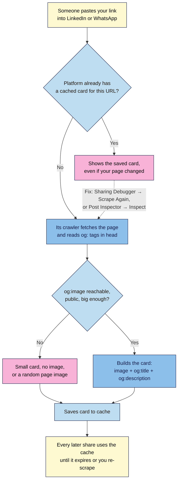

# M02.L05 — Meta Tags & Social Previews
> After this lesson you can write a page title and meta description that earn the click in search, add Open Graph tags so your link shows a proper preview card on Facebook, LinkedIn, WhatsApp and X, and fix a preview that's stuck showing old content.

**Time:** ~16 min reading + ~25 min exercise · **Level:** L1 Foundation (beginner) · **Prereqs:** M02.L01 · **Remediate to:** M02.L01
**Verified against:** Google Search Central "Influencing your title links" and "Control your snippets", the Open Graph protocol (ogp.me), Meta for Developers "Images in link shares" and Sharing Debugger, X Developer "Cards markup", LinkedIn Post Inspector, and a live W3C Nu HTML Checker run on this lesson's `<head>`, on 2026-11-02.

> Note: your launch page lives on your computer until Module 4, and social platforms can't read files on your computer. So in this lesson you **write** the tags for your page and **test** the sharing tools on a public site you already know (your Module 1 capstone brand). Once your page is live (Lesson 4.3 and Capstone 4), you repeat the test on your own URL.

> ⚠️ **Freshness flag:** search and social platforms change how they show titles, descriptions and cards without notice. Google already rewrites many titles and descriptions, and AI answer engines may show none of them. The tags below are the stable, documented inputs; always re-test with the official tools.

## Learning objectives
1. **Write** a `<title>` and meta description that are accurate, specific and click-worthy. *(O1)*
2. **Add** Open Graph and X card tags with a correctly sized share image (1200×630) and alt text. *(O2)*
3. **Test** previews with the Facebook Sharing Debugger and LinkedIn Post Inspector, and explain why previews cache. *(O3)*

## Why it matters
Deepa shares her new workshop page in three WhatsApp groups and on LinkedIn. The preview says "Untitled", shows her footer logo stretched into a strip, and the description reads "Home | About | Contact | Cookie settings". She fixes the page, shares again, and LinkedIn still shows the old broken card. In Google, the page appears as "Home". Nothing on the page itself was wrong, but the **metadata** in `<head>` (the part visitors never see) decides how the page looks *everywhere else*: search results, chat apps, social feeds and browser tabs. For a campaign page, that preview is often the first and only impression.

## Core concept
**Plain version:** the `<head>` holds information **about** the page. The `<title>` and meta description are written for search engines and browser tabs. **Open Graph** tags (`og:…`), created by Facebook and now read by LinkedIn, WhatsApp, Slack, X and many others, describe the **preview card**: its title, description, image and link. Platforms read these tags once, **save a copy (cache it)**, and keep showing that copy until they're told to read the page again.

**Analogy:** the page is a book; the metadata is its **cover and back-cover blurb**. Search engines display the spine label (title) and blurb (description). Social platforms photograph the cover (Open Graph) and keep that photo in their files. Reprinting the cover doesn't change the photo they already have until you ask them to take a new one.

### The tags
| Tag | Example (Nila Coffee) | Notes |
|---|---|---|
| `<title>` | `Fresh Coffee Beans Delivered Monthly \| Nila Coffee` | Unique per page; main topic first, brand last. Shown in tabs, bookmarks and (often) search results. Google truncates long titles to fit the screen; roughly 50–60 characters usually fit (observed practice, not a Google rule) |
| `<meta name="description">` | `Beans roasted this week and shipped within 3 days…` | Summarise the page and give a reason to click. Google says there's no length limit but snippets are truncated; it may show page text instead |
| `<link rel="canonical">` | `href="https://nilacoffee.example/"` | The page's one official address, so copies with tracking parameters (`?utm_source=…`) count as the same page. Lesson 7.4 covers it in depth |
| `og:title` | `Fresh beans every month, roasted this week` | Can be friendlier than the `<title>`; no brand needed (that's `og:site_name`) |
| `og:description` | `Join the launch list and get 10% off your first box.` | One or two short sentences; feeds often show only the first line |
| `og:image` | `https://nilacoffee.example/images/share-1200x630.jpg` | **Full absolute URL.** Meta recommends at least **1200×630** (ratio 1.91:1), file under 8 MB |
| `og:image:width` / `:height` | `1200` / `630` | Helps platforms show the image on the first share instead of waiting to download it |
| `og:image:alt` | `A bag of Nila Coffee beans beside a fresh cup…` | Alt text for the preview image (Lesson 2.2 rules apply) |
| `og:url` | `https://nilacoffee.example/` | Same as the canonical |
| `og:type` | `website` (or `article` for blog posts) | Required by the Open Graph protocol |
| `twitter:card` | `summary_large_image` | X's only must-have tag: it falls back to the `og:` tags for title, description and image |
| Favicon | `<link rel="icon" href="/icon.svg" type="image/svg+xml">` | The small icon in tabs and some search results |

**Writing the title and description:**
- **Title:** what the page offers, in the words people search for, then your brand. "Fresh Coffee Beans Delivered Monthly | Nila Coffee" beats "Home" or "Nila Coffee — Welcome!".
- **Description:** what's on the page + one concrete detail + why click. Include prices, dates or numbers when they're true. Don't stuff keywords, and don't write the same description on every page.
- **Google may rewrite both.** It builds the title link from several sources (your `<title>`, the main heading, `og:title`, link text…) and often builds snippets from page text. Accurate, specific tags make rewrites rarer and better.

## How it works



**In words:** the first time anyone shares a URL, the platform's crawler (an automated bot that fetches pages, like a browser with no screen) fetches the page, reads the Open Graph tags, downloads the image, builds a card and **caches** it. Later shares reuse that card, which is why fixing your page doesn't fix old previews. The official debugging tools make the platform fetch the page again. If the image is missing, private, behind a login, or too small, the card falls back to a small or image-less version.

## Hands-on walkthrough

**Part A: inspect a real brand's metadata (6 min)**
1. Open your Module 1 capstone brand's homepage (or any big brand site) in Chrome or Edge. Press **F12** → **Console**.
2. Paste this and press Enter:
   ```js
   [...document.querySelectorAll('title, meta[name="description"], meta[property^="og:"], meta[name^="twitter:"], link[rel="canonical"]')].map(e => e.outerHTML)
   ```
   **Expected:** a list of the page's metadata tags. Most big sites show `og:title`, `og:description`, `og:image` and a canonical link. Some sites (especially small ones) show none; that's a finding for your notes.
   > 🖼️ **Image prompt:** Desktop screenshot (1440×900) of Chrome DevTools Console after running the metadata one-liner on a well-known public brand homepage, listing the title, meta description, canonical, og:title, og:description, og:image and twitter:card tags. Outline the og:image line. Highlight the key element with a 3px #F9B2D7 outline; blur any personal details.
   > **Alt text:** DevTools Console listing a brand homepage's title, description, canonical and Open Graph tags.
3. Copy the `og:image` URL, paste it into a new tab, and note the image's size (right-click → **Open image in new tab**; the tab title shows its pixel size in most browsers, or use the Network panel's preview).
   **Expected:** usually about 1200×630, or another wide image.

**Part B: test with the official preview tools (8 min)**
1. Open **https://developers.facebook.com/tools/debug/** (you'll need to log in with a Facebook account; skip to step 3 if you don't have one). Paste the brand's URL and click **Debug**.
   **Expected:** a **Link preview** card, the time it was last scraped ("Time Scraped"), the tags Facebook found, and warnings such as "Missing Properties" if a tag is absent. The **Scrape Again** button makes Facebook re-read the page.
   > 🖼️ **Image prompt:** Desktop screenshot (1440×900) of the Meta Sharing Debugger results for a public brand homepage: the warnings section, the "Time Scraped" line, the "Scrape Again" button and the link preview card. Outline Time Scraped and Scrape Again. Highlight the key element with a 3px #F9B2D7 outline; blur any personal details.
   > **Alt text:** Meta Sharing Debugger showing a link preview card, its last scrape time and the Scrape Again button.
2. Note anything odd: a cropped image, a description different from the page's `meta description` (because `og:description` takes priority on Facebook), or warnings.
3. Open **https://www.linkedin.com/post-inspector/** (LinkedIn login needed), paste the same URL and click **Inspect**.
   **Expected:** LinkedIn's preview, the title, image and description it found, and *where* each one came from. Inspecting the URL also refreshes LinkedIn's cached copy.
4. **Compare:** do both tools show the same card? If not, which tags explain the difference?

**Part C: write the tags for your launch page (8 min)**
1. In `launch.html`, replace your `<head>` with this structure, filled in for **your** launch:
   ```html
   <head>
     <meta charset="utf-8">
     <meta name="viewport" content="width=device-width, initial-scale=1">
     <title>Fresh Coffee Beans Delivered Monthly | Nila Coffee</title>
     <meta name="description" content="Beans roasted this week and shipped within 3 days. Plans from ₹499 / $6 a month; pause or cancel any time. Join the launch list for 10% off.">
     <link rel="canonical" href="https://nilacoffee.example/">
     <meta property="og:type" content="website">
     <meta property="og:site_name" content="Nila Coffee">
     <meta property="og:title" content="Fresh beans every month, roasted this week">
     <meta property="og:description" content="Join the Nila Coffee launch list and get 10% off your first box.">
     <meta property="og:url" content="https://nilacoffee.example/">
     <meta property="og:image" content="https://nilacoffee.example/images/share-1200x630.jpg">
     <meta property="og:image:width" content="1200">
     <meta property="og:image:height" content="630">
     <meta property="og:image:alt" content="A bag of Nila Coffee beans beside a fresh cup, with the words Launching soon">
     <meta name="twitter:card" content="summary_large_image">
     <link rel="icon" href="/icon.svg" type="image/svg+xml">
   </head>
   ```
   Until you have a domain (Module 4), use a placeholder like `https://YOUR-DOMAIN.example/` and add a `<!-- TODO: real domain -->` comment.
2. Paste the page into the W3C checker.
   **Expected (checked 2026-11-02):** "The document validates according to the specified schema(s)."
3. Plan your **share image**: 1200×630 pixels, important text and logo kept near the centre (feeds crop edges, and some show it smaller or square), large readable text (or none), saved as JPG or PNG under 1 MB for fast loading. Sketch it or make it in Canva/Figma; save it as `images/share-1200x630.jpg`. Lesson 3.2 (brand tokens) helps you keep it on-brand.

**Part D: break it and see why (3 min)**
1. Look at the brand from Part A in the Sharing Debugger again. Read the **Time Scraped** value.
2. Think through this scenario in your notes: the brand changes its `og:image` today. What will people see when they share the link tomorrow? (Answer: probably the **old** image, until the cache expires or someone clicks **Scrape Again** / inspects it in Post Inspector.)
3. Write down the "preview fix" routine for your launch day: *change tags → publish → Sharing Debugger → Scrape Again → Post Inspector → Inspect → share.*

## When to use / when not to
- **Different `og:title` vs `<title>`:** use a friendlier, more emotional `og:title` for social feeds when your `<title>` is search-focused. **Trade-off:** two versions to maintain; keep them telling the same story so the click matches the page.
- **One share image for the whole site vs one per page:** a site-wide default is fine to start; important campaign pages and blog posts deserve their own. WordPress SEO plugins handle this (WordPress 101 M05.L02).
- **`twitter:` tags beyond `twitter:card`:** add `twitter:title` or `twitter:image` only when X should show something different; otherwise the `og:` tags are enough.
- **Meta keywords tag (`<meta name="keywords">`):** don't bother. Google has ignored it for many years.

## Use AI for this
**Example prompt:**
> "Write 3 options each for: an HTML title (main topic first, brand last, about 55 characters), a meta description (about 150 characters, with one concrete detail and a reason to click), and an og:title + og:description for social feeds, for this page: [paste the page's text]. Use only facts from the text. Then give alt text for a share image that shows [describe it]."

**What AI does well here:** quick, varied drafts in the right shape, and counting characters.
**Where it gets it wrong:** it invents details ("award-winning", "free shipping worldwide") that aren't on your page, stuffs keywords, and writes generic hype ("Discover the ultimate coffee experience!"). It may also produce tags with relative image URLs, which social platforms can't use.
**How to check:** every claim must appear on the page; read the title in a tab and the description as a search snippet; make sure `og:image` is a full `https://` URL; validate; then test the live page with the debuggers once it's deployed (Lesson 4.3).

## Common mistakes
- **"Home" or the brand name alone as the `<title>`,** or the same title on every page.
- **A relative `og:image`** (`images/share.jpg`). Platforms need the full `https://` address.
- **A share image that's too small, or a logo on a transparent background.** It gets cropped, pixelated or shown on black.
- **An image behind a login, on a staging site or blocked for bots.** The crawler can't fetch it.
- **Expecting fixes to show instantly.** Previews are cached; re-scrape after every change.
- **Writing `name="og:title"` instead of `property="og:title"`.** Most platforms tolerate it, but `property` is what the Open Graph protocol specifies.
- **Promises in the description that the page doesn't keep.** Visitors bounce, and Google is more likely to rewrite it.

## Troubleshooting
| Symptom | Likely cause | Fix |
|---|---|---|
| Old title or image keeps showing after a fix | The platform's cached card | Facebook Sharing Debugger → **Scrape Again**; LinkedIn Post Inspector → **Inspect**; WhatsApp and others refresh on their own schedule. Adding a harmless `?v=2` can force a new card in some apps, but platforms that group shares by `og:url` (Facebook does) may still show the old one, so re-scrape first |
| No image in the preview | `og:image` missing, relative, private, or blocked | Use a full public `https://` URL; open it in a private window to check it loads |
| Image cropped badly | Wrong ratio or key content near the edges | 1200×630 (1.91:1), important content in the centre |
| Debugger warns "Missing properties: og:…" | A required tag is absent | Add the tag it names (often `og:type` or `og:url`) |
| Google shows a different title than yours | Google's title-link system chose another source (title too long, vague, or not matching the page) | Make `<title>` specific, unique and consistent with the `<h1>` |
| Validator error on a `meta` line | A typo, e.g. missing quote, or `content` missing | Fix the first error first and re-check (Lesson 2.1) |

## Exercise
**Task:** create your launch page's **metadata pack** in your project note and in `launch.html`:
1. Three candidate `<title>`s and three meta descriptions; pick one of each and explain why in a sentence.
2. The full Open Graph + `twitter:card` block, with placeholders only where you have no domain yet.
3. A share-image brief: size, what it shows, where the text sits, and its `og:image:alt`.
4. A preview audit of your Module 1 brand: screenshot or notes from the Sharing Debugger *and* Post Inspector, listing one thing they do well and one thing you'd fix.
5. A clean W3C check of your page.

**Expected outcome:** a validated `<head>` with title, description, canonical, Open Graph, `twitter:card` and favicon; a share-image brief; and a two-tool preview audit with one concrete improvement for the brand (for example "og:image is a 400×400 logo, so LinkedIn shows a small card").
**Stretch goal:** run your Module 1 brand through the debugger, then share its link in a private WhatsApp chat with yourself and compare the WhatsApp card with the debugger's. Note any difference and the likely reason.

## Key takeaways
- The `<head>` controls how your page looks **everywhere except on the page**: tabs, search results, chat apps and social feeds.
- **Title:** specific, unique, topic first and brand last. **Description:** accurate summary + one concrete detail + reason to click. Google may rewrite both.
- **Open Graph** (`og:title`, `og:description`, `og:image` with a full URL at 1200×630, `og:url`, `og:type`) builds the preview card; `twitter:card` is all X needs on top.
- Platforms **cache** previews. After changes, re-scrape with the Sharing Debugger and Post Inspector.

## Teach it back
Explain to a friend in 3 sentences why their LinkedIn post still shows the old image after they updated their page, and exactly what they should do about it.

## Glossary terms added
- Metadata — added to `webdev-101/glossary.md`
- Title tag / title link — added to `webdev-101/glossary.md`
- Meta description / snippet — added to `webdev-101/glossary.md`
- Canonical URL — added to `webdev-101/glossary.md`
- Open Graph (`og:` tags) — added to `webdev-101/glossary.md`
- Share image (`og:image`) — added to `webdev-101/glossary.md`
- Twitter/X card — added to `webdev-101/glossary.md`
- Preview cache / re-scrape — added to `webdev-101/glossary.md`
- Favicon — added to `webdev-101/glossary.md`
- Sharing Debugger / Post Inspector — added to `webdev-101/glossary.md`

## Further reading
*All checked 2026-11-02.*
- Google Search Central — Influencing your title links: https://developers.google.com/search/docs/appearance/title-link
- Google Search Central — Control your snippets (meta descriptions): https://developers.google.com/search/docs/appearance/snippet
- Google Search Central — Consolidate duplicate URLs (canonical): https://developers.google.com/search/docs/crawling-indexing/consolidate-duplicate-urls
- The Open Graph protocol: https://ogp.me/
- Meta for Developers — Images in link shares: https://developers.facebook.com/docs/sharing/webmasters/images/
- Meta — Sharing Debugger: https://developers.facebook.com/tools/debug/
- LinkedIn — Post Inspector: https://www.linkedin.com/post-inspector/
- X Developer — Cards markup: https://developer.x.com/en/docs/x-for-websites/cards/overview/markup
- MDN — What's in the head? Webpage metadata: https://developer.mozilla.org/en-US/docs/Learn_web_development/Core/Structuring_content/Webpage_metadata

## Refresher card
*Used by remediation when a learner fails a quiz twice on a later lesson that points back here.*
`<head>` = how the page appears elsewhere. `<title>`: specific, unique, topic first, brand last. `<meta name="description">`: accurate summary + detail + reason to click (Google may rewrite). `<link rel="canonical">`: the one official URL. Open Graph with `property=`: `og:title`, `og:description`, `og:image` (full https URL, 1200×630, under 8 MB) + `og:image:alt`, `og:url`, `og:type`; `twitter:card="summary_large_image"` for X. Previews are cached: re-scrape in Sharing Debugger and Post Inspector after changes.
