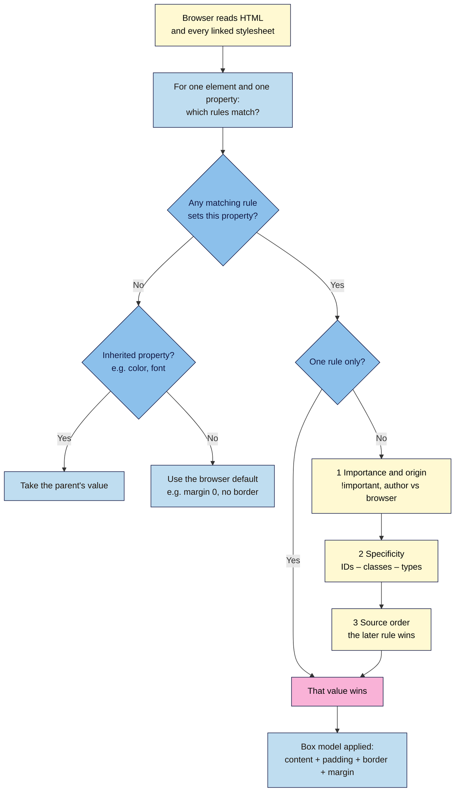

# M03.L01 — How CSS Works: Selectors, Cascade, Box Model
> After this lesson you can link a stylesheet to your launch page, write rules that target exactly the elements you mean, predict which rule wins when two rules disagree, and control spacing with padding, border and margin.

**Time:** ~16 min reading + ~30 min exercise · **Level:** L1 Foundation (beginner) · **Prereqs:** M02.L01, M01.L05 · **Remediate to:** M02.L01
**Verified against:** MDN "CSS styling basics" (selectors, cascade, specificity, inheritance, box model), the CSS Cascading and Inheritance Level 4 spec, Chrome DevTools "CSS features reference" (specificity tooltip, Computed box model), live W3C CSS Validator checks of this lesson's stylesheet, and a headless Chrome 156 run of Parts A–D (winning colours, 960/992 px box widths, 12/20 px button padding, and the `net::ERR_FILE_NOT_FOUND` message for a missing local stylesheet), on 2026-11-02 (Chrome/Edge stable, Firefox stable).

> Note: you keep working in your `webdev-101` folder with Notepad or TextEdit, as in Module 2. Part A uses CodePen for a quick experiment; Parts B–D use a real `styles.css` file next to `launch.html`. VS Code arrives in Module 4.

## Learning objectives
1. **Connect** CSS to a page three ways (linked stylesheet, `<style>` block, inline `style`) and explain why a linked file is the default. *(O1)*
2. **Write** rules with type, class, ID, descendant and attribute selectors, and **predict** which rule wins using the cascade, specificity and inheritance. *(O2)*
3. **Control** spacing with the box model (content, padding, border, margin, `box-sizing: border-box`) and inspect it in DevTools. *(O3)*

## Why it matters
Kwame's agency sends him a landing page and asks for one change: "make the Join button green." He adds `button { background: green; }` to the stylesheet. Nothing happens. He adds it again, lower down. Still nothing. He finally types `style="background: green"` straight into the HTML, which works, until the next campaign page needs the same button and he has to find and copy that edit by hand. The problem was never the colour. Another, more **specific** rule was winning, and DevTools would have shown him which one in five seconds. Most "CSS is broken" moments in marketing work are one of three things: the stylesheet isn't loading, the rule has a typo, or another rule wins. This lesson teaches you to tell which one, fast.

## Core concept
**Plain version:** CSS (Cascading Style Sheets) is a list of **rules**. Each rule says *which elements* (the **selector**) and *what to change* (the **declarations**: a property and a value). The browser reads every rule that applies to an element. When two rules set the same property, it uses a fixed set of tie-breakers called **the cascade** to pick one winner.

**Analogy:** think of a company style guide plus notes from managers. The guide says "all headings navy." A team note says "headings on the pricing page: green." A sticky note on one slide says "this heading: red." The more **specific** the instruction, the more it wins. If two equally specific notes disagree, the **newer one** (later in the file) wins.

### Anatomy of a rule
```css
.button {                 /* selector: which elements */
  background-color: #14532d;   /* declaration: property: value; */
  color: #ffffff;
}
```
Every declaration ends with a semicolon. Curly braces wrap the block. The browser never shows an error on the page: a missing `;` makes it drop the broken declaration **silently**, and a missing `}` is worse, because the following rules get swallowed into the unfinished block and stop working too.

### Three ways to connect CSS
| Way | Example | Use it for |
|---|---|---|
| **Linked stylesheet** (default) | `<link rel="stylesheet" href="styles.css">` in `<head>` | Every real page: one file styles many pages, the browser caches it, and the HTML stays clean |
| `<style>` block | `<style> h1 { color: navy; } </style>` in `<head>` | A one-off page, an email template, or a quick test |
| Inline `style` attribute | `<h1 style="color: navy">` | Almost never. It beats almost every stylesheet rule, can't be reused, and is hard to find later. Builders and email tools add it for you |

### Selectors you'll use 90% of the time
| Selector | Example | Matches |
|---|---|---|
| Type (element) | `p` | every `<p>` |
| Class | `.button` | every element with `class="button"` (an element can have several classes: `class="button primary"`) |
| ID | `#signup` | the one element with `id="signup"` |
| Descendant | `footer a` | every `<a>` anywhere inside a `<footer>` |
| Grouping | `h1, h2, h3` | all three (a comma means "and also") |
| Attribute | `input[type="email"]` | inputs whose `type` is `email` |
| Pseudo-class | `a:hover`, `button:focus-visible` | an element in a state (Lesson 3.5 styles these) |

**House rule for this course:** style with **classes**. Keep IDs for anchors (`#signup`) and form labels, not for styling, because ID selectors are very hard to override later.

### The cascade: how the winner is picked
When several rules set the same property on the same element, the browser checks these in order and stops at the first difference:
1. **Importance and origin.** Your stylesheet beats the browser's built-in defaults. A declaration marked `!important` jumps the queue (avoid it; it starts an arms race).
2. **Specificity.** The more specific selector wins. Count it as three numbers, **IDs – classes – types** (classes include attributes and pseudo-classes):
   | Selector | Specificity | Why |
   |---|---|---|
   | `button` | 0-0-1 | one type |
   | `.button` | 0-1-0 | one class |
   | `section .button` | 0-1-1 | one class, one type |
   | `#signup button` | 1-0-1 | one ID, one type: beats any number of classes |
   | `style="…"` (inline) | beats all selectors | strictly a separate cascade step, not specificity, but the effect is the same |
   Compare left to right, like version numbers: 1-0-0 beats 0-9-9.
3. **Order of appearance.** If importance and specificity are equal, the rule that comes **later** wins (later in the file, or in a file linked later).

> Modern CSS also has **cascade layers** (`@layer`, defined in CSS Cascading and Inheritance Level 5), which sit between steps 1 and 2. You won't need them in this course; just know the word if you see it in a library's code.

### Inheritance
Some properties pass down from parent to children; others don't.
- **Inherited (mostly text):** `color`, `font-family`, `font-size`, `line-height`. Set them once on `body` and the whole page follows.
- **Not inherited (mostly boxes):** `margin`, `padding`, `border`, `background`, `width`. Setting a border on `main` doesn't give every paragraph a border.
- A rule that targets the element directly **always** beats an inherited value, even a very specific one on the parent. Form controls don't inherit fonts by default, which is why the starter CSS uses `font: inherit` on `button`.

### The box model
Every element is a rectangular box with four layers, from inside out:

| Layer | What it is | Example |
|---|---|---|
| **Content** | the text or image | the words "Join the launch list" |
| **Padding** | space *inside* the border; shows the background colour | `padding: 0.75rem 1.25rem;` (top/bottom, left/right) |
| **Border** | the line around the padding | `border: 2px solid #14532d;` |
| **Margin** | space *outside* the border, between this box and others; always transparent | `margin: 0 auto;` (centres a box that has a width) |

**`box-sizing`:** by default (`content-box`), `width: 300px` means the *content* is 300 px, and padding and border are added on top, so the box ends up wider than you asked. With `box-sizing: border-box`, `width: 300px` is the size of the whole visible box. Almost every modern site sets `border-box` on everything first; so will you.

**Margin collapse:** when two block boxes sit on top of each other, their vertical margins don't add up; the larger one wins. A `margin-bottom: 2rem` on one paragraph and `margin-top: 1rem` on the next gives a 2rem gap, not 3rem. Padding never collapses, and margins don't collapse between flex or grid items (Lesson 3.3).

**Units for now:** `px` for thin borders; `rem` for spacing and text (1rem = the browser's base font size, usually 16 px, and it grows when a visitor raises their default text size). Lesson 3.4 adds fluid units.

## How it works



**In words:** for every element and every property, the browser collects the rules whose selectors match. If none set the property, it inherits the parent's value (for text properties) or uses its default. If several do, it compares importance, then specificity, then source order, and the first difference decides. The winning values, including padding, border and margin, then size the element's box.

## Hands-on walkthrough

**Part A: predict the winner in CodePen (6 min)**
1. Open **https://codepen.io/pen/**. In the **HTML** panel type:
   ```html
   <section id="signup">
     <a class="button" href="#form">Join the launch list</a>
   </section>
   ```
2. In the **CSS** panel type these three rules **in this order**:
   ```css
   #signup a { color: #fde68a; }
   .button   { color: #ffffff; background-color: #14532d; padding: 0.75rem 1.25rem; }
   a         { color: #0b57d0; }
   ```
3. Before you look at the preview, write down your prediction: what colour is the link text, and what colour is its background?
   **Expected:** pale yellow text (`#fde68a`) on dark green. `#signup a` is 1-0-1, which beats `.button` (0-1-0) and `a` (0-0-1) even though it comes first. The background is green because only `.button` sets a background, so there's no contest.
4. Move the `.button` rule to the bottom. **Expected:** still yellow. Source order only breaks ties; it can't beat higher specificity.
5. Change the first selector to `.button` (so there are two `.button` rules). **Expected:** now the later `.button` rule wins and the text turns white: equal specificity, later wins.
6. Now add an inline style to the link in the HTML panel: `<a class="button" href="#form" style="color: #fde68a">`. Then change the first CSS selector back to `#signup a` and give it `color: #ffffff;`. **Expected:** pale yellow. The inline `style` attribute beats even an ID selector, which is exactly why it's so hard to override later. Remove the `style` attribute again.
7. Right-click the link in the preview → **Inspect**. In the **Styles** pane, hover over a selector.
   **Expected:** a tooltip shows its **Specificity**, e.g. `(0,1,0)`. Losing declarations appear ~~struck through~~.
   > 🖼️ **Image prompt:** Desktop screenshot (1440×900) of Chrome DevTools Elements panel inspecting the CodePen link, with the Styles pane showing two `.button` rules: the earlier `color` declaration struck through and a hover tooltip reading "Specificity: (0,1,0)". Outline the tooltip and the struck-through line. Highlight the key element with a 3px #F9B2D7 outline; blur any personal details.
   > **Alt text:** DevTools Styles pane with a struck-through losing colour rule and a tooltip showing selector specificity 0,1,0.

**Part B: link a stylesheet to your launch page (10 min)**
1. In your `webdev-101` folder, create a new plain-text file called `styles.css` (Notepad: **Save as type → All files**, **Encoding → UTF-8**; TextEdit: **Format → Make Plain Text** first).
2. Paste this starter and save:
   ```css
   /* styles.css: Nila Coffee launch page (Lesson 3.1 base) */

   /* 1. Size boxes the intuitive way: width includes padding and border */
   *,
   *::before,
   *::after {
     box-sizing: border-box;
   }

   /* 2. Base text for the whole page (inherited by everything inside body) */
   body {
     margin: 0;
     font-family: system-ui, sans-serif;
     line-height: 1.5;
     color: #1f2933;
     background-color: #ffffff;
   }

   /* 3. Keep lines readable and centre the content */
   header,
   main,
   footer {
     max-width: 60rem;
     margin: 0 auto;
     padding: 0 1rem;
   }

   /* 4. Breathing room between sections */
   section {
     padding: 2rem 0;
     border-bottom: 1px solid #d9dee3;
   }

   /* 5. The call-to-action link and the form button share one look */
   .button,
   button {
     display: inline-block;
     padding: 0.75rem 1.25rem;
     border: 2px solid #14532d;
     border-radius: 0.5rem;
     background-color: #14532d;
     color: #ffffff;
     font: inherit;
     text-decoration: none;
   }
   ```
   The colours are placeholders; Lesson 3.2 replaces them with your brand tokens.
3. Open `launch.html` and add this line inside `<head>`, **after** the `<title>` and meta tags:
   ```html
   <link rel="stylesheet" href="styles.css">
   ```
4. Find the hero's "Join the launch list" link from Module 2 and give it the class: `<a class="button" href="#signup">Join the launch list</a>`.
5. Save both files and reload `launch.html` in the browser.
   **Expected:** a system font (Segoe UI on Windows, San Francisco on Mac, Roboto on Android), content centred in a column no wider than `60rem` (960 px at the default text size), light grey lines between sections, and a dark green "Join" button that matches your form's submit button.
6. Paste the stylesheet into the **W3C CSS Validation Service** (https://jigsaw.w3.org/css-validator/ → **By direct input**) and click **Check**.
   **Expected (checked 2026-11-02):** "Congratulations! No Error Found."

**Part C: see the box model in DevTools (6 min)**
1. Right-click the "Join the launch list" button → **Inspect**. Open the **Computed** tab (next to **Styles**).
   **Expected:** a nested box diagram: content in the middle, then padding, border and margin, with the numbers in pixels (e.g. padding 12 / 20, border 2). Hovering over each layer highlights it on the page.
   > 🖼️ **Image prompt:** Desktop screenshot (1440×900) of Chrome DevTools Computed tab showing the box-model diagram for the "Join the launch list" button (content size, padding 12 and 20, border 2, margin 0), with the button highlighted on the page. Outline the box-model diagram. Highlight the key element with a 3px #F9B2D7 outline; blur any personal details.
   > **Alt text:** DevTools Computed tab box-model diagram for a button showing content, padding, border and margin values.
2. Back in **Styles**, click the `padding` value in the `.button, button` rule and change it to `2rem 3rem`. **Expected:** the button grows live. Reload: it goes back (DevTools edits are temporary, just like in Lesson 1.5).
3. Make the browser window wide (over 1000 px). Select `<main>` and note its total width in the Computed diagram: **960** px (60rem). Now untick `box-sizing: border-box` in the `*` rule. **Expected:** `main` grows to **992** px, because with `content-box` the `max-width` applies to the content only and the 16 px of padding on each side is added on top. Tick it again.

**Part D: break it and fix it: "why isn't my style applying?" (8 min)**
Plant each bug, reload, find it with the tool named, then fix it before planting the next.
1. **Wrong file name.** In `launch.html`, change `href="styles.css"` to `href="style.css"`. Reload.
   **Symptom:** the page is back to unstyled. **Find it:** DevTools → **Network** → reload → `style.css` shows in red as **(failed)** with `net::ERR_FILE_NOT_FOUND` (filter by **All** or **CSS** if you don't see it), and the **Console** says "Failed to load resource: net::ERR_FILE_NOT_FOUND". Once the page is on a real web server (Module 4), the same mistake shows as status **404**. **Fix:** match the file name exactly. Watch letter case too: Windows and Mac usually ignore it on your computer (`Styles.css` still loads), but most web servers don't, so a case mismatch breaks only after you publish.
2. **Missing semicolon.** In `body`, delete the `;` after `color: #1f2933`. Reload.
   **Symptom:** hard to see! The text turns pure black instead of dark blue-grey, and the background rule is lost too (you can't tell, because the default is also white). The browser reads `color: #1f2933 background-color: #ffffff` as **one** declaration with an invalid value and drops it. Silent bugs like this are why you validate. **Find it:** the W3C CSS checker reports "Missing a semicolon before the property name "background-color"". In DevTools, the broken declaration shows struck through with a warning icon (invalid property value). **Fix:** add the `;`.
3. **A more specific rule wins.** Add this at the **bottom** of `styles.css`: `a { background-color: #b91c1c; }` (you want the hero button red for a sale). Reload.
   **Symptom:** the "Join the launch list" button stays green, even though your red rule comes last. **Find it:** inspect the button. In **Styles**, the `a` rule's `background-color` is struck through. Hover both selectors: `a` is `(0,0,1)`, `.button` is `(0,1,0)`. The class wins, and source order never gets a say. **Fix:** target what you mean with equal or higher specificity, ideally a new class: `<a class="button button-sale" …>` with `.button-sale { background-color: #b91c1c; border-color: #b91c1c; }` placed **after** `.button` (0-1-0 vs 0-1-0, so the later one wins). Delete the test rules when you're done.
   **Lesson:** "it didn't work" usually means "it lost." Inspect the exact element and read what beat it.

## When to use / when not to
- **Class vs ID for styling:** classes are reusable and easy to override. IDs are unique and very specific (1-0-0), so one ID selector forces you to write even more specific rules later. **Trade-off:** IDs feel precise today and create a fight tomorrow. Use them for anchors and labels.
- **Linked file vs `<style>`:** a linked file wins once you have more than one page, because every page shares it and the browser caches it. A `<style>` block is fine for a single email or a test page. Keep **one** main stylesheet for the launch page.
- **`!important`:** only to override third-party CSS you can't edit (a plugin, an embed), and then with a comment saying why. Never as your first fix.
- **Builders and CMSs:** WordPress, Webflow and Wix write CSS for you; you'll still use exactly these skills in their "Additional CSS" boxes and to debug why a theme rule beats yours (WordPress 101 covers the theme side).

## Use AI for this
**Example prompt:**
> "Here is my HTML and CSS [paste both]. The submit button should be green but it's red. List every rule in my CSS that matches the `<button>`, give each selector's specificity as (IDs, classes, types), and tell me which one wins and why. Don't rewrite my CSS; suggest the smallest fix."

**What AI does well here:** explaining specificity, spotting typos and missing braces, and translating a vague request ("make the buttons match") into a selector.
**Where it gets it wrong:** it often "fixes" problems with `!important` or by adding IDs, which makes the next change harder. It can't see the browser's built-in styles, a theme's other files or what the page loads in reality, so it may blame the wrong rule. It sometimes uses property names that don't exist or values from old CSS.
**How to check:** inspect the element in DevTools and look for the struck-through rule yourself; run the CSS through the W3C checker; reject any fix that uses `!important` or an ID unless you know why.

## Common mistakes
- **The `<link>` points to the wrong file or folder** (`style.css` vs `styles.css`, `css/styles.css` when the file isn't in a `css` folder). Always check the Network panel for a red, failed request (`ERR_FILE_NOT_FOUND` on your computer, 404 on a live site).
- **A missing `;` or `}`.** The browser skips the broken part silently. Validate.
- **Styling with IDs and `!important`,** then needing even stronger rules to change anything.
- **Expecting margin or border to inherit.** Only text-related properties pass down.
- **Forgetting `box-sizing: border-box`,** then wondering why a `width: 100%` box with padding overflows its container.
- **Writing `.Button` in CSS and `class="button"` in HTML.** Class names are case-sensitive.
- **Editing in DevTools and forgetting to copy the change into `styles.css`.** Reload throws it away.

## Troubleshooting
| Symptom | Likely cause | Fix |
|---|---|---|
| No styles at all | `<link>` wrong (`href` typo, missing `rel="stylesheet"`), or file saved as `styles.css.txt` | Network panel or Console: a red failed request (`ERR_FILE_NOT_FOUND` locally, 404 live); show file extensions; fix the `href` |
| One property ignored, others work | Typo in the property or value, or a missing `;` on the line before | DevTools shows it struck through with a ⚠ icon; W3C CSS checker names the line |
| Rule exists but loses | A more specific selector or a later rule sets the same property | Inspect the element; hover selectors for specificity; make your selector match the winner's specificity or edit the winning rule |
| Change shows in DevTools but not after reload | DevTools edits are temporary | Copy the change into `styles.css` and save |
| Change saved but still not showing | Browser cache, or you edited a different copy of the file | Hard reload (Ctrl+Shift+R / Cmd+Shift+R); check the file path in the tab and the Sources panel |
| Box wider than expected; sideways scroll | `content-box` sizing adds padding and border to `width` | Add the `box-sizing: border-box` rule at the top |
| Gap between two blocks smaller than the margins added together | Vertical margin collapse | Expected behaviour; use padding or `gap` (Lesson 3.3) if you need both |

## Exercise
**Task:** style the base layer of **your** launch page and document one debugging case.
1. Link `styles.css` to `launch.html` and add the five starter rules (adjust the placeholder colours if you like).
2. Give your main call-to-action link `class="button"` and make it match your submit button.
3. Add one rule of your own using a **descendant** selector (e.g. `footer a { color: … }`) and one using an **attribute** selector (e.g. `input[type="email"] { width: 100%; }`).
4. In your project note, write a 3-row table for three selectors from your stylesheet: selector · specificity (IDs-classes-types) · what it matches.
5. Plant one of the Part D bugs, take a screenshot of the DevTools evidence, fix it, and write two lines on how you found it.
6. Run `styles.css` through the W3C CSS checker.

**Expected outcome:** `launch.html` loads `styles.css` (no failed request in the Network panel), uses one system font, has a centred content column, separated sections and one shared button style; the CSS checker says "Congratulations! No Error Found."; your note has the specificity table and one bug write-up.
**Stretch goal:** open your Module 1 brand site, inspect its main call-to-action button, and count how many rules in the Styles pane set its `background-color`. Write down the winning selector and its specificity, and guess why the others lost.

## Key takeaways
- A CSS rule = **selector** + **declarations** (`property: value;`). One **linked stylesheet** is the default for real pages.
- When rules disagree, the cascade decides: **importance → specificity (IDs–classes–types) → later wins**.
- Text properties **inherit** from parents; box properties (margin, padding, border, background) don't.
- Box model: **content → padding → border → margin**; set `box-sizing: border-box` on everything first.
- "My CSS doesn't work" = not loading (red failed request in Network), typo (struck through ⚠, validator), or losing (struck through, specificity tooltip). DevTools tells you which.

## Teach it back
Explain to a friend in 3 sentences why their `button { background: red; }` at the bottom of the stylesheet doesn't turn the "Buy now" button red, and how they'd find out what's winning.

## Glossary terms added
- CSS rule (selector, declaration, property, value) — added to `webdev-101/glossary.md`
- Stylesheet (linked, `<style>`, inline style) — added to `webdev-101/glossary.md`
- Class and ID selectors — added to `webdev-101/glossary.md`
- Descendant and attribute selectors — added to `webdev-101/glossary.md`
- Cascade — added to `webdev-101/glossary.md`
- Specificity — added to `webdev-101/glossary.md`
- Inheritance (CSS) — added to `webdev-101/glossary.md`
- `!important` — added to `webdev-101/glossary.md`
- Box model (content, padding, border, margin) — added to `webdev-101/glossary.md`
- `box-sizing: border-box` — added to `webdev-101/glossary.md`
- Margin collapse — added to `webdev-101/glossary.md`
- `rem` — added to `webdev-101/glossary.md`
- Computed tab — added to `webdev-101/glossary.md`

## Further reading
*All checked 2026-11-02.*
- MDN — CSS styling basics (learning area): https://developer.mozilla.org/en-US/docs/Learn_web_development/Core/Styling_basics
- MDN — Cascade, specificity, and inheritance: https://developer.mozilla.org/en-US/docs/Learn_web_development/Core/Styling_basics/Handling_conflicts
- MDN — Specificity (reference): https://developer.mozilla.org/en-US/docs/Web/CSS/Specificity
- MDN — The box model: https://developer.mozilla.org/en-US/docs/Learn_web_development/Core/Styling_basics/Box_model
- MDN — Mastering margin collapsing: https://developer.mozilla.org/en-US/docs/Web/CSS/CSS_box_model/Mastering_margin_collapsing
- W3C — CSS Cascading and Inheritance Level 4 (the cascade sort order): https://www.w3.org/TR/css-cascade-4/
- W3C — CSS Cascading and Inheritance Level 5 (cascade layers): https://www.w3.org/TR/css-cascade-5/
- Chrome for Developers — CSS features reference (specificity tooltip, Computed tab): https://developer.chrome.com/docs/devtools/css/reference
- W3C CSS Validation Service: https://jigsaw.w3.org/css-validator/

## Refresher card
*Used by remediation when a learner fails a quiz twice on a later lesson that points back here.*
Rule = `selector { property: value; }`. Link one file: `<link rel="stylesheet" href="styles.css">` in `<head>`. Selectors: `p` (type), `.button` (class), `#signup` (ID, avoid for styling), `footer a` (descendant), `input[type="email"]` (attribute). Conflicts: `!important` → specificity (IDs–classes–types, e.g. 0-1-0 beats 0-0-3) → later rule wins. Text properties inherit; box properties don't. Box model: content → padding → border → margin; start with `* { box-sizing: border-box; }`. Debug: red failed request in Network (not loading: `ERR_FILE_NOT_FOUND` locally, 404 live), struck through + ⚠ (typo), struck through (lost; hover for specificity).
